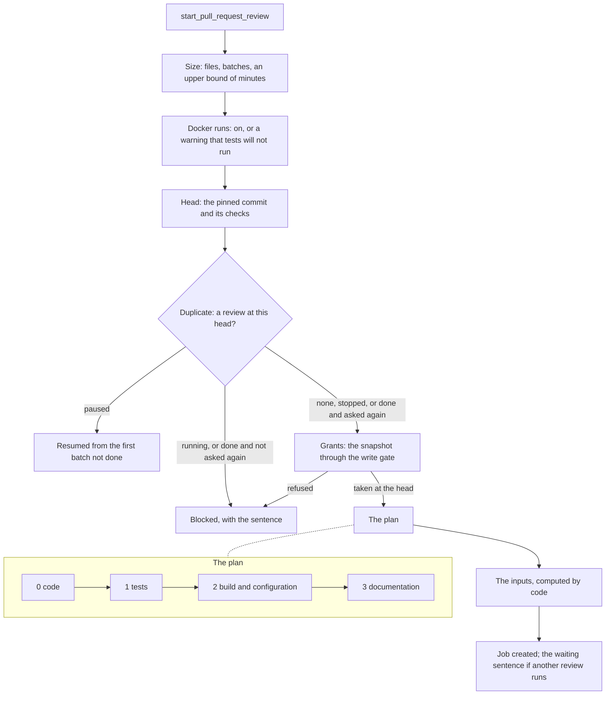
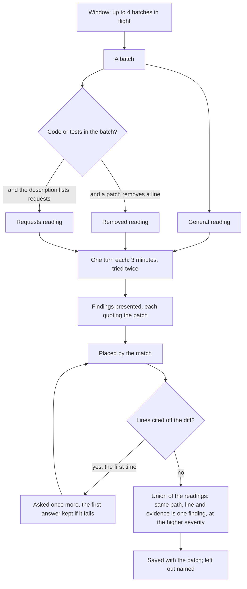
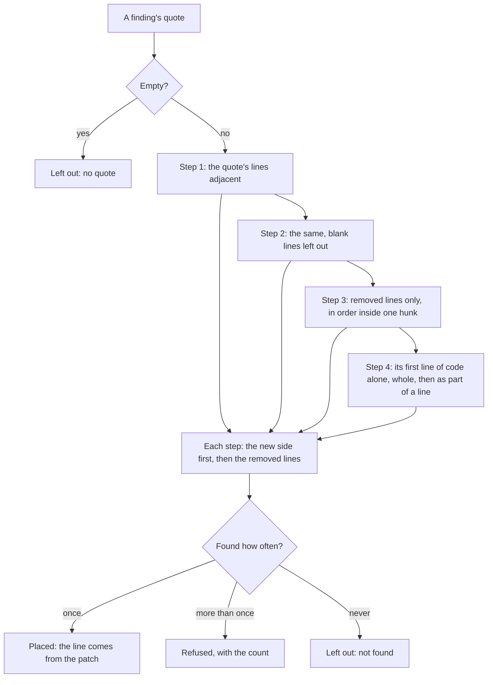

# Code review: the review job's start and its batches

> A review job reads every changed file in batches, code first, each batch a closed turn that can only read the repository and present findings, and every finding is placed on the diff by code ([[pages/decisions/0061-the-pull-request-review-job-as-built]], [[pages/decisions/0066-every-finding-carries-evidence-and-its-line-is-derived-by-code]]).

Part of [[pages/architecture/code-review-flow]].

## The start

The start checks the pull request before anything is written, takes the snapshot at the head commit through the write gate, plans the batches in reading order and keeps the inputs every batch will be handed. A check that blocks stops the start with its sentence; a warning is kept and shown on the card.

- The checks, in order: `src/Scout.Audit/RepositoryAudits.Reviews.cs:186` (Size `:327`, Docker runs `:356`, Head `:372`), the duplicate `:201` to `:205`, the snapshot `:214`, the job `:244`. The names: `src/Scout.Audit/ReviewPreflight.cs:40`.
- The reading order: `ReviewReadings.ReadingOrder` (`src/Scout.Review/ReviewReadings.cs:59`): documentation is a documentation extension or a file under `docs`, `context` or `.claude` at the root; a test is under a test folder, in a `.Tests` project or named as a test; configuration is a configuration extension or a `Dockerfile`; the rest is code.
- A batch holds at most `Scout:Audit:MaxBatchFiles` files (40) and `Scout:Audit:MaxBatchCharacters` of patch (60,000), less the room the inputs take (`src/Scout.Audit/AuditOptions.cs:24`, `:30`; `PlanIn`, `src/Scout.Audit/RepositoryAudits.Reviews.cs:266`). A file larger than a batch is read in parts, at most ten (`:69`); a file with no diff, a path with a control character or a file GitHub did not list is a batch marked not read.

The inputs every batch is handed, once per job ([[pages/decisions/0064-the-review-batch-is-handed-the-purpose-the-rules-and-what-was-removed]]):

| Input | What it holds | Bound |
|---|---|---|
| The purpose | the title, the description, the issue it names | description 16,000 characters, issue body 4,000 (`src/Scout.Audit/ReviewInputs.cs:276`, `src/Scout.Review/PullRequestDescription.cs:57`) |
| The project's rules | `AGENTS.md`, `CLAUDE.md`, `CONTRIBUTING.md` (also under `.github` and `docs`), then the `*.md` of `.claude/rules`, `docs/conventions`, `docs/rules`, `context/pages/invariants`, `context/pages/conventions` | 12 files, 6,000 characters each, 16,000 in all (`src/Scout.Audit/ReviewInputs.cs:27`, `:33`, `:34`) |
| What was removed | removed files, removed or emptied tests, test files that lose more tests than they gain, and the code named like a deleted test | 200 entries (`src/Scout.Audit/ReviewInputs.cs:145`, `:164`) |

## A batch

The run keeps at most `Scout:Audit:ReviewParallelBatches` batches in flight (4) and starts the next pending one as one ends. Each batch is read by a general reading and, for code and tests, by the focused readings; each reading is one turn offered only the reads of the repository at the head and the function that presents findings, held to the job's repository. Every finding must quote the patch, and code places it; a reading whose findings cite lines off the diff is asked once more.

- The window and its checks before each start (the job still running, under 60 minutes, the head re-read as often as the window holds): `src/Scout.Audit/AuditWorker.Reviews.cs:332`, `:392` ([[pages/decisions/0074-a-review-runs-its-batches-through-a-window]]).
- The readings and when each applies: `ReviewReadings.For` (`src/Scout.Review/ReviewReadings.cs:35`).
- What a batch turn is offered: `get_file_contents`, `search_code`, `list_repository_files`, `present_review_findings`, `search_project`, `find_symbol` (`src/Scout.Audit/AuditBatchRunner.cs:92`), held to the job's repository (`:998`); the turn's bound `Scout:Audit:ReviewTurnTimeout`, 3 minutes (`src/Scout.Audit/AuditOptions.cs:40`), tried twice (`src/Scout.Audit/AuditBatchRunner.cs:1027`).
- The match: `DiffQuote.Locate` (`src/Scout.Review/DiffQuote.cs:40`); a quote found once on a step with no line of code is refused as not code, which the drawing leaves out. A finding outside the batch's files is dropped and logged (`src/Scout.Audit/AuditBatchRunner.cs:225`).
- The extra request: `:237`; the union: `:158`.
