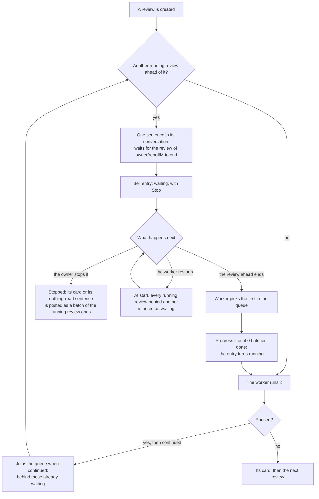
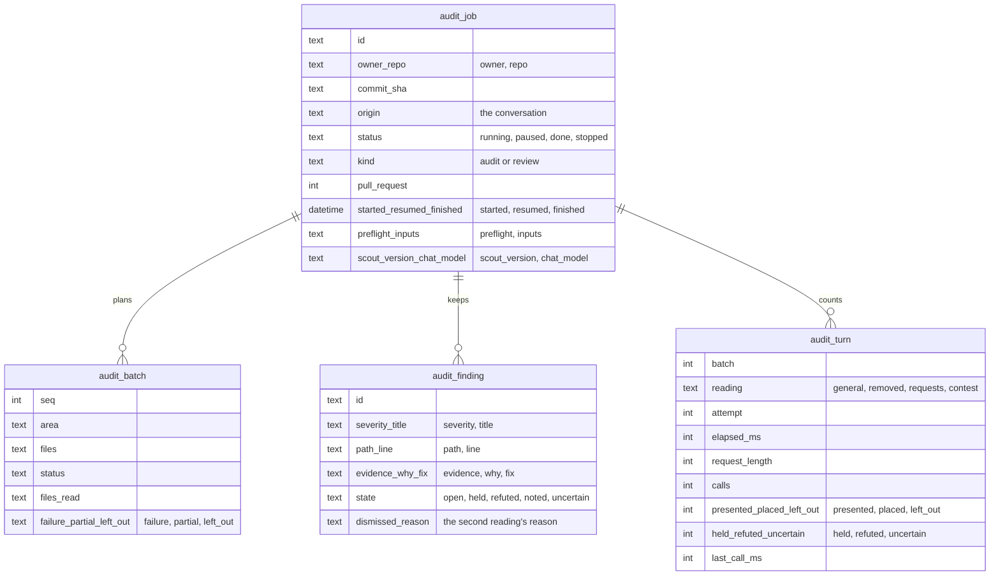

# Code review: the queue of review jobs and what is kept

> The worker runs one review at a time, in the order the reviews joined the queue; everything a review needs to go on after a restart is in one SQLite file under Scout's data folder ([[pages/decisions/0075-a-review-asked-while-another-runs-says-it-waits]], [[pages/decisions/0052-persistence-behind-stores-on-entity-framework]]).

Part of [[pages/architecture/code-review-flow]].

## The queue

A review asked while another runs is created running, with its batches pending, and waits: the one place that says so is `Ahead`, the running review directly ahead of it in the queue. It says once in its conversation which review it waits for, and the bell shows a waiting entry with that sentence and Stop. When the review ahead ends, the worker picks the next one and its entry turns running; a continued review joins the queue when it is continued.

- The queue's order is when a review was created or last continued, the earlier first: `SqliteAuditStore.RunningJobsAsync` (`src/Scout.Audit/SqliteAuditStore.cs:82`), ordered in memory over the query `RunningJobs` (`:286`).
- `Ahead` and the sentence: `src/Scout.Audit/RepositoryAudits.Reviews.cs:468` and `:458`; posted by `PostWaitingAsync` (`:485`) when the review is created behind another, or in place of the resume line.
- The worker's loop runs a running review before any audit (`src/Scout.Audit/AuditWorker.cs:97`); notes the waiting reviews when it starts (`:148`); posts the progress line when it picks one that was said to wait (`src/Scout.Audit/AuditWorker.Reviews.cs:237`); posts the stop of another review as a batch ends (`OthersLeftAsync`, `:500`).
- The bell reads the sentence as a `waiting` entry (`ui/packages/main/src/notifications/sources.ts:30`, `:157`) offering Stop only (`ui/packages/shared/src/ipc-contract.ts:2170`).
- Simplified: an audit job shares the queue but waits for every review; the drawing shows reviews only.

## What is kept

The job database is one SQLite file, `audit.db` under Scout's data folder by default, with four tables: the job, its batches, its findings and the numbers of every model turn. The turn record is off by default; when on, each turn's request, calls, results and answer are appended as JSON lines under Scout's own data folder, never where the database is configured.

- The tables and columns: `src/Scout.Audit/Storage/AuditDbContext.cs`; each attribute that names two or more columns stands for those columns, a simplification of the drawing.
- The database's default path: `src/Scout.Audit/AuditServiceCollectionExtensions.cs:44`; a state is written by `RecordOutcomesAsync` and read by `FindingStatesAsync` (`src/Scout.Audit/SqliteAuditStore.cs:127`), the reason kept for every outcome but holds (`:192`).
- The turn record: `Scout:Audit:RecordTurns` (`src/Scout.Audit/AuditOptions.cs:18`), the folder `audit` under Scout's data folder (`src/Scout.Audit/AuditServiceCollectionExtensions.cs:96`), one file per job and turn name, `batch-<order>-<reading>.jsonl` and `contest-<group>.jsonl` (`src/Scout.Audit/AuditBatchRunner.cs:266`, `:866`; `src/Scout.Audit/AuditWorker.Reviews.cs:716`).
- The test runs are kept by the sandbox, not here: see [[pages/architecture/code-review/tests-in-docker]].
