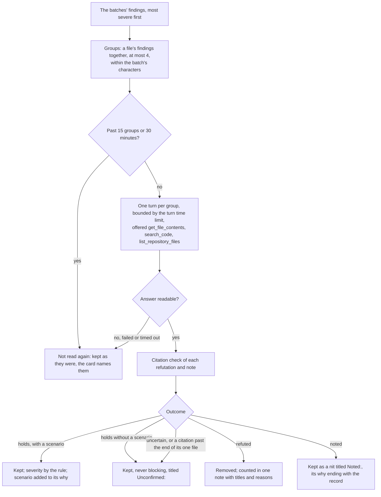
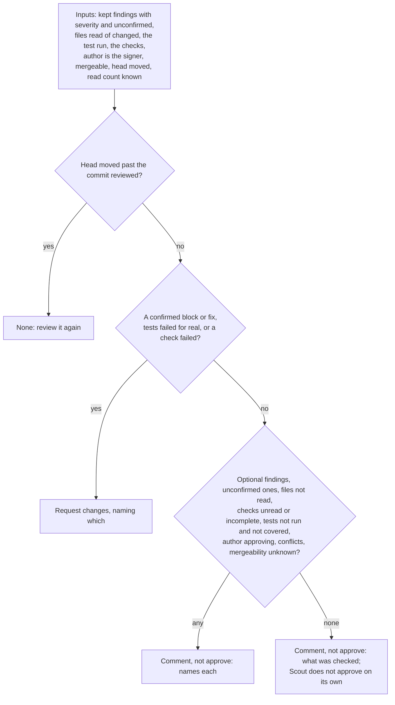

# Code review: the second reading and the verdict

> Before the card, every finding is read again by a turn told to refute it; then one decision by code says what the review offers, and Scout never offers an approval on its own ([[pages/decisions/0069-the-second-reading-tries-to-refute-and-holds-only-with-a-scenario]], [[pages/decisions/0070-one-verdict-decision-and-no-approval-on-its-own]]).

Part of [[pages/architecture/code-review-flow]].

## The second reading

The findings are put in groups, a file's findings together, each group one turn that may only read the repository at the head. Its answer is read by code: each finding holds, is refuted, is noted, or stays uncertain, and code decides what each outcome does to the finding. A group whose call fails, runs out of time or answers something unreadable leaves its findings as the first reading gave them: a failure never weakens a finding.

What each group's request holds, for each finding: its fields, the code around its line (15 lines before, 25 after), the hunk of its file that holds the line, the definitions of the names its evidence calls, and the test files that name its file or those names; and once per request, where to read at the head, the run's facts with what they establish, and what the pull request asks, from its description's requests or its description.

- Groups and bounds: `Contestation.Groups`, `src/Scout.Review/Contestation.cs:249`; at most 4 findings, 15 groups, 30 minutes (`:85`, `:88`, `:91`); each group's own bound is the turn time limit, 10 minutes (`src/Scout.Audit/AuditWorker.Reviews.cs:706`, `ContestGroupTime ?? runner.TurnTimeout`).
- The material: `ContestRequest.Material`, `src/Scout.Review/ContestRequest.cs:166`, `:43`; the facts and the asks: `:111`, `:78`; the request: `src/Scout.Audit/AuditWorker.Reviews.cs:683`, `:706`. The reads offered: `src/Scout.Audit/AuditBatchRunner.cs:760`, held to the job's repository.
- Reading the answer, and a hold without a scenario made uncertain: `Contestation.Read`, `src/Scout.Review/Contestation.cs:122`. What each outcome does: `Apply`, `:203`. The severity rule, block only for lost or corrupted data, a security or secret exposure, a failing build or test run, or a core operation that cannot complete: `SeverityRule`, `:50`.
- The citation check: `Checked`, `:380`, and `Resolve`, `:403`: a cited name is resolved to one file (its path from the root, the finding's own file, the one changed file it ends); only a line past that file's end is unreal; a name that resolves to nothing or to two stands.
- A group left as it was: `src/Scout.Audit/AuditWorker.Reviews.cs:728`; the card's notes on all of it: `Contestation.Notes`, `src/Scout.Review/Contestation.cs:281`.

## The verdict

One function decides what a review offers, from what it found and read and from the pull request's state. A confirmed finding that needs fixing, tests that really failed, or a failed check ask for changes; anything else offers a comment that says why, and a clean review's comment says that Scout does not approve on its own.

- The decision: `ReviewOffers.Decide`, `src/Scout.Review/ReviewOffer.cs:61`; a noted finding is a nit and counts as optional; an unconfirmed one never needs fixing (`:68`, `:94`).
- Tests that could not run for want of a Docker daemon are not a failure (`:69`): see [[pages/architecture/code-review/tests-in-docker]].
- Approval is not offered: `Approve` and `Wait` are kept for the card to draw and for the approval to return under the owner's flag, and `Decide` gives neither (`:42`, `:51`).
- What the gate refuses before anything is written: every GitHub write while the owner has not allowed GitHub writes; an approval the review does not offer, with the offer's reason; an approval while mergeability is unknown, by the author, or with a check not passed; a request for changes with no finding (`src/Scout.Plugin.GitHub/GitHubActionsPlugin.cs:290` to `:318`; the summary at `:14`).
