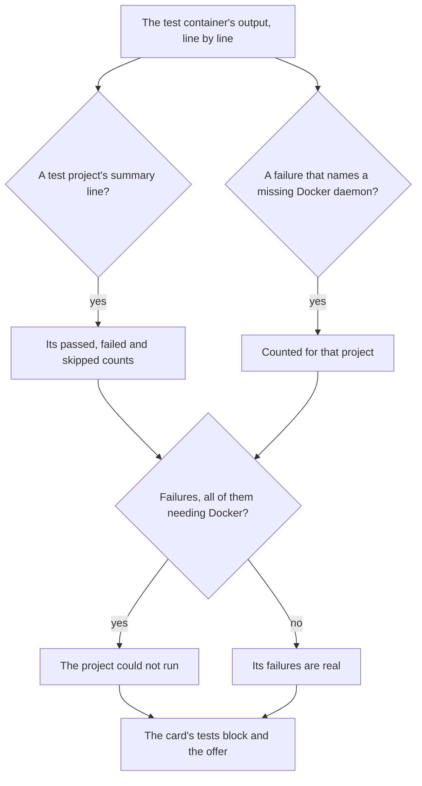

# Code review: what is sent to Docker when a review runs the tests

> The tests run on the owner's computer in a disposable container, only under the GitHub feature's "Local container" grant, on a copy of the snapshot, with no network while the tests run ([[pages/decisions/0060-a-run-that-could-not-run-its-tests-is-not-a-failed-run]], [[pages/decisions/0032-per-feature-write-permissions]]).

Part of [[pages/architecture/code-review-flow]].

## The run

When a review job starts its run, the worker starts the tests once for the head, in the background, while the batches are read; the card waits for the answer. The request goes through the kernel function the GitHub plugin declares, so the write gate decides it like any other write; the sandbox then runs two containers, one to restore the dependencies and one to run the tests.

```mermaid
sequenceDiagram
    participant W as Review worker
    participant R as Batch runner
    participant G as Write gate
    participant P as GitHub plugin: run_pull_request_tests
    participant S as Sandbox
    participant D as Docker
    W->>R: start the tests for the job's head (once per review in a worker)
    R->>G: call run_pull_request_tests
    G->>G: "Local container" granted? refused otherwise, and logged
    G->>P: run
    P->>S: run the snapshot at the head
    S->>S: detect the stack from the manifests; pick its image by digest
    S->>S: copy the snapshot into a fresh work folder (links skipped)
    S->>D: restore container: network on (an option), the limits below
    D-->>S: output, read as it flows
    S->>D: test container: network none, the limits below, 20 minutes for the whole run
    D-->>S: output: each test project's counts read as it flows
    S->>S: could-not-run rule; record and log kept; work folder deleted
    S-->>P: ran, command, exit code, counts, output tail
    P-->>R: the answer as JSON
    R-->>W: the run's facts
    W->>W: progress line names the tests; the card's tests block
```

The limits of both containers: an unprivileged user (the worker's own uid and gid, never root), a read-only root filesystem, the work folder bound at `/work` as the only mount, `/tmp` as a tmpfs, every capability dropped, no new privileges, 512 processes, 4 GB of memory, 2 CPUs, and only the stack's own environment variables.

- The worker's start and wait: `StartTests`, `src/Scout.Audit/AuditWorker.Reviews.cs:79`; the facts read from the answer: `FactsOf`, `:129`; the progress line: `TestsLine`, `:174`. The runner's call: `RunTestsAsync`, `src/Scout.Audit/AuditBatchRunner.cs:677`, offered only when the kernel has the function (`:670`).
- The function and its grant: `src/Scout.Plugin.GitHub/GitHubActionsPlugin.Tests.cs:21`, `:24`, `:58`; the feature's row: `src/Scout.ControlPlane/Features/FeatureCatalog.cs:131`.
- The images, each pinned by digest: `src/Scout.Sandbox/SandboxStacks.cs:27` onward; the detection: `DockerSandboxRunner.Detect`, `src/Scout.Sandbox/DockerSandboxRunner.cs:183`.
- The copy: `:119`, `:482` (a link in the snapshot is skipped); the restore: `:121`, its network by `Scout:Sandbox:RestoreNetwork`, on by default (`src/Scout.Sandbox/SandboxOptions.cs:13`); the test container with no network: `src/Scout.Sandbox/DockerSandboxRunner.cs:140`; the arguments: `RunArguments`, `:190` to `:216`; the limits: `:32` to `:36`.
- Simplified: a stack that cannot be detected, a missing Docker or a refused mount end the run with a reason before the containers, which the drawing leaves out.

## What is read back

As the output flows, each test project's summary line gives its passed, failed and skipped counts. A project whose failures all carry a message that a Docker daemon is needed could not run: it is not a failure of the pull request, and the card says so. The output kept is the last 200,000 characters, in a log beside a small record of the run; the work folder is deleted after the run.



- The reader: `TestSummaryReader`, `src/Scout.Sandbox/DockerSandboxRunner.cs:339`; the signatures of a missing daemon: `:306`; the could-not-run rule: `:388` ([[pages/services/sandbox/test-summary-reader]]).
- The output's bound: `:29`; the record `<id>.run.json`, written as running when the tests start: `:106`, `:138`; the log and the folder: the summary at `:8` to `:17`.
- How the offer reads a run that could not run: [[pages/architecture/code-review/second-reading-and-verdict]].

## What never goes into the container

- No credential: the container gets only the stack's own variables (`:212`); the GitHub token stays with the plugin, and the snapshot was taken before the run.
- None of the owner's files outside the snapshot: the only mount is the run's own work folder, under `Scout:Sandbox:WorkDirectory` in Scout's data folder (`src/Scout.Sandbox/SandboxOptions.cs:7`), which holds the copy; a work folder inside the snapshot is refused (`src/Scout.Sandbox/DockerSandboxRunner.cs:28`).
- No network while the tests run.
