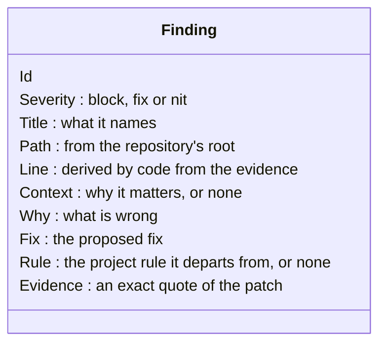

# Code review: what a reading evaluates and what a finding carries

> Every reading judges only what the diff shows, against what the pull request says it does, and reports each problem as one finding on a file and line with its evidence ([[pages/services/skills]], [[pages/decisions/0066-every-finding-carries-evidence-and-its-line-is-derived-by-code]]).

Part of [[pages/architecture/code-review-flow]].

## The points of the review

A review batch is handed the code-review skill's steps of what to look for and how a finding is written, up to its decision step, which a batch never reaches (`src/Scout.Audit/AuditBatchRunner.cs:659`, `:632`). The same steps guide a review asked in one turn. The table gives each point with the examples the skill names; the skill's own text is the full list.

| Point | What the reading looks for (examples the skill names) | Skill |
|---|---|---|
| Any point | only what the diff shows, removals included; the change judged against its title, description and issue; what would break production or a user first | `src/Scout.Skills/skills/code-review.md:31` |
| Functional correctness | an unreachable branch, an off-by-one, a null dereference, a wrong comparison, a changed return value a caller expects, a concurrency hazard, a resource not closed; empty collections, limits, time zones; a guard that cannot fire; a swallowed exception, a catch too broad, a silent default, a retry without a limit | `:35` |
| Design and architecture | a class doing two jobs or reaching into another's internals; a public interface, API or schema changed without its callers; an unsafe migration; a dependency for what the standard library does | `:39` |
| Readability | a name that lies, a function doing two things, duplicated logic, magic numbers, a stale comment, a missing reason, dead code | `:43` |
| Tests | changed behaviour with no test that fails without it; error paths; tests that assert behaviour; a test that only asserts a call; a test weakened, deleted or skipped | `:47` |
| Security and performance | input reaching a query, a shell, a path or a URL unchecked; a secret in code, a log or a fixture; a permission check removed; performance only when the diff shows it: N+1 queries, needless calls, async misused, allocations in loops | `:51` |
| Feedback | on the code, never the person; each finding on a line in the diff (line 1 of a deleted file), what is wrong, why it matters, the smallest fix; blocking, then should fix, then nit; at most ten | `:55` |

## The focused readings

Each focused reading is the general request with one task paragraph more, and applies only to batches with code or tests ([[pages/decisions/0068-focused-readings-only-on-code-and-test-batches]]).

| Reading | When | Its question | Code |
|---|---|---|---|
| General | every batch | the points above | `src/Scout.Audit/AuditBatchRunner.cs:659` |
| Removed | a code or test patch removes a line | for each removal, above all removed tests and checks: is the code or behaviour they tested or guarded still there without them; its evidence is the removed lines without the leading `-` | `src/Scout.Review/ReviewReadings.cs:22` |
| Requests | code or tests in the batch and the description lists requests | for each request: is every place it applies to covered, sibling operations included; a request only partly met is a finding that names it | `src/Scout.Review/ReviewReadings.cs:26` |

## What a finding carries

- The record and its fields: `src/Scout.Review/Finding.cs:17`; the severities, block the one that blocks: `:23` to `:32`.
- The evidence rule the request carries: `src/Scout.Audit/AuditBatchRunner.cs:388`: an exact, contiguous quote of the new side of the file's patch, never a blank line, a comment or an import alone; the line given by the model is not used.
- An audit, and a finding on a deleted file, carry no evidence (`src/Scout.Review/Finding.cs:13`).
- After the batches, every finding is read again before the card: see [[pages/architecture/code-review/second-reading-and-verdict]].
