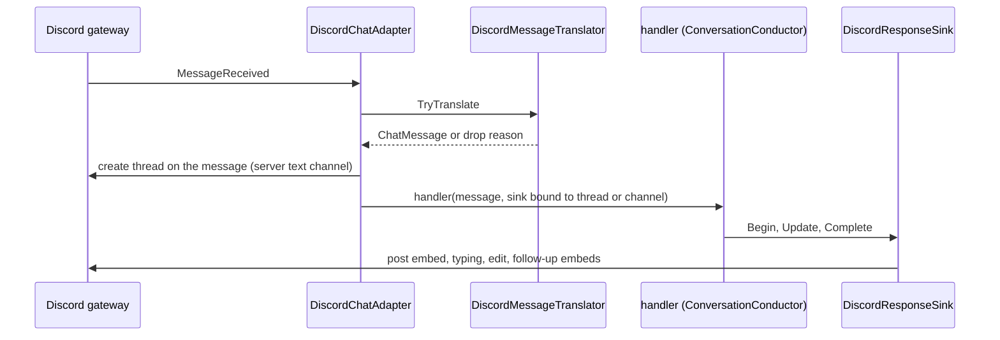

## How it works

The translator drops messages from any bot first (`InboundDiscordMessage.AuthorIsBot`, which `ProjectInbound` reads from the author it is handed, `IUser.IsBot` beside the author's id, `src/Scout.Adapter.Discord/DiscordChatAdapter.cs:399`, the gateway handler passing `SocketMessage.Author`, `:213`; `src/Scout.Adapter.Discord/DiscordMessageTranslator.cs:46`), so another bot's mention, direct message or voice reply never starts a conversation, then guild messages not addressed to the bot, and text messages empty after the mention is stripped; direct messages need no mention (`src/Scout.Adapter.Discord/DiscordMessageTranslator.cs:48`, `:60`, `:84`). A message without a guild, text or voice, gets `ChatMessage.IsDirectMessage = true` (`src/Scout.Adapter.Discord/DiscordMessageTranslator.cs:56`), which owner pairing requires ([[pages/decisions/0021-allowed-users]]). Login and start happen in `StartAsync` (`src/Scout.Adapter.Discord/DiscordChatAdapter.cs:98`): it logs in through the internal `Login` seam, then starts the gateway through `Connect` only while the lifecycle is still running, under a gate `StopAsync` also takes around the client's stop and logout (`:105`, `:108`, `:179`), so a stop that lands during the login leaves the gateway never started and the start returns. The gateway starts only while the lifetime token, which the start token cancels, is not cancelled either, so a start whose token is cancelled before the gateway starts, during the login or before the start was called, never opens it: the start stops the adapter through `StopAsync`, which drops the handler, unsubscribes from the client and logs it out through the internal `Logout` seam, and then throws `OperationCanceledException` for the start token (`:108`, `:119`), which the host's start loop rethrows during a shutdown, starting no later adapter and signalling no readiness (`src/Scout.Host.Console/ConversationWorker.cs:47`). When that stop fails, for example the logout throws, the start logs the failure once as a Warning and still throws the cancellation, with the adapter already stopped (`src/Scout.Adapter.Discord/DiscordChatAdapter.cs:125`); a plain `StopAsync` still lets such a failure escape to its caller; a later stop or dispose finds the adapter stopped and does nothing. Once the gateway has started, the start token cancels the replies in flight through the lifetime token and leaves the client logged in until the host's stop. A login that fails escapes to the host, the gateway is never started, and the adapter stays armed until the host's stop or dispose; this holds when the start token is cancelled too. `DisposeAsync` stops the adapter and leaves that gate undisposed, because nothing reads its wait handle, so a start still waiting for its login when the adapter is disposed returns with the gateway never started instead of failing on a disposed semaphore (`src/Scout.Adapter.Discord/DiscordChatAdapter.cs:191`). `DiscordAdapterLifecycle` creates the lifetime token and publishes the started state under one lock (`src/Scout.Adapter.Discord/DiscordAdapterLifecycle.cs:71`), so no reader sees the started state without its token, and hands the token out together with the running state, `TryGetLifetimeToken` (`:40`). The gateway handler filters the message, starts the conversation on the thread pool and returns before the reply finishes, so a long reply never blocks the Discord gateway task (`src/Scout.Adapter.Discord/DiscordChatAdapter.cs:232`); it takes the handler and that token in one read (`:239`), so a message a stop overtakes is dropped without a log line, like a message after the stop; `StopAsync` cancels the lifetime token and waits up to 10 s for the in-flight replies to unwind before it logs out (`src/Scout.Adapter.Discord/DiscordChatAdapter.cs:169`).

- **Thread per conversation.** With `ReplyInThreads` on, a mention in a server text channel (not a thread, not a voice channel's chat, not a DM) from a sender the access policy admits first opens a public thread on the user's message, archived after a day of inactivity and named from the question's first 60 characters on one line, cut at a word with "..." ("Voice message" for a voice message; `src/Scout.Adapter.Discord/DiscordChatAdapter.cs:310`, `:342`). The reply streams in the thread and `ChatMessage.ChannelId` is the thread id, so memory is per thread; a later mention inside the thread continues there. Creating the thread is a descriptive write in the originating channel. If Discord refuses (for example the bot lacks Create Public Threads), the adapter logs a warning and replies in the channel. A sender `AccessPolicy` refuses (`src/Scout.Conversation/Access/AccessPolicy.cs:42`, the decision the conductor's allow-list uses; [[pages/decisions/0021-allowed-users]]) gets no thread: the conductor's refusal is posted in the channel as a reply to their message.
- **Reply reference.** When the reply stays in the channel or DM, its first message is a Discord reply to the user's message, with `failIfNotExists: false` so a deleted message does not fail the post (`src/Scout.Adapter.Discord/DiscordChatAdapter.cs:288`); follow-up messages are plain.
- **Typing indicator.** After Begin posts the cursor embed, the sink enters the channel's typing state, which Discord.Net renews every 9.5 s, and leaves it at the first streamed content, on Complete or Fail, and when the adapter disposes the sink after a cancelled reply (`src/Scout.Adapter.Discord/Streaming/DiscordResponseSink.cs:120`, `:141`). If Discord refuses the typing call, the sink logs a warning and the reply carries on without it.
- **Long replies.** The sink tells the pump it has no body limit (`src/Scout.Adapter.Discord/Streaming/DiscordResponseSink.cs:113`) and splits the text itself into parts of at most 3,968 characters plus closing markers, below the 4,096-character embed limit (`src/Scout.Adapter.Discord/Streaming/DiscordReplySplitter.cs:20`). A part ends at a paragraph or line in its second half, else at the last space, so no word is cut; a code fence moves whole to the next part, or, when it is longer than a part, is closed and reopened with its language. Each render edits only the parts that changed and posts new parts as follow-up messages in order, stopping at the first failed write (`src/Scout.Adapter.Discord/Streaming/DiscordResponseSink.cs:237`). At most 5 parts; the fifth then ends with "(reply truncated)". If a follow-up post fails on Complete, the last written part gets "(the rest of this reply could not be posted; see Scout logs)" and Complete does not throw (`:197`).
- **Voice messages.** A message with `MessageFlags.VoiceMessage` (1<<13) and an `audio/*` attachment becomes an `InboundVoiceMessage` with the URL, content type, size and duration (`src/Scout.Adapter.Discord/DiscordChatAdapter.cs:358`). The translator accepts it in a DM, or in a server channel or thread when it mentions or replies to the bot, and hands the core a `ChatMessage` with empty text and an `AudioAttachment` whose download runs only when the conductor asks (`src/Scout.Adapter.Discord/DiscordMessageTranslator.cs:57`, `:64`). A text reply to the bot without a mention is still ignored. Transcription and the quoted reply belong to the core ([[pages/decisions/0024-voice-messages-transcribed-locally]]).
- **Origin reference.** The translator names the conversation as `discord:<channel id>:<message id>`, the channel or DM and the user's message, text or voice (`src/Scout.Adapter.Discord/DiscordMessageTranslator.cs:77`, `:94`); when the adapter moves the conversation into a new thread, the reference becomes `discord:<thread id>` (`src/Scout.Adapter.Discord/DiscordChatAdapter.cs:286`) ([[pages/decisions/0033-channel-operator-architecture]], [[pages/services/conversation]]).
- **Later posts.** `DiscordOriginPoster` reads that payload, resolves the channel or thread through the running adapter's socket client, cache first, then REST (`src/Scout.Adapter.Discord/DiscordChatAdapter.cs:448`), and posts one plain-text message capped at 2,000 characters, ending in "..." when cut, as a reply to the user's message with `failIfNotExists: false` when the payload names one, with `AllowedMentions.None` so model text never pings anyone (`src/Scout.Adapter.Discord/DiscordOriginPoster.cs:42`). A payload it cannot read, an adapter that is not running, a channel it cannot resolve or a post Discord refuses (an `HttpException`, a reset) returns false with a Warning that names no id (`:50`, `:58`, `:75`). A post Discord accepted is logged by `OriginNotifier`, once for every adapter ([[pages/services/conversation]]); the poster itself logs only a failure.
