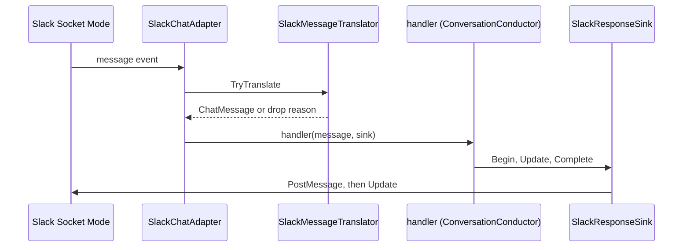

## How it works

The sink posts the cursor on Begin and edits that message on every later call; a `CompleteAsync` or `FailAsync` before a Begin that posted, never called or refused by Slack, throws `InvalidOperationException` "Terminal call before a successful BeginAsync." like an update before Begin, instead of returning as if the reply had landed (`src/Scout.Adapter.Slack/Streaming/SlackResponseSink.cs:206`); the conductor logs that throw from its own `FailAsync` and goes on ([[pages/services/conversation]]).

`StartAsync` (`src/Scout.Adapter.Slack/SlackChatAdapter.cs:92`) arms the lifecycle and then, inside one try, awaits `auth.test` and takes a connect gate; under the gate it reads the lifecycle again and, when a stop has already run or the lifetime token is cancelled, connects nothing and returns, throwing the cancellation when the start token was the one cancelled (`:114`); only then does it arm the handler and connect Socket Mode with the lifetime token (`:126`), so a stop that lands while the connect is pending cancels it and the start returns, while a start token cancelled by the host still throws (`:129`). A failure of `auth.test` or of the connect stops the adapter, a failure of that stop logged as a Warning, and the start throws the original fault (`:139`). `StopAsync` takes the same gate before it disconnects (`:163`), so a stop that lands while the connect is in flight waits for the cancelled connect to unwind and then closes it, without waiting on its own token. Until 2026-11-11 the start armed the handler and connected after a stop that landed during `auth.test`, a failed start left the lifecycle running, and a hung connect held the gate until the stop's own token fired ([[pages/history/adapter-slack]]).

A message event reads the running state and the lifetime token in one step, `SlackAdapterLifecycle.TryGetLifetimeToken` (`src/Scout.Adapter.Slack/SlackAdapterLifecycle.cs:40`, `src/Scout.Adapter.Slack/SlackChatAdapter.cs:192`), under the lock the start and the stop take, and the start creates the token before the started state is visible (`src/Scout.Adapter.Slack/SlackAdapterLifecycle.cs:61`); a message a stop overtakes, before the handler is armed or once the stop has begun, returns without work and never throws into SlackNet's event handler.

The translator drops anything from a bot, from this app, or with a `bot_message` subtype, so the sink's own `chat.update` edits cannot retrigger the adapter (`src/Scout.Adapter.Slack/SlackMessageTranslator.cs:40`). Messages with other subtypes are also dropped (`:56`). A message in an `im` channel gets `ChatMessage.IsDirectMessage = true` (`:86`), which owner pairing requires ([[pages/decisions/0021-allowed-users]]).

- **Origin reference.** The adapter names the conversation as `slack:<channel id>:<thread ts>`, built from the same channel and thread timestamp the reply sink is bound to (the parent thread, or the message's own ts when it starts one), so a later post lands in the thread the reply went to (`src/Scout.Adapter.Slack/SlackChatAdapter.cs:227`; [[pages/decisions/0033-channel-operator-architecture]], [[pages/services/conversation]]).
- **Later posts.** `SlackOriginPoster` reads that payload and, while the adapter is running (`src/Scout.Adapter.Slack/SlackChatAdapter.cs:266`), posts one plain-text message into that channel and thread through the adapter's own API client, capped at the sink's 3000 characters and ending in "..." when cut (`src/Scout.Adapter.Slack/SlackOriginPoster.cs:27`). It escapes `&`, `<` and `>` as `&amp;`, `&lt;` and `&gt;` (`:21`), so `<!channel>`, `<!here>`, `<!everyone>`, `<!subteam^...>`, user mentions and link markup in model text arrive as plain text; a plain `@channel` stays plain because the post does not set `link_names`. A payload it cannot read, an adapter that is not running, or a post Slack refuses (a `SlackException` such as `channel_not_found`, a reset) returns false with a Warning that names no channel (`:32`, `:37`, `:58`). The reply sink does not escape markup; only the later post does.
