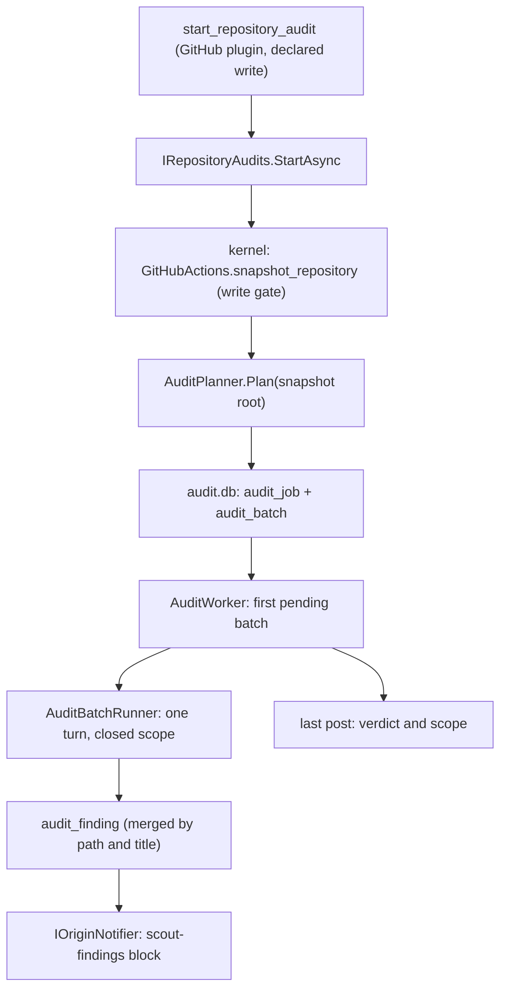

## How it works

- **Start** (`src/Scout.Audit/RepositoryAudits.cs:99`): the owner and repository must be letters, digits, dots, hyphens or underscores and never `.` or `..`, each matched whole so a trailing line break is refused (`:296`, `:87`); then a running job of the same repository answers with its progress, takes no snapshot and wakes the worker (`:111`, since 2026-11-11), so a job the worker left running after an error runs again when the owner asks to start it, and a paused one is resumed from its first batch not done, with the origin of the turn that resumed it, no new snapshot, and the answer `Resuming the audit of owner/repo from the first area not done.` and its progress (`:115`). The snapshot is taken by invoking `GitHubActions.snapshot_repository` through the kernel, on the default branch, in the one method an audit and a review share (`src/Scout.Audit/RepositoryAudits.cs:152`, `:160`), so it passes the write gate like the model's own call and is logged on the `github` feature's `Scout's data folder` row; the plugin's `start_repository_audit` is itself a declared write on that row, so one start asks the gate twice. The snapshot is then looked up through `IAuditSnapshots.Find` by the short commit in parentheses the function's answer names (`:162`, `:170`): an answer that names none is a refusal and is returned as it is, so a refused snapshot never falls back to an older tree. A lookup that throws or finds nothing stops the start with `The audit of owner/repo did not start: Scout could not read the snapshot it just took (<exception type> | not found).` and a Warning in the log (`:172`, `:181`). The plan is kept as a job with the origin reference of the chat turn (`ChatOrigin.Current`, `src/Scout.Audit/AuditServiceCollectionExtensions.cs:60`), the worker is woken, and the answer is `Auditing owner/repo: N areas, M files; the first batch is running. Findings arrive here as each area is done.`, N being the batch count the ADR's consequences ask the first answer to name.

- **Review start** (`src/Scout.Audit/RepositoryAudits.Reviews.cs:53`, [[pages/decisions/0055-pull-request-review-as-a-job-in-batches]]): the review of a pull request too large for one turn is a job of kind `review` with its number, on this engine. Nothing calls it yet: no chat function and no host adapter reaches `IPullRequestReviews`, so production creates no review row. It answers a `ReviewStart(Started, Sentence, Preflight)` (`src/Scout.Audit/ReviewPreflight.cs:41`): whether it started or resumed the review, the sentence the owner reads, and the checks it ran (Checks before a review, below). The owner and repository are checked as an audit's are, each name matched whole, so a trailing line break is refused too (`src/Scout.Audit/RepositoryAudits.cs:87`); a pull request number of 0 or below is refused, `The pull request must be given by its number, above zero.`, before anything is read or written, by the status too (`src/Scout.Audit/RepositoryAudits.Reviews.cs:61`, `:210`); a head that is not a commit SHA of 7 to 40 hexadecimal characters, matched whole, is refused before the snapshot is asked for, `The pull request's head must be a commit SHA of 7 to 40 hexadecimal characters.` (`:66`); a pull request whose answer left no diff out starts no review and takes no snapshot, `No review of owner/repo#n was started: the pull request's answer left no diff out, so it is reviewed in this turn.` (`:72`), and one with no file GitHub gave a patch for, every changed file without a diff or no file listed at all, starts none either, `No review of owner/repo#n was started: GitHub returned no diff for any of the N changed files, so there is nothing to read in batches.` (`:77`); each of these runs no check. The files with a patch are planned by the list planner, each sized by its patch's length and under the audit's caps (`:87`); the files GitHub returned no diff for go in one last batch, `files GitHub returned no diff for`, kept not covered from the start with the reason `GitHub returned no diff` (`:94`). The latest review of that pull request is read next (`:100`), so a database that cannot be opened answers the store's sentence and takes no snapshot; a paused one at the same head commit is resumed from its first batch not done with the turn's origin and runs no check, its row keeping the checks of its own start (`:102`). A running one at the same head commit blocks the start with `A review of owner/repo#n at <commit> is already running.` and its progress, and a done one blocks it with `The review of owner/repo#n at <commit> is already done.` and its progress (`:110`, `:111`, `:116`). The snapshot is then taken at the pull request's head commit through the same gated method an audit uses (`:122`), so a refusal is returned as it is and a call that throws is `Scout could not take the snapshot of owner/repo (<exception type>).`; a snapshot whose full commit is not the head starts no review, `The review of owner/repo#n did not start: the snapshot Scout took is at <commit>, not at the pull request's head <head>.` (`:130`). A running or paused review of the pull request at an earlier head is then stopped, so the pull request keeps one live review, and a done or stopped one is left as it is (`:135`, `tests/Scout.Audit.Tests/RepositoryReviewsTests.cs:200`); the stop is the store's stop for that pull request, which keeps no reason, so the reason is in the answer; it runs before the new review is kept, so a database that refuses the new one leaves the earlier one stopped, answers the store's sentence, and a second start then keeps the new one (`tests/Scout.Audit.Tests/RepositoryReviewsTests.cs:271`). The job is kept with the head commit, the turn's origin and the checks, in one save (`src/Scout.Audit/RepositoryAudits.Reviews.cs:140`), and the answer is `review started: M files, K batches, owner/repo#n at <commit>.`, M every changed file and K every batch kept, followed by `Stopped the review at <earlier>: the pull request moved from <earlier> to <commit>.` when it stopped one, and by `Files GitHub returned no diff for, counted as not read: k.` when there are any. The status, `StatusAsync(owner, repo, number, ct)` (`:203`), reads the latest review of that pull request only: `The review of owner/repo#n at <commit> is <status>. <progress>`, or `No review of owner/repo#n has been started.`; a review's progress counts batches where an audit's counts areas (`src/Scout.Audit/RepositoryAudits.cs:290`).

- **Checks before a review** (since 2026-11-13, the first part of the checks [[pages/decisions/0055-pull-request-review-as-a-job-in-batches]] lists): before a review job is created, Scout's code runs five checks, each a `PreflightCheck(Name, Outcome, Sentence)` (`src/Scout.Audit/ReviewPreflight.cs:18`) whose outcome is `ok`, `warning` or `block` (`:25`); a check whose source could not be read is a warning whose sentence starts `Could not check` (`src/Scout.Audit/RepositoryAudits.Reviews.cs:199`), and the review still starts. They read Scout's own facts and the start's arguments only, never the model's words or the pull request's text, and none makes a call of its own. In the order they run (`:97`, `:108`, `:125`): **Size** (`:163`), `N files in K batches; at most M minutes.`, N every changed file and K every batch, M an upper bound and never an expected time: each batch a turn run at most twice (`src/Scout.Audit/AuditBatchRunner.cs:253`) under `Scout:Audit:TurnTimeout`, for at most 10 batches (`src/Scout.Audit/RepositoryAudits.Reviews.cs:48`), the batch of files with no diff counting no minutes, and never more than the review's bound of 60 minutes (`:51`), which the batches' runner does not enforce yet; past 10 batches a warning that adds `; F files will not be read.`, F the files of the batches after the tenth. **Docker runs** (`:175`), from `IReviewEnvironment.ContainerRunsOn` (`src/Scout.Audit/IReviewEnvironment.cs:7`), which the host adapts from `Scout:Sandbox:Enabled`, the switch the sandbox runner obeys ([[pages/services/sandbox]]): `Docker runs are on.` or the warning `Docker runs are off; tests will not run.`, and `Could not check whether Docker runs are on.` when the switch cannot be read. **Head** (`src/Scout.Audit/RepositoryAudits.Reviews.cs:191`), from the head commit's check counts the caller passes, `ReviewCheckCounts(Passing, Pending, Failing)` (`src/Scout.Audit/ReviewPreflight.cs:44`), read once: `Head <commit>; P checks passing.`, a warning `Head <commit>; P checks passing, Q pending, R failing.` when any is pending or failing, and `Could not check the checks.` when the caller passed none. **Duplicate**, the latest review of the pull request at the same head commit: a running one blocks and a done one blocks, each with the sentence above, a stopped one a warning `A review of owner/repo#n at <commit> was stopped; this start reviews it again.`, and otherwise `No other review of owner/repo#n at <commit>.` **Grants**, the gated snapshot itself: a refused snapshot blocks with the gate's sentence, unchanged (`src/Scout.Audit/RepositoryAudits.Reviews.cs:125`), a snapshot taken is `The snapshot at <commit> was taken through the write gate.`, and when an earlier check blocked, the snapshot is not asked for and the check is `Could not check the grants: the snapshot was not asked for, because the review did not start.` A block starts no review, writes no row and returns every check (`:116`); warnings start the review and stay on it. The checks are kept once, on the job's `preflight` column in the same save as the job (Rows, below), and never computed again, so the card shows what was true at the start; the checks are written in the insert of the job's own row (`src/Scout.Audit/SqliteAuditStore.cs:62`), read back by `tests/Scout.Audit.Tests/RepositoryReviewsTests.cs:430`, and a start the database refuses keeps no review and returns every check with the store's sentence (`:510`). The AI Source, Docker on this computer, tests that need a Docker daemon and the stack are not checked yet ([[pages/roadmap/followups]]).
