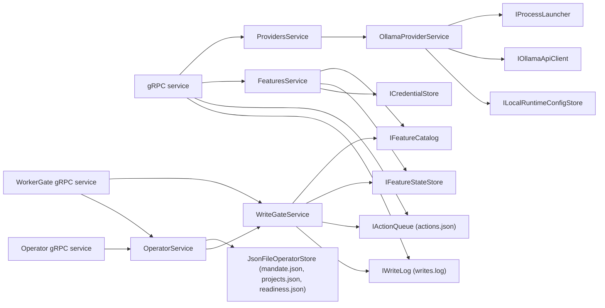

## How it works

The daemon is launched with both control-plane tokens, the desktop's `SCOUT_CONTROLPLANE_TOKEN` and the worker's `SCOUT_CONTROLPLANE_WORKER_TOKEN`, removed from the child environment (`src/Scout.ControlPlane/Providers/OllamaProviderService.cs:199`, `:200`); the code carries no comment about the worker token, and `tests/Scout.ControlPlane.Tests/Security/CallerTokensTests.cs:58` keeps its literal in step with the host's. The credential store falls back to `InMemoryCredentialStore` (`src/Scout.ControlPlane/ControlPlaneServiceCollectionExtensions.cs:69`) and the activator to `NullFeatureActivator` (`:70`), which makes `Enable` answer not-yet-implemented (`src/Scout.ControlPlane/Features/FeaturesService.cs:285`). No `IFeatureCredentialValidator` implementation exists outside `src/old`.

**Credentials and settings.** `SetupAsync` (`src/Scout.ControlPlane/Features/FeaturesService.cs:93`) validates the whole request before it writes. A required credential or setting is present when the request supplies it or, left out of the request, it is already stored (`ContainsAsync` for a credential, the persisted settings for a setting), so a settings-only edit need not resend the token and a token rotation need not resend the settings; a required setting the request clears is still missing (`tests/Scout.ControlPlane.Tests/Features/FeaturesServiceTests.cs:455`, `:480`). A settings key the catalog entry does not declare, set or cleared, is refused as `settings.<key>`, "Unknown setting '<key>'.", and nothing is written (`src/Scout.ControlPlane/Features/FeaturesService.cs:121`, `tests/Scout.ControlPlane.Tests/Features/FeaturesServiceTests.cs:504`); a credential check that fails is rethrown with nothing written (`:520`), and a state file that cannot be read fails as `FeaturePersistFailedException` "Failed to read the feature's settings: <reason>" with nothing written (`:648`). That early read serves the validation only: the settings are merged onto the state read again just before the save (`src/Scout.ControlPlane/Features/FeaturesService.cs:207`), so whatever changed meanwhile is kept, and a revoke made while a credential validator was running does not come back (`tests/Scout.ControlPlane.Tests/Features/FeaturesServiceTests.cs:601`). `SetCredentialsAsync` and `SetupAsync` both fail as `FeaturePersistFailedException` "Credential store is unavailable; no changes were saved.", with nothing saved, when the credential store answers false (`src/Scout.ControlPlane/Features/FeaturesService.cs:80`, `:194`; one row per caller in `tests/Scout.ControlPlane.Tests/Features/FeaturesServiceTests.cs:418`). Since 2026-11-11 the store's contract says what that false means: the value was not stored at all. `IsAvailable` false means a stored secret lasts only while Scout runs, and such a store still stores it and answers true (`src/Scout.ControlPlane/Features/ICredentialStore.cs`). The default `InMemoryCredentialStore` is that store (`src/Scout.ControlPlane/Features/InMemoryCredentialStore.cs:34`), pinned by a test in which setup and then enable run on it (`tests/Scout.ControlPlane.Tests/Features/FeaturesServiceTests.cs:437`). No owner is warned at the moment of saving because no owner can save through it today: no card of the shipped catalog saves a credential through this store, since each has its own connection flow and the desktop never shows the dialog that would; nothing reads a stored value back (`GetAsync` has no caller, `ContainsAsync` checks presence only); and the real credentials live in the desktop's protected storage and reach the worker as environment variables ([[pages/invariants/secrets-never-in-source]]). The rule for the change that first lets an owner save through this store, or adds one backed by the system keyring, is in [[pages/roadmap/followups]].

**Write grants.** A feature whose matrix has a `Write` or `IrreversibleWrite` row needs the owner's confirmation of those rows. `EnableAsync` checks it after the credentials and before the activator (`src/Scout.ControlPlane/Features/FeaturesService.cs:278`), so even with the confirmation the default activator still ends in not-yet-implemented; a successful enable records `Granted` and `GrantedAt` (`:313`), and a failed activation clears them (`:298`); when the state cannot be read or saved after this enable activated the plugin, the plugin is deactivated before the failure is rethrown, and a plugin that was already active stays active, so the plugin and the stored state never disagree, and a deactivation that fails too never replaces the failure the owner is shown (`:323`, `tests/Scout.ControlPlane.Tests/Features/FeaturesServiceTests.cs:543`, `:563`, `:581`). A connection card with no toggle, such as YouTube, grants through `SetWriteGrantAsync` (`src/Scout.ControlPlane/Features/FeaturesService.cs:340`): granting needs the confirmation, revoking does not, a feature without write rows is a validation error, and `Enabled` is left alone. `DisableAsync` and `DeleteCredentialsAsync` reset the state and so revoke the grant (`src/Scout.ControlPlane/Features/FeaturesService.cs:378`, `:252`). `FeatureState` keeps `Granted` and `GrantedAt` (`src/Scout.ControlPlane/Features/IFeatureStateStore.cs:11`); the JSON store writes them only while granted, so a state file without them reads as not granted (`src/Scout.ControlPlane/Features/JsonFileFeatureStateStore.cs:191`). Every read and write of that store runs under its gate (`:119`), so reads that arrive together move a malformed file aside once and none of them fails (`tests/Scout.ControlPlane.Tests/Features/JsonFileFeatureStateStoreTests.cs:88`); a `features.json` that does not parse, or holds the JSON literal `null` (since 2026-11-11, `tests/Scout.ControlPlane.Tests/Features/JsonFileFeatureStateStoreTests.cs:133`), is moved aside like the queue's, logged once as "Feature state file at <path> is malformed; moved it to <aside> and started from defaults", and read as defaults (`src/Scout.ControlPlane/Features/JsonFileFeatureStateStore.cs:151`, `tests/Scout.ControlPlane.Tests/Features/JsonFileFeatureStateStoreTests.cs:68`); one that cannot be opened or read fails the call, and a set whose read failed writes nothing, so a transient lock never replaces every feature's state and grants (`tests/Scout.ControlPlane.Tests/Features/JsonFileFeatureStateStoreTests.cs:108`). The worker learns the grants at start from `SCOUT__FEATURES__GRANTEDWRITES`, set by the desktop ([[pages/services/llm]]).

**Approval queue and write log.** `JsonFileActionQueue` keeps every action in `actions.json` beside `features.json`; enqueue, list, find and each decision run their read, check and write under one gate (`src/Scout.ControlPlane/Actions/JsonFileActionQueue.cs:35`), so two approvals of one action let one through and the other fails as already decided. The worker never writes the file: it enqueues through the WorkerGate service, so every writer is the control-plane process. A decision records the status, `DecidedAt` and the owner's reason when one was given, on an approval as on a rejection. `ExecuteAsync` moves an `Approved` action to `Executed` under the same gate and fails with `PendingActionNotApprovedException` for any other status, an executed one included (`src/Scout.ControlPlane/Actions/JsonFileActionQueue.cs:530`); before the move it runs the caller's record, and a record that throws leaves the action approved (`:535`). `MarkExecutedAsync` is `ExecuteAsync` with nothing to record (`:502`). An executed action is no longer pending. Every write of the file drops rejected actions whose `DecidedAt` is more than 30 days old and executed ones approved more than 90 days ago, and keeps pending and approved actions whatever their age (`:556`, `tests/Scout.ControlPlane.Tests/Actions/ActionQueueTests.cs:389`); an executed action is aged from its approval, the only time the queue keeps for it. A queue file that does not parse, or that holds the JSON literal `null` (since 2026-11-11, `tests/Scout.ControlPlane.Tests/Actions/ActionQueueTests.cs:516`), is moved aside to `actions.json.corrupt-<UTC yyyyMMddHHmmss>` and logged once as a warning naming both paths, and the queue starts empty (`src/Scout.ControlPlane/Actions/JsonFileActionQueue.cs:657`); the move never overwrites: while that name is taken, as after a second corruption within the same second, `-1`, `-2` and so on are appended (`src/Scout.ControlPlane/CorruptFile.cs:13`, `tests/Scout.ControlPlane.Tests/Actions/ActionQueueTests.cs:191`); the second is read from the injected `TimeProvider`, so the three names are pinned on a fixed clock (`tests/Scout.ControlPlane.Tests/CorruptFileTests.cs:24`), and a move that fails fails the read with nothing reported as moved, for the queue as for the feature state, operator and runtime config stores (`:51`). A batch the owner approved is checked entry by entry before any of it is written (`tests/Scout.ControlPlane.Tests/Actions/ActionQueueTests.cs:355`). Only malformed content is moved aside (`src/Scout.ControlPlane/Actions/JsonFileActionQueue.cs:657`): a file that cannot be opened or read (an `IOException` or `UnauthorizedAccessException`) fails the call and stays where it is, so a transient lock never empties the queue (`tests/Scout.ControlPlane.Tests/Actions/ActionQueueTests.cs:372`). `JsonLinesWriteLog` appends one line per write to `writes.log` and lists the last N newest first, skipping and logging a line that does not parse with its number counted from the end of the file. The list reads only the tail: it seeks back from the end in 4096-byte blocks (`src/Scout.ControlPlane/Actions/JsonLinesWriteLog.cs:20`, `:96`), carries a line cut by a block boundary into the next block (`:178`), parses each line as it reads it, and stops once it has N entries; blank and malformed lines are skipped and not counted, so N older entries that parse are still listed behind a malformed line (since 2026-11-11, `tests/Scout.ControlPlane.Tests/Actions/WriteLogTests.cs:129`), and the first line of the file and a last line without a newline are read (`tests/Scout.ControlPlane.Tests/Actions/WriteLogTests.cs:87`, `:107`).
