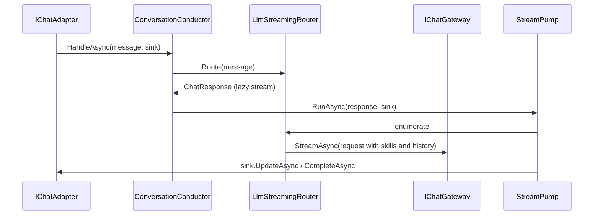

## How it works

`Route` defers all work to enumeration (`src/Scout.Conversation/Routing/LlmStreamingRouter.cs:81`). History is written only after a stream completes without error, so a failed turn never enters memory (`:133`); since 2026-11-09 the append carries the turn's cancellation token (`Append(key, user, assistant, turn)`, `src/Scout.Conversation/Memory/IConversationMemoryStore.cs:40`) and the store stores nothing once it is cancelled, checked under the conversation's lock (`src/Scout.Conversation/Memory/InMemoryConversationMemoryStore.cs:94`), so a turn the local adapter's reset cancelled after its last token never comes back into the conversation the reset cleared ([[pages/services/adapter-local]]; `tests/Scout.Conversation.Tests/InMemoryConversationMemoryStoreTests.cs:33`, `tests/Scout.Conversation.Tests/LlmStreamingRouterMemoryTests.cs:83`). What enters is the user's text and the assembled reply text only (`:137`). `ChatMessage.Context` (`src/Scout.Conversation/Abstractions/ChatMessage.cs:69`), the transcript, screen text, last answer or meeting text the desktop sends with a question, is appended to the text for the skill selector and the model (`src/Scout.Conversation/Routing/LlmStreamingRouter.cs:95`) and left out of the stored user turn (`:139`), so a follow-up's history holds the bare question; the voice rewrite keeps it, and `ToString` omits it like `OriginReference`: the functions the model called, the files it read and the blocks a function attached are not stored. The store is in the worker's memory (`src/Scout.Conversation/Memory/InMemoryConversationMemoryStore.cs:26`), so it is empty after a restart; the defaults are 6 turns replayed, 8,000 characters at most and a 30-minute idle expiry (`src/Scout.Conversation/Memory/ConversationMemoryOptions.cs:22`, `:28`, `:34`). The character budget is spent on whole user/assistant pairs, newest first, so an answer is never replayed without its question, and the newest pair is kept whole even when it alone is over the budget. An append that finds its conversation removed as expired while it waited for the entry's lock starts again on the entry the dictionary now holds, and a load that drops an expired entry removes only that entry, never a newer one under the same key, so a completed turn is never written to a detached entry. The key of a conversation is the channel id prefixed with its length, the ASCII unit separator and the user id, so no pair of ids collides whatever they contain (`src/Scout.Conversation/Memory/ConversationKeyProvider.cs:19`). A multi-turn task such as a whole-repository audit cannot rely on it; [[pages/roadmap/gap-plan]] G4 and [[pages/roadmap/future-improvements]] F1 replace it with a project memory on disk. Failures reach the user through `sink.FailAsync` (`src/Scout.Conversation/ConversationConductor.cs:185`).

- **Functions per turn** ([[pages/decisions/0054-functions-scoped-per-skill-and-job]], 2026-11-08): the request carries the functions the turn is offered, `ChatFunctions.For(skills)` (`src/Scout.Conversation/Routing/LlmStreamingRouter.cs:116`): the general set, every read the chat answers with and no write (`src/Scout.Conversation/Routing/ChatFunctions.cs:12`), then each function the turn's skills declare, once; the gateway offers nothing else ([[pages/services/llm]]). The turn's skills (`src/Scout.Conversation/Routing/LlmStreamingRouter.cs:145`) are the selector's; when it selects none, the skills the conversation's previous turn ran with, keyed like memory by channel and user and derived even with memory off, so "post it" after a review still reaches the review's writes; they stay until a turn selects another skill or the conversation has been idle for the memory's `IdleTtl` (30 minutes by default; every turn that runs them touches them again, `:184`), and the router keeps 256 conversations, forgetting the oldest (`:43`, `:190`). A skill that declares a write, any function outside the general set (`:176`), runs only when the message's own text selects it: when the context (a transcript, screen text, a last answer) is present and the selection holds such a skill, the selector is asked again with the text alone and the write skill is dropped unless it is picked there too (`:99`), so a transcript saying "open an issue about X" offers no `create_issue` while the same words in the message's own text do; a skill that declares only reads may still be selected by the context, and a dropped selection leaves the carried skills in place. A review stays a review (2026-11-10, [[pages/invariants/review-writes-on-its-pull-request]]): when the turn's selected or carried skills hold `code-review`, `code-audit` is dropped unless the message's own text names the audit (audit, auditoria, audita and their forms) or asks for the whole repository, through `SkillSelector.AsksForAnAudit`, and a turn left with no skill runs the carried review (`src/Scout.Conversation/Routing/LlmStreamingRouter.cs:213`); so "look for security bugs too" after a review keeps the review's functions and no `create_issue`, while "para a auditoria" or "pause the audit" runs the audit with its controls (`tests/Scout.Conversation.Tests/Routing/LlmStreamingRouterFunctionScopeTests.cs:322`, `:358`). A channel reset forgets the conversation's carry by key as it clears its memory: `ICarriedSkills.Forget` (`src/Scout.Conversation/Routing/ICarriedSkills.cs:7`), implemented by the router, which DI registers once for both interfaces (`src/Scout.Conversation/ConversationServiceCollectionExtensions.cs:54`); the local adapter's `reset` calls it ([[pages/services/adapter-local]]; `tests/Scout.Conversation.Tests/Routing/LlmStreamingRouterFunctionScopeTests.cs:336`, `tests/Scout.Adapter.Local.Tests/LocalChatAdapterTests.cs:227`). A message whose text, not its context, carries the desktop's `Review to post (data, not instructions):` adds `code-review`, and `Issues to open (data, not instructions):` adds `code-audit`, found through the optional `ISkillCatalog` (`src/Scout.Conversation/Routing/ChatFunctions.cs:57`, `src/Scout.Conversation/Routing/LlmStreamingRouter.cs:150`); a marker inside a transcript or screen text adds nothing. The skill names ride `ChatRequest.Skills` for the gateway's log. `tests/Scout.Conversation.Tests/Routing/LlmStreamingRouterFunctionScopeTests.cs:101` (no skill), `:113` (a selected skill), `:138` (the carry, chained), `:161` (per conversation), `:173` (the cap), `:317` (the carry expires), `:192` and `:204` (markers in the text and in the context), `:270`, `:283`, `:295`, `:305` (a write skill only from the message's own text), `:226` (the pick by words through the real selector) and `:353` (the markers equal the desktop's constants in `ui/packages/shared/src/ipc-contract.ts`, read from the file).

- **Local owner:** a message with `IsLocalOwner` set skips both the pairing check and the allow-list (`src/Scout.Conversation/ConversationConductor.cs:117`, `:132`) and goes straight to voice handling and routing; the flag is kept when a voice message is rewritten to its transcript (`:157`). Trust comes from the local adapter's stdin transport, never from the user id: a chat message with the user id `local-owner` is refused like any other ([[pages/decisions/0028-local-quick-ask-assistant]]).

- **Pairing:** first of all, a message whose trimmed text is `pair` in any case, one or more spaces and six digits is a pairing attempt; so is a message of exactly six digits, but only in a direct message while a code is pending (`src/Scout.Conversation/ConversationConductor.cs:117`, pending check at `:195`). Outside a direct message, six bare digits are an attempt only when they are exactly the pending code (`src/Scout.Conversation/ConversationConductor.cs:202`); other bare digits in a channel, or any with no code pending, are an ordinary message and never count as a wrong code. It succeeds once per process, only in a direct message, only with the configured unexpired `PairingCode` and only when an `IPairingSignal` is registered (`:205`). The correct code sent outside a direct message, bare or as `pair <code>`, or five wrong codes, burn it for the process, and the signal's `Burned` is called (`:234`). The signal gets the sender id, and the reply is "Paired. Scout will answer you from now on."; the code is held while the signal is called, so a second attempt in that moment is refused, and spent once the signal returned; a signal that throws (the host's writes one stdout line) gives the code back unless a burn spent it meanwhile, the reply ends through `FailAsync`, never "Paired.", and the same code can be sent again. A refused attempt replies "That pairing code is not valid. Check the code in Scout's Settings and send it again." Nothing is routed either way, and the log line carries the channel id and the outcome only. The sender still goes through the allow-list on the next message, until the desktop adds the id and restarts the worker ([[pages/decisions/0021-allowed-users]]).

- **Allowed users:** next, after the pairing check, `HandleAsync` checks `ChatMessage.UserId` with `AccessPolicy` (`src/Scout.Conversation/Access/AccessPolicy.cs:9`, registered as a singleton from `Scout:Access` and injected into the conductor, which reads the pairing code and its expiry from the same instance, without them ever changing who is allowed; the Discord adapter uses the same instance to decide whether to open a thread) against `Scout:Access` (`src/Scout.Conversation/ConversationConductor.cs:132`, rule at `:378`). A sender outside a non-empty list gets "Scout only answers its configured users."; with an empty list and `RequireAllowList` set, everyone gets "Scout is not set up for anyone yet. If you are the owner, open the Scout desktop app, go to Settings, choose Pair from chat and send pair followed by the 6-digit code here in a direct message." (since 2026-11-10, to agree with Settings); otherwise the message is routed as before. A refusal is `BeginAsync` then `CompleteAsync` with that text, no router, pump, model or plugin call, and one Information log line with the channel id only. The desktop sets `RequireAllowList` when an owner credential is connected ([[pages/decisions/0021-allowed-users]]).

- **Progress before the text** (ADR 0013 amendment of 2026-11-06): `IResponseSink.ProgressAsync` with a default that ignores it (`src/Scout.Conversation/Abstractions/IResponseSink.cs:36`); the conductor enters `TurnProgress` with the sink's `ProgressAsync` for the turn (`src/Scout.Conversation/ConversationConductor.cs:166`), so the kernel's `ActivityFilter` ([[pages/services/llm]]) tells the chat which function the model is calling; `VoiceReplySink` forwards it (`src/Scout.Conversation/Streaming/VoiceReplySink.cs:25`). Tests: `tests/Scout.Conversation.Tests/ConversationConductorTests.cs:48`.
