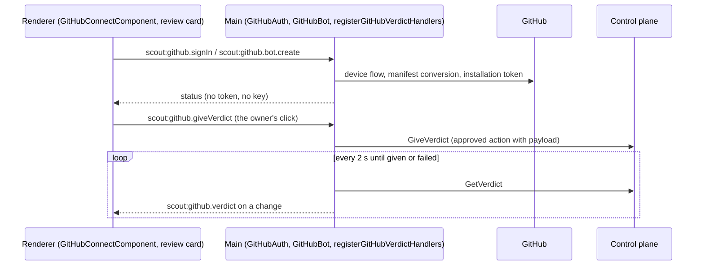

## How it works

The GitHub card does not use the control plane's credential dialog: `sc-github-connect` sits in the GitHub side panel (`ui/packages/renderer/src/app/features/features.component.ts:231`), and the card's chip, fact and action are read from its live status, so the GitHub card shows "Connected" or "Not connected" from the main-owned status instead of the control-plane badge, "Connected as <login>" with the writes line or "Connect with GitHub", and neither the card nor the panel has a toggle or credential buttons (see [[pages/services/desktop-ui]], Cards of one size, the rest in a side panel) (`ui/packages/renderer/src/app/features/github-connect.component.spec.ts:695`). The Kubernetes card works the same way, see Kubernetes connection. The component (`ui/packages/renderer/src/app/features/github-connect.component.ts:751`) calls five channels, `scout:github.signIn`, `status`, `cancel`, `signOut` and `saveToken`, handled in `ui/packages/main/src/ipc/github.ts:80`, and polls the status 3 s after each answer, never with two requests in flight and never after the card is gone, while a code is pending or the App is not installed and an install page exists. It also reads its status again on every `scout:features.changed` push (`ui/packages/renderer/src/app/features/github-connect.component.ts:793`), so "Connected as" goes when main drops the session; a Scout bot switch main refuses goes back to what main holds (`:886`); and a bot status that cannot be read while GitHub is connected keeps the bot section with the reason inside it (`:455`, `:1016`; tests `ui/packages/renderer/src/app/features/github-connect.component.spec.ts:1246`, `:1259`, `:1275`). "Open GitHub" and "Install Scout on your GitHub account" go through the existing `scout:app.openExternal` allow-list (https, `github.com` only).

`GitHubAuth` (`ui/packages/main/src/oauth/github-auth.ts:98`) runs the device flow, keeps the session in the vault, writes `<userData>/github-token.json` with mode `0600` (`ui/packages/main/src/oauth/github-auth.ts:561`), refreshes every minute and when the system wakes from sleep (`powerMonitor` resume) once less than 5 minutes remain, through one serial queue so two checks never both rotate the token, and on disconnect or `bad_refresh_token` deletes the token file first and the vault session second; if the file cannot be removed the owner stays connected and sees "Could not remove the GitHub token file, so Scout is still connected. Try Disconnect again." (`ui/packages/main/src/oauth/github-auth.ts:543`). On connect and disconnect it calls `restartWorkerIfRunning` (`ui/packages/main/src/ipc/github.ts:19`); first, on every credential change or loss (Disconnect, a saved token, a completed browser sign-in, GitHub refusing the saved sign-in on refresh) it revokes the `github` write grant on the control plane, as the Disconnect dialog promises and as YouTube does; a revoke the control plane cannot take then is kept by main and sent again before the next worker start reads the grants (see [[pages/services/desktop-ui]], Credentials follow the grant) (`revokeWriteGrant`, `ui/packages/main/src/oauth/github-auth.ts:69`, `:261`, `:190`, `:314`, `:375`; wired at `ui/packages/main/src/main.ts:564`; tests `ui/packages/main/test/ipc-github.test.ts:159`, `:176`, `:201`, `:219`, `:246`), and main pushes `scout:features.changed` to every window on each connection change (`ui/packages/main/src/main.ts:561`), so the card re-reads its status when main drops the session without a click. "Use a token" is the second method: main checks the pasted token against `GET /user`, keeps it under `github.token`, warns when a classic token's `X-OAuth-Scopes` can write, and removes any browser session, as a browser connect removes a saved token ([[pages/decisions/0019-github-app-device-flow]]). `GitHubAuth.workerEnv()` gives the worker `SCOUT__PLUGINS__GITHUB__TOKENFILE` for the browser method or `SCOUT__PLUGINS__GITHUB__TOKEN` for a pasted token, and nothing when disconnected (`ui/packages/main/src/main.ts:828`, `ui/packages/main/src/worker/build-env.ts:83`). What the owner sees:

- **No client id:** "The Scout GitHub App is not configured yet." and a disabled Connect button; "Use a token" still works.

- **Use a token:** opens the credential dialog the Features artboard draws, "Connect GitHub", with one required field, "Personal access token *": a password field, empty each time it opens, with Cancel focused; its help names read access to Metadata, Contents, Checks, Commit statuses, Pull requests and Issues; "Create a fine-grained token on GitHub" opens that page through `scout:app.openExternal`; "Required permissions" is folded, and "How to get this credential" lists the four steps for making the token (`ui/packages/renderer/src/app/features/github-connect.component.ts:1231`). Save with the field empty or blank sends nothing and says "One required field is empty. Nothing was saved.", with "Enter a GitHub token." under the field. Save, or Enter in the field, sends the typed token to main once (`:1273`) and shows "Saving…" with both buttons off; Esc does nothing until main answers. A refusal keeps the dialog open with main's sentence, for example "GitHub rejected this token.", the field emptied and focused. A kept token closes it with the notice "GitHub credentials saved" and the card reads its status again (`:843`); the keyboard lands on the side panel's close button, never on Disconnect, and the artboard draws no focus, so it is not drawn there. Esc or Cancel closes it with nothing saved, gives the focus back to "Use a token" and leaves the side panel open (`:834`; tests `ui/packages/renderer/src/app/features/github-connect.component.spec.ts:289`, `ui/packages/renderer/src/app/features/features.prototype.spec.ts:1639`). The dialog has the shared credential dialog's look (`DIALOG_STYLES`) but not its component: `sc-credential-dialog` is closed by the Features screen before its save answers, so it has no saving or refused state. It asks for no default repository, because nothing in Scout reads one ([[pages/roadmap/followups]]). The client id and slug come from `SCOUT_GITHUB_APP_CLIENT_ID` and `SCOUT_GITHUB_APP_SLUG`, else from constants that are empty until the App is registered.

- **Pending:** the one-time code in large type, Open GitHub, Copy code and Cancel.

- **Connected:** "Connected as <login>", for the browser method followed by " · installed on <n> repositories" (see Repositories the App is installed on, below), and Disconnect, which asks first ("Disconnect GitHub?", Cancel focused; Remove the bot asks the same way, see [[pages/services/desktop-ui]], Disconnect asks first); for a write-capable classic token, "This token can write to your repositories. A read-only fine-grained token is safer."; for the browser method when the App has no installation, also "Install Scout on your GitHub account".

- **Failed:** the reason above Connect, for example "The sign-in was cancelled on GitHub." or "The code expired. Click Connect with GitHub to get a new one."
