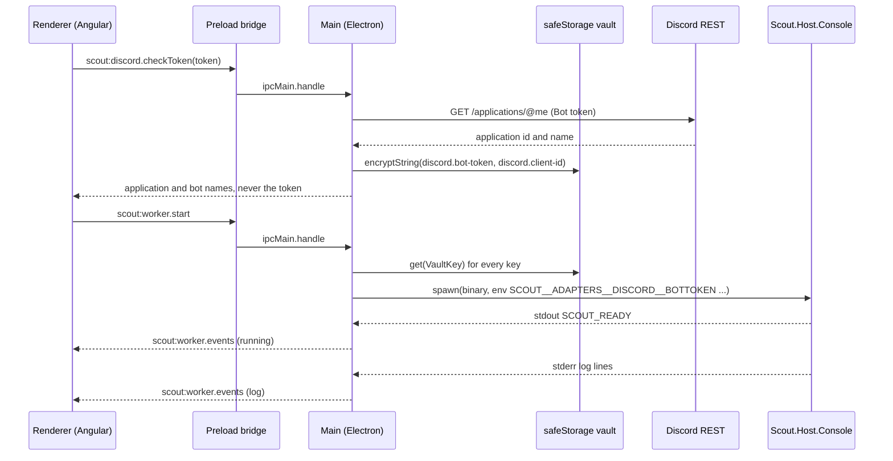

## How it works

The vault to environment mapping is `ui/packages/main/src/worker/build-env.ts`; at app start `migrateLegacyApiKey` (`ui/packages/main/src/worker/build-env.ts:235`, called from `ui/packages/main/src/main.ts:492`) moves a legacy shared cloud key into the active provider's own slot; the binary is resolved per platform and packaging mode in `ui/packages/main/src/worker/resolve-binary.ts:38`, through `resolveWorkerBinaryWithOverride` (`ui/packages/main/src/worker/resolve-binary.ts:186`, called from `ui/packages/main/src/main.ts:816`), which honours `SCOUT_WORKER_BIN` only when `app.isPackaged === false`, the seam the end-to-end tests use ([[pages/decisions/0051-desktop-end-to-end-tests]]). Crash handling is a bounded restart policy with backoff (`ui/packages/main/src/worker/supervisor.ts:218`); a crash after which no restart is scheduled carries `gaveUp: true`. `stop()` cancels a scheduled restart and resolves at once when no worker process is alive, so Quit exits during the backoff or after a crash (`ui/packages/main/src/worker/supervisor.ts:406`). Since 2026-11-08 a stop on Windows closes the worker's stdin, which the worker's parent watchdog reads as its parent gone and shuts down on (`src/Scout.Host.Console/ParentWatchdogRegistration.cs:22`); for a worker still alive after the stop timeout it runs `taskkill /pid <pid> /t /f` and kills the process itself only once taskkill has answered, so the tree walk runs while the parent still exists; a taskkill that cannot run, or gives no answer within 5 s, still ends the worker and stop resolves (`ui/packages/main/src/worker/supervisor.ts:64`, `:180`, tests `ui/packages/main/test/worker-supervisor.test.ts:270`, `:430`). POSIX sends SIGTERM, then SIGKILL. Since 2026-11-07 `start()` while the worker is starting waits for that start, the launch, the backoff before a restart or the restart attempt, and answers with the pid once the worker is running, or rejects with `worker/start-failed` once it crashes or is stopped (`whenRunning`, `ui/packages/main/src/worker/supervisor.ts:254`, `:392`); until then it answered at once with pid 0. A start that fails before the worker is spawned, a missing binary or an environment that cannot be built, now ends in `crashed`, so those waiters and a question held in quick ask are refused instead of waiting forever (`ui/packages/main/src/worker/supervisor.ts:400`). A readiness timeout reports `crashed` and still schedules a restart, so a Start pressed during that start is refused although the worker may come back. Since 2026-11-08 each `start()` and `stop()` takes a new generation (`ui/packages/main/src/worker/supervisor.ts:138`, `:396`, `:411`): a start whose environment arrives after a stop or a newer start gives up before it spawns (`:225`), so a restart asked while the worker is starting spawns one worker, and its rejection never marks the newer start crashed; the exit of a child that is no longer the current one neither schedules a restart nor reports the worker crashed or stopped, and is not passed on as an exit (`:305`, `:324`, `:374`), so Start pressed after a Stop whose worker has not exited yet leaves exactly one worker, reported as running. Tests: `ui/packages/main/test/worker-supervisor-stop.test.ts:230`, `:250`, `:262`; `ui/packages/main/test/worker-supervisor.test.ts:845`; `ui/packages/main/test/worker-supervisor.test.ts:752`, `:686`.

### Credential vault

`createVault` (`ui/packages/main/src/vault/safe-storage-vault.ts`) keeps every desktop credential and setting in `<userData>/vault.enc`, each value encrypted by Electron's `safeStorage` and written through a temporary file. Main builds it once, inside `app.whenReady` (`ui/packages/main/src/main.ts:440`), from `createProductionVaultDeps`, which passes Electron's `safeStorage` and `process.platform` (`ui/packages/main/src/vault/deps.ts:9`). The renderer reaches it only through main's vault channels (`ui/packages/main/src/ipc/vault.ts`).

- **One decision.** `availability` (`ui/packages/main/src/vault/safe-storage-vault.ts:122`) answers `isAvailable`, `scout:vault.isAvailable`, and the gate (`whenAvailable`, `:144`) that `store`, `get` and `has` pass before they touch the file. On Linux it asks `getSelectedStorageBackend` first and accepts only `gnome_libsecret`, `kwallet`, `kwallet5` and `kwallet6` (`:58`); any other value, or a lookup that throws, is refused with the reason `insecure-store`, whatever `isEncryptionAvailable` says, because `basic_text` protects data with a fixed, publicly known password. Then, on every platform, `isEncryptionAvailable() === false` is refused with `no-keyring`. On macOS and Windows the backend is never asked: the method is Linux only. A refusal rejects with `VaultUnavailableError`, `vault/unavailable`, whose message for `insecure-store` is the owner's sentence (`INSECURE_STORE_MESSAGE`, `ui/packages/shared/src/errors.ts`), and logs `vault: refused, no keyring service was selected` with the backend, once per run.
- **`unknown` is refused.** Electron documents `unknown` as the answer before the `ready` event. The vault is built after `ready`, and on Electron 45.2.3 a probe on 2026-11-10 saw `unknown` before `ready` and the selected backend after it, so `unknown` should not reach the vault; if it does, the vault cannot tell what protects the file and refuses.
- **What Electron 45.2.3 selected**, probed on 2026-11-10 in private D-Bus sessions with xvfb: with a Secret Service on the bus, `gnome_libsecret` for `XDG_CURRENT_DESKTOP` set to GNOME, COSMIC or empty, encryption available, ciphertext prefixed `v11`; KDE selects `kwallet`; with no Secret Service, `gnome_libsecret` with encryption unavailable, so `no-keyring`; `--password-store=basic` selects `basic_text` with encryption unavailable, and available, prefixed `v10`, once `setUsePlainTextEncryption(true)` is called, which Scout never does. So on this Electron the `basic_text` refusal is a second line: it holds if Electron changes its default or plain-text encryption is ever turned on.
- **`delete` is not gated.** It rewrites the file without the entry and decrypts nothing, so Disconnect and a revoked credential still clear their entry while the store is refused.
- **A file written before.** The vault refuses to read `vault.enc` while the store is refused, and leaves it as it is: no read, no write, no delete. Electron does not say under which backend an entry was written, so the rule is no keyring now, no vault now; once a keyring service is selected after a restart, entries are read again as before, including any written under `basic_text` ([[pages/roadmap/followups]], entry of 2026-11-10).
- **What the owner reads.** The shell banner (`ui/packages/renderer/src/app/shell/vault-availability-banner.component.ts`) and the Bot token step (`ui/packages/renderer/src/app/wizard/token-paste/token-paste.component.ts`) show, for `insecure-store`: "Scout found no keyring service such as GNOME Keyring or KWallet on this computer, so it saved nothing and does not use the credentials saved before; start or install one, then restart Scout." `no-keyring` keeps its earlier text, and so does a check that fails: the banner shows the unavailable warning, never hides it, and never echoes the error (`ui/packages/renderer/src/app/shell/vault-availability-banner.component.ts:53`). A refused store or read carries the same sentence as its error message, so a screen that prints that message shows it. The Bot token state is on its artboard (`context/prototypes/desktop/Wizard.dc.html`, state No keyring service).
- **Where it runs without a desktop keyring.** The end-to-end and packaged smoke runs start a private `gnome-keyring-daemon` on a private D-Bus session and pass `--password-store=gnome-libsecret` (`ui/e2e/run.sh`, `ui/e2e/fixtures/app.ts:218`, `ui/e2e/smoke/packaged-app.spec.ts:143`), so they get `gnome_libsecret`; CI's e2e job installs `gnome-keyring` and `dbus` for that runner. Unit tests use a fake `safeStorage` with the platform injected, so no row depends on the host. A session bus with no Secret Service, as in an SSH session, got `no-keyring` in the probe; a container with no session bus at all was not probed. The README's Download section and `ui/README.md` (Troubleshooting) tell a Linux user what is needed.
- **Tests.** `ui/packages/main/test/vault.test.ts:112`, the table over platform, backend and operation: `basic_text` and `unknown` refuse store, get and has with the sentence, encrypt, write and decrypt nothing, log the backend once and never a value, and still delete; the four keyring backends and darwin and win32, whose fake throws when asked for a backend, store, read, check and delete as before. `ui/packages/main/test/ipc-vault.test.ts:226`, `:234`: the reason and the sentence across `registerVaultHandlers`. `ui/packages/renderer/src/app/shell/vault-availability-banner.component.spec.ts:44` and the No keyring service row of `ui/packages/renderer/src/app/wizard/token-paste/token-paste.component.spec.ts:600`: the sentence on screen.
