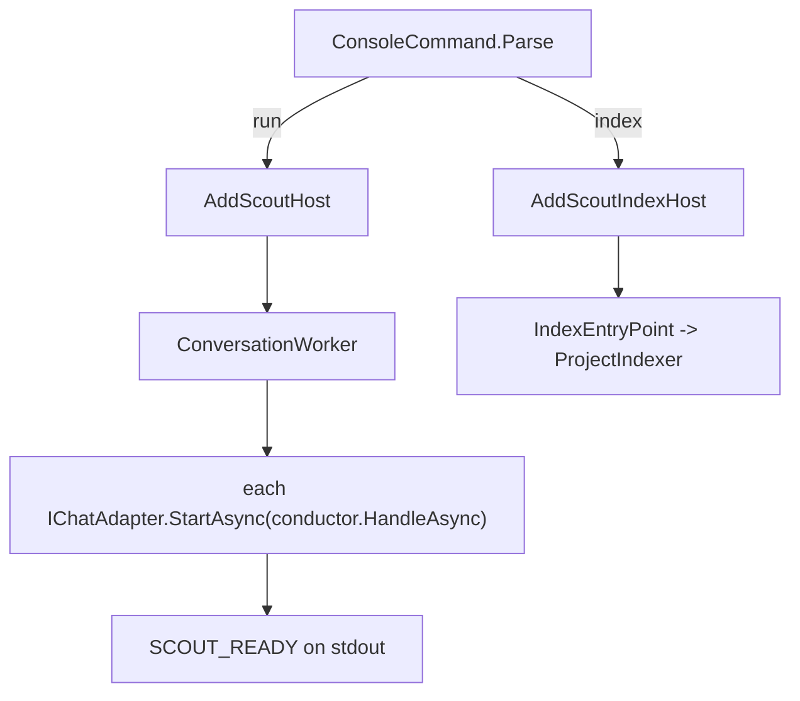

## How it works

With no adapter registered the worker writes a hint to stderr and stops the application (`src/Scout.Host.Console/ConversationWorker.cs:25`); a failing adapter start does the same (`:52`). Readiness is signalled only after every adapter has started (`:66`).

**The owner's controls** (2026-11-10). When the worker reaches the control plane, `JobControlPoller` (`src/Scout.Host.Console/JobControlPoller.cs:20`, registered at `src/Scout.Host.Console/HostComposition.cs:107`) asks for the owner's next click in Scout Desktop on a running job, through `IJobControls` on `GrpcWriteGate` (`src/Scout.Host.Console/GrpcWriteGate.cs:207`, `:224`), and applies it (`src/Scout.Host.Console/JobControlPoller.cs:161`): an audit's pause, continue or stop through the audit library's `ControlAsync`, whose answer says whether the click changed the job, the continue resuming only a paused job in the conversation it already holds ([[pages/services/audit]]); a test run's stop through the plugin's `RunningTests` (`:177`), which cancels every run of that pull request and waits up to 90 seconds (`:39`) for each to end: a run the stop cut short is `applied` with one notice, `The tests of owner/repo#N ended at your request; no result was kept.`, in the conversation it was asked from; a run that had already finished keeps its result and the click is `not applied`; a run that does not end in time is `not confirmed` ([[pages/services/plugin-github]]). Each control is settled once with its status and the sentence, which the control plane keeps in the write log as the owner's. It asks every 2 seconds (`:28`) while clicks arrive and every 10 seconds, the GitHub executor's interval, once none has come for a minute or while the control plane does not answer, back to every 2 seconds as soon as one arrives (`NextDelay`, `:66`): idle, 6 calls a minute after the first minute instead of 30, each one read of `controls.json`. A take that fails is logged once and tried on the next tick, so a control waiting is never lost; a settle that fails after the control was applied is tried again on the next tick with the same status and sentence (`:145`), and the control is never applied again; one still refused after two minutes (`:36`) is dropped and logged, so it never keeps the next click waiting, and the control plane's sweep records that control as not confirmed (`tests/Scout.Host.Console.Tests/JobControlPollerTests.cs`).

A control-plane call whose token is cancelled, as when the worker stops or restarts mid-call, ends as an `OperationCanceledException` carrying that token and never as a gRPC failure: in `GrpcOperatorControlPlane`, through which every operator call goes (`src/Scout.Host.Console/GrpcOperatorControlPlane.cs:90`), and in each call `GrpcWriteGate` makes, request, record and claim (`src/Scout.Host.Console/GrpcWriteGate.cs:96`, `:161`, `:176`). So the readiness reporter and the approved-action executor end quietly on stop, and the host does not log `BackgroundService failed` and stop as if one had failed (`tests/Scout.Host.Console.Tests/GrpcOperatorControlPlaneTests.cs:266`, `:282`, `tests/Scout.Host.Console.Tests/GrpcWriteGateTests.cs:185`, `tests/Scout.Host.Console.Tests/GitHubActionExecutorTests.cs:97`). With the token not cancelled, the mapping stays the same: a refusal the control plane words keeps its words, and anything else reads unreachable.
