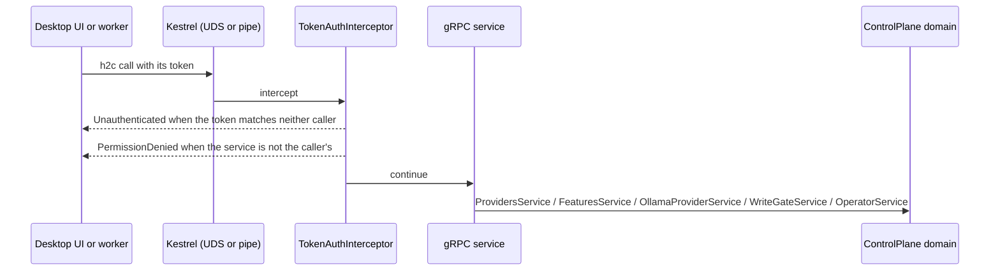

## How it works

Startup refuses to run on Unix when the native `stat` self-test fails, because the socket anti-hijack pre-flight depends on it (`src/Scout.Host.ControlPlane/Program.cs:32`). The self-test stats a regular file it has just written and passes only when the stat reports the current user as owner and a regular file as type (`src/Scout.Host.ControlPlane/Transport/NativeUnix.cs:125`), so offsets that are wrong for the machine fail it even where uid and gid are equal (`tests/Scout.ControlPlane.Tests/Transport/NativeUnixStatLayoutTests.cs:53`). On Linux `st_mode` and `st_uid` are read at 24 and 28 on x86_64 and at 16 and 24 on arm64, and any other architecture is refused (`src/Scout.Host.ControlPlane/Transport/NativeUnix.cs:133`, `tests/Scout.ControlPlane.Tests/Transport/NativeUnixStatLayoutTests.cs:17`, `:29`, `:41`). A stat that fails for another reason than a missing path, a path under a regular file for one, is `Unavailable`, and the pre-flight then refuses to bind (`tests/Scout.ControlPlane.Tests/Transport/NativeUnixStatLayoutTests.cs:68`).

After Kestrel binds, the socket mode is tightened to owner read and write (`src/Scout.Host.ControlPlane/Program.cs:53`, `src/Scout.Host.ControlPlane/Transport/ControlPlaneEndpoint.cs:108`, `tests/Scout.ControlPlane.Tests/Transport/SocketHardeningTests.cs:72`). `HardenSocket` throws when the socket is missing or its ownership cannot be verified, instead of skipping the chmod (`src/Scout.Host.ControlPlane/Transport/ControlPlaneEndpoint.cs:99`, `tests/Scout.ControlPlane.Tests/Transport/SocketHardeningTests.cs:104`). Any failure to harden is logged as Critical, "The control plane socket <path> could not be restricted to its owner; the control plane is stopping.", sets the process exit code to 1 and stops the application (`HardenSocketOrStop`, `src/Scout.Host.ControlPlane/Transport/ControlPlaneEndpoint.cs:119`, `tests/Scout.ControlPlane.Tests/Transport/SocketHardeningTests.cs:17`), so the host never keeps serving on a socket it could not restrict to its owner. On Windows the pipe is restricted to the current user (`src/Scout.Host.ControlPlane/Program.cs:12`).
