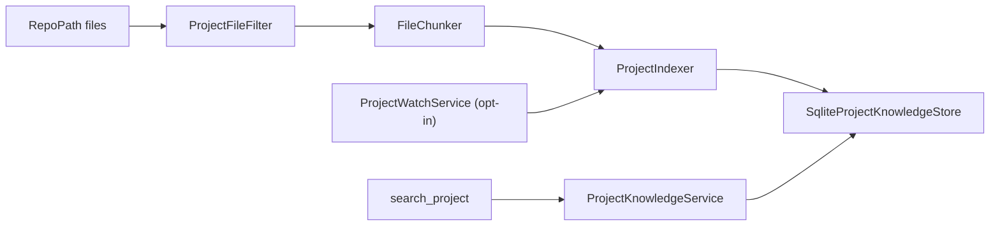

## How it works

Indexing runs from the host command `index <project>` ([[pages/services/host-console]]), from the first use of a project in a tool call, or per file from the watcher. The agent is skipped when no project is configured; the plugin stays, and with nothing registered its functions answer that no project is indexed (`src/Scout.Knowledge/KnowledgeServiceCollectionExtensions.cs:65`). The watcher is registered only when enabled and at least one item exists (`:92`). Option validation warns and never throws (`src/Scout.Knowledge/ProjectsOptionsValidator.cs:38`).
