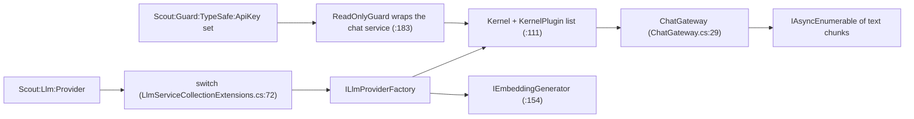

## Contract

- **Entry point:** `AddScoutLlm(IServiceCollection, IConfiguration)` at `src/Scout.Llm/LlmServiceCollectionExtensions.cs:52`.
- **Consumer abstraction:** `IChatGateway` with `StreamAsync` and `CompleteAsync` (`src/Scout.Llm/Abstractions/IChatGateway.cs:8`); request record `ChatRequest` (`src/Scout.Llm/Abstractions/ChatRequest.cs:8`) with the `Functions` the turn may call as `Plugin.function` names, null or empty for none (`:50`), the turn's `Skills` for the log (`:53`), an optional `Image`, a `ChatImage(ContentType, Bytes)` sent as an image part of the user message (`src/Scout.Llm/Abstractions/ChatRequest.cs:38`, `src/Scout.Llm/Abstractions/ChatImage.cs:9`); the signal that the provider cannot read that picture, `LlmVisionUnavailableException` (`src/Scout.Llm/Abstractions/LlmVisionUnavailableException.cs:7`); history turn `ConversationTurn` (`src/Scout.Llm/Abstractions/ConversationTurn.cs:22`); rate-limit signal `LlmRateLimitException` (`src/Scout.Llm/Abstractions/LlmRateLimitException.cs:9`); quota or billing signal `LlmQuotaExceededException` with the provider's `Code` (`src/Scout.Llm/Abstractions/LlmQuotaExceededException.cs:9`), `payment_required` for an HTTP 402 whose body names no billing code; the signal that a key-based provider rejected its key, `LlmKeyRejectedException` (`src/Scout.Llm/Abstractions/LlmKeyRejectedException.cs:8`), whose message is "The AI provider rejected its key (HTTP 401)." and never the provider's text, which can echo part of the key; the signal that the AI Source does not have the model asked for, `LlmModelNotFoundException` with the `Model` id (`src/Scout.Llm/Abstractions/LlmModelNotFoundException.cs:8`), whose message is "The AI Source does not have the model <id> (HTTP 404).", the id "it is set to use" when the chat service names none, never the provider's text. `LlmSignInRequiredException` stays the ChatGPT plan's: its sentence names the ChatGPT sign-in, and the plan's 401 is turned into it by the token policy before the gateway sees a status.

## How it works

**Turn attachments** (ADR 0040 v1.1, 2026-11-06). `TurnAttachments` (`src/Scout.Llm/Abstractions/TurnAttachments.cs`) is the per-turn collector beside `TurnProgress`, an `AsyncLocal` slot the conversation opens with `Begin()` for each turn: a function attaches a fenced block with `Attach(block)` (at most 4 blocks of 64,000 characters; a block whose first line matches one attached replaces it), the pump takes them once at the end with `Take()`, and an attach outside a turn is dropped; the GitHub plugin's `present_review_findings` is its first user ([[pages/services/plugin-github]], [[pages/services/conversation]]). Tests: `tests/Scout.Llm.Tests/Abstractions/TurnAttachmentsTests.cs`.

**Read outcome** (2026-11-09). `ReadOutcome` (`src/Scout.Llm/Abstractions/ReadOutcome.cs:11`) is a per-call signal shaped like `TurnAttachments`, an `AsyncLocal` slot: a caller that counts what was read, the audit's files read ([[pages/services/audit]]), opens a scope with `Begin()` around one function call (`:19`), the read function calls `MarkNoContent()` when its answer is not the content it was asked for (`:28`), and the caller reads `Scope.NoContent` before it disposes the scope, which restores the scope that was watched before (`:40`, `:43`). Every scope starts unmarked, a mark made inside a call never reaches the call after it, the call around it or another call running at the same time, and a mark outside a scope is dropped, so a read in a chat turn behaves as before. The answer the model receives is the same either way; the GitHub plugin's `get_file_contents` is its first marker ([[pages/services/plugin-github]]). Tests: `tests/Scout.Llm.Tests/Abstractions/ReadOutcomeTests.cs`.

**Activity filter** (ADR 0013 amendment of 2026-11-06). `ActivityFilter` (`src/Scout.Llm/Guard/ActivityFilter.cs:13`), registered on every kernel before the write gate (`src/Scout.Llm/LlmServiceCollectionExtensions.cs:136`), reports each function the model calls to `TurnProgress` (`src/Scout.Llm/Abstractions/TurnProgress.cs:8`), the async-local the conversation conductor routes to the turn's sink: the function name as a sentence plus the short values of the arguments on an allow-list of names that identify a thing (`:40`; `owner`, `repo`, `number`, `path`, `reference`, `query`, `prefix`, `extension`, `extensions`, `project`, `symbol`, `name`, `namespace`, `context`, `kind`, `state`, `id`, `file`, `language`, `limit`, `page`, `since`; at most 80 characters each, 160 in all, nothing multi-line; a body, a label, a token or an unknown name never reaches the chat, [[pages/invariants/secrets-never-in-source]]), read from CLR values or the `JsonElement`s the Ollama and Gemini connectors hand over, so the desktop can say "Get pull request file: octocat hello 42 src/Checkout.cs" while the reply is still empty. A report that throws never stops the function (`tests/Scout.Llm.Tests/Guard/ActivityFilterTests.cs:53`); outside a turn a report goes nowhere, and a turn entered inside another restores the outer routing when it ends (`tests/Scout.Llm.Tests/Guard/ActivityFilterTests.cs:123`).
