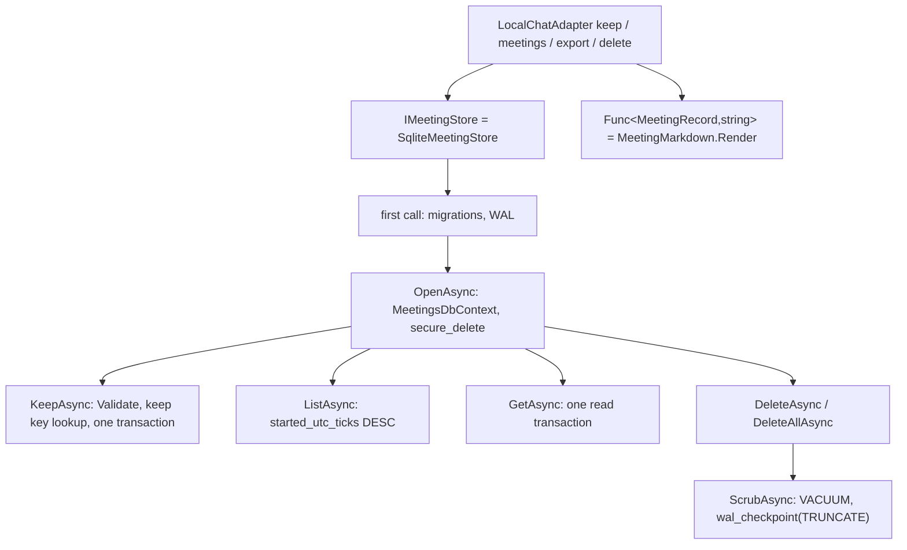

## How it works

- **Schema:** Entity Framework Core through the internal `MeetingsDbContext` and its `Initial` migration, never SQL in code for a query ([[pages/decisions/0052-persistence-behind-stores-on-entity-framework]]): `schema_version` holding one row, version 1 (`src/Scout.Meetings/Storage/MeetingsDbContext.cs:27`), and `meetings(number, id, started_at, started_utc_ticks, ended_at, title)`, `lines(meeting_id, seq, at, lane, text, translation, language)` and `turns(meeting_id, seq, at, question, answer, screenshot, transcript, screen_text)`, both keyed by meeting and seq and deleted with their meeting (`:42`, `:43`), and `keeps(key, meeting_id)` keyed by the keep key, its row going with its meeting (`:79`). `number` keeps the order meetings were kept in and `started_utc_ticks` the start as a UTC instant; times are stored as text with their offset, so a time read back carries the offset the desktop sent.
- **First call:** the store opens the file for writing, applies the migrations it lacks and sets `journal_mode = WAL`, once per store (`src/Scout.Meetings/SqliteMeetingStore.cs:231`, `:250`); a failed attempt is tried again on the next call. A file with tables and no migration history, which an older build wrote, is deleted with its `-wal` and `-shm` and created again (`:259`), its meetings lost, but only when every table it holds is one the store knows: the model's, Entity Framework's own, and `schema_version`, `meetings`, `lines`, `turns` and `keeps` of the schema before Entity Framework (`:261`); a file with any other table is never deleted and the call fails with `Scout could not <operation> the meetings database: it holds tables Scout did not create, so Scout left it as it is.`; a file Scout cannot delete, in a folder it cannot write to, fails with the exception type and stays where it is; a file that is not a database is never deleted and fails with error 26. Resolving the store opens no file. The host runs this step right after `SCOUT_READY`, through one list of a single meeting ([[pages/services/host-console]]), so a meetings request 3 s after ready answered in 73 ms against 247 ms without it (median of 5, 2026-11-08).
- **Open:** one context per call over the pooled connections, foreign keys on through the connection string, and `PRAGMA secure_delete = ON` on the call's connection (`src/Scout.Meetings/SqliteMeetingStore.cs:213`, `:220`).
- **Keep** (`src/Scout.Meetings/SqliteMeetingStore.cs:46`): `Validate` first (`:195`), so a meeting past the limits throws `ArgumentException` before anything is opened and nothing is stored. The limits (`:19` to `:22`): a title of 1 to 200 characters, not blank; at most 5,000 lines of at most 2,000 characters; at most 500 turns. The id is 16 random bytes in base64url, 22 characters (`:49`), and the meeting, its lines and its turns are inserted in one transaction (`:53`, `:94`), each line and turn numbered from 1 in the order given. With a keep key, the transaction first looks the key up in `keeps` and, when it is there, answers the id kept under it and writes nothing (`:56`); otherwise the key row goes in with the meeting (`:90`). So a retry of a keep whose `kept` never reached the desktop, after main's 30 s guard or a worker exit, keeps the meeting once, and keeps under different keys each get their own id. `keeps.key` is the primary key, so of two keeps racing under one key only one can commit; the other fails on the constraint and stores nothing.
- **List** (`src/Scout.Meetings/SqliteMeetingStore.cs:104`): newest first by `started_utc_ticks` (`:190`, the query `Newest`, `:188`), which compares the instants whatever their offsets, then by the order kept, read in that order from the index `IX_meetings_started_utc_ticks_number` (`src/Scout.Meetings/Storage/MeetingsDbContext.cs:35`) so the list neither reads the whole table nor sorts, and stops after the limit (`tests/Scout.Meetings.Tests/SqliteMeetingStoreTests.cs:453`, which reads SQLite's plan for the query's own SQL); each summary carries its line and turn counts.
- **Get** (`src/Scout.Meetings/SqliteMeetingStore.cs:119`): the meeting, its lines and its turns in seq order, inside one read transaction (`:125`), or null.
- **Delete** (`src/Scout.Meetings/SqliteMeetingStore.cs:156`, `:173`): one `DELETE` of the meeting rows, and the database's cascade takes their lines, turns and keep key (`:162`, `:178`); then `VACUUM` rebuilds the file and `PRAGMA wal_checkpoint(TRUNCATE)` empties the write-ahead log (`:283`). Delete all answers how many meetings that `DELETE` removed, their cascaded lines and turns not counted, so the local adapter reports the count without listing the meetings (`:180`, since 2026-11-11). `secure_delete` alone overwrote the freed pages but left 704 of them on the free list; without the checkpoint the deleted text stayed in `meetings.db-wal` (both measured by the Gate 5 mutations of 2026-11-04). A checkpoint another connection's read holds back truncates nothing, and the busy flag it answers is not read, so a list racing a delete can leave the text in the log until the next delete. The scrub runs after the delete has committed and does not take the caller's cancellation token, so a Stop that cancels the request cannot leave the deleted text on disk; it also runs when the delete finds nothing and answers false, so a retry of a delete whose scrub failed repairs it. The pragmas and the scrub are the SQL the store keeps, because Entity Framework has no API for them.
- **Errors:** every `SqliteException`, and a write refused inside `SaveChanges` as the `SqliteException` in the `DbUpdateException`, becomes a `MeetingStoreException` "Scout could not <save|list|read|delete> the meetings database (SQLite error <code>)." (`src/Scout.Meetings/SqliteMeetingStore.cs:286`, `:289`); an `IOException` or `UnauthorizedAccessException` of the file, as when an older build's file cannot be deleted, becomes the same sentence with the exception type in place of the code, and a file with tables Scout did not create the sentence above; never with a title, a line, a turn or a keep key in it.
- **Markdown** (`src/Scout.Meetings/MeetingMarkdown.cs:15`): `# <title>`, the start and end as `yyyy-MM-dd HH:mm:ss zzz`, `## Transcript` with one `- [HH:mm:ss] You|Others: text` item per line, `me` being You and anything else Others (`:31`), and a nested `- (<language>) <translation>` item when there is a translation (`:33`); then `## Questions`, a `### [HH:mm:ss] <question>` heading per turn, `_With screenshot, transcript, screen text_` naming the flags that were set (`:55`), and the answer as written (`:57`). Titles, lines and questions are folded onto one line (`:80`), times are written in the offset each carries (`:82`) and every line ends in `\n`, so the same meeting always renders the same text.
