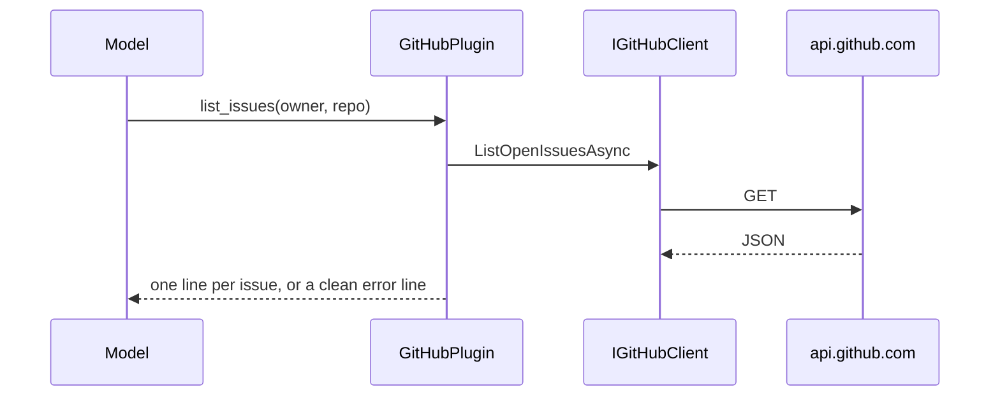

## How it works

With a token file, `GitHubTokenFileHandler` (`src/Scout.Plugin.GitHub/GitHubTokenFileHandler.cs:14`) sets the bearer header on every request from the file, and re-reads the file whenever its write time changes (`:40`), so the token the desktop refreshes every 8 hours is used without a restart. A missing, empty, unparsable or unreadable file throws `GitHubApiException` with "GitHub is not connected. Connect it on the Features screen." before any request leaves the process (`:70`). A 401 on a request that used the file becomes "GitHub rejected the connection. Disconnect and connect GitHub again on the Features screen." (`:35`, `tests/Scout.Plugin.GitHub.Tests/GitHubTokenFileHandlerTests.cs:113`); a 401 for a configured `Token` keeps "Check the configured token" (`:129`). Neither message carries the token or the file contents.

Every function catches `GitHubApiException`, `HttpRequestException` and `OperationCanceledException` and returns a user-safe string, so a tool call never throws into the kernel (`src/Scout.Plugin.GitHub/GitHubPlugin.cs:180`, `tests/Scout.Plugin.GitHub.Tests/GitHubPluginReadsTests.cs:358`). `get_repository` assembles metadata, languages, README excerpt and top-level entries from several GETs, treating 404 as absent (`src/Scout.Plugin.GitHub/GitHubClient.cs:54`).
