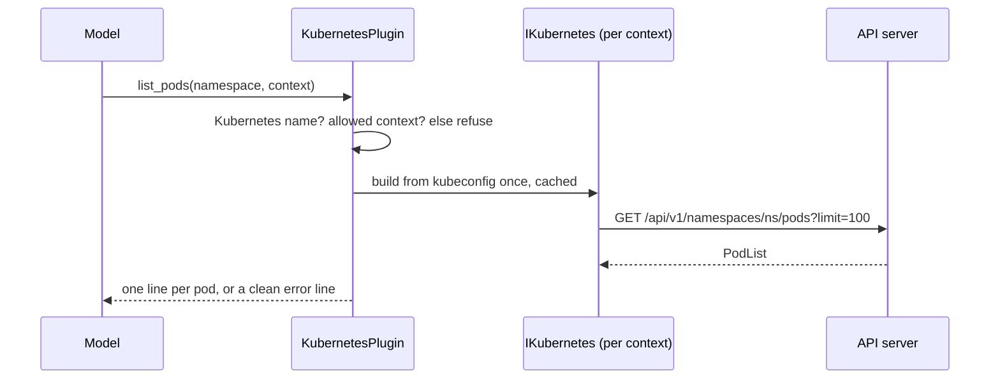

## How it works

**Model input never shapes a path.** KubernetesClient builds the request path by concatenating the namespace and the pod name, so a value like `../secrets/x` or `x/services/y:80/proxy/z` would reach another API, and the pod name also goes into the events field selector. Before any client is built, a namespace must match the DNS-1123 label pattern (63 characters at most) and a pod name the DNS-1123 subdomain pattern (253 at most), anchored with `\z` (`src/Scout.Plugin.Kubernetes/KubernetesPlugin.cs:215`, `src/Scout.Plugin.Kubernetes/KubernetesPlugin.cs:218`); anything else answers "'<value>' is not a valid Kubernetes namespace." or "... pod name.", quoting at most 63 characters (`src/Scout.Plugin.Kubernetes/KubernetesPlugin.cs:223`).

`RunAsync` (`src/Scout.Plugin.Kubernetes/KubernetesPlugin.cs:235`) then resolves the context (omitted means the first allowed one), matches the requested label (trimmed, any case) to its context name, refuses any other value, a raw context name included, with "That is not a context Scout may read. Allowed contexts: <labels>." before a client exists (`src/Scout.Plugin.Kubernetes/KubernetesPlugin.cs:244`), gets the context's client and runs the read. Each context gets one client through a `Lazy` with `ExecutionAndPublication` (`src/Scout.Plugin.Kubernetes/KubernetesPlugin.cs:289`), so concurrent first calls build it once; a failed build is dropped from the cache, so the next call tries again. The client comes from `KubernetesClientConfiguration.BuildConfigFromConfigFile(path, context)` (`src/Scout.Plugin.Kubernetes/KubernetesPlugin.cs:305`). The library's `ExecTokenProvider` still runs an exec command a second time on the client's first request, without a lock, so one client build can mean two runs of the command (a `ponytail:` line there).

A pod line carries phase, ready containers, restarts and the first waiting or terminated reason, such as `CrashLoopBackOff` or `ImagePullBackOff`. `describe_pod` adds one line per container and the last 20 events (`src/Scout.Plugin.Kubernetes/KubernetesPlugin.cs:24`) of that pod, which a field selector picks on the server (`src/Scout.Plugin.Kubernetes/KubernetesPlugin.cs:133`). `list_pods`, `list_deployments` and `list_namespaces` ask the server for at most 100 items and end with "...and N more; ask about one namespace to narrow it." from the list's `remainingItemCount`, or "...and more; ..." when only a continue token comes back (`src/Scout.Plugin.Kubernetes/KubernetesPlugin.cs:313`). `list_events` keeps events seen in the last `sinceMinutes`, clamped to 1 to 1440 (`src/Scout.Plugin.Kubernetes/KubernetesPlugin.cs:191`), warnings first, cut at 100 lines (`src/Scout.Plugin.Kubernetes/KubernetesPlugin.cs:325`); it fetches every event the server keeps and filters locally (a `ponytail:` line). An event message longer than 200 characters is cut with "...".

Failures never quote the cluster's answer or the library's text: 401 and 403 answer "The credentials for context X cannot read Y." (`src/Scout.Plugin.Kubernetes/KubernetesPlugin.cs:272`), a refused connection "Could not reach the cluster for context X." (`src/Scout.Plugin.Kubernetes/KubernetesPlugin.cs:279`), a request timeout says the cluster did not answer within 15 seconds while a caller's own cancellation propagates (`src/Scout.Plugin.Kubernetes/KubernetesPlugin.cs:283`), an exec credential command that fails or hangs "The command that gets the token for context X failed." and any other kubeconfig problem "The Kubernetes configuration for context X could not be read." (`src/Scout.Plugin.Kubernetes/KubernetesPlugin.cs:334`).
