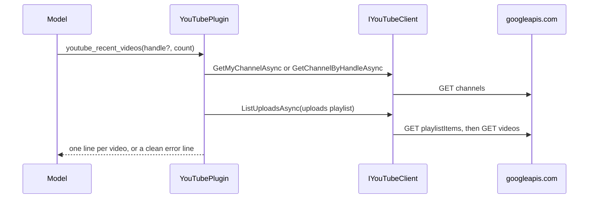

## How it works

With a token file, `YouTubeTokenFileHandler` (`src/Scout.Plugin.YouTube/YouTubeTokenFileHandler.cs:14`) sets the bearer header from the file on every request and re-reads it when its write time changes (`:37`), so the token the desktop refreshes is used without a restart. A missing, empty, unparsable or unreadable file throws "YouTube is not connected. Sign in from the Scout app." before any request leaves the process (`:67`). A 401 on a signed-in request becomes "The YouTube sign-in is no longer valid. Sign in again in the Scout app." (`:32`). With a key, `YouTubeApiKeyHandler` (`src/Scout.Plugin.YouTube/YouTubeApiKeyHandler.cs:8`) appends `key=<ApiKey>` to the query string; the key is in no header.

Every non-success status is mapped in one place (`src/Scout.Plugin.YouTube/YouTubeClient.cs:156`), the search included: 401 asks to sign in again; on the `mine=true` call a 401 instead says "Sign in from the Scout app to read your own channel; an API key reads public channels by handle only." (`:160`), which only a key can reach because the token handler answers 401 first, while a 400 there gets the plain-reason message below; 403 with reason `quotaExceeded` or `dailyLimitExceeded` in Google's error body is the quota message, any other 403 "The YouTube credentials cannot read this."; 404 is not found; 400 names Google's reason only when it is a plain identifier (`:191`); 5xx is "currently unavailable". A 200 whose body is not JSON (a proxy or captive-portal page) becomes "YouTube returned an unexpected response." (`:150`). No message carries the request URL, the key, the token or Google's own message text. Timeouts and transport faults bubble unchanged, and every function catches them and returns a clean line, so a tool call never throws into the kernel (`src/Scout.Plugin.YouTube/YouTubePlugin.cs:191`).

`YouTubeWriteClient.UploadVideoAsync` (`src/Scout.Plugin.YouTube/YouTubeWriteClient.cs:61`) refuses a title or description holding `<` or `>` before any request, then opens a resumable session (`POST upload/youtube/v3/videos?uploadType=resumable&part=snippet,status` with `X-Upload-Content-Length`, `X-Upload-Content-Type: video/mp4` and the snippet and status: title, description, tags, category, the language code when there is one, privacy, `publishAt` when scheduled, `selfDeclaredMadeForKids`, `containsSyntheticMedia`) and PUTs the file to the session address, which must be HTTPS on `www.googleapis.com` or nothing is sent there (`:269`). The session lives in the caller's `UploadSession`, so a later call with the same instance asks that session first instead of opening a new one (`:82`). A PUT that runs longer than 5 minutes plus the bytes left at 100 KB a second counts as stalled and is cancelled (`:278`). After a 5xx, a dropped connection, a timeout, a stall or a 308 answer to the PUT itself it asks the session with `Content-Range: bytes */<total>`: a 308 with `Range: bytes=0-N` resumes from byte N+1 (`:318`), a 308 without it sends the whole file again, a 200 or 201 is the finished upload, and a 404 opens a new session and starts over; at most 5 attempts, 2 s apart then doubling, then "The upload to YouTube kept failing; Scout tries again later.", retryable. Any other 4xx is mapped and not retried. `SetThumbnailAsync` (`:129`) posts the PNG or JPEG bytes, refuses a file over 50 MB, and turns a 403 that is not a spent quota into "YouTube refused the thumbnail: custom thumbnails need a verified channel (verify it at youtube.com/verify), or the sign-in does not allow Scout to change this video." `UpdateTitleAsync` (`:151`) reads the snippet, sends nothing when the title is already the one asked for, and otherwise sends the snippet back whole with the new title (category, description, tags, language as YouTube holds them), because `videos.update` replaces every property of the parts it is sent. A 403 whose reason is `insufficientPermissions`, a sign-in without the upload scope, reads "YouTube needs the upload permission: open the YouTube card in Scout Desktop and allow writes again." and is retryable, on the upload and on the thumbnail (`src/Scout.Plugin.YouTube/YouTubeWriteClient.cs:366`); a 429 on a write reads "YouTube's upload rate limit is reached for now; Scout tries again later." (`:351`); every other status goes through the read client's mapping (`src/Scout.Plugin.YouTube/YouTubeClient.cs:156`), a 403 that is not a quota reading "The YouTube sign-in does not allow Scout to change this video; sign in again in Scout Desktop." `ReplyToCommentAsync` (`src/Scout.Plugin.YouTube/YouTubeWriteClient.cs:211`) posts `{"snippet":{"parentId":<id>,"textOriginal":<text>}}` to `comments?part=snippet` and answers the id of the comment YouTube returns, or "YouTube took the reply but returned no id for it."; every failure carries the status YouTube answered, a success status when YouTube took the reply but its answer could not be read or held no id (`:227`), and no status only when nothing was sent, so the operator can tell a reply that may be on YouTube from one that surely is not ([[pages/services/operator]]); `HoldCommentAsync` (`:235`) posts nothing to `comments/setModerationStatus?id=<id>&moderationStatus=heldForReview`, never `rejected`, `published` or `banAuthor`. Both fail through the write mapping above with the comment's own sentence for a 403 that is neither a spent quota nor a missing permission, "YouTube refused the change to this comment: it may have been deleted, or the sign-in does not allow Scout to change it." (`:45`, `:219`), because Google answers 403 for a deleted comment too; a 403 `insufficientPermissions` reads "YouTube needs Scout's permission to reply to and moderate comments: open the YouTube card in Scout Desktop and allow writes again." and is retryable (`:48`, `:243`). Google's reference pages, read 2026-11-03 (each "Last updated 2026-10-15 UTC"): `commentThreads.list` (https://developers.google.com/youtube/v3/docs/commentThreads/list) lists `allThreadsRelatedToChannelId` as one of its three filters, "return all comment threads associated with the specified channel", costs 1 unit, takes `maxResults` 1 to 100, `order` `time` by default, and `textFormat` `html` by default or `plainText`; its `moderationStatus` defaults to `published`, so threads held for review or likely spam are not returned unless asked for, and Scout does not ask. The page names no scope for the call; Scout's own call with `allThreadsRelatedToChannelId` and a token holding only `youtube.readonly` and `yt-analytics.readonly` was refused 403 `insufficientPermissions` on 2026-11-03, so the read needs `youtube.force-ssl`. `comments.insert` (https://developers.google.com/youtube/v3/docs/comments/insert) "Creates a reply to an existing comment", needs `snippet.textOriginal` and `snippet.parentId` and the `youtube.force-ssl` scope, and costs 50 units; the page does not say in words that the parent must be top-level, but its `operationNotSupported` error speaks of "the top-level comment identified by the snippet.parentId property", and Scout always passes the top-level comment's id. `comments.setModerationStatus` (https://developers.google.com/youtube/v3/docs/comments/setModerationStatus) takes up to 50 ids and `heldForReview`, `published` or `rejected`, allows `banAuthor` only with `rejected`, needs the owner of the channel or video and `youtube.force-ssl`, costs 50 units, and answers 204 No Content. The comment's `textOriginal` is returned only to its author, so the client reads `textDisplay`, plain text with `textFormat=plainText`, which YouTube says may differ from the original, for example a video link replaced by its title. The Analytics client reads the report's columns by name and fails with "YouTube Analytics returned a report Scout could not read." on a table it cannot read; no row means no data yet. The Reporting client reads the reach CSV by its header (`date`, `video_id`, `video_thumbnail_impressions`, `video_thumbnail_impressions_ctr`), and a missing column, a short row or a value that is not a number fails the whole report with "YouTube returned a reach report Scout could not read." (`src/Scout.Plugin.YouTube/YouTubeReportingClient.cs:79`); Google's metrics page (https://developers.google.com/youtube/reporting/v1/reports/metrics, read 2026-11-03) defines `video_thumbnail_impressions_ctr` as "The percentage of impressions that resulted in a click to watch the video. This is calculated as clicks divided by impressions.", which names a percentage but describes a fraction; the client reads it as a fraction, and a report holding any rate above 1 as percent, every rate in it divided by 100 (`src/Scout.Plugin.YouTube/YouTubeReportingClient.cs:100`). A download address that is not HTTPS on `youtubereporting.googleapis.com` is refused before any request (`:65`).

`youtube_video_stats` takes ids or links (`youtube.com/watch?v=`, `youtu.be/`, `youtube.com/shorts/`) separated by commas or spaces, extracts the 11-character ids (`src/Scout.Plugin.YouTube/YouTubePlugin.cs:188`), looks up the first 50 distinct ones in one call, and ends with a "Not found:" line for ids YouTube did not return and tokens that are not a video, then a "Not looked up" line for any id past the fiftieth (`tests/Scout.Plugin.YouTube.Tests/YouTubePluginTests.cs:113`). Counts are formatted with invariant thousands separators; a count the channel hides reads "hidden".
