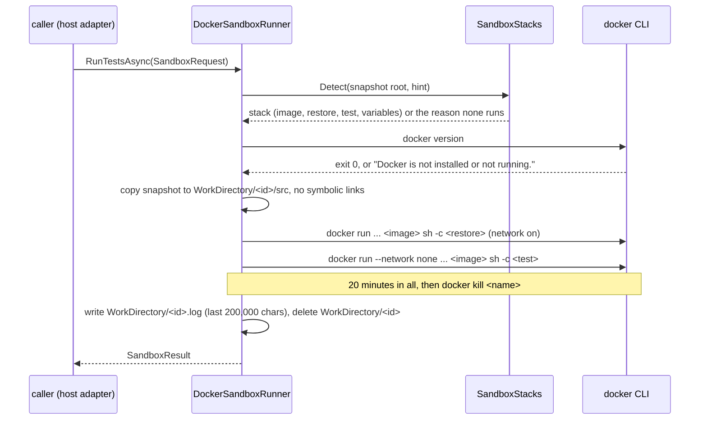

## How it works

- **Stacks** (`src/Scout.Sandbox/SandboxStacks.cs:98`): manifests at the snapshot's root only, in the order .NET, Node, Python, Go, Java; a `StackHint` (`dotnet`, `node`, `python`, `go`, `java`) picks one of the five and never names an image. A stack whose manifest is there but whose version Scout refuses ends the detection with its refusal; the next stack's manifest never runs in its place.

  | Stack | Manifest | Restore (network) | Tests (`--network none`) | Variables under `/work` |
  |---|---|---|---|---|
  | .NET | first `*.slnx`, else `*.sln`, else `*.csproj` | `dotnet restore '<file>'`; on the SDK 8 image first `mkdir -p` and `touch /work/cache/home/.local/share/NuGet/Migrations/1` | `dotnet test '<file>' --no-restore`, plus `--filter 'Category!=Docker'` when a `*.cs` file marks tests `Trait("Category", "Docker")` (below) | `HOME`, `DOTNET_CLI_HOME`, `NUGET_PACKAGES`, `DOTNET_NOLOGO`, `DOTNET_CLI_TELEMETRY_OPTOUT`; `DOTNET_ROLL_FORWARD=Major` without a `global.json` SDK, or when its `rollForward` is `major` or `latestMajor` |
  | Node | `package.json`, by lockfile | `npm ci` (`npm install` without one), `corepack pnpm install --frozen-lockfile`, `corepack yarn install --frozen-lockfile` | `npm test`, `corepack pnpm test`, `corepack yarn test` | `HOME`, `npm_config_cache`, `COREPACK_HOME`, `COREPACK_ENABLE_DOWNLOAD_PROMPT=0`; tests add `npm_config_offline=true` |
  | Node with Bun | `package.json` and `bun.lock` or `bun.lockb`, no npm, pnpm or yarn lockfile | `bun install --frozen-lockfile` | `bun run test`, or `bun test` when `package.json` has no `test` script | `HOME`, `BUN_INSTALL_CACHE_DIR`, `DO_NOT_TRACK=1`; Bun has no offline variable, so the tests rely on `--network none` alone |
  | Python | `requirements.txt`, `pyproject.toml` | `python -m venv /work/cache/venv && .../pip install pytest [-r requirements.txt] [-e .]` | `/work/cache/venv/bin/python -m pytest` | `HOME`, `PIP_CACHE_DIR`; tests add `PIP_NO_INDEX=1` |
  | Go | `go.mod` | `go mod download` | `go test ./...` | `HOME`, `GOPATH`, `GOMODCACHE`, `GOCACHE`, `GOFLAGS=-mod=mod -modcacherw`, `GOTOOLCHAIN=local`; tests add `GOPROXY=off` |
  | Java with Maven | `pom.xml` (wins over a Gradle file beside it) | `mvn -B -ntp test -Dtest='*#scoutRestoreSelectsNoTest' -Dsurefire.failIfNoSpecifiedTests=false`: compiles and resolves everything `test` needs, the Surefire provider included, and selects no test, so no test runs with the network | `mvn -B -ntp -o test` | `HOME`, `MAVEN_OPTS=-Dmaven.repo.local=/work/cache/m2 -Duser.home=/work/cache/home`, `MAVEN_CONFIG=/work/cache/home/.m2` (the official image's entrypoint copies its reference settings there instead of failing on `/root/.m2`) |
  | Java with Gradle | `build.gradle`, `build.gradle.kts`, `settings.gradle` or `settings.gradle.kts` | the image's `gradle --no-daemon` with a Scout init script written to `/work/cache/scout-restore.gradle` that adds a `scoutResolve` task whose input is each project's `testRuntimeClasspath`, run as `testClasses scoutResolve` (`testClasses` alone leaves the test engine and launcher unresolved, and the offline run fails) | `gradle --no-daemon --offline test` | `HOME`, `GRADLE_USER_HOME=/work/cache/gradle` |

  A Bun repository runs in the pinned `oven/bun` image (`src/Scout.Sandbox/SandboxNode.cs:125`), under the stack name `node`. On the SDK 8 image the restore first marks NuGet's one migration done in the fresh home (`src/Scout.Sandbox/SandboxDotNet.cs:31`): the .NET 8 SDK's first run takes a named mutex for that migration, and it fails ("The system cannot open the device or file specified. : 'NuGet-Migrations'") for a uid the image's `/etc/passwd` does not list, which the owner's uid is. Found on 2026-11-07 under these flags: it fails as uid 1000 with or without `--read-only`, `--cap-drop ALL` and the tmpfs, and runs as uid 1654, which the image lists; the SDK 9 and 10 images run their first run as uid 1000 without the marker, so only SDK 8 gets it. The repository's Gradle wrapper (`./gradlew`) never runs: it downloads a distribution the repository chose, so the pinned image's `gradle` runs and the note says so. A `Command` in the request replaces the test command, as one `sh -c` word on the offline run; the GitHub plugin chooses it and never passes a CI line that cannot run over a fresh snapshot, such as a `dotnet test --no-build` or a runner of another stack ([[pages/services/plugin-github]]).

- **Tests that need Docker** (2026-11-12, issue 372, [[pages/decisions/0043-the-verdict-on-a-pull-request]] amendment). The container has no Docker daemon, so a .NET test marked for one cannot pass there. The .NET stack reads the snapshot's `*.cs` files as text, as it reads `global.json` and the project files, and counts those that contain `Trait("Category", "Docker")`, spaces allowed inside the parentheses (`src/Scout.Sandbox/SandboxDotNet.cs:47`, `:140`): it skips `bin`, `obj`, `.git` and `node_modules`, symbolic links (files and folders), files over 1 MB, and a folder or file it cannot read, which counts as not declaring (`:158`). Only when the count is above zero does the stack's own test command become `dotnet test '<file>' --no-restore --filter 'Category!=Docker'` (`:126`), and the stack carries the sentence "Left out the tests marked Category=Docker, found in N file(s): the container has no Docker daemon." (`SandboxStack.LeftOut`, `src/Scout.Sandbox/SandboxStacks.cs:19`; `src/Scout.Sandbox/SandboxDotNet.cs:132`). The filter is a constant in Scout's code; the repository only declares a fact, a trait, and never a command. The runner appends that sentence to the note, after a space, only when the stack's own test command ran; a `Command` from the caller replaces the test command whole and is never altered, so its note says nothing was left out (`src/Scout.Sandbox/DockerSandboxRunner.cs:131`). A failed restore keeps the stack's note alone, since no test ran. A repository without the trait gets the command it got before, byte for byte (`tests/Scout.Sandbox.Tests/SandboxStacksTests.cs:19` to `:21`). The note carries a count, never a path. A text match inside a comment or a string adds a filter that excludes nothing; a pull request can hide a failing test by marking it, which the note states on every run and the diff shows ([[pages/roadmap/followups]]).

- **Scout's own repository in its sandbox** (proved by hand on 2026-11-12, issue 372). A copy of the working tree, restored with `dotnet restore 'Scout.slnx'` and tested with `dotnet test 'Scout.slnx' --no-restore --filter 'Category!=Docker'` in the pinned SDK 10 image under the runner's flags (`--network none` for the tests, the owner's uid, `--read-only`, `--cap-drop ALL`, pids 512, 4 GB, 2 CPUs), on the native engine: both exited 0 (the restore in 27 s, the tests in 3 min 51 s, well inside the runner's 20 minutes), no "Failed!" line, Skipped 0 in all 19 test projects. The image has no libgomp, so the Whisper tests took their no-runtime branch and passed (70). Each project's total equals `tools/checks/test-per-project.sh`'s on the host, Scout.Sandbox.Tests aside (261 against 271, its 10 `Category=Docker` tests left out), so the solution-wide filter leaves the projects without that trait running all their tests. Nothing in CI repeats it ([[pages/roadmap/followups]]).

- **Java versions** (`src/Scout.Sandbox/SandboxJava.cs:29`). The owner on 2026-11-07: someone who uses Java must get their stack exactly. The repository names a version, never an image; the version is read from its files as text or XML (`DtdProcessing.Prohibit`; a malformed `pom.xml` reads as declaring nothing), never by running the build, and mapped to this table:

  | Tool | Tool version in the image | JDK |
  |---|---|---|
  | Maven (`maven:3-eclipse-temurin-<N>`) | 3.10.0 | 8, 11, 17, 21, 25 |
  | Gradle 7 (`gradle:7-jdk<N>`) | 7.6.6 | 8, 11, 17 |
  | Gradle 8 (`gradle:8-jdk<N>`) | 8.14.6 | 8, 11, 17, 21 |
  | Gradle 9 (`gradle:9-jdk<N>`) | 9.8.2 | 17, 21, 25 |

  The declared JDK, first match wins, `1.8` read as 8 and a `${property}` resolved once against the pom's own properties (an unresolved one falls through):
  - Maven (`src/Scout.Sandbox/SandboxJava.cs:180`): `maven.compiler.release`, then `maven.compiler.source`, then `maven.compiler.target`, then `<release>` in the `maven-compiler-plugin` configuration, then the `java.version` property, then `.java-version`, then `java=` in `.sdkmanrc`.
  - Gradle (`src/Scout.Sandbox/SandboxJava.cs:230`), over `build.gradle` and `build.gradle.kts`: `JavaLanguageVersion.of(N)` or Kotlin's `jvmToolchain(N)`, then `sourceCompatibility`, then `targetCompatibility` (a quoted or bare number or `JavaVersion.VERSION_N`), then `.java-version`, then `.sdkmanrc`.
  - The Gradle major is the one in `gradle/wrapper/gradle-wrapper.properties`' `distributionUrl`, of which only the version number is read (`src/Scout.Sandbox/SandboxJava.cs:270`); without one, Gradle 8.

  A declared JDK in the table runs exactly that JDK. Nothing declared runs Java 21 (for Gradle 7, its newest, 17), and the note says "No Java version was declared; ran on Java 21 ...". A version the table lacks runs nothing, and the reason names both: "This project asks for Java 23; Scout runs Java 8, 11, 17, 21 and 25." (`src/Scout.Sandbox/SandboxJava.cs:165`), "This project asks for Gradle 6; Scout runs Gradle 7, 8 and 9.", "This project asks for Gradle 9 on Java 8; Scout runs Gradle 9 on Java 17, 21 and 25.". Every Java note names the JDK and the tool: "Ran on Java 17 with Maven 3.10.0.", "Ran on Java 17 with Gradle 7.6.6 from the image, not the repository's wrapper; the wrapper asks for Gradle 7.6.1."
