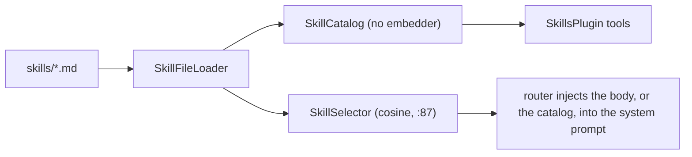

## How it works

Loading is lazy and never throws; malformed files are skipped with a warning (`src/Scout.Skills/SkillFileLoader.cs:30`). An optional `functions: Plugin.function, Plugin.function` frontmatter line names the kernel functions a turn running the skill is offered (`src/Scout.Skills/SkillFileLoader.cs:131`); an entry not shaped `Plugin.function` is dropped with a Warning naming the file and the entry (`:147`), and a skill without the line declares none ([[pages/decisions/0054-functions-scoped-per-skill-and-job]]; `tests/Scout.Skills.Tests/SkillFileLoaderTests.cs:86`, `:98`, `:106`). The catalog depends on the loader only, so the kernel can include the plugin without re-entering the embedder (`src/Scout.Skills/SkillsServiceCollectionExtensions.cs:54`). When disabled, only `NoOpSkillSelector` is registered (`:69`).

The selector builds its index on the first message and caches a successful build, including an empty one when no skill files exist; a build that throws (an embeddings 429, for example) is not cached: that message picks a skill by the words of the message (below), and the next message builds again once `IndexRetryInterval` (one minute, `src/Scout.Skills/SkillSelector.cs:32`) has passed on the injected `TimeProvider` (`src/Scout.Skills/SkillSelector.cs:162`, `src/Scout.Skills/SkillSelector.cs:215`), so a persistent failure costs one embeddings call per minute, not one per message. The first failure is logged as a Warning with its exception, "Failed to build skill index; picking skills by the words of the message until a retry after <time>.", and every later one as a short line with the exception's message only. An embedding model the AI Source answers HTTP 404 for (`HttpRequestException` with status 404, which the Ollama embedder throws while the model is not installed or still downloading, read from a local Ollama on 2026-11-11) takes the same retry gate (`src/Scout.Skills/SkillSelector.cs:207`) and is logged once, as a Warning without a stack: "The embedding model <model> is not installed on the AI Source (HTTP 404); skills are picked by the words of the message until it is. Download it in Scout Desktop, AI Sources.", the model read from the embedder's own `EmbeddingGeneratorMetadata.DefaultModelId` (which the Ollama, OpenAI, OpenRouter, Azure OpenAI, Gemini, Mistral and Azure AI Inference embedders report; `unknown` otherwise), so the owner reads one sentence that names the fix instead of a stack trace and the false "running with no skills". The same 404 on a query embedding, the model removed after the index was built, sets the query retry gate, picks by the words of the message and logs the same sentence under the same once-only flag (`src/Scout.Skills/SkillSelector.cs:126`), so the two paths together say it once per process (`tests/Scout.Skills.Tests/SkillSelectorTests.cs`, `A_Missing_Embedding_Model_On_A_Query_Is_Logged_Once_By_Name_Without_A_Stack_And_The_Pick_Is_By_Words`) (`tests/Scout.Skills.Tests/SkillSelectorTests.cs:154`, `A_Missing_Embedding_Model_Is_Logged_Once_By_Name_With_The_Fix_And_No_Stack_And_Skills_Are_Picked_By_Words`; `A_Failed_Index_Build_Picks_By_The_Words_Of_The_Message`, `:141`, green before and after). The project index's handling of the same 404 is unchanged ([[pages/services/knowledge]]).

When the AI provider has no embeddings (the ChatGPT plan sign-in, for one), the index build throws `NotSupportedException` and the selector never retries (`src/Scout.Skills/SkillSelector.cs:199`): it picks by the words of the message instead (below), and keeps the loaded skills as `ISkillSelector.ModelChoiceCatalog` (`src/Scout.Skills/ISkillSelector.cs:25`, empty while embeddings work and on `NoOpSkillSelector`) and logs once at Information "Skill auto-selection without embeddings: the AI provider has none, so a skill that declares functions is picked by the words of the message and the skill catalog is in the prompt for the model to load the others." (`src/Scout.Skills/SkillSelector.cs:203`). The router passes that catalog to `SkillPromptComposer.Compose` (`src/Scout.Conversation/Routing/LlmStreamingRouter.cs:106`), which appends a `# Skills` section to the system prompt (`src/Scout.Skills/SkillPromptComposer.cs:46`): one sentence telling the model to call `load_skill` when the request matches a skill, adding that a pull-request review goes to `code-review` and a review or audit of a whole repository or project goes to `code-audit` only for the ones the catalog holds, so a custom `Scout:Skills:Directory` without them gets the plain sentence (`:55`), then one line per skill, `- {name}: {summary}`, where the summary is the description's first sentence, cut at the first ` - ` or ` — ` clause or the first period that ends a sentence, without outer quotes, at most 160 characters (`:72`). With the 58 bundled skills the section is 5,137 characters; `tests/Scout.Skills.Tests/BundledSkillsTests.cs` keeps it under 12,000 with every skill listed once.
