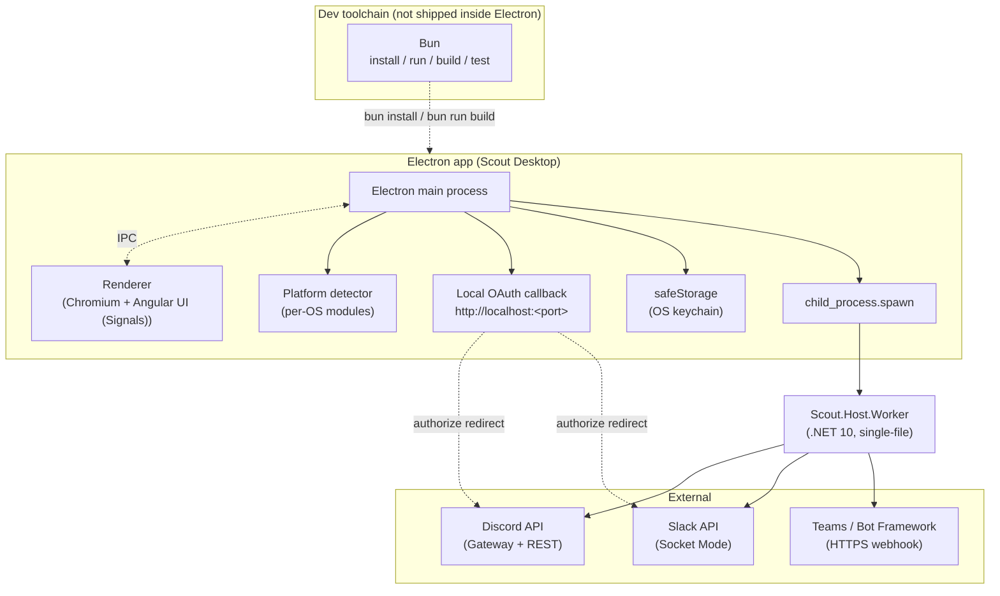

# Electron Provisioning UI - feasibility study: Electron architecture sketch

The diagram highlights a critical boundary: **Bun is the dev
toolchain, not the runtime that ships inside Electron.** The Electron
main process owns the lifecycle of the packaged app; the renderer is a
Chromium Angular app (Signals-first, standalone components). Bun sits
outside the packaged binary and is only invoked at install/build/test
time — see the subsection below.

The renderer framework choice is fixed: **Angular only**. No React, Vue,
Svelte, or Solid anywhere in Scout's web surfaces (now or later — see
[[pages/decisions/0004-web-stack-angular|ADR — Web stack is Angular]]).
The Electron renderer is an Angular application built with the Angular
CLI and bootstrapped inside the Chromium `BrowserWindow` that the main
process creates.

### Bun as toolchain

The desktop UI uses **Bun** as its developer toolchain. This is a hard
project constraint, not a suggestion.

**What Bun does in this project:**

- **Package manager.** `bun install` replaces `npm`/`yarn`/`pnpm`.
  Lockfile: `bun.lockb` (binary, checked in).
- **Script runner.** `bun run <script>` is the entry point for every
  project script. `package.json` scripts stay compatible.
- **Renderer bundle ownership stays with Angular CLI.** `ng build` /
  `ng test` own the renderer bundle, invoked via `bun run` (for example
  `bun run build:renderer` → `ng build`). Angular CLI currently uses
  esbuild under the hood; Bun stays outside that pipeline.
  `TODO: verify` whether `ng` tooling works cleanly under `bun install`
  — some Angular schematics historically shell out to other package
  managers and may need a workaround when the lockfile is `bun.lockb`.
- **Bundler for non-Angular code paths.** `bun build` is used for
  main-process bundling and for the `scout init` CLI compile target
  (see below). **`bun build --compile` targets the `scout init` CLI
  binary only — it does NOT package the Electron app itself.** Electron
  is packaged via `electron-builder` or `electron-forge`.
- **TypeScript transpiler.** Bun transpiles TS natively; no separate
  `tsc` build step for dev.
- **Unit test runner.** `bun test` is the default for pure-JS/TS units
  (main-process modules, detection logic, CLI helpers).

**What Bun does NOT do:**

- **It does not run the Electron main process runtime.** That is
  Electron's responsibility — the Electron runtime executes
  `main.ts` / `main.js` inside the packaged app, and Bun cannot be
  swapped in there. Any code path that assumes `bun:*` built-ins or
  Bun-specific globals at runtime will break the moment the app is
  packaged.
- **It does not run inside the renderer.** The renderer is a Chromium
  page; JS there runs in V8 under Chromium, not Bun.
- **It does not replace `electron-builder` / `electron-forge`.** Those
  tools still do the packaging. Bun just invokes them via `bun run
  dist` / `bun run package`.

**Known Bun + Electron caveats (verify before committing to specifics):**

- **Native-module rebuild.** Native modules (e.g. anything calling into
  `nan` / `node-addon-api`) must be compiled against Electron's native
  module ABI, handled by `@electron/rebuild`. `electron-builder` wires
  this through its `install-app-deps` / `postinstall` hook. `bun
  install` historically skipped some lifecycle scripts by default and
  may not trigger `@electron/rebuild` cleanly. `TODO: verify` current
  Bun lifecycle-script behavior and whether a manual
  `bun run electron-rebuild` postinstall step is required.
- **`electron-builder` / `electron-forge` invocation.** Both are plain
  CLIs; running them as `bun run dist` or `bun run make` should work
  since Bun delegates to the correct runtime when needed.
  `TODO: verify` against the current `electron-builder` and
  `electron-forge` release notes, and link to any tracking issue.
- **`app.asar` packaging.** Packaging is done by `electron-builder`,
  not Bun, so ASAR layout is unaffected. The existing
  `extraResource`-for-worker-binary pattern (see below) still applies.
- **`postinstall` hooks.** If `bun install` ignores or runs
  `postinstall` differently from other package managers, the Electron
  rebuild chain may need a `scripts.postinstall` wired explicitly or
  replaced with an explicit `bun run electron-rebuild` in CI.
  `TODO: verify`.

**`scout init` CLI wizard — Bun-native.** The recommended `scout init`
CLI (see section 8) is a Bun-native single-file executable:

- Written as TypeScript with a `#!/usr/bin/env bun` shebang for local
  dev.
- Shipped as a compiled binary via `bun build --compile
  --target=<triple>` so end users do not need any JS runtime installed.
  Target triples of interest: `bun-linux-x64`, `bun-linux-arm64`,
  `bun-darwin-arm64`, `bun-darwin-x64`, `bun-windows-x64`.
  `TODO: verify` the exact list of supported triples against current
  Bun docs.

### Token storage

- **Use [`safeStorage`](https://www.electronjs.org/docs/latest/api/safe-storage)**,
  not `keytar`. `keytar` has been unmaintained since December 2022;
  VS Code migrated off it; it links against `libsecret` on Linux which
  is a packaging headache.
- `safeStorage.encryptString()` / `decryptString()` uses OS keychain
  (Keychain on macOS, DPAPI on Windows, libsecret / KWallet /
  kdewallet on Linux where available). Stores the ciphertext wherever
  Scout wants — typically a JSON file in
  `app.getPath('userData')`.
- **On Linux without a desktop keyring**, `safeStorage` falls back to
  "basic" encryption which is equivalent to plaintext. The Electron
  docs are explicit about this. Scout should surface that state to the
  user with a warning. `TODO: verify` exact fallback behavior on
  headless Linux.

### Worker process

- Publish `Scout.Host.Worker` as **single-file, self-contained**
  .NET 10 using `dotnet publish -r <rid> --self-contained -p:PublishSingleFile=true`.
  See [single-file deployment docs](https://learn.microsoft.com/en-us/dotnet/core/deploying/single-file/overview).
  This avoids "is .NET 10 installed?" as a prerequisite for Electron
  users.
- **Package per-RID:** `win-x64`, `osx-arm64`, `osx-x64`, `linux-x64`.
  Electron Forge / electron-builder will produce matching installers.
  The worker binary is shipped as `extraResource` so it lives *outside*
  the ASAR archive. This sidesteps the long-standing Electron issue
  that `child_process.spawn` cannot execute binaries *inside* ASAR
  ([electron#9459](https://github.com/electron/electron/issues/9459)).
- The Electron main process `spawn`s the worker with the
  configuration (including tokens from `safeStorage`) passed via env
  vars. Scout's existing `IConfiguration` binding picks them up
  without code change. Main process monitors stdout/stderr, restarts
  on crash, terminates on Electron quit.
