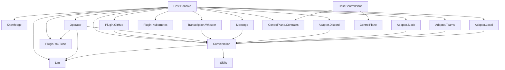

# Project map

> Eighteen source projects in `Scout.slnx`; the dependency graph is shallow and acyclic. The retired first cut under `src/old` and `tests/old` was deleted on 2026-11-06 (in the history before `93da0d4`).

Derived from the `ProjectReference` items in each `.csproj`. Package references are listed on the service pages.

| Project | Kind | Depends on | Test project |
|---|---|---|---|
| [[pages/services/llm]] | library | none | `Scout.Llm.Tests` |
| [[pages/services/skills]] | library | none | `Scout.Skills.Tests` |
| [[pages/services/conversation]] | library | Llm, Skills | `Scout.Conversation.Tests` |
| [[pages/services/knowledge]] | library | none | `Scout.Knowledge.Tests` |
| [[pages/services/adapter-discord]] | adapter | Conversation | `Scout.Adapter.Discord.Tests` |
| [[pages/services/adapter-slack]] | adapter | Conversation | `Scout.Adapter.Slack.Tests` |
| [[pages/services/adapter-teams]] | adapter | Conversation | `Scout.Adapter.Teams.Tests` |
| [[pages/services/adapter-local]] | adapter | Conversation | `Scout.Adapter.Local.Tests` |
| [[pages/services/plugin-github]] | plugin | Conversation (origin notifier, chat origin; Llm through it for the write gate) | `Scout.Plugin.GitHub.Tests` |
| [[pages/services/plugin-kubernetes]] | plugin | none | `Scout.Plugin.Kubernetes.Tests` |
| [[pages/services/plugin-youtube]] | plugin | none | `Scout.Plugin.YouTube.Tests` |
| [[pages/services/transcription-whisper]] | library | Conversation | `Scout.Transcription.Whisper.Tests` |
| [[pages/services/meetings]] | library | Conversation | `Scout.Meetings.Tests` |
| [[pages/services/operator]] | library | Llm, Conversation, Plugin.YouTube | `Scout.Operator.Tests` |
| [[pages/services/control-plane-contracts]] | contracts | none | none of its own (`Scout.ControlPlane.Tests`) |
| [[pages/services/control-plane]] | library | none | `Scout.ControlPlane.Tests` |
| [[pages/services/host-console]] | host | Llm, Conversation, Knowledge, four adapters, Plugin.GitHub, Plugin.Kubernetes, Plugin.YouTube, Operator, Transcription.Whisper, Meetings, ControlPlane.Contracts | `Scout.Host.Console.Tests` (also references ControlPlane, for the feature catalog, and Host.ControlPlane, so one test carries a comments view over 4 MB between the worker and the real control-plane host) |
| [[pages/services/host-control-plane]] | host | Contracts, ControlPlane | none of its own (`Scout.ControlPlane.Tests`) |

The graph is enforced: `tests/Scout.ArchTests/ArchitectureTests.cs:55` fails when a leaf references another Scout assembly, an adapter or a plugin references a sibling or a host, Conversation reaches past Llm and Skills, or Operator touches the control plane directly; a ProjectReference that changes this table changes those rules in the same diff. `Scout.Host.Console` reaches Skills through Conversation. `Scout.Knowledge`, `Scout.Skills`, `Scout.Plugin.Kubernetes` and `Scout.Plugin.YouTube` do not reference `Scout.Llm`; they meet it at run time through Semantic Kernel types (`Kernel`, `KernelPlugin`, `IEmbeddingGenerator`) that the host wires together (`src/Scout.Host.Console/HostComposition.cs:46` to `:71`). `Scout.Plugin.GitHub` references `Scout.Conversation` since 2026-11-06 for the origin notifier and the chat origin, and through it `Scout.Llm` for `IWriteGate`, `IApprovedActions` and `AddWriteFunction`. `Scout.Operator` references `Scout.Llm` only for `AddWriteFunction`, and reaches the control plane through its own `IOperatorControlPlane`, which the host implements over the `WorkerGate` client; it references no Contracts or gRPC package.

## Two processes

- **Chat host:** `Scout.Host.Console` and everything it references. Run by the desktop app or by hand.
- **Control-plane host:** `Scout.Host.ControlPlane`, `Scout.ControlPlane`, `Scout.ControlPlane.Contracts`. Serves the desktop UI, and the write gate to the chat host. Until 2026-11-02 it shared no project with the chat host; since then the chat host references `Scout.ControlPlane.Contracts` for the generated `WorkerGate` client, because the worker asks the control plane before a declared write ([[pages/decisions/0011-backend-frontend-grpc-uds]], amended). It still shares no code path: the contracts project holds only the `.proto` files.

The desktop UI under `ui/` is a separate Bun and Electron workspace and is not part of `Scout.slnx` (see [[pages/conventions/testing]]).

## Related

- [[pages/invariants/pluggable-boundaries]]
- [[pages/invariants/no-executive-writes]]
