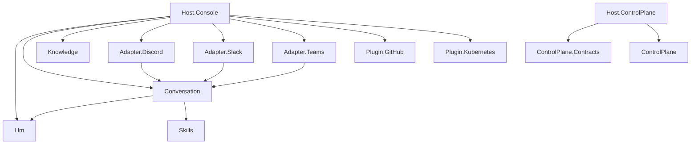

# Project map

> Thirteen source projects in `Scout.slnx`; the dependency graph is shallow and acyclic. Projects under `src/old` and `tests/old` are not in the solution.

Derived from the `ProjectReference` items in each `.csproj`. Package references are listed on the service pages.

| Project | Kind | Depends on | Test project |
|---|---|---|---|
| [[pages/services/llm]] | library | none | `Scout.Llm.Tests` |
| [[pages/services/skills]] | library | none | `Scout.Skills.Tests` |
| [[pages/services/conversation]] | library | Llm, Skills | `Scout.Conversation.Tests` |
| [[pages/services/knowledge]] | library | none | `Scout.Knowledge.Tests` |
| [[pages/services/adapter-discord]] | adapter | Conversation | `Scout.Adapter.Discord.Tests` |
| [[pages/services/adapter-slack]] | adapter | Conversation | `Scout.Adapter.Slack.Tests` |
| [[pages/services/adapter-teams]] | adapter | Conversation | `Scout.Adapter.Teams.Tests` |
| [[pages/services/plugin-github]] | plugin | none | `Scout.Plugin.GitHub.Tests` |
| [[pages/services/plugin-kubernetes]] | plugin | none | `Scout.Plugin.Kubernetes.Tests` |
| [[pages/services/control-plane-contracts]] | contracts | none | none of its own (`Scout.ControlPlane.Tests`) |
| [[pages/services/control-plane]] | library | none | `Scout.ControlPlane.Tests` |
| [[pages/services/host-console]] | host | Llm, Conversation, Knowledge, three adapters, Plugin.GitHub, Plugin.Kubernetes | `Scout.Host.Console.Tests` |
| [[pages/services/host-control-plane]] | host | Contracts, ControlPlane | none of its own (`Scout.ControlPlane.Tests`) |

`Scout.Host.Console` reaches Skills through Conversation. `Scout.Knowledge`, `Scout.Skills`, `Scout.Plugin.GitHub` and `Scout.Plugin.Kubernetes` do not reference `Scout.Llm`; they meet it at run time through Semantic Kernel types (`Kernel`, `KernelPlugin`, `IEmbeddingGenerator`) that the host wires together (`src/Scout.Host.Console/HostComposition.cs:36` to `:52`).

## Two processes

- **Chat host:** `Scout.Host.Console` and everything it references. Run by the desktop app or by hand.
- **Control-plane host:** `Scout.Host.ControlPlane`, `Scout.ControlPlane`, `Scout.ControlPlane.Contracts`. Serves the desktop UI. It shares no project with the chat host.

The desktop UI under `ui/` is a separate Bun and Electron workspace and is not part of `Scout.slnx` (see [[pages/conventions/testing]]).

## Related

- [[pages/invariants/pluggable-boundaries]]
- [[pages/invariants/no-executive-writes]]
