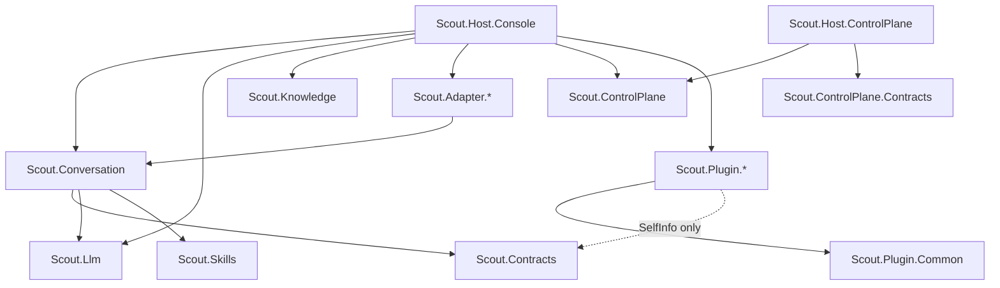

# Project map

> Thirty-six source projects under `src/`; the dependency graph is shallow and acyclic. Only the two hosts and Conversation have fan-out; every plugin is a leaf.

Derived from the `ProjectReference` items in each `.csproj`; package references are on the service pages. The solution file is `Scout.slnx`.

| Project | Kind | Depends on | Test project |
|---|---|---|---|
| [[pages/services/adapter-discord]] | adapter | Conversation | `Scout.Adapter.Discord.Tests` |
| [[pages/services/adapter-slack]] | adapter | Conversation | `Scout.Adapter.Slack.Tests` |
| [[pages/services/adapter-teams]] | adapter | Conversation | `Scout.Adapter.Teams.Tests` |
| [[pages/services/contracts]] | contracts | none | `Scout.Contracts.Tests` |
| [[pages/services/control-plane]] | library | none | `Scout.ControlPlane.Tests` |
| [[pages/services/control-plane-contracts]] | contracts | none | none of its own (`Scout.ControlPlane.Tests`) |
| [[pages/services/conversation]] | library | Contracts, Llm, Skills | `Scout.Conversation.Tests` |
| [[pages/services/host-console]] | host | Llm, Conversation, Knowledge, 3 adapters, ControlPlane, 23 plugins (every `Scout.Plugin.*` except Common) | `Scout.Host.Console.Tests` |
| [[pages/services/host-control-plane]] | host | ControlPlane.Contracts, ControlPlane | none of its own (`Scout.ControlPlane.Tests`) |
| [[pages/services/knowledge]] | library | none | `Scout.Knowledge.Tests` |
| [[pages/services/llm]] | library | none | `Scout.Llm.Tests` |
| [[pages/services/skills]] | library | none | `Scout.Skills.Tests` |
| [[pages/services/plugin-common]] | library | none | `Scout.Plugin.Common.Tests` |
| [[pages/services/plugin-codereview]] | plugin | none | `Scout.Plugin.CodeReview.Tests` |
| [[pages/services/plugin-converter]] | plugin | Plugin.Common | `Scout.Plugin.Converter.Tests` |
| [[pages/services/plugin-currency]] | plugin | none | `Scout.Plugin.Currency.Tests` |
| [[pages/services/plugin-dates]] | plugin | Plugin.Common | `Scout.Plugin.Dates.Tests` |
| [[pages/services/plugin-dictionary]] | plugin | Plugin.Common | `Scout.Plugin.Dictionary.Tests` |
| [[pages/services/plugin-github]] | plugin | none | `Scout.Plugin.GitHub.Tests` |
| [[pages/services/plugin-holidays]] | plugin | Plugin.Common | `Scout.Plugin.Holidays.Tests` |
| [[pages/services/plugin-ledger]] | plugin | Plugin.Common | `Scout.Plugin.Ledger.Tests` |
| [[pages/services/plugin-lists]] | plugin | Plugin.Common | `Scout.Plugin.Lists.Tests` |
| [[pages/services/plugin-markets]] | plugin | Plugin.Common | `Scout.Plugin.Markets.Tests` |
| [[pages/services/plugin-news]] | plugin | Plugin.Common | `Scout.Plugin.News.Tests` |
| [[pages/services/plugin-notes]] | plugin | Plugin.Common | `Scout.Plugin.Notes.Tests` |
| [[pages/services/plugin-nutrition]] | plugin | Plugin.Common | `Scout.Plugin.Nutrition.Tests` |
| [[pages/services/plugin-parcels]] | plugin | Plugin.Common | `Scout.Plugin.Parcels.Tests` |
| [[pages/services/plugin-recipes]] | plugin | Plugin.Common | `Scout.Plugin.Recipes.Tests` |
| [[pages/services/plugin-reminders]] | plugin | Plugin.Common | `Scout.Plugin.Reminders.Tests` |
| [[pages/services/plugin-selfinfo]] | plugin | Contracts | `Scout.Plugin.SelfInfo.Tests` |
| [[pages/services/plugin-sports]] | plugin | Plugin.Common | `Scout.Plugin.Sports.Tests` |
| [[pages/services/plugin-weather]] | plugin | Plugin.Common | `Scout.Plugin.Weather.Tests` |
| [[pages/services/plugin-websearch]] | plugin | Plugin.Common | `Scout.Plugin.WebSearch.Tests` |
| [[pages/services/plugin-whattowatch]] | plugin | Plugin.Common | `Scout.Plugin.WhatToWatch.Tests` |
| [[pages/services/plugin-wikipedia]] | plugin | none | `Scout.Plugin.Wikipedia.Tests` |
| [[pages/services/plugin-worldclock]] | plugin | Plugin.Common | `Scout.Plugin.WorldClock.Tests` |

## Non-plugin dependencies

Plugins are one node. `Scout.Host.Console` references every plugin project except Common (`src/Scout.Host.Console/Scout.Host.Console.csproj:19-41`), so adding a plugin means a project reference and a registration line in the host ([[pages/architecture/plugin-catalogue]]).

`Scout.Llm`, `Scout.Knowledge`, `Scout.Skills`, `Scout.ControlPlane`, `Scout.ControlPlane.Contracts` and `Scout.Contracts` reference no other Scout project. Plugins reach the kernel at run time, not by reference: `Scout.Llm` collects every `KernelPlugin` from DI (`src/Scout.Llm/LlmServiceCollectionExtensions.cs:96`).

## Reading notes

- Plugin.GitHub, Plugin.CodeReview, Plugin.Currency and Plugin.Wikipedia reference nothing; SelfInfo references only Contracts. Converter, Dictionary, Nutrition, Recipes and WebSearch reference Plugin.Common without using its types.
- CodeReview reads the GitHub token by configuration key rather than by reference (`src/Scout.Plugin.CodeReview/CodeReviewServiceCollectionExtensions.cs:25`).
- Test projects mostly reference only their own source project; `Scout.Host.Console.Tests` also references Llm, Knowledge and the Discord adapter, and `Scout.ControlPlane.Tests` also covers Host.ControlPlane and the contracts.
- Related: [[pages/architecture/high-level]].
