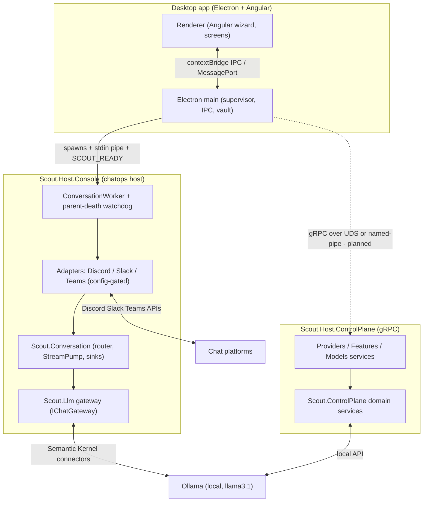

# Scout Restructure - Architecture, Status and Backlog

Living overview of the ground-up restructure on branch `feat/scout-llm-gateway`.
The previous source tree is archived under `src/old/` (frozen reference, not
built). All LLM communication goes through Semantic Kernel; everything is
streaming-first.

## Layered architecture

## Projects (src/)

| Project | Responsibility | Tests |
|---|---|---|
| `Scout.Llm` | LLM gateway. SK kernel; chat via `AddOllamaChatCompletion`, embeddings via `AddOllamaEmbeddingGenerator` (SKEXP0070 scoped). `IChatGateway` is the streaming-first primary API. Single config source `Scout:Llm`. | 51 |
| `Scout.Conversation` | Platform-agnostic core: `IResponseSink` (cumulative-text), `StreamPump` (owns the drive loop once), `IConversationRouter`/`LlmStreamingRouter`, `ConversationConductor`, inverted `IChatAdapter`, `ChatMessage`/`ChatResponse`/`Citation`, `ScoutActivitySource`. | 44 |
| `Scout.Adapter.Discord` | Reference adapter. `DiscordResponseSink` (edit-based), translator, lifecycle. | 34 |
| `Scout.Adapter.Slack` | Socket Mode; `chat.update` sink; 429 retry in sink. | 54 |
| `Scout.Adapter.Teams` | Bot Framework; cumulative streaming sink; live webhook hosting documented (needs Azure). | 50 |
| `Scout.Host.Console` | Chatops host: config-gated multi-adapter, `SCOUT_READY` stdout marker, parent-death watchdog (stdin EOF → shutdown). | 19 |
| `Scout.ControlPlane.Contracts` | `.proto` contracts + C# server codegen (providers/models/features). | — |
| `Scout.ControlPlane` | Domain services ported from old (provider lifecycle, feature registry, model ops). | (in Tests below) |
| `Scout.Host.ControlPlane` | gRPC server over UDS (Linux/macOS) / named pipe (Windows), no TCP port, per-session token interceptor. | 65 |

Desktop `ui/` (Electron + Angular): `bun` 274 tests + `vitest` 253 tests.
Whole project: ~890 tests green; build 17 projects, 0 warnings (warnings-as-errors).

## Key decisions (ADRs)

- [[pages/decisions/0012-llm-communication-through-semantic-kernel]] — all LLM comms (chat + embeddings) through SK; SKEXP0070 accepted.
- [[pages/decisions/0013-conversation-core-streaming-sink]] — cumulative `IResponseSink` designed against Teams (least-capable); pump owns the drive loop; rate-limit lives in the sink.
- [[pages/decisions/0011-backend-frontend-grpc-uds]] — backend↔frontend transport = gRPC over UDS/named-pipe, no TCP port, `.proto` single contract.
- [[pages/decisions/0009-descriptive-vs-executive-writes]] — descriptive-write invariant (no executive writes).

Streaming-first is a hard mandate end to end. Adapters are config-gated: the
host starts whichever of Discord/Slack/Teams have credentials, runs several at
once, and exits cleanly (with guidance) when none are configured.

## Implemented

Re-verified against `main` 5fb2a15 on 2026-10-22.

- [x] `Scout.Llm` gateway (chat + embeddings via SK, streaming-first). [[pages/services/llm]]
- [x] `Scout.Conversation` core (cumulative sink, StreamPump, router, conductor). [[pages/services/conversation]]
- [x] Discord, Slack, Teams adapters (all on the same `IResponseSink`).
- [x] `Scout.Host.Console` chatops host (config-gated, multi-adapter, `SCOUT_READY`, parent-death watchdog). [[pages/services/host-console]]
- [x] gRPC control-plane .NET server (contracts + domain + host, UDS/named-pipe + token). [[pages/services/host-control-plane]]
- [x] GitHub plugin as SK functions and streaming function-calling (`FunctionChoiceBehavior.Auto()` in `src/Scout.Llm/ChatGateway.cs:343`). [[pages/services/plugin-github]]
- [x] Skills library (markdown skills, embedding-matched injection, `list_skills` / `load_skill`). [[pages/services/skills]]
- [x] Project knowledge: SQLite vector store, `search_project` / `find_symbol` / `list_projects`. [[pages/services/knowledge]]
- [x] Desktop: launch wired to `Scout.Host.Console` (binary repoint, vault to env, token-gated launch guard, graceful "backend unavailable" degradation of the Providers / Features screens). [[pages/services/desktop-ui]]
- [x] Linux AppImage packaging (`bun run dist:linux`); three-OS package step in `ui-ci.yml`.
- [x] Observability: inbound accepted / ignored-with-reason, routing, completion and LLM target logged at Info (stderr); readiness marker on stdout.

## Backlog (what's left)

Open as of 2026-10-22. Small deferrals with a known unblock live in [[pages/roadmap/followups]].

### Control plane client (initiative: [[pages/roadmap/control-plane-client]])
- [ ] Node/Electron `@grpc/grpc-js` client over `unix:`; Windows named-pipe spike.
- [ ] `ts-proto` codegen from `src/Scout.ControlPlane.Contracts`; replace the hand-written `ipc-contract.ts` shapes.
- [ ] Launch `Scout.Host.ControlPlane` beside the console worker; move the Providers / Features / Models screens and the Ollama pull onto the control plane.

### Onboarding (second wave)
- [ ] Slack onboarding form (bot token + app-level token) in the wizard.
- [ ] Teams onboarding form (app id / password / tenant); live webhook hosting stays out of this repository.

### Chatops capability
- [ ] Decide the retired plugins' fate (CloudStatus, CodeQA, Kubernetes, Help under `src/old`): rebuild on SK or drop. The GitHub issues that tracked them were deleted on 2026-10-22.
- [ ] Bot identity: tighten `Scout:Conversation:SystemPrompt` so a local model answers as Scout.

### Hardening / release
- [ ] Re-enable the `dotnet format` check in `ci.yml` (see [[pages/roadmap/followups]]).
- [ ] Code signing + real icons before any distribution.
- [ ] Packaged smoke run on Windows and macOS.

## Run notes

- Bot host reads config from env (`SCOUT__ADAPTERS__DISCORD__BOTTOKEN`,
  `SCOUT__LLM__OLLAMA__CHAT__MODEL`, ...). Default chat model `llama3.1` via
  Ollama at `http://localhost:11434`.
- Discord: replies only when @-mentioned in a guild channel; DMs always work.
- AppImage: `ui/build/dist/Scout Desktop-0.0.1-linux-x86_64.AppImage`. Closing
  the app now reliably stops the bot host (parent-death watchdog).
