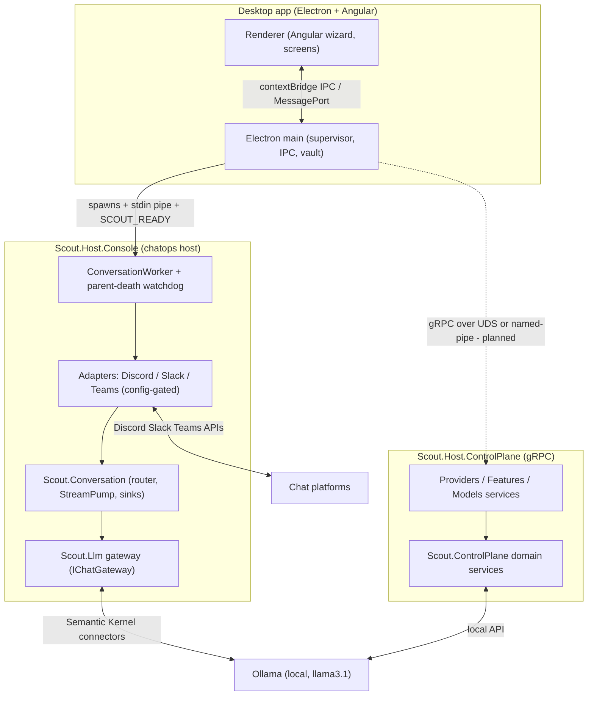

# Scout Restructure - Architecture, Status and Backlog

Living overview of the ground-up restructure on branch `feat/scout-llm-gateway`.
The previous source tree is archived under `src/old/` (frozen reference, not
built). All LLM communication goes through Semantic Kernel; everything is
streaming-first.

## Layered architecture

## Projects (src/)

| Project | Responsibility | Tests |
|---|---|---|
| `Scout.Llm` | LLM gateway. SK kernel; chat via `AddOllamaChatCompletion`, embeddings via `AddOllamaEmbeddingGenerator` (SKEXP0070 scoped). `IChatGateway` is the streaming-first primary API. Single config source `Scout:Llm`. | 51 |
| `Scout.Conversation` | Platform-agnostic core: `IResponseSink` (cumulative-text), `StreamPump` (owns the drive loop once), `IConversationRouter`/`LlmStreamingRouter`, `ConversationConductor`, inverted `IChatAdapter`, `ChatMessage`/`ChatResponse`/`Citation`, `ScoutActivitySource`. | 44 |
| `Scout.Adapter.Discord` | Reference adapter. `DiscordResponseSink` (edit-based), translator, lifecycle. | 34 |
| `Scout.Adapter.Slack` | Socket Mode; `chat.update` sink; 429 retry in sink. | 54 |
| `Scout.Adapter.Teams` | Bot Framework; cumulative streaming sink; live webhook hosting documented (needs Azure). | 50 |
| `Scout.Host.Console` | Chatops host: config-gated multi-adapter, `SCOUT_READY` stdout marker, parent-death watchdog (stdin EOF → shutdown). | 19 |
| `Scout.ControlPlane.Contracts` | `.proto` contracts + C# server codegen (providers/models/features). | — |
| `Scout.ControlPlane` | Domain services ported from old (provider lifecycle, feature registry, model ops). | (in Tests below) |
| `Scout.Host.ControlPlane` | gRPC server over UDS (Linux/macOS) / named pipe (Windows), no TCP port, per-session token interceptor. | 65 |

Desktop `ui/` (Electron + Angular): `bun` 274 tests + `vitest` 253 tests.
Whole project: ~890 tests green; build 17 projects, 0 warnings (warnings-as-errors).

## Key decisions (ADRs)

- [[pages/decisions/0012-llm-communication-through-semantic-kernel]] — all LLM comms (chat + embeddings) through SK; SKEXP0070 accepted.
- [[pages/decisions/0013-conversation-core-streaming-sink]] — cumulative `IResponseSink` designed against Teams (least-capable); pump owns the drive loop; rate-limit lives in the sink.
- [[pages/decisions/0011-backend-frontend-grpc-uds]] — backend↔frontend transport = gRPC over UDS/named-pipe, no TCP port, `.proto` single contract.
- [[pages/decisions/0009-descriptive-vs-executive-writes]] — descriptive-write invariant (no executive writes).

Streaming-first is a hard mandate end to end. Adapters are config-gated: the
host starts whichever of Discord/Slack/Teams have credentials, runs several at
once, and exits cleanly (with guidance) when none are configured.

## Implemented

- [x] `Scout.Llm` gateway (chat + embeddings via SK, streaming-first).
- [x] `Scout.Conversation` core (cumulative sink, StreamPump, router, conductor).
- [x] Discord, Slack, Teams adapters (all on the same `IResponseSink`).
- [x] `Scout.Host.Console` chatops host (config-gated, multi-adapter, `SCOUT_READY`, parent-death watchdog).
- [x] gRPC control-plane .NET server (contracts + domain + host, UDS/named-pipe + token).
- [x] Quality gates run: architecture + code review + security audit; findings fixed.
- [x] Desktop Step 1: launch wired to `Scout.Host.Console` (binary repoint, vault→env `SCOUT__ADAPTERS__DISCORD__BOTTOKEN`, fixed LLM model env key, token-gated launch guard, graceful "backend unavailable" degradation of provider/feature screens).
- [x] Linux AppImage packaging working (`bun run dist:linux`); publish script cleans output dir; Discord bot connects and replies end to end.
- [x] Observability: inbound message accepted / ignored-with-reason, routing, completion, and LLM target (provider/endpoint/model) logged at Info (stderr); marker on stdout.

## Backlog (what's left)

### Backend↔frontend gRPC (follow-on to the .NET server)
- [ ] Node/Electron `@grpc/grpc-js` client over `unix:` scheme; **Windows named-pipe spike** (no first-class API — fallbacks: `grpc-js-namedpipes` shim or stdio-JSON-RPC on Windows).
- [ ] `ts-proto` codegen; replace the hand-written `ipc-contract.ts` shapes.
- [ ] `MessagePort` streaming to the renderer for progress/status.
- [ ] Repoint `ui/build/worker` + `resolve-binary` (control-plane) and revive the Providers / Models / Features screens.

### Onboarding (second wave)
- [ ] Slack onboarding form (bot token + app-level token) in the wizard.
- [ ] Teams onboarding form (app id / password / tenant); live webhook hosting (CloudAdapter / Azure Bot) is a separate concern.

### Chatops capability
- [ ] Feature plugins not yet rebuilt: GitHub, Kubernetes, CloudStatus, CodeQA, Help. Today the bot only does LLM fallback chat — **no tools**.
- [ ] Agent router (streaming function-calling) to expose plugins as SK tools.
- [ ] Bot identity: `llama3.1` hallucinates being "Claude 2" — tighten `Scout:Conversation:SystemPrompt` so it answers as Scout / a local model.

### Hardening / release
- [ ] Full `dotnet format` pass (sandbox can't run the analyzer build-host).
- [ ] PR strategy for the consolidated branch (one PR vs split).
- [ ] Code signing + real icons before any distribution (current builds are unsigned, placeholder icons).
- [ ] gRPC server test coverage was completed (UDS integration + boundary), but the Node client side needs its own tests when built.

## Run notes

- Bot host reads config from env (`SCOUT__ADAPTERS__DISCORD__BOTTOKEN`,
  `SCOUT__LLM__OLLAMA__CHAT__MODEL`, ...). Default chat model `llama3.1` via
  Ollama at `http://localhost:11434`.
- Discord: replies only when @-mentioned in a guild channel; DMs always work.
- AppImage: `ui/build/dist/Scout Desktop-0.0.1-linux-x86_64.AppImage`. Closing
  the app now reliably stops the bot host (parent-death watchdog).
