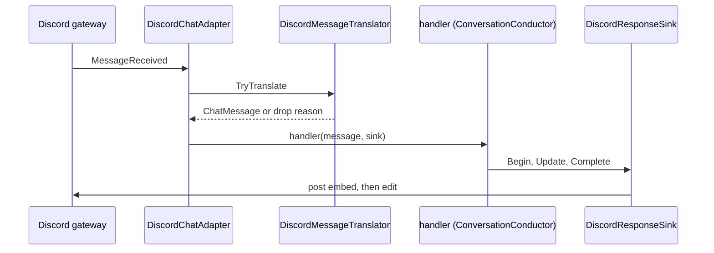

# Adapter.Discord

> Connects Scout to Discord with a bot token and shows the answer as it streams.

## To change here, read

- [[pages/invariants/pluggable-boundaries]]
- [[pages/invariants/secrets-never-in-source]]
- [[pages/invariants/no-executive-writes]]
- [[pages/services/conversation]]
- [[pages/conventions/testing]]

## Responsibility

Owns the Discord gateway session, message filtering and the response sink. Does not own routing or memory ([[pages/services/conversation]]).

## Public contract

- **Entry point:** `AddDiscordAdapter(IServiceCollection, IConfiguration)` at `src/Scout.Adapter.Discord/DiscordServiceCollectionExtensions.cs:20`; a blank token registers nothing (`:30`).
- **Key types:** `DiscordChatAdapter : IChatAdapter` (`src/Scout.Adapter.Discord/DiscordChatAdapter.cs:18`), `DiscordMessageTranslator` (`src/Scout.Adapter.Discord/DiscordMessageTranslator.cs:13`), `DiscordResponseSink : IResponseSink` (`src/Scout.Adapter.Discord/Streaming/DiscordResponseSink.cs:27`), `DiscordOptions` (`src/Scout.Adapter.Discord/DiscordOptions.cs:6`), internal `DiscordAdapterLifecycle` (`src/Scout.Adapter.Discord/DiscordAdapterLifecycle.cs:11`).
- **Configuration keys:** `Scout:Adapters:Discord` with `BotToken` (`src/Scout.Adapter.Discord/DiscordServiceCollectionExtensions.cs:18`).
- **External boundaries:** Discord.Net socket client with intents Guilds, GuildMessages, DirectMessages and MessageContent (`src/Scout.Adapter.Discord/DiscordChatAdapter.cs:49`); writes to Discord are `SendMessageAsync` (`src/Scout.Adapter.Discord/Streaming/DiscordResponseSink.cs:66`) and `ModifyAsync` (`:76`) on its own reply.

## How it works

The translator drops the bot's own messages, guild messages without an @-mention, and messages empty after the mention is stripped; direct messages need no mention (`src/Scout.Adapter.Discord/DiscordMessageTranslator.cs:36`, `:46`, `:53`). Login and start happen in `StartAsync` (`src/Scout.Adapter.Discord/DiscordChatAdapter.cs:78`).

## Invariants

- [[pages/invariants/pluggable-boundaries]]: self-gates on its token and registers as `IChatAdapter`.
- [[pages/invariants/secrets-never-in-source]]: the constructor rejects an empty token and names the config route (`src/Scout.Adapter.Discord/DiscordChatAdapter.cs:38`).
- [[pages/invariants/no-executive-writes]]: the only platform writes are the reply post and its edits.

## Hot spots

- `src/Scout.Adapter.Discord/DiscordChatAdapter.cs:108`: inbound gateway handler.
- `src/Scout.Adapter.Discord/Streaming/DiscordResponseSink.cs:99`: render capabilities and embed length cap.

## Testing footprint

`tests/Scout.Adapter.Discord.Tests` (36 test attributes, 6 files): translator rules, inbound projection, lifecycle, DI gating, sink behaviour and a sink boundary test with a faked channel. No live Discord connection.

## Related

Direct project references: [[pages/services/conversation]]. Referenced by [[pages/services/host-console]]. Map: [[pages/architecture/project-map]].
