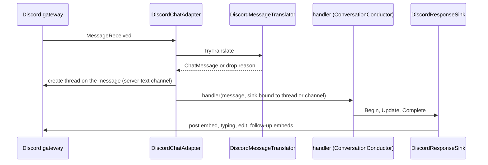

# Adapter.Discord

> Connects Scout to Discord with a bot token and shows the answer as it streams.

## To change here, read

- [[pages/invariants/pluggable-boundaries]]
- [[pages/invariants/secrets-never-in-source]]
- [[pages/invariants/no-executive-writes]]
- [[pages/services/conversation]]
- [[pages/decisions/0024-voice-messages-transcribed-locally]]
- [[pages/conventions/testing]]

## Responsibility

Owns the Discord gateway session, message filtering, the thread per conversation, the voice-message projection and download, and the response sink. Does not own routing, memory or transcription ([[pages/services/conversation]], [[pages/services/transcription-whisper]]).

## Public contract

- **Entry point:** `AddDiscordAdapter(IServiceCollection, IConfiguration)` at `src/Scout.Adapter.Discord/DiscordServiceCollectionExtensions.cs:22`; a blank token registers nothing (`:32`).
- **Key types:** `DiscordChatAdapter : IChatAdapter` (`src/Scout.Adapter.Discord/DiscordChatAdapter.cs:24`), `DiscordMessageTranslator` (`src/Scout.Adapter.Discord/DiscordMessageTranslator.cs:20`), `DiscordResponseSink : IResponseSink, IDisposable` (`src/Scout.Adapter.Discord/Streaming/DiscordResponseSink.cs:30`), internal `DiscordReplySplitter` (`src/Scout.Adapter.Discord/Streaming/DiscordReplySplitter.cs:10`), `DiscordOptions` (`src/Scout.Adapter.Discord/DiscordOptions.cs:6`), `InboundDiscordMessage` and `InboundVoiceMessage` (`src/Scout.Adapter.Discord/InboundDiscordMessage.cs`), internal `DiscordAttachmentDownloader` (`src/Scout.Adapter.Discord/DiscordAttachmentDownloader.cs:7`), internal `DiscordAdapterLifecycle` (`src/Scout.Adapter.Discord/DiscordAdapterLifecycle.cs:11`), `DiscordOriginPoster : IOriginPoster` (`src/Scout.Adapter.Discord/DiscordOriginPoster.cs:13`), registered with the adapter (`src/Scout.Adapter.Discord/DiscordServiceCollectionExtensions.cs:42`).
- **Configuration keys:** `Scout:Adapters:Discord` with `BotToken` (`src/Scout.Adapter.Discord/DiscordServiceCollectionExtensions.cs:18`) and `ReplyInThreads`, default true (`src/Scout.Adapter.Discord/DiscordOptions.cs:19`).
- **External boundaries:** Discord.Net socket client with intents Guilds, GuildMessages, DirectMessages and MessageContent (`src/Scout.Adapter.Discord/DiscordChatAdapter.cs:70`). Writes to Discord: `CreateThreadAsync` on the user's message (`src/Scout.Adapter.Discord/DiscordChatAdapter.cs:273`), `SendMessageAsync` (`src/Scout.Adapter.Discord/Streaming/DiscordResponseSink.cs:74`), `ModifyAsync` on its own messages (`:83`) and the typing state (`:85`); a later plain-text `SendMessageAsync` into the originating conversation (`src/Scout.Adapter.Discord/DiscordOriginPoster.cs:65`). Read: one HTTPS GET of a voice message attachment from the URL Discord put on the message, through one shared client whose pooled connections are recycled every 2 minutes, 30 s to the response headers, non-success status throws (`src/Scout.Adapter.Discord/DiscordAttachmentDownloader.cs:15`); the conductor bounds the whole download, body included, at 30 s.
- **Bot permissions this needs in a server:** View Channel (1<<10), Send Messages (1<<11), Embed Links (1<<14), Read Message History (1<<16, for the reply reference), Create Public Threads (1<<35) and Send Messages in Threads (1<<38). Without Create Public Threads the reply falls back to the channel.

## How it works

The translator drops the bot's own messages, guild messages not addressed to the bot, and text messages empty after the mention is stripped; direct messages need no mention (`src/Scout.Adapter.Discord/DiscordMessageTranslator.cs:48`, `:60`, `:84`). A message without a guild, text or voice, gets `ChatMessage.IsDirectMessage = true` (`src/Scout.Adapter.Discord/DiscordMessageTranslator.cs:56`), which owner pairing requires ([[pages/decisions/0021-allowed-users]]). Login and start happen in `StartAsync` (`src/Scout.Adapter.Discord/DiscordChatAdapter.cs:80`). The gateway handler filters the message, starts the conversation on the thread pool and returns before the reply finishes, so a long reply never blocks the Discord gateway task (`src/Scout.Adapter.Discord/DiscordChatAdapter.cs:180`); `StopAsync` cancels the lifetime token and waits up to 10 s for the in-flight replies to unwind before it logs out (`src/Scout.Adapter.Discord/DiscordChatAdapter.cs:125`).

- **Thread per conversation.** With `ReplyInThreads` on, a mention in a server text channel (not a thread, not a voice channel's chat, not a DM) from a sender the access policy admits first opens a public thread on the user's message, archived after a day of inactivity and named from the question's first 60 characters on one line, cut at a word with "..." ("Voice message" for a voice message; `src/Scout.Adapter.Discord/DiscordChatAdapter.cs:259`, `:291`). The reply streams in the thread and `ChatMessage.ChannelId` is the thread id, so memory is per thread; a later mention inside the thread continues there. Creating the thread is a descriptive write in the originating channel. If Discord refuses (for example the bot lacks Create Public Threads), the adapter logs a warning and replies in the channel. A sender `AccessPolicy` refuses (`src/Scout.Conversation/Access/AccessPolicy.cs:42`, the decision the conductor's allow-list uses; [[pages/decisions/0021-allowed-users]]) gets no thread: the conductor's refusal is posted in the channel as a reply to their message.
- **Reply reference.** When the reply stays in the channel or DM, its first message is a Discord reply to the user's message, with `failIfNotExists: false` so a deleted message does not fail the post (`src/Scout.Adapter.Discord/DiscordChatAdapter.cs:237`); follow-up messages are plain.
- **Typing indicator.** After Begin posts the cursor embed, the sink enters the channel's typing state, which Discord.Net renews every 9.5 s, and leaves it at the first streamed content, on Complete or Fail, and when the adapter disposes the sink after a cancelled reply (`src/Scout.Adapter.Discord/Streaming/DiscordResponseSink.cs:120`, `:141`). If Discord refuses the typing call, the sink logs a warning and the reply carries on without it.
- **Long replies.** The sink tells the pump it has no body limit (`src/Scout.Adapter.Discord/Streaming/DiscordResponseSink.cs:113`) and splits the text itself into parts of at most 3,968 characters plus closing markers, below the 4,096-character embed limit (`src/Scout.Adapter.Discord/Streaming/DiscordReplySplitter.cs:20`). A part ends at a paragraph or line in its second half, else at the last space, so no word is cut; a code fence moves whole to the next part, or, when it is longer than a part, is closed and reopened with its language. Each render edits only the parts that changed and posts new parts as follow-up messages in order, stopping at the first failed write (`src/Scout.Adapter.Discord/Streaming/DiscordResponseSink.cs:237`). At most 5 parts; the fifth then ends with "(reply truncated)". If a follow-up post fails on Complete, the last written part gets "(the rest of this reply could not be posted; see Scout logs)" and Complete does not throw (`:197`).
- **Voice messages.** A message with `MessageFlags.VoiceMessage` (1<<13) and an `audio/*` attachment becomes an `InboundVoiceMessage` with the URL, content type, size and duration (`src/Scout.Adapter.Discord/DiscordChatAdapter.cs:307`). The translator accepts it in a DM, or in a server channel or thread when it mentions or replies to the bot, and hands the core a `ChatMessage` with empty text and an `AudioAttachment` whose download runs only when the conductor asks (`src/Scout.Adapter.Discord/DiscordMessageTranslator.cs:57`, `:64`). A text reply to the bot without a mention is still ignored. Transcription and the quoted reply belong to the core ([[pages/decisions/0024-voice-messages-transcribed-locally]]).
- **Origin reference.** The translator names the conversation as `discord:<channel id>:<message id>`, the channel or DM and the user's message, text or voice (`src/Scout.Adapter.Discord/DiscordMessageTranslator.cs:77`, `:94`); when the adapter moves the conversation into a new thread, the reference becomes `discord:<thread id>` (`src/Scout.Adapter.Discord/DiscordChatAdapter.cs:235`) ([[pages/decisions/0033-channel-operator-architecture]], [[pages/services/conversation]]).
- **Later posts.** `DiscordOriginPoster` reads that payload, resolves the channel or thread through the running adapter's socket client, cache first, then REST (`src/Scout.Adapter.Discord/DiscordChatAdapter.cs:396`), and posts one plain-text message capped at 2,000 characters, ending in "..." when cut, as a reply to the user's message with `failIfNotExists: false` when the payload names one, with `AllowedMentions.None` so model text never pings anyone (`src/Scout.Adapter.Discord/DiscordOriginPoster.cs:42`). A payload it cannot read, an adapter that is not running, a channel it cannot resolve or a post Discord refuses (an `HttpException`, a reset) returns false with a Warning that names no id (`:50`, `:58`, `:75`).

## Invariants

- [[pages/invariants/pluggable-boundaries]]: self-gates on its token and registers as `IChatAdapter`; the voice download is a delegate on `AudioAttachment`, so no Discord type reaches the core.
- [[pages/invariants/secrets-never-in-source]]: the constructor rejects an empty token and names the config route (`src/Scout.Adapter.Discord/DiscordChatAdapter.cs:55`).
- [[pages/invariants/no-executive-writes]]: the platform writes are the thread on the user's message, the reply posts, their edits, the typing state and a later progress post, all in the originating channel or its thread.

## Hot spots

- `src/Scout.Adapter.Discord/DiscordChatAdapter.cs:146`: inbound gateway handler; `:180` is the filter-and-dispatch seam the tests drive; `:218` opens the thread and builds the sink.
- `src/Scout.Adapter.Discord/Streaming/DiscordResponseSink.cs:237`: the part render loop; `src/Scout.Adapter.Discord/Streaming/DiscordReplySplitter.cs:20` decides where a reply splits.

## Testing footprint

`tests/Scout.Adapter.Discord.Tests` (83 test attributes, 90 test cases, 13 files): the origin reference for text, voice, a new thread and a reply kept in the channel (`DiscordMessageTranslatorTests.cs`, `DiscordChatAdapterThreadTests.cs`); the later post (`DiscordOriginPosterTests.cs`: plain text as a reply that pings nobody, a thread without a reply, the 2,000 cap, a missing channel, a refused channel lookup and a refused post (`HttpException`) each false with a Warning naming no id, unreadable payloads, an adapter not started, and the composed notifier reaching the Discord poster); translator rules, inbound projection, lifecycle, DI gating, sink behaviour, a sink boundary test with a faked channel, dispatch tests for the non-blocking gateway handler, failure logging, the stop drain and typing stopped at stop (`DiscordChatAdapterDispatchTests.cs`); splitter parts with exact expected text (`Streaming/DiscordReplySplitterTests.cs`); follow-up order, the five-part cap, a failing follow-up post, typing, a typing call Discord refuses, and the reply reference (`Streaming/DiscordResponseSinkPartsTests.cs`); thread created and reply streamed into it, a refused sender gets no thread and the refusal in the channel, an allowed sender still gets one, DM and existing thread untouched, threads off, fallback when Discord refuses (`DiscordChatAdapterThreadTests.cs`); voice translation, the download URL, a 503 from the CDN and a non-HTTPS URL never requested (`DiscordVoiceMessageTests.cs`). No live Discord connection.

## Related

Direct project references: [[pages/services/conversation]]. Referenced by [[pages/services/host-console]]. Map: [[pages/architecture/project-map]]. Dated changes: [[pages/history/adapter-discord]].
