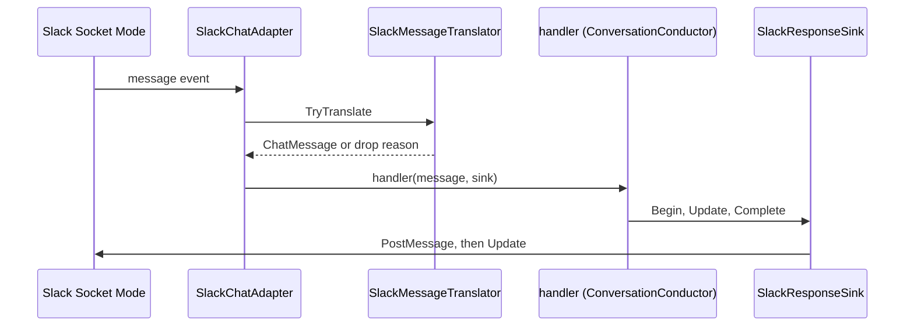

# Adapter.Slack

> Connects Scout to Slack without a public endpoint, using a bot token and an app-level token.

## To change here, read

- [[pages/invariants/pluggable-boundaries]]
- [[pages/invariants/secrets-never-in-source]]
- [[pages/invariants/no-executive-writes]]
- [[pages/services/conversation]]
- [[pages/conventions/testing]]

## Responsibility

Owns the Socket Mode connection, message filtering and the response sink. Does not own routing or memory ([[pages/services/conversation]]).

## Public contract

- **Entry point:** `AddSlackAdapter(IServiceCollection, IConfiguration)` at `src/Scout.Adapter.Slack/SlackServiceCollectionExtensions.cs:20`; registers nothing unless both tokens are set (`:32`).
- **Key types:** `SlackChatAdapter : IChatAdapter` (`src/Scout.Adapter.Slack/SlackChatAdapter.cs:18`), `SlackMessageTranslator` (`src/Scout.Adapter.Slack/SlackMessageTranslator.cs:13`), `SlackResponseSink : IResponseSink` (`src/Scout.Adapter.Slack/Streaming/SlackResponseSink.cs:34`), `SlackMessageHandle` (`src/Scout.Adapter.Slack/Streaming/SlackMessageHandle.cs:10`), `SlackOptions` (`src/Scout.Adapter.Slack/SlackOptions.cs:8`), `SlackOriginPoster : IOriginPoster` (`src/Scout.Adapter.Slack/SlackOriginPoster.cs:12`), registered with the adapter (`src/Scout.Adapter.Slack/SlackServiceCollectionExtensions.cs:41`).
- **Configuration keys:** `Scout:Adapters:Slack` with `BotToken`, `AppLevelToken` (`src/Scout.Adapter.Slack/SlackServiceCollectionExtensions.cs:18`).
- **External boundaries:** SlackNet service builder and Socket Mode client (`src/Scout.Adapter.Slack/SlackChatAdapter.cs:63`, `:112`), on SlackNet 0.19.0; `StopAsync` awaits `DisconnectAsync`, bounded by the caller's cancellation token (`:125`), and lets its fault propagate; `DisposeAsync` disposes the lifecycle and awaits the socket client's `DisposeAsync` even when stop throws (`:128`); writes are `Chat.PostMessage` (`src/Scout.Adapter.Slack/Streaming/SlackResponseSink.cs:84`) and `Chat.Update` (`:96`). Body capped at 3000 characters (`:38`). A later plain-text `Chat.PostMessage` into the originating thread (`src/Scout.Adapter.Slack/SlackOriginPoster.cs:43`).

## How it works

The translator drops anything from a bot, from this app, or with a `bot_message` subtype, so the sink's own `chat.update` edits cannot retrigger the adapter (`src/Scout.Adapter.Slack/SlackMessageTranslator.cs:39`). Messages with other subtypes are also dropped (`:55`). A message in an `im` channel gets `ChatMessage.IsDirectMessage = true` (`:85`), which owner pairing requires ([[pages/decisions/0021-allowed-users]]).

- **Origin reference.** The adapter names the conversation as `slack:<channel id>:<thread ts>`, built from the same channel and thread timestamp the reply sink is bound to (the parent thread, or the message's own ts when it starts one), so a later post lands in the thread the reply went to (`src/Scout.Adapter.Slack/SlackChatAdapter.cs:182`; [[pages/decisions/0033-channel-operator-architecture]], [[pages/services/conversation]]).
- **Later posts.** `SlackOriginPoster` reads that payload and, while the adapter is running (`src/Scout.Adapter.Slack/SlackChatAdapter.cs:221`), posts one plain-text message into that channel and thread through the adapter's own API client, capped at the sink's 3000 characters and ending in "..." when cut (`src/Scout.Adapter.Slack/SlackOriginPoster.cs:27`). It escapes `&`, `<` and `>` as `&amp;`, `&lt;` and `&gt;` (`:21`), so `<!channel>`, `<!here>`, `<!everyone>`, `<!subteam^...>`, user mentions and link markup in model text arrive as plain text; a plain `@channel` stays plain because the post does not set `link_names`. A payload it cannot read, an adapter that is not running, or a post Slack refuses (a `SlackException` such as `channel_not_found`, a reset) returns false with a Warning that names no channel (`:32`, `:37`, `:58`). The reply sink does not escape markup; only the later post does.

## Desktop setup

The desktop app creates the Slack app from a manifest and passes the two tokens as `SCOUT__ADAPTERS__SLACK__BOTTOKEN` and `SCOUT__ADAPTERS__SLACK__APPLEVELTOKEN` ([[pages/decisions/0023-slack-setup-from-a-manifest]], [[pages/services/desktop-ui]]). The manifest (`ui/packages/main/src/slack/slack-setup.ts:19`) turns Socket Mode on and asks for the events this adapter reads, `message.channels`, `message.groups` and `message.im`, with `channels:history`, `groups:history`, `im:history` and `chat:write`. A change here that reads another event or calls another Web API method changes that manifest too; otherwise an app created from it never receives the event or lacks the scope.

## Invariants

- [[pages/invariants/pluggable-boundaries]]: self-gates on two tokens and registers as `IChatAdapter`.
- [[pages/invariants/secrets-never-in-source]]: the constructor rejects either empty token (`src/Scout.Adapter.Slack/SlackChatAdapter.cs:43`, `:51`).
- [[pages/invariants/no-executive-writes]]: the only platform writes are the reply post, its updates and a later progress post into the same thread.

## Hot spots

- `src/Scout.Adapter.Slack/SlackChatAdapter.cs:198`: projection of the SlackNet event into `InboundSlackMessage`.
- `src/Scout.Adapter.Slack/Streaming/SlackResponseSink.cs:261`: truncation budget with cursor glyph and citation footer.

## Testing footprint

`tests/Scout.Adapter.Slack.Tests` (67 test attributes, 72 test cases, 9 files): the origin reference for a top-level and a threaded message, and the later post (`SlackOriginPosterTests.cs`: plain text into the channel and thread, broadcast mentions posted as plain text, the 3000 cap, a `SlackException` false with a Warning naming no channel, an adapter not started, unreadable payloads, the composed notifier reaching the Slack poster); translator rules, inbound projection, adapter and lifecycle (stop awaits the Socket Mode disconnect, returns on cancellation if it never completes, and surfaces its fault; dispose still disposes the socket client when stop faults), DI gating including a missing app-level token, sink behaviour and a sink boundary test. No live Slack connection.

## Related

Direct project references: [[pages/services/conversation]]. Referenced by [[pages/services/host-console]]. Map: [[pages/architecture/project-map]]. Dated changes: [[pages/history/adapter-slack]].
