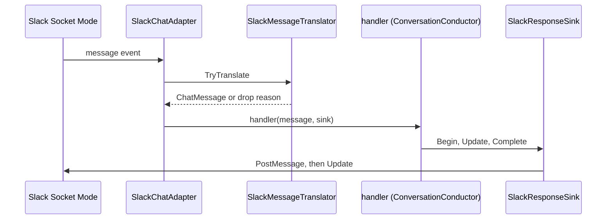

# Adapter.Slack

> Connects Scout to Slack without a public endpoint, using a bot token and an app-level token.

## To change here, read

- [[pages/invariants/pluggable-boundaries]]
- [[pages/invariants/secrets-never-in-source]]
- [[pages/invariants/no-executive-writes]]
- [[pages/services/conversation]]
- [[pages/conventions/testing]]

## Responsibility

Owns the Socket Mode connection, message filtering and the response sink. Does not own routing or memory ([[pages/services/conversation]]).

## Public contract

- **Entry point:** `AddSlackAdapter(IServiceCollection, IConfiguration)` at `src/Scout.Adapter.Slack/SlackServiceCollectionExtensions.cs:20`; registers nothing unless both tokens are set (`:32`).
- **Key types:** `SlackChatAdapter : IChatAdapter` (`src/Scout.Adapter.Slack/SlackChatAdapter.cs:18`), `SlackMessageTranslator` (`src/Scout.Adapter.Slack/SlackMessageTranslator.cs:13`), `SlackResponseSink : IResponseSink` (`src/Scout.Adapter.Slack/Streaming/SlackResponseSink.cs:34`), `SlackMessageHandle` (`src/Scout.Adapter.Slack/Streaming/SlackMessageHandle.cs:10`), `SlackOptions` (`src/Scout.Adapter.Slack/SlackOptions.cs:8`).
- **Configuration keys:** `Scout:Adapters:Slack` with `BotToken`, `AppLevelToken` (`src/Scout.Adapter.Slack/SlackServiceCollectionExtensions.cs:18`).
- **External boundaries:** SlackNet service builder and Socket Mode client (`src/Scout.Adapter.Slack/SlackChatAdapter.cs:63`, `:112`); writes are `Chat.PostMessage` (`src/Scout.Adapter.Slack/Streaming/SlackResponseSink.cs:84`) and `Chat.Update` (`:96`). Body capped at 3000 characters (`:38`).

## How it works

The translator drops anything from a bot, from this app, or with a `bot_message` subtype, so the sink's own `chat.update` edits cannot retrigger the adapter (`src/Scout.Adapter.Slack/SlackMessageTranslator.cs:39`). Messages with other subtypes are also dropped (`:55`).

## Invariants

- [[pages/invariants/pluggable-boundaries]]: self-gates on two tokens and registers as `IChatAdapter`.
- [[pages/invariants/secrets-never-in-source]]: the constructor rejects either empty token (`src/Scout.Adapter.Slack/SlackChatAdapter.cs:43`, `:51`).
- [[pages/invariants/no-executive-writes]]: the only platform writes are the reply post and its updates.

## Hot spots

- `src/Scout.Adapter.Slack/SlackChatAdapter.cs:192`: projection of the SlackNet event into `InboundSlackMessage`.
- `src/Scout.Adapter.Slack/Streaming/SlackResponseSink.cs:261`: truncation budget with cursor glyph and citation footer.

## Testing footprint

`tests/Scout.Adapter.Slack.Tests` (54 test attributes, 7 files): translator rules, inbound projection, adapter and lifecycle, DI gating including a missing app-level token, sink behaviour and a sink boundary test. No live Slack connection.

## Related

Direct project references: [[pages/services/conversation]]. Referenced by [[pages/services/host-console]]. Map: [[pages/architecture/project-map]].
