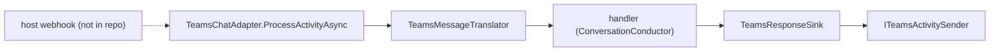

# Adapter.Teams

> The Teams half of Scout that is testable without Azure: it handles a turn once something hands it one.

## To change here, read

- [[pages/invariants/pluggable-boundaries]]
- [[pages/invariants/secrets-never-in-source]]
- [[pages/invariants/no-executive-writes]]
- [[pages/services/conversation]]
- [[pages/conventions/testing]]

## Responsibility

Owns turn handling, message translation and the response sink over an abstract activity sender. Does not own the HTTP endpoint, the `CloudAdapter` or the `IBot` that forward Bot Framework requests; the source states these are not registered (`src/Scout.Adapter.Teams/TeamsServiceCollectionExtensions.cs:18`).

## Public contract

- **Entry point:** `AddTeamsAdapter(IServiceCollection, IConfiguration)` at `src/Scout.Adapter.Teams/TeamsServiceCollectionExtensions.cs:27`; registers nothing without an app id (`:37`).
- **Key types:** `TeamsChatAdapter : IChatAdapter` (`src/Scout.Adapter.Teams/TeamsChatAdapter.cs:37`) with `ProcessActivityAsync(ITurnContext, CancellationToken)` (`:107`), `TeamsMessageTranslator` (`src/Scout.Adapter.Teams/TeamsMessageTranslator.cs:18`), `TeamsResponseSink : IResponseSink` (`src/Scout.Adapter.Teams/Streaming/TeamsResponseSink.cs:42`), `ITeamsActivitySender` (`src/Scout.Adapter.Teams/Streaming/ITeamsActivitySender.cs:16`), `TeamsTransportException` (`src/Scout.Adapter.Teams/Streaming/TeamsTransportException.cs:12`), `TeamsOptions` (`src/Scout.Adapter.Teams/TeamsOptions.cs:8`).
- **Configuration keys:** `Scout:Adapters:Teams` with `AppId`, `AppPassword`, `TenantId` (`src/Scout.Adapter.Teams/TeamsServiceCollectionExtensions.cs:25`).
- **External boundaries:** Bot Framework connector; the sink writes through `SendActivityAsync` (`src/Scout.Adapter.Teams/TeamsChatAdapter.cs:166`). `ProcessActivityAsync` has no production caller in the repository.

## How it works

`StartAsync` only arms a lifetime token and stores the handler (`src/Scout.Adapter.Teams/TeamsChatAdapter.cs:74`); a turn arriving before start or after stop returns without work (`:117`). Each turn links the request token to the lifetime token so host shutdown cancels it (`:124`).

## Invariants

- [[pages/invariants/pluggable-boundaries]]: registers as `IChatAdapter` only when configured.
- [[pages/invariants/secrets-never-in-source]]: the constructor rejects an empty app id (`src/Scout.Adapter.Teams/TeamsChatAdapter.cs:58`).
- [[pages/invariants/no-executive-writes]]: the only platform writes are the reply activities.

## Hot spots

- `src/Scout.Adapter.Teams/Streaming/TeamsResponseSink.cs:141`: streaming update with transport-error mapping (`src/Scout.Adapter.Teams/Streaming/TeamsErrorMapper.cs:15`).
- `src/Scout.Adapter.Teams/TeamsServiceCollectionExtensions.cs:18`: the missing webhook, so a configured Teams adapter receives nothing in the shipped host.

## Testing footprint

`tests/Scout.Adapter.Teams.Tests` (50 test attributes, 7 files): translator, adapter and lifecycle, DI gating, sink behaviour, a sink boundary test and a sink-with-pump test using `Streaming/RecordingSender.cs`. No Azure calls.

## Related

Direct project references: [[pages/services/conversation]]. Referenced by [[pages/services/host-console]]. Map: [[pages/architecture/project-map]].
