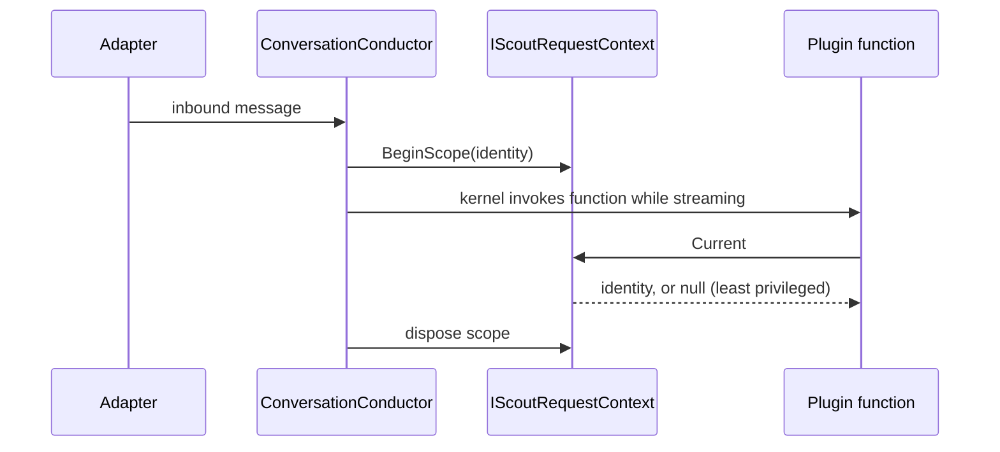

# Contracts

> The shared, dependency-free types that carry the current caller's identity from the chat boundary to code that runs while the model streams.

## To change here, read

- [[pages/invariants/no-executive-writes]]
- [[pages/invariants/pluggable-boundaries]]
- [[pages/services/conversation]]
- [[pages/services/plugin-selfinfo]]
- [[pages/conventions/testing]]

## Responsibility

Owns `ScoutRequestIdentity`, the ambient accessor and its DI registration. Does not own deciding who is an admin (that is `SelfInfoOptions`, [[pages/services/plugin-selfinfo]]) or opening the scope ([[pages/services/conversation]]).

## Public contract

- **Record:** `ScoutRequestIdentity(UserId, ChannelId, IsDirectMessage, AdapterName)` (`src/Scout.Contracts/ScoutRequestIdentity.cs:17`).
- **Accessor:** `IScoutRequestContext` with `Current` and `BeginScope(identity)` (`src/Scout.Contracts/IScoutRequestContext.cs:15`); `Current` is null when no scope is active and consumers must then act as the least-privileged caller (`:18`).
- **Implementations:** `AsyncLocalScoutRequestContext` (`src/Scout.Contracts/AsyncLocalScoutRequestContext.cs:17`), nesting-safe and idempotent on dispose (`:25,42`); `NullScoutRequestContext` always returns null (`src/Scout.Contracts/NullScoutRequestContext.cs:9`).
- **Entry point:** `AddScoutRequestContext(IServiceCollection)` registers one singleton with `TryAddSingleton` (`src/Scout.Contracts/ScoutRequestContextServiceCollectionExtensions.cs:22,25`). Two instances would not share the AsyncLocal and would fail closed, hence the single registration.
- **Configuration keys:** none.
- **Writer:** the conductor opens the scope per turn (`src/Scout.Conversation/ConversationConductor.cs:65`). **Reader:** the SelfInfo plugin (`src/Scout.Plugin.SelfInfo/SelfInfoPlugin.cs:39`). Registered from `src/Scout.Conversation/ConversationServiceCollectionExtensions.cs:36`, `src/Scout.Host.Console/HostComposition.cs:63` and the SelfInfo extension.

## How it works

The identity is deliberately not a Semantic Kernel function parameter, so the model cannot forge it (`src/Scout.Contracts/IScoutRequestContext.cs:10`).

## Invariants

- [[pages/invariants/no-executive-writes]]: the record's own comment states the identity gates disclosure only and never authorises a write (`src/Scout.Contracts/ScoutRequestIdentity.cs:9`). Nothing in this project writes anything.
- [[pages/invariants/pluggable-boundaries]]: plugins depend on this small project, not on Conversation; only SelfInfo references it today (`src/Scout.Plugin.SelfInfo/Scout.Plugin.SelfInfo.csproj`).

## Testing footprint

`tests/Scout.Contracts.Tests` (15 test attributes, 4 files): AsyncLocalScoutRequestContextTests, NullScoutRequestContextTests, ScoutRequestContextServiceCollectionExtensionsTests.

## Related

Direct project references: none. Referenced by [[pages/services/conversation]] and [[pages/services/plugin-selfinfo]]. Map: [[pages/architecture/project-map]].
