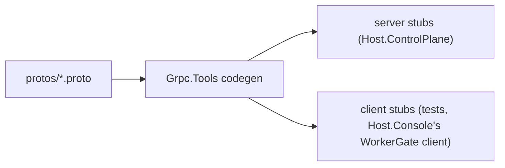

# ControlPlane.Contracts

> The wire format: four services for the desktop, one for the worker, no logic.

## To change here, read

- [[pages/invariants/no-executive-writes]]
- [[pages/decisions/0032-per-feature-write-permissions]]
- [[pages/decisions/0033-channel-operator-architecture]]
- [[pages/services/host-control-plane]]
- [[pages/services/control-plane]]
- [[pages/conventions/testing]]

## Responsibility

Holds `.proto` files and generates C# for both sides (`GrpcServices="Both"`). The project contains no hand-written `.cs` files.

## Public contract

All five services share package `scout.controlplane.v1` and C# namespace `Scout.ControlPlane.Contracts`. The proto files carry no comments; what a field means is written here.

- **Providers** (`src/Scout.ControlPlane.Contracts/protos/providers.proto:8`): `ListProviders`, `GetProviderStatus`, `StartProvider`, `StopProvider`, `RestartProvider`, `SetAutostart`, `WatchProviderStatus` (server stream).
- **Models** (`src/Scout.ControlPlane.Contracts/protos/models.proto:11`): `PullModel` (server stream of progress), `DeleteModel`, `ListModels`.
- **Features** (`src/Scout.ControlPlane.Contracts/protos/features.proto:8`): `ListFeatures`, `SetCredentials`, `Setup`, `DeleteCredentials`, `Enable`, `Disable`, `SetWriteGrant`, `ListPendingActions`, `ApproveAction`, `RejectAction`, `ListWrites` ([[pages/decisions/0032-per-feature-write-permissions]]).
  - `FeatureScopeRow.access` (`:55`): 0 read, 1 write, 2 irreversible write. `Feature` (`:59`) carries `write_class` (`:75`; 0 none, 1 descriptive, 2 executive), `granted` and the optional ISO 8601 round-trip time of the owner's grant, `granted_at` (`:77`). Every addition is a new field number, so a client built on the earlier proto still reads the message.
  - `EnableRequest.confirm_writes` (`:106`): the owner confirmed the write rows; enabling a feature with write rows without it answers `FAILED_PRECONDITION`. `SetWriteGrantRequest` (`:113`, `id`, `granted`, `confirm_writes`) grants or revokes the write permission of a feature with write rows; granting needs `confirm_writes`, revoking does not.
  - `PendingAction` (`:119`): an irreversible action waiting for the owner, times in ISO 8601, `status` one of `pending`, `approved`, `rejected`, `executed` (approved and recorded by the worker), and the owner's optional `reason` on either decision; `ApproveAction` and `RejectAction` take `ActionDecisionRequest` (`:137`, `id`, optional `reason`) and return the decided action with that reason.
  - `WriteLogEntry` (`:141`): one write a feature performed, `approved_by` `owner` or unset; `ListWritesRequest.limit` (`:152`) is the number of newest entries to return, 0 or less means 50.
- **Operator** (`src/Scout.ControlPlane.Contracts/protos/operator.proto:7`): the desktop's door to the channel operator's state ([[pages/decisions/0033-channel-operator-architecture]]): `GetMandate`, `SaveMandate`, `ListProjects`, `GetProject`, `StartProject`, `DecideClaim` (`:8` to `:13`).
  - `Mandate` (`:18`): `objective`, `audience`, `pillars` (at most 5, each at most 80 characters), `cadence`, `language`, `voice_and_style`, `blocked_topics`, `target_metric`, `target_value`, and the optional ISO 8601 round-trip `updated_at`, set by the control plane when it saves. `SaveMandate` takes and returns it; `objective` and `language` are required.
  - `ListProjectsRequest.limit` (`:31`): 0 or less means 50, at most 200; newest first. `StartProjectRequest.topic` (`:43`): 3 to 200 characters after trimming; without the owner's YouTube write grant `StartProject` answers `PERMISSION_DENIED` with the write gate's reason.
  - `DecideClaimRequest` (`:47`): `project_id`, `claim_id`, `status` one of `supported`, `unsupported`, `waived`, and the optional `note`, required for `waived`.
  - `Project` (`:54`): `id`, `topic`, `status` (`queued`, `researching`, `scripting`, `script_ready`, `failed`), `origin` (`desktop` or `chat`), ISO 8601 `created_at` and `updated_at`, `candidates` (`TopicCandidate`, `:67`: `title`, `reason`, `fit`), the optional `script` (`Script`, `:73`: `hook`, `sections` of `ScriptSection` `:83` `heading` and `narration`, `call_to_action`, `title_variants`, `description`, `tags`, `chapters` of `Chapter` `:88` `at` and `title`), `claims` and the optional `error`. A `Project` never carries the conversation reference a chat request came from.
  - `Claim` (`:93`): `id`, `text`, `risk`, `source_urls`, `status` (`pending` or `unsupported` from the worker; `supported`, `unsupported` or `waived` from the owner) and the optional `note`.
- **WorkerGate** (`src/Scout.ControlPlane.Contracts/protos/worker.proto:9`): the worker's only door into the control plane ([[pages/decisions/0032-per-feature-write-permissions]]). It asks whether a declared write may run, records the writes it performed, and reads and saves the operator's state; it can never grant a permission, decide an action or decide a claim. It imports `operator.proto` for the shared messages.
  - `RequestWrite` (`:10`) takes `RequestWriteRequest` (`:19`: `feature_id`, `scope`, `target`, `summary`) and answers `RequestWriteResponse` (`:26`): `decision` is exactly `allowed`, `queued` or `refused`, `reason` says why (empty when allowed), and the optional `action_id` is set only when queued.
  - `RecordWrite` (`:11`) takes `RecordWriteRequest` (`:32`: `feature_id`, `scope`, `target`, `outcome`, optional `action_id`) and answers the empty `RecordWriteResponse` (`:40`), or `FAILED_PRECONDITION` when the write could not have been permitted. The semantics are on [[pages/services/control-plane]].
  - `GetOperatorMandate` (`:12`) answers the owner's `Mandate`, empty when none is saved.
  - `SaveOperatorProject` (`:13`) takes `SaveOperatorProjectRequest` (`:42`: `project`, optional `origin_reference`) and answers the saved `Project`. An empty `project.id` creates a project of origin `chat` that keeps `origin_reference`; an existing project keeps its topic, origin and reference. It needs the owner's live `youtube` write grant (`PERMISSION_DENIED` with the gate's reason); a status or claim value outside the vocabulary is `INVALID_ARGUMENT`; marking a claim `supported` or `waived`, changing or dropping an owner-decided claim, or changing the topic or origin is `FAILED_PRECONDITION`; an unknown id is `NOT_FOUND`. Every successful save is one entry in the write log, action "Scout's data folder", outcome `saved <status>`.
  - `NextQueuedProject` (`:14`) takes the empty `NextQueuedProjectRequest` (`:47`) and answers `NextQueuedProjectResponse` (`:49`): the oldest `queued` project or, when none is queued, the oldest project left in `researching` or `scripting` with no save for 15 minutes, moved to `researching`, with its optional `origin_reference`, or neither when nothing waits. It needs the same grant.
  - `GetOperatorProject` (`:15`) takes `GetProjectRequest` and answers the `Project`, owner-decided claims with their status and note, never the origin reference; `ListOperatorProjects` (`:16`) takes `ListProjectsRequest` and answers `ListProjectsResponse`, newest first, with the desktop's limit rules. Both need the same grant; an unknown id is `NOT_FOUND`.
- **Build wiring:** `src/Scout.ControlPlane.Contracts/Scout.ControlPlane.Contracts.csproj:21` to `:25` list the five `Protobuf` items, all `GrpcServices="Both"`; packages are `Google.Protobuf`, `Grpc.AspNetCore`, `Grpc.Tools`. The desktop client loads `providers.proto`, `features.proto` and `operator.proto` with `@grpc/proto-loader` (the proto list in `createControlPlaneClient`, `ui/packages/main/src/control-plane/client.ts`); `Scout.Host.Console` uses the generated `WorkerGate` client ([[pages/services/host-console]]).
- **Configuration keys:** none. **External boundaries:** none; this is the contract.

## How it works

## Invariants

- [[pages/invariants/no-executive-writes]]: `StartProvider`, `StopProvider`, `PullModel` and `DeleteModel` are mutating calls on the host; adding a method here widens what the UI can make Scout do.
- [[pages/decisions/0032-per-feature-write-permissions]]: `Enable` with `confirm_writes`, `SetWriteGrant`, `ApproveAction` and `RejectAction` are the only ways to grant a write or approve an action, and only the desktop's token reaches them; the worker's token reaches `WorkerGate` alone, which can request and record but never grant or decide ([[pages/services/host-control-plane]]). No chat path calls the desktop's services.
- [[pages/decisions/0033-channel-operator-architecture]]: `SaveMandate`, `StartProject` and `DecideClaim` are the desktop's alone; the worker changes operator state only through `SaveOperatorProject` and `NextQueuedProject`, and reads projects only through `GetOperatorProject` and `ListOperatorProjects`, all under the grant.

## Hot spots

- `src/Scout.ControlPlane.Contracts/protos/models.proto:13`: `DeleteModel` is the RPC that removes model files from the host.

## Testing footprint

No test project of its own. `tests/Scout.ControlPlane.Tests` references it and exercises the stubs through `Integration/ControlPlaneUdsIntegrationTests.cs`, `Integration/ControlPlaneBoundaryTests.cs`, `Integration/FeatureWritesGrpcTests.cs` (the grant, the queue and the log over the socket), `Integration/OperatorGrpcTests.cs` (the operator's two callers, its round trips and status codes) and `Integration/WorkerGateGrpcTests.cs` (the two callers and the exact `decision` and `reason` strings over the socket, `tests/Scout.ControlPlane.Tests/Integration/WorkerGateGrpcTests.cs:93`).

## Related

Direct project references: none. Referenced by [[pages/services/host-control-plane]] and, for the WorkerGate client, [[pages/services/host-console]]. Map: [[pages/architecture/project-map]].
