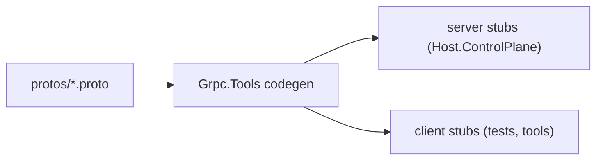

# ControlPlane.Contracts

> The wire format: three services, no logic.

## To change here, read

- [[pages/invariants/no-executive-writes]]
- [[pages/services/host-control-plane]]
- [[pages/services/control-plane]]
- [[pages/conventions/testing]]

## Responsibility

Holds `.proto` files and generates C# for both sides (`GrpcServices="Both"`). The project contains no hand-written `.cs` files.

## Public contract

All three services share package `scout.controlplane.v1` and C# namespace `Scout.ControlPlane.Contracts`.

- **Providers** (`src/Scout.ControlPlane.Contracts/protos/providers.proto:8`): `ListProviders`, `GetProviderStatus`, `StartProvider`, `StopProvider`, `RestartProvider`, `SetAutostart`, `WatchProviderStatus` (server stream).
- **Models** (`src/Scout.ControlPlane.Contracts/protos/models.proto:11`): `PullModel` (server stream of progress), `DeleteModel`, `ListModels`.
- **Features** (`src/Scout.ControlPlane.Contracts/protos/features.proto:8`): `ListFeatures`, `SetCredentials`, `Setup`, `DeleteCredentials`, `Enable`, `Disable`.
- **Build wiring:** `src/Scout.ControlPlane.Contracts/Scout.ControlPlane.Contracts.csproj:21` to `:23` list the three `Protobuf` items; packages are `Google.Protobuf`, `Grpc.AspNetCore`, `Grpc.Tools`.
- **Configuration keys:** none. **External boundaries:** none; this is the contract.

## How it works

## Invariants

- [[pages/invariants/no-executive-writes]]: `StartProvider`, `StopProvider`, `PullModel` and `DeleteModel` are mutating calls on the host; adding a method here widens what the UI can make Scout do.

## Hot spots

- `src/Scout.ControlPlane.Contracts/protos/models.proto:13`: `DeleteModel` is the RPC that removes model files from the host.

## Testing footprint

No test project of its own. `tests/Scout.ControlPlane.Tests` references it and exercises the stubs through `Integration/ControlPlaneUdsIntegrationTests.cs` and `Integration/ControlPlaneBoundaryTests.cs`.

## Related

Direct project references: none. Referenced by [[pages/services/host-control-plane]]. Map: [[pages/architecture/project-map]].
