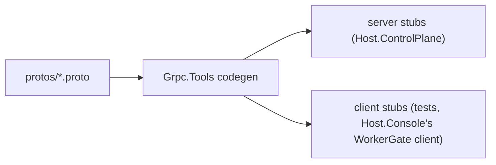

# ControlPlane.Contracts

> The wire format: three services for the desktop, one for the worker, no logic.

## To change here, read

- [[pages/invariants/no-executive-writes]]
- [[pages/decisions/0032-per-feature-write-permissions]]
- [[pages/services/host-control-plane]]
- [[pages/services/control-plane]]
- [[pages/conventions/testing]]

## Responsibility

Holds `.proto` files and generates C# for both sides (`GrpcServices="Both"`). The project contains no hand-written `.cs` files.

## Public contract

All four services share package `scout.controlplane.v1` and C# namespace `Scout.ControlPlane.Contracts`. The proto files carry no comments; what a field means is written here.

- **Providers** (`src/Scout.ControlPlane.Contracts/protos/providers.proto:8`): `ListProviders`, `GetProviderStatus`, `StartProvider`, `StopProvider`, `RestartProvider`, `SetAutostart`, `WatchProviderStatus` (server stream).
- **Models** (`src/Scout.ControlPlane.Contracts/protos/models.proto:11`): `PullModel` (server stream of progress), `DeleteModel`, `ListModels`.
- **Features** (`src/Scout.ControlPlane.Contracts/protos/features.proto:8`): `ListFeatures`, `SetCredentials`, `Setup`, `DeleteCredentials`, `Enable`, `Disable`, `SetWriteGrant`, `ListPendingActions`, `ApproveAction`, `RejectAction`, `ListWrites` ([[pages/decisions/0032-per-feature-write-permissions]]).
  - `FeatureScopeRow.access` (`:55`): 0 read, 1 write, 2 irreversible write. `Feature` (`:59`) carries `write_class` (`:75`; 0 none, 1 descriptive, 2 executive), `granted` and the optional ISO 8601 round-trip time of the owner's grant, `granted_at` (`:77`). Every addition is a new field number, so a client built on the earlier proto still reads the message.
  - `EnableRequest.confirm_writes` (`:106`): the owner confirmed the write rows; enabling a feature with write rows without it answers `FAILED_PRECONDITION`. `SetWriteGrantRequest` (`:113`, `id`, `granted`, `confirm_writes`) grants or revokes the write permission of a feature with write rows; granting needs `confirm_writes`, revoking does not.
  - `PendingAction` (`:119`): an irreversible action waiting for the owner, times in ISO 8601, `status` one of `pending`, `approved`, `rejected`, `executed` (approved and recorded by the worker), and the owner's optional `reason` on either decision; `ApproveAction` and `RejectAction` take `ActionDecisionRequest` (`:137`, `id`, optional `reason`) and return the decided action with that reason.
  - `WriteLogEntry` (`:141`): one write a feature performed, `approved_by` `owner` or unset; `ListWritesRequest.limit` (`:152`) is the number of newest entries to return, 0 or less means 50.
- **WorkerGate** (`src/Scout.ControlPlane.Contracts/protos/worker.proto:7`): the worker's only door into the control plane ([[pages/decisions/0032-per-feature-write-permissions]]). It asks whether a declared write may run and records the writes it performed; it can never grant a permission or decide an action.
  - `RequestWrite` (`:8`) takes `RequestWriteRequest` (`:12`: `feature_id`, `scope`, `target`, `summary`) and answers `RequestWriteResponse` (`:19`): `decision` is exactly `allowed`, `queued` or `refused`, `reason` says why (empty when allowed), and the optional `action_id` is set only when queued.
  - `RecordWrite` (`:9`) takes `RecordWriteRequest` (`:25`: `feature_id`, `scope`, `target`, `outcome`, optional `action_id`) and answers the empty `RecordWriteResponse` (`:33`), or `FAILED_PRECONDITION` when the write could not have been permitted. The semantics are on [[pages/services/control-plane]].
- **Build wiring:** `src/Scout.ControlPlane.Contracts/Scout.ControlPlane.Contracts.csproj:21` to `:24` list the four `Protobuf` items, all `GrpcServices="Both"`; packages are `Google.Protobuf`, `Grpc.AspNetCore`, `Grpc.Tools`. The desktop client loads `providers.proto` and `features.proto` only; `Scout.Host.Console` uses the generated `WorkerGate` client ([[pages/services/host-console]]).
- **Configuration keys:** none. **External boundaries:** none; this is the contract.

## How it works

## Invariants

- [[pages/invariants/no-executive-writes]]: `StartProvider`, `StopProvider`, `PullModel` and `DeleteModel` are mutating calls on the host; adding a method here widens what the UI can make Scout do.
- [[pages/decisions/0032-per-feature-write-permissions]]: `Enable` with `confirm_writes`, `SetWriteGrant`, `ApproveAction` and `RejectAction` are the only ways to grant a write or approve an action, and only the desktop's token reaches them; the worker's token reaches `WorkerGate` alone, which can request and record but never grant or decide ([[pages/services/host-control-plane]]). No chat path calls the desktop's services.

## Hot spots

- `src/Scout.ControlPlane.Contracts/protos/models.proto:13`: `DeleteModel` is the RPC that removes model files from the host.

## Testing footprint

No test project of its own. `tests/Scout.ControlPlane.Tests` references it and exercises the stubs through `Integration/ControlPlaneUdsIntegrationTests.cs`, `Integration/ControlPlaneBoundaryTests.cs`, `Integration/FeatureWritesGrpcTests.cs` (the grant, the queue and the log over the socket) and `Integration/WorkerGateGrpcTests.cs` (the two callers and the exact `decision` and `reason` strings over the socket, `tests/Scout.ControlPlane.Tests/Integration/WorkerGateGrpcTests.cs:93`).

## Related

Direct project references: none. Referenced by [[pages/services/host-control-plane]] and, for the WorkerGate client, [[pages/services/host-console]]. Map: [[pages/architecture/project-map]].
