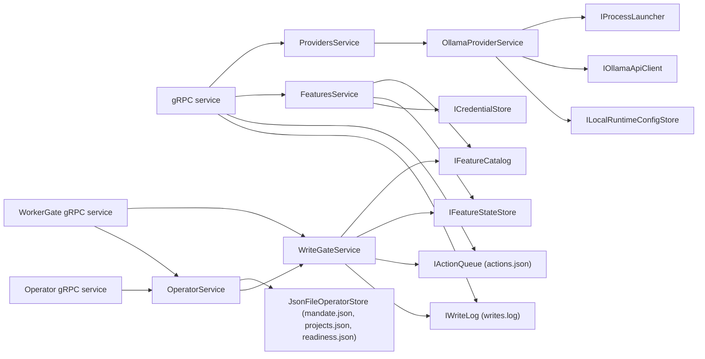

# ControlPlane

> What the desktop app asks Scout to do on the user's machine: run Ollama, pull models, store feature settings.

## To change here, read

- [[pages/invariants/no-executive-writes]]
- [[pages/decisions/0032-per-feature-write-permissions]]
- [[pages/decisions/0033-channel-operator-architecture]]
- [[pages/invariants/secrets-never-in-source]]
- [[pages/invariants/local-first-default]]
- [[pages/services/host-control-plane]]
- [[pages/services/control-plane-contracts]]
- [[pages/conventions/testing]]

## Responsibility

Owns the provider and feature domain services, the write gate and the channel operator's state, with no transport. [[pages/services/host-control-plane]] exposes them over gRPC. It does not run in the chat host ([[pages/services/host-console]]); the chat host reaches it only through the WorkerGate service, as a gRPC client, and shares no code path with it.

## Public contract

- **Entry point:** `AddControlPlaneDomain(IServiceCollection, IConfiguration)` at `src/Scout.ControlPlane/ControlPlaneServiceCollectionExtensions.cs:14`.
- **Providers:** `ProvidersService` (`src/Scout.ControlPlane/Providers/ProvidersService.cs:11`), `OllamaProviderService` for start, stop, status, model pull and delete (`src/Scout.ControlPlane/Providers/OllamaProviderService.cs:12`), seams `IProcessLauncher`, `IOllamaApiClient`, `IBinaryLocator`, `ILocalRuntimeRegistry`, `ILocalRuntimeConfigStore` and `IOllamaReadinessProbe`.
- **Features:** `FeaturesService` (`src/Scout.ControlPlane/Features/FeaturesService.cs:9`), `IFeatureCatalog` (`src/Scout.ControlPlane/Features/IFeatureCatalog.cs:6`) with GitHub, Kubernetes and YouTube entries (`src/Scout.ControlPlane/Features/FeatureCatalog.cs:7,10,13`), `IFeatureStateStore` (`src/Scout.ControlPlane/Features/IFeatureStateStore.cs:22`), `ICredentialStore` (`src/Scout.ControlPlane/Features/ICredentialStore.cs:9`), `IFeatureActivator` (`src/Scout.ControlPlane/Features/IFeatureActivator.cs:9`), `IFeatureCredentialValidator` (`src/Scout.ControlPlane/Features/FeatureCredentialValidation.cs:50`).
- **Write declarations and grants** ([[pages/decisions/0032-per-feature-write-permissions]]): every scope row carries `ScopeAccess` `Read`, `Write` or `IrreversibleWrite` (`src/Scout.ControlPlane/Features/FeatureFields.cs:29`, `:42`); `FeatureMetadata.HasWriteRows` (`src/Scout.ControlPlane/Features/FeatureMetadata.cs:42`); `FeatureCatalog.Validate` rejects a write row under `WriteClass.None` and runs in the catalog's constructor (`src/Scout.ControlPlane/Features/FeatureCatalog.cs:174`, `:181`). `EnableAsync(id, confirmWrites, ct)` (`src/Scout.ControlPlane/Features/FeaturesService.cs:248`) and `SetWriteGrantAsync(id, granted, confirmWrites, ct)` (`src/Scout.ControlPlane/Features/FeaturesService.cs:307`) throw `WriteConfirmationRequiredException` (`src/Scout.ControlPlane/Features/FeatureExceptions.cs:56`) for a feature with write rows when the confirmation is missing. `FeatureSnapshot` carries `WriteClass`, `Granted` and `GrantedAt`.
- **Actions:** `IActionQueue` (`src/Scout.ControlPlane/Actions/IActionQueue.cs:7`, with `ApproveAsync` and `RejectAsync` taking the owner's optional reason, `:23`, `MarkExecutedAsync`, `:33`, and `FindAsync` by id in any status, `:36`) over `JsonFileActionQueue` (`src/Scout.ControlPlane/Actions/JsonFileActionQueue.cs:17`) with `PendingAction` (`src/Scout.ControlPlane/Actions/PendingAction.cs:24`); `IWriteLog` (`src/Scout.ControlPlane/Actions/IWriteLog.cs:4`) over `JsonLinesWriteLog` (`src/Scout.ControlPlane/Actions/JsonLinesWriteLog.cs:13`) with `WriteLogEntry` (`src/Scout.ControlPlane/Actions/WriteLogEntry.cs:7`); registered with `TryAdd` (`src/Scout.ControlPlane/ControlPlaneServiceCollectionExtensions.cs:72`, `:73`).
- **Write gate:** `WriteGateService` (`src/Scout.ControlPlane/WriteGate/WriteGateService.cs:39`) with `RequestAsync` (`:62`) returning a `WriteDecision` (`:20`) of `Allowed`, `Queued` or `Refused` (`:7`) and `RecordAsync` (`:109`), which throws `WriteNotRecordableException` (`:23`); registered as a singleton (`src/Scout.ControlPlane/ControlPlaneServiceCollectionExtensions.cs:76`).
- **Operator** ([[pages/decisions/0033-channel-operator-architecture]]): records `Mandate`, `OperatorProject` (with the init-only `Scenes`, empty by default, and `Package`, null until the first assembly), `TopicCandidate`, `Script`, `ScriptSection`, `Chapter`, `Claim`, `Scene`, `VideoPackage`, `ShortClip`, `PackageCheck` and `Readiness` (`src/Scout.ControlPlane/Operator/OperatorModels.cs:4`, `:25`, `:39`, `:42`, `:46`, `:49`, `:59`, `:62`, `:68`, `:82`, `:102`, `:118`, `:121`, `:124`); `JsonFileOperatorStore` (`src/Scout.ControlPlane/Operator/JsonFileOperatorStore.cs:17`) with `ReadMandateAsync`, `WriteMandateAsync`, `ReadReadinessAsync`, `WriteReadinessAsync`, `ReadProjectsAsync` and `UpdateProjectsAsync` (`:55`, `:69`, `:85`, `:99`, `:115`, `:132`) and `MediaRoot` (`:52`); `OperatorService` (`src/Scout.ControlPlane/Operator/OperatorService.cs:18`) with the desktop side `GetMandateAsync`, `SaveMandateAsync`, `ListProjectsAsync`, `GetProjectAsync`, `StartProjectAsync`, `DecideClaimAsync` (`:72`, `:77`, `:121`, `:130`, `:140`, `:152`), `ProduceProjectAsync`, `ReorderScenesAsync`, `SetSceneLockedAsync`, `RegenerateSceneAsync`, `AttachSceneMediaAsync`, `GetMediaDirectoryAsync` and `GetReadinessAsync` (`:371`, `:404`, `:432`, `:441`, `:474`, `:514`, `:708`), `AssembleProjectAsync`, `ConfirmMediaRightsAsync`, `EditPackageMetadataAsync` and `ApprovePackageAsync` (`:541`, `:584`, `:599`, `:641`), and the worker side `GetMandateAsync`, `SaveProjectFromWorkerAsync` (`:206`), `GetProjectForWorkerAsync` (`:303`), `ListProjectsForWorkerAsync` (`:311`), `NextQueuedProjectAsync` (`:327`), `GetMediaDirectoryForWorkerAsync` (`:526`) and `ReportReadinessAsync` (`:690`); `SceneRules` (`src/Scout.ControlPlane/Operator/SceneRules.cs:7`) with the file name rule, the scene vocabulary and the worker's scene merge (`:31`, `:56`, `:95`); `PackageRules` (`src/Scout.ControlPlane/Operator/PackageRules.cs:12`) with the fresh package of an assembly, the package vocabulary, the worker's package merge, the package comparison, the assembled files and the metadata limits (`:28`, `:38`, `:85`, `:122`, `:137`, `:154`); exceptions `OperatorValidationException`, `OperatorNotFoundException`, `OperatorWriteRefusedException`, `OperatorTamperingException` and `OperatorStoreException` (`src/Scout.ControlPlane/Operator/OperatorExceptions.cs:4`, `:14`, `:24`, `:34`, `:44`); both registered as singletons (`src/Scout.ControlPlane/ControlPlaneServiceCollectionExtensions.cs:77`, `:78`).
- **Configuration keys:** `Scout:Providers:Ollama` (`Endpoint`, `PingTimeout`, `StartTimeout`, `WarmupBudget`; `src/Scout.ControlPlane/Providers/OllamaProviderOptions.cs:9`), `Scout:LocalRuntime:Config` (`src/Scout.ControlPlane/Providers/ILocalRuntimeConfigStore.cs:24`), `Scout:Features:StateStore` with `FilePath` (`src/Scout.ControlPlane/Features/FeatureStateStoreOptions.cs:11`); the queue, the log and the operator's files take the folder of that file (`src/Scout.ControlPlane/Features/FeatureStateStoreOptions.cs:23`).
- **External boundaries:** HTTP to the Ollama daemon, including a streamed model pull with no global timeout (`src/Scout.ControlPlane/ControlPlaneServiceCollectionExtensions.cs:43`); spawn and kill of the `ollama serve` process (`src/Scout.ControlPlane/Providers/OllamaProviderService.cs:192`, `src/Scout.ControlPlane/Providers/SystemProcessLauncher.cs:173`); JSON files `local-runtimes.json`, `features.json` and `actions.json` under local application data, written through a temp file and atomic move (`src/Scout.ControlPlane/Providers/JsonFileLocalRuntimeConfigStore.cs:123`, `src/Scout.ControlPlane/Features/JsonFileFeatureStateStore.cs:165`, `src/Scout.ControlPlane/Actions/JsonFileActionQueue.cs:240`), and the append-only `writes.log` beside them, one JSON object per line (`src/Scout.ControlPlane/Actions/JsonLinesWriteLog.cs:51`); the operator's `mandate.json`, `projects.json` and `readiness.json` in the same folder, written the same way (`src/Scout.ControlPlane/Operator/JsonFileOperatorStore.cs:36`, `:37`, `:38`, `:199`), and one media directory per project under `operator/` there, created on demand (`:39`, `src/Scout.ControlPlane/Operator/OperatorService.cs:532`).

## How it works

The daemon is launched with both control-plane tokens, the desktop's `SCOUT_CONTROLPLANE_TOKEN` and the worker's `SCOUT_CONTROLPLANE_WORKER_TOKEN`, removed from the child environment (`src/Scout.ControlPlane/Providers/OllamaProviderService.cs:200`, `:201`); the code carries no comment about the worker token, and `tests/Scout.ControlPlane.Tests/Security/CallerTokensTests.cs:58` keeps its literal in step with the host's. The credential store falls back to `InMemoryCredentialStore` (`src/Scout.ControlPlane/ControlPlaneServiceCollectionExtensions.cs:69`) and the activator to `NullFeatureActivator` (`:70`), which makes `Enable` answer not-yet-implemented (`src/Scout.ControlPlane/Features/FeaturesService.cs:270`). No `IFeatureCredentialValidator` implementation exists outside `src/old`.

**Write grants.** A feature whose matrix has a `Write` or `IrreversibleWrite` row needs the owner's confirmation of those rows. `EnableAsync` checks it after the credentials and before the activator (`src/Scout.ControlPlane/Features/FeaturesService.cs:263`), so even with the confirmation the default activator still ends in not-yet-implemented; a successful enable records `Granted` and `GrantedAt` (`:283`), and a failed activation clears them (`:294`). A connection card with no toggle, such as YouTube, grants through `SetWriteGrantAsync` (`src/Scout.ControlPlane/Features/FeaturesService.cs:307`): granting needs the confirmation, revoking does not, a feature without write rows is a validation error, and `Enabled` is left alone. `DisableAsync` and `DeleteCredentialsAsync` reset the state and so revoke the grant (`src/Scout.ControlPlane/Features/FeaturesService.cs:345`, `:240`). `FeatureState` keeps `Granted` and `GrantedAt` (`src/Scout.ControlPlane/Features/IFeatureStateStore.cs:11`); the JSON store writes them only while granted, so a state file without them reads as not granted (`src/Scout.ControlPlane/Features/JsonFileFeatureStateStore.cs:172`). The worker learns the grants at start from `SCOUT__FEATURES__GRANTEDWRITES`, set by the desktop ([[pages/services/llm]]).

**Approval queue and write log.** `JsonFileActionQueue` keeps every action in `actions.json` beside `features.json`; enqueue, list, find and each decision run their read, check and write under one gate (`src/Scout.ControlPlane/Actions/JsonFileActionQueue.cs:167`), so two approvals of one action let one through and the other fails as already decided. The worker never writes the file: it enqueues through the WorkerGate service, so every writer is the control-plane process. A decision records the status, `DecidedAt` and the owner's reason when one was given, on an approval as on a rejection. `MarkExecutedAsync` moves an `Approved` action to `Executed` under the same gate and fails with `PendingActionNotApprovedException` for any other status, an executed one included (`src/Scout.ControlPlane/Actions/JsonFileActionQueue.cs:109`); an executed action is no longer pending. A queue file that does not parse is moved aside to `actions.json.corrupt-<UTC yyyyMMddHHmmss>` and logged once as a warning naming both paths, and the queue starts empty (`src/Scout.ControlPlane/Actions/JsonFileActionQueue.cs:213`); the move never overwrites, so a second corruption within the same second fails the call instead of losing the first file. Only malformed content is moved aside (`:211`): a file that cannot be opened or read (an `IOException` or `UnauthorizedAccessException`) fails the call and stays where it is, so a transient lock never empties the queue (`tests/Scout.ControlPlane.Tests/Actions/ActionQueueTests.cs:156`). `JsonLinesWriteLog` appends one line per write to `writes.log` and lists the last N newest first, skipping and logging a line that does not parse.

**Write gate.** `WriteGateService` is what the worker reaches through the WorkerGate service ([[pages/services/host-control-plane]]); it never grants a permission and never decides an action. `RequestAsync` looks the scope up among the catalog rows of the feature by exact, case-sensitive scope text (`src/Scout.ControlPlane/WriteGate/WriteGateService.cs:177`) and answers, in order: an unknown feature or a scope the feature does not declare is `Refused` with "<scope> is not declared by <feature>"; a `Read` row is `Refused` with "<scope> is a read"; a feature whose state is not `Granted` is `Refused` with "The owner has not allowed <feature> to write; allow it on the Features screen of Scout Desktop."; a `Write` row is `Allowed` with an empty reason; an `IrreversibleWrite` row enqueues a pending action (feature, the scope as the action, target, summary) and is `Queued` with its id and "Waiting for the owner's approval on the Review screen of Scout Desktop." (`:96`). The grant is read from the state store on every request (`:86`), so a grant or a revocation on the Features screen applies to the next request without a restart. `RecordAsync` appends a `WriteLogEntry` with the time, feature, scope, target and outcome; it refuses an undeclared scope or a read row, refuses a reversible `Write` row while the feature is not granted, with the same "has not allowed" text, read live like a request (`src/Scout.ControlPlane/WriteGate/WriteGateService.cs:129`), refuses an `IrreversibleWrite` row recorded without an action id with "<scope> is irreversible; it is recorded only with an action the owner approved.", even under the grant (`src/Scout.ControlPlane/WriteGate/WriteGateService.cs:135`), and with an action id it requires an action the owner approved for the same feature and scope (`:146`), then marks it executed before appending (`:161`), recording `ApprovedBy` `owner`; a second record with the same action id, sequential or concurrent, fails as not approved, so an approval covers one write. So every logged irreversible write carries the owner as its approver; the WorkerGate service answers each refusal with `FailedPrecondition` and the log is left untouched.

**Operator state.** The control plane is the only writer of the channel operator's state ([[pages/decisions/0033-channel-operator-architecture]]); the desktop reaches it through the `Operator` gRPC service and the worker through seven operator methods of `WorkerGate` ([[pages/services/host-control-plane]]). `JsonFileOperatorStore` keeps the mandate in `mandate.json` and every project, in creation order, in `projects.json`, both beside `features.json`. `UpdateProjectsAsync` reads the list, runs the caller's check-and-change and writes the list back under one gate (`src/Scout.ControlPlane/Operator/JsonFileOperatorStore.cs:26`, `:132`); when the change throws or answers null, nothing is written (`:141`). A file that does not parse is moved aside to `<name>.corrupt-<UTC yyyyMMddHHmmss>`, never overwritten, logged once as "Operator file at <path> is malformed; moved it to <aside> and started empty", and read as empty (`src/Scout.ControlPlane/Operator/JsonFileOperatorStore.cs:170`, `:174`); a file that cannot be opened fails the call and stays where it is. A `projects.json` written before scenes existed reads with no scenes.

The desktop side: `GetMandateAsync` answers the empty mandate when none is saved. `SaveMandateAsync` trims every field, drops blank pillars and blocked topics, stamps `UpdatedAt`, and refuses an empty objective or language, more than 5 pillars or a pillar over 80 characters, joining the messages ("The objective is required.", "At most 5 pillars.", "Each pillar is at most 80 characters.", "The language is required."). `ListProjectsAsync` returns the newest first; a limit of 0 or less means 50 and at most 200 are returned. `StartProjectAsync` trims the topic, refuses one outside 3 to 200 characters ("The topic must be 3 to 200 characters."), then asks the write gate for the `youtube` grant like a worker save and, without it, refuses with the gate's text as `OperatorWriteRefusedException` (`src/Scout.ControlPlane/Operator/OperatorService.cs:143`), which the desktop receives as `PERMISSION_DENIED`; with it, it queues a project with status `queued` and origin `desktop`. `DecideClaimAsync` takes `supported`, `unsupported` or `waived`, anything else being "A claim is decided as supported, unsupported or waived.", needs a note for `waived` ("A waived claim needs a note saying why."), and stamps the claim's `DecidedAt`, which marks it as the owner's decision. An unknown project or claim is `OperatorNotFoundException`. No desktop method returns a project's `OriginReference` (`src/Scout.ControlPlane/Operator/OperatorService.cs:768`).

The worker side: `SaveProjectFromWorkerAsync`, `GetProjectForWorkerAsync`, `ListProjectsForWorkerAsync` and `NextQueuedProjectAsync` first ask `WriteGateService.RequestAsync` for the `youtube` feature's `Write` row "Scout's data folder", so the grant is read live and a refusal carries the gate's own text, "The owner has not allowed youtube to write; allow it on the Features screen of Scout Desktop." (`src/Scout.ControlPlane/Operator/OperatorService.cs:946`). The mandate read is not gated: it is a read of the owner's brief. The two reads return what the desktop sees, owner-decided claims with their status and note included, with the desktop's limit rules and without the origin reference on the wire, so the worker can send an owner's decision back unchanged. A save then refuses, as `OperatorValidationException`, a status other than `researching`, `scripting`, `script_ready`, `producing`, `media_ready`, `assembling`, `assembled` or `failed`, a claim without an id, duplicate claim ids and a claim status outside `pending`, `unsupported`, `supported` and `waived` (`:214`, `:796`), a scene that breaks the scene rules below (`:221`), and a package that breaks the package rules below; and, as `OperatorTamperingException`, a claim the worker marks `supported` or `waived` unless the stored claim already has that status (`:816`), a claim the owner decided that comes back changed in text, status, note, risk or source links (the links compared in order) or does not come back (`:830`), a different topic or origin on an existing project (`:257`), and a scene change only the owner may make (`:262`). On a project the owner queued for production again (`production_queued`), every worker save is refused, a `failed` one included; on any other project the store no longer holds as `producing`, because the owner regenerated a scene or produced it again between the worker's read and its save, a save that sends `producing` or `media_ready`, or whose merged scenes differ from the stored ones, is refused as `OperatorTamperingException`, `FAILED_PRECONDITION` on the wire, with "The project is no longer producing." (`:272`), and the owner's change stays; the worker stops on those words ([[pages/services/operator]]). Each save that succeeds appends one `WriteLogEntry` to `writes.log` as a reversible write under [[pages/decisions/0032-per-feature-write-permissions]]: feature `youtube`, action "Scout's data folder", the project id as target, outcome `saved <status>`, no approver (`:913`); a refused save appends nothing. An empty id creates a project of origin `chat` that stores the origin reference; an existing project keeps its topic, origin, creation time, owner decisions and reference. `NextQueuedProjectAsync` takes the oldest `queued` project and moves it to `researching`; when none is queued, the oldest `production_queued` project and moves it to `producing`; when neither waits, the oldest `assembly_queued` project and moves it, and its package, to `assembling` (`:726`, `:350`); when none of those waits, the oldest project left in `researching`, `scripting`, `producing` or `assembling` whose `UpdatedAt` is more than 15 minutes old, back in `researching` or, for `producing` and `assembling`, in the same status (`:54`, `:732`); the pipeline saves at every stage, so a live run is never that stale, and a run a worker shutdown cut short is taken again. It moves the project with a fresh `UpdatedAt` inside one `UpdateProjectsAsync`, so two callers never take the same project, appends `saved <status>` for it to the write log, and returns it with its reference. It first reads the list outside the store's write path and returns null when nothing waits, and the change answers null under the gate when another caller took it first, so an idle poll never rewrites `projects.json`.

**Production and scenes.** `ProduceProjectAsync` asks the write gate for the `youtube` grant like `StartProjectAsync`, then refuses, as `OperatorValidationException`, a project that is not `script_ready`, `media_ready`, or `failed` with a script, so a run that failed, planning included, is produced again (`src/Scout.ControlPlane/Operator/OperatorService.cs:379`) ("Only a project with its script ready, its media ready, or a failed one with a script goes to production; this one is <status>.") and one with claims still `pending` ("1 claim is still pending; decide it before production.", "<n> claims are still pending; decide them before production."), and otherwise sets `production_queued` and clears the project's error (`src/Scout.ControlPlane/Operator/OperatorService.cs:393`). The owner's scene edits change Scout's own state, not anything the model wrote, so they need no grant; each answers the project without its origin reference and `NOT_FOUND` for an unknown project or scene ("Unknown scene '<id>' in project '<id>'."). `ReorderScenesAsync` takes the scene ids in the owner's order, refuses anything but every scene exactly once ("The new order must name every scene of the project exactly once."), and numbers them from 1. `SetSceneLockedAsync` sets `Locked`. `RegenerateSceneAsync` refuses a locked scene ("Scene '<id>' is locked; unlock it before regenerating it."), otherwise sets the scene to `planned` without its error, clears the audio file, the visual file and the duration where the source is not `owner` (the source names stay), keeps the owner's media, and sets the project to `production_queued`. `AttachSceneMediaAsync` takes `audio` or `visual` ("Media is attached as audio or visual."), checks the file name, requires the file to be in the project's media directory already ("'<name>' is not in the project's media folder; copy it there first."), sets that source to `owner` with the name, sets the duration to 0 for the owner's audio, unknown until it is measured, and sets the scene `ready` without its error once it has a visual and its audio is decided (`src/Scout.ControlPlane/Operator/OperatorService.cs:512`). A visual is a visual file, or a `text_card` production chose; decided audio is an audio file, or `AudioSource` `none` production chose. Production chose them only on a scene it saved `ready`; on a `planned` or `failed` scene the planner's `none` and `text_card` are placeholders, so an image attached there leaves the scene as it was and the next run still makes its narration.

A media file name is a plain name: not empty, at most 120 characters, no leading dot, no `..`, no backslash, no character the platform forbids in a file name (the folder separator among them), and an audio extension `.mp3`, `.wav`, `.m4a`, `.ogg` or a visual one `.png`, `.jpg`, `.jpeg`, `.webp`, compared without case (`src/Scout.ControlPlane/Operator/SceneRules.cs:31`); it is checked wherever a name is accepted, from the desktop's attach and from a worker save. The media directory is `<folder of features.json>/operator/<project id>`; the id must be 32 hex digits, the store's own id format, so no path can escape (`src/Scout.ControlPlane/Operator/OperatorService.cs:876`), the project must exist, and the folder is created with the default permissions of its parent; when it cannot be created (a file in the way, no permission) the `IOException` propagates, which `OperatorMapping.Guard` does not map, so the desktop receives gRPC `UNKNOWN`. The desktop's `GetMediaDirectoryAsync` and the worker's `GetMediaDirectoryForWorkerAsync`, which needs the grant, return its absolute path.

A worker save checks the scenes it sends: ids present and unique, `Status` one of `planned`, `generating`, `ready`, `failed`, `AudioSource` one of `generated`, `owner`, `none`, `VisualSource` one of `generated`, `owner`, `text_card`, a duration not below 0, and every file name (`src/Scout.ControlPlane/Operator/SceneRules.cs:56`). When the project has no scenes the worker adds its own, none locked and none with an `owner` source. Once scenes exist it can neither add nor drop one, and a worker that claims an `owner` source the stored scene does not have is refused; each of those is `OperatorTamperingException`. Otherwise the save is merged with the stored scenes, in their stored order (`src/Scout.ControlPlane/Operator/SceneRules.cs:95`): the worker sets a scene's status, error, generated sources and files, duration, narration and visual prompt, and what the owner owns comes from storage whatever the worker sends, the `Order` and `Locked` of every scene, a locked scene whole (`:119`), and the owner's audio or visual with its file (`:127`, `:137`). The duration of an owner audio stays the worker's only when the worker sent that same owner file; else the stored one stays. So an owner reorder, lock or attach between the worker's read and its save never fails the run.

**Assembly and the package.** `AssembleProjectAsync` asks the write gate for the `youtube` grant like `ProduceProjectAsync`, then refuses, as `OperatorValidationException`, a project that is not `media_ready`, `assembled` or `failed` ("Only a project with its media ready, an assembled one, or a failed one with every scene ready is assembled; this one is <status>."), one without scenes ("The project has no scenes to assemble.") and one with a scene not `ready` ("1 scene is not ready; regenerate it or attach its media before assembly.", "<n> scenes are not ready; regenerate them or attach their media before assembly."); otherwise it sets `assembly_queued`, clears the project's error and starts the package again (`src/Scout.ControlPlane/Operator/OperatorService.cs:586`): status `assembly_queued`, no video, Shorts, thumbnail, checks, duration or error, rights not confirmed, not approved, and the title, description and tags kept, with `MetadataEdited`, only when the owner edited them, else empty for the worker to fill (`src/Scout.ControlPlane/Operator/PackageRules.cs:34`). The package's own status is `assembly_queued`, `assembling`, `assembled`, `approved` or `failed`; the owner sets `assembly_queued` and `approved`, the worker the other three.

A worker save that carries a package is checked first (`src/Scout.ControlPlane/Operator/PackageRules.cs:44`): a status in that set, no duration, Shorts duration or Shorts start below 0, a title, description and tags within YouTube's limits once any of them is written (empty, the package is still unwritten), every check named with a result `pass`, `warn` or `fail`, and safe file names, the video and each Shorts cut `.mp4`, the thumbnail `.png` or `.jpg`, under the scene file name rule (`src/Scout.ControlPlane/Operator/SceneRules.cs:31`). A worker cannot start a project already `assembling` or `assembled` or with a package (`src/Scout.ControlPlane/Operator/OperatorService.cs:229`). The merge (`src/Scout.ControlPlane/Operator/PackageRules.cs:91`) keeps the stored package when the worker sends none, so a save from a stage that does not know the package leaves it as it is; otherwise the worker's package stands, and it is `OperatorTamperingException` when the worker confirms the rights ("Only the owner confirms the media rights of project '<id>'."), sets or changes `ApprovedAt` ("Only the owner approves the package of project '<id>'."), sends `assembly_queued` or `approved` the store does not hold ("Only the owner sets the package of project '<id>' to <status>."), changes `MetadataEdited` ("Only the owner edits the package metadata of project '<id>'."), or changes the title, description or tags once the owner edited them ("The owner edited the package metadata of project '<id>'; the worker may not change it."). Until then the worker sets them. A save that sends `assembling` or `assembled`, or a package that differs from the stored one, its lists compared item by item (`:128`), is refused with "The project is no longer assembling." unless the store holds the project as `assembling` and the save leaves the scenes as stored, and every worker save on a project the store holds as `assembly_queued` or `approved` is refused with the same words (`src/Scout.ControlPlane/Operator/OperatorService.cs:266`), so a stale run never overwrites a new assembly or the owner's approval. This check comes before the production one, so an assembler whose project the owner sent back to production, by regenerating a scene, reads "no longer assembling", the words it stops on ([[pages/services/operator]]). A save that reports `assembled` needs the package's video file, and every file it names, the video, the thumbnail and each Shorts cut, must be in the project's media directory ("An assembled package needs its video file.", "'<name>' is not in the project's media folder.", `:278`, `src/Scout.ControlPlane/Operator/PackageRules.cs:143`).

The owner's package edits need a package ("Project '<id>' has no package yet; assemble it first.", `src/Scout.ControlPlane/Operator/OperatorService.cs:914`) and answer the project without its origin reference. `EditPackageMetadataAsync` trims the title, description and each tag and refuses, joining the messages, a title outside 1 to 100 characters, a description over 5000, a tag outside 1 to 100 and tags over 500 characters together, YouTube's limits, the tags counted YouTube's way, two more for a tag with a space and a comma between tags, as the worker counts them ("The title is 1 to 100 characters.", "The description is at most 5000 characters.", "Each tag is 1 to 100 characters.", "The tags are at most 500 characters together.", `src/Scout.ControlPlane/Operator/PackageRules.cs:160`, `:218`); it is allowed on an `assembled` or `approved` project ("Only the metadata of an assembled or approved package is edited; this one is <status>."), sets `MetadataEdited`, and sends an approved package back to `assembled` without its `ApprovedAt`; the rights confirmation stays. It runs the `metadata` and `discoverability` checks again over the owner's values, the project's topic and the mandate's pillars, with the worker's rules and sentences, and drops the worker's two: `metadata` fails outside YouTube's limits, `discoverability` warns when the title shares no word of three letters or more with the topic or the pillars, or the description has no `0:00` chapter line (`src/Scout.ControlPlane/Operator/OperatorService.cs:628`, `src/Scout.ControlPlane/Operator/PackageRules.cs:188`); the other checks stay, so the approval reads checks that match the metadata it approves. `ConfirmMediaRightsAsync` sets `RightsConfirmed` on an `assembled` project only ("Media rights are confirmed on an assembled package; this one is <status>."); a new assembly clears it. Neither needs the grant, like the scene edits. `ApprovePackageAsync` asks the write gate for the grant, refuses a project that is not `assembled` ("Only an assembled package is approved; this one is <status>."), then refuses, joining every cause, a package whose rights are not confirmed ("Confirm the media rights first."), one with a failed check ("1 check failed.", "<n> checks failed.") a project with a claim neither `supported` nor `waived` ("1 claim is not supported or waived.", "<n> claims are not supported or waived."), and metadata outside YouTube's limits, with the same sentences as the edit (`src/Scout.ControlPlane/Operator/OperatorService.cs:689`); otherwise it sets the project and the package `approved` with `ApprovedAt` and appends a write-log entry, outcome `approved package`, approved by `owner` (`src/Scout.ControlPlane/Operator/OperatorService.cs:660`, `:703`).

An owner scene edit that changes the video, an attach, a regenerate or a reorder into a new order, on an `assembled` or `approved` project takes the approval back (`src/Scout.ControlPlane/Operator/OperatorService.cs:770`, `src/Scout.ControlPlane/Operator/PackageRules.cs:174`): the package goes back to `assembled` without its rights confirmation or `ApprovedAt`, and the project to `media_ready`, or to `production_queued` for a regenerate as before. The package files stay on disk, but neither the rights nor the approval can be given again until the owner assembles the project again. The same edit on a project `assembly_queued` or `assembling` sends the project and the package back to `assembly_queued`, the project to `production_queued` for a regenerate, so a running assembly reads that it is no longer assembling and its save is refused with those words, and the next take assembles the edited scenes. A lock or unlock, and a reorder into the order the scenes already have, do not change the video: they leave the status, the rights and the approval as they are, anywhere (`src/Scout.ControlPlane/Operator/OperatorService.cs:427`, `:442`).

**Readiness.** `ReportReadinessAsync` stores the worker's latest report in `readiness.json`, its `ReportedAt` replaced by the control plane's time; it needs no grant, because it describes the worker and writes only that file. A report that cannot be written fails as `OperatorStoreException` (`src/Scout.ControlPlane/Operator/OperatorExceptions.cs:44`) "Scout could not save the worker's readiness report in its data folder." and the earlier report stays readable (`src/Scout.ControlPlane/Operator/OperatorService.cs:720`); the host answers it `FAILED_PRECONDITION` with that sentence ([[pages/services/host-control-plane]]), so the worker logs the real reason. `GetReadinessAsync` answers the report or, before the first one, every flag false, no provider and the note "The Scout worker has not reported yet.".

## Invariants

- [[pages/decisions/0032-per-feature-write-permissions]]: the write gate refuses an undeclared scope and a read row even under the grant (`tests/Scout.ControlPlane.Tests/WriteGate/WriteGateServiceTests.cs:61`, `:72`), refuses a declared write without the grant (`:84`), allows a reversible write under it (`:93`), queues an irreversible one for the owner (`:104`), reads the grant live (`:118`), and records a write with an action id only once the owner approved that action for that scope (`:134`, `:197`, `:219`), once per approval (`:154`, `:172`), refuses an irreversible write recorded without one (`:234`) and a reversible one without the grant (`:246`); a corrupt queue file is moved aside, never overwritten (`tests/Scout.ControlPlane.Tests/Actions/ActionQueueTests.cs:133`). Every catalog row declares its `ScopeAccess`; a write row under `WriteClass.None` fails `FeatureCatalog.Validate` (`tests/Scout.ControlPlane.Tests/Features/FeatureCatalogTests.cs:137`); a feature with write rows is enabled or granted only with the owner's confirmation (`tests/Scout.ControlPlane.Tests/Features/FeaturesServiceTests.cs:211`, `:288`) and the grant is revoked by disable, credential deletion or an explicit revoke (`tests/Scout.ControlPlane.Tests/Features/FeaturesServiceTests.cs:258`, `:274`, `:311`). The queue and the log are Scout's own files (`tests/Scout.ControlPlane.Tests/Actions/ActionQueueTests.cs:21`, `tests/Scout.ControlPlane.Tests/Actions/WriteLogTests.cs:26`).
- [[pages/decisions/0033-channel-operator-architecture]]: the worker's operator writes and reads refuse without the grant and leave a queued project queued (`tests/Scout.ControlPlane.Tests/Operator/OperatorServiceTests.cs:263`, `:280`, `:568`, `:1144`), and so does the desktop's start and production (`:152`, `:870`); the worker reads projects newest first with the owner's decisions (`:550`); each save and each taken project appends one write-log entry, a refused save or an idle poll none (`:581`); the worker cannot mark a claim supported or waived (`:295`), overwrite or drop an owner's decision (`:314`, `:328`), change its risk or sources (`:343`), or change a topic or origin (`:379`); a status outside its set is refused (`:396`); the desktop never sees the origin reference (`:430`, `:449`); a project stuck 15 minutes in researching or scripting is taken again after every queued one (`:477`), and production work comes after queued projects and before stale ones, a stale `producing` project back in `producing` (`:644`), and assembly work after production and before stale ones, a stale `assembling` project back in `assembling` (`:1481`); a project is assembled only from `media_ready`, `assembled` or `failed` with every scene ready, without the grant never, and its errors are cleared (`:1550`, `:1566`, `:1582`, `:1593`, `:1530`); a new assembly clears the rights and the approval and keeps the metadata only when the owner edited it (`:1609`); an assembled report needs its video and every file it names in the media folder (`:1648`, `:1630`), and a package file name is safe and of its type (`:1676`); a package outside the vocabulary is refused (`:1700`); the worker cannot confirm rights, approve, queue an assembly or mark the metadata edited (`:1725`), nor change the metadata once the owner edited it (`:1750`); an assembly save on a project not `assembling`, any save on one `assembly_queued` or `approved`, and a new worker project assembled or with a package are refused (`:1789`, `:1815`), an owner regenerate during assembly with "The project is no longer assembling." (`:2015`); a save without a package keeps the stored one (`:1829`); the owner's metadata keeps YouTube's limits and is marked the owner's, and an edit sends an approved package back to `assembled` (`:1858`, `:1870`, `:1840`, `:1881`); metadata and rights are set only on an assembled package (`:1896`, `:1912`, `:1923`); approval needs the grant, an assembled package, the rights, no failed check, every claim supported or waived and metadata within YouTube's limits, and is logged as the owner's (`:1934`, `:1957`, `:1990`, `:2065`); the worker's metadata, once written, keeps the same limits (`:2090`); every owner scene edit on an approved package takes the approval and the rights back until a new assembly (`:2034`); the worker cannot set `assembly_queued` or `approved` (`:2004`); an idle poll leaves `projects.json` untouched (`:514`, `tests/Scout.ControlPlane.Tests/Operator/JsonFileOperatorStoreTests.cs:41`); a project with claims pending, or not `script_ready`, `media_ready` or `failed` with a script, is not produced (`tests/Scout.ControlPlane.Tests/Operator/OperatorServiceTests.cs:846`, `:858`, `:823`), and a failed one with a script is, with or without scenes, without its old error (`:799`); any worker save on a project the owner queued for production again is refused (`:725`); a reorder must name every scene once (`:897`); a locked scene is not regenerated (`:924`), and a regenerated one keeps the owner's media (`:938`); media is attached only from a file already in the project's media directory and under a safe name, even when a file exists at the path a traversal names (`:1033`, `:1055`); an image on a scene production has not made leaves it not ready (`:981`), the owner's audio on a text card production made is ready (`:994`), and the owner's audio leaves the duration 0 (`:1007`); the media directory is given only for a project id and nothing is created elsewhere (`:1118`); the worker cannot add a locked scene or owner media (`:1195`), add or drop a scene once there are some (`:1220`); its order and lock are ignored (`:1241`), a locked scene stays as stored (`:1258`), the owner's media stays whatever it sends (`:1294`), an owner reorder, lock and attach between its read and its save are kept and the save accepted (`:741`), and a save after a regenerate in between is refused with "The project is no longer producing." (`:702`); it cannot send a scene outside the vocabulary or with an unsafe file (`:1335`); the readiness report is stamped by the control plane (`:1368`), and a malformed `readiness.json` is moved aside and read as not reported (`:1400`), and a `readiness.json` that cannot be written fails the report and keeps the earlier one (`:1385`); a media folder that cannot be created fails the call and leaves `projects.json` as it was (`:1412`); a phase 2 `projects.json` reads with no scenes (`tests/Scout.ControlPlane.Tests/Operator/JsonFileOperatorStoreTests.cs:170`); two concurrent takers never share a queued project (`tests/Scout.ControlPlane.Tests/Operator/OperatorServiceTests.cs:538`, `tests/Scout.ControlPlane.Tests/Operator/JsonFileOperatorStoreTests.cs:104`); a malformed operator file is moved aside, an unreadable one fails (`tests/Scout.ControlPlane.Tests/Operator/JsonFileOperatorStoreTests.cs:132`, `:153`).
- [[pages/invariants/no-executive-writes]]: start, stop, pull and delete mutate the host. The GitHub catalog entry lists only the read-only GitHub App permissions Metadata, Contents, Pull requests and Issues, each `ScopeAccess.Read` (`src/Scout.ControlPlane/Features/FeatureCatalog.cs:46`, guarded by `tests/Scout.ControlPlane.Tests/Features/FeatureCatalogTests.cs:19`), and its setup steps describe "Connect with GitHub" ([[pages/decisions/0019-github-app-device-flow]]). The `pat` credential field stays for a host without the desktop sign-in. The Kubernetes entry says it reads pods, deployments and events using the Kubernetes configuration on this computer, with consent, read-only (`src/Scout.ControlPlane/Features/FeatureCatalog.cs:73`, guarded by `tests/Scout.ControlPlane.Tests/Features/FeatureCatalogTests.cs:59`); its setup steps name `KUBECONFIG` and `~/.kube/config`, recommend a read-only user, and no longer promise a keyring or ask for a pasted kubeconfig (`tests/Scout.ControlPlane.Tests/Features/FeatureCatalogTests.cs:68`). It asks for no credentials (`tests/Scout.ControlPlane.Tests/Features/FeatureCatalogTests.cs:80`): the desktop card reads the local kubeconfig, and a host without the desktop configures `Scout:Plugins:Kubernetes` ([[pages/decisions/0020-kubernetes-from-local-kubeconfig]]). The YouTube entry is the channel operator's contract under `WriteClass.Executive` (`src/Scout.ControlPlane/Features/FeatureCatalog.cs:89`, guarded by `tests/Scout.ControlPlane.Tests/Features/FeatureCatalogTests.cs:87`): reads `channels.list`, `playlistItems.list`, `videos.list`, `search.list`, `commentThreads.list` and the YouTube Analytics v2 reports; one `Write` row for scripts, narration, images, the scene list, the video and thumbnails under Scout's data folder; `IrreversibleWrite` rows `videos.insert`, `videos.update`, `thumbnails.set`, `playlistItems.insert`, `comments.insert` and `comments.setModerationStatus`. Its description says the write side is not implemented yet; the plugin stays GET-only ([[pages/decisions/0030-youtube-plugin-read-only-with-browser-sign-in]], amended). It asks for one `api_key` field whose help points to the Google Cloud Console; its setup steps offer the key or the sign-in from the Scout app (`tests/Scout.ControlPlane.Tests/Features/FeatureCatalogTests.cs:120`, [[pages/services/plugin-youtube]]).
- [[pages/invariants/secrets-never-in-source]]: credentials go to `ICredentialStore` (in memory by default), not to the JSON state file, whose record holds only `Enabled`, `LastError`, `Settings`, `Granted` and `GrantedAt` (`src/Scout.ControlPlane/Features/IFeatureStateStore.cs:11`); the queue and the log hold no secret either.
- [[pages/invariants/local-first-default]]: the default endpoint is localhost (`src/Scout.ControlPlane/Providers/OllamaProviderOptions.cs:12`).

## Hot spots

- `src/Scout.ControlPlane/Providers/SystemProcessLauncher.cs:13`: process spawn, kill of the whole tree, cross-platform.
- `src/Scout.ControlPlane/Providers/OllamaProviderService.cs:319`: streamed pull progress.
- `src/Scout.ControlPlane/Features/FeaturesService.cs:97`: setup flow combining validation, persistence and activation.
- `src/Scout.ControlPlane/Features/FeaturesService.cs:248` and `:307`: the only two paths that grant a write; both need the owner's confirmation.
- `src/Scout.ControlPlane/WriteGate/WriteGateService.cs:62`: the only path through which the worker's write is allowed or queued; a new scope access value must be decided here.
- `src/Scout.ControlPlane/Operator/OperatorService.cs:206`: the worker's only way to change operator state; a new field on `OperatorProject`, `Scene` or `VideoPackage` must be decided here, in `SceneRules.MergeFromWorker` (`src/Scout.ControlPlane/Operator/SceneRules.cs:95`) or in `PackageRules.MergeFromWorker` and `PackageRules.Same` (`src/Scout.ControlPlane/Operator/PackageRules.cs:91`, `:128`) as the worker's to set or the owner's to keep.
- `src/Scout.ControlPlane/Operator/OperatorService.cs:876`: the only place a project id becomes a path; it accepts 32 hex digits and nothing else.

## Testing footprint

`tests/Scout.ControlPlane.Tests` (275 test attributes, 27 files, shared with the host and contracts): `Providers/` (Ollama service with a harness and stubs, providers service), `Features/` (catalog rows and the consistency check, the service with the confirmation and grant tests over a real state file, the JSON state store's round trip, legacy file and corrupt-file fallback), `Actions/` (the queue's pending, decision, decide-once, execute-once, concurrent-approval, moved-aside corrupt-file and unreadable-file tests; the log's newest-first listing and corrupt-line skip), `WriteGate/` (the gate's decisions and records over the real catalog and Scout's own files in a temp folder), `Operator/` (the store's round trip, atomic update, concurrency, moved-aside and unreadable files; the service's validation, grant, claim and origin rules, the stuck-project take and the idle poll that writes nothing, production, the scene edits, the media directory, the worker's scene limits and readiness, assembly, the package rules and the owner's metadata, rights and approval, the checks run again on an edit, tags counted YouTube's way, and scene edits during assembly, the lock and the unchanged order that keep the approval, over the real gate and files in a temp folder). Integration tests live under `Integration/` and are described in [[pages/services/host-control-plane]].

## Related

Direct project references: none. Referenced by [[pages/services/host-control-plane]]. Map: [[pages/architecture/project-map]].
