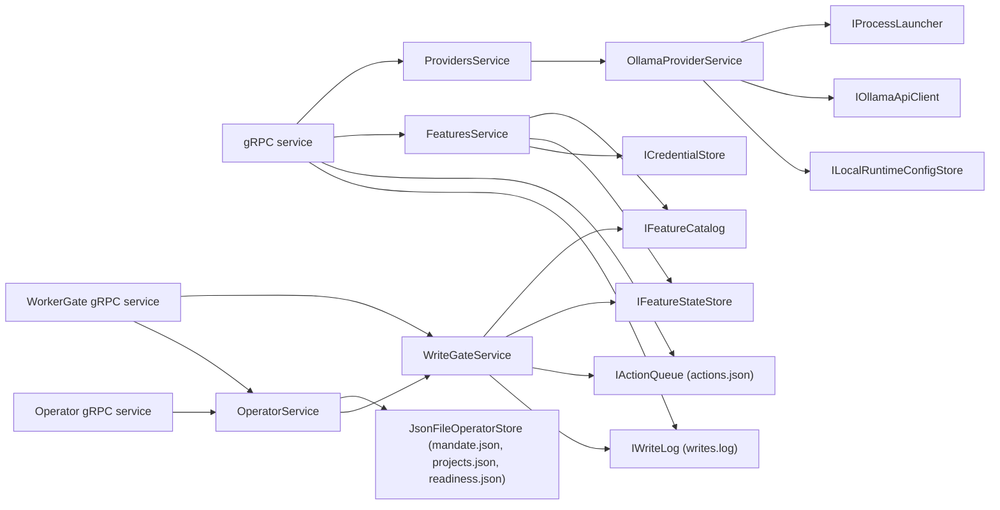

# ControlPlane

> What the desktop app asks Scout to do on the user's machine: run Ollama, pull models, store feature settings.

## To change here, read

- [[pages/invariants/no-executive-writes]]
- [[pages/decisions/0032-per-feature-write-permissions]]
- [[pages/decisions/0033-channel-operator-architecture]]
- [[pages/invariants/secrets-never-in-source]]
- [[pages/invariants/local-first-default]]
- [[pages/services/host-control-plane]]
- [[pages/services/control-plane-contracts]]
- [[pages/conventions/testing]]

## Responsibility

Owns the provider and feature domain services, the write gate and the channel operator's state, with no transport. [[pages/services/host-control-plane]] exposes them over gRPC. It does not run in the chat host ([[pages/services/host-console]]); the chat host reaches it only through the WorkerGate service, as a gRPC client, and shares no code path with it.

## Public contract

- **Entry point:** `AddControlPlaneDomain(IServiceCollection, IConfiguration)` at `src/Scout.ControlPlane/ControlPlaneServiceCollectionExtensions.cs:14`.
- **Providers:** `ProvidersService` (`src/Scout.ControlPlane/Providers/ProvidersService.cs:11`), `OllamaProviderService` for start, stop, status, model pull and delete (`src/Scout.ControlPlane/Providers/OllamaProviderService.cs:12`), seams `IProcessLauncher`, `IOllamaApiClient`, `IBinaryLocator`, `ILocalRuntimeRegistry`, `ILocalRuntimeConfigStore` and `IOllamaReadinessProbe`.
- **Features:** `FeaturesService` (`src/Scout.ControlPlane/Features/FeaturesService.cs:9`), `IFeatureCatalog` (`src/Scout.ControlPlane/Features/IFeatureCatalog.cs:6`) with GitHub, Kubernetes and YouTube entries (`src/Scout.ControlPlane/Features/FeatureCatalog.cs:7,10,13`), `IFeatureStateStore` (`src/Scout.ControlPlane/Features/IFeatureStateStore.cs:22`), `ICredentialStore` (`src/Scout.ControlPlane/Features/ICredentialStore.cs:9`), `IFeatureActivator` (`src/Scout.ControlPlane/Features/IFeatureActivator.cs:9`), `IFeatureCredentialValidator` (`src/Scout.ControlPlane/Features/FeatureCredentialValidation.cs:50`).
- **Write declarations and grants** ([[pages/decisions/0032-per-feature-write-permissions]]): every scope row carries `ScopeAccess` `Read`, `Write` or `IrreversibleWrite` (`src/Scout.ControlPlane/Features/FeatureFields.cs:29`, `:42`); `FeatureMetadata.HasWriteRows` (`src/Scout.ControlPlane/Features/FeatureMetadata.cs:42`); `FeatureCatalog.Validate` rejects a write row under `WriteClass.None` and runs in the catalog's constructor (`src/Scout.ControlPlane/Features/FeatureCatalog.cs:193`, `:186`). `EnableAsync(id, confirmWrites, ct)` (`src/Scout.ControlPlane/Features/FeaturesService.cs:248`) and `SetWriteGrantAsync(id, granted, confirmWrites, ct)` (`src/Scout.ControlPlane/Features/FeaturesService.cs:308`) throw `WriteConfirmationRequiredException` (`src/Scout.ControlPlane/Features/FeatureExceptions.cs:56`) for a feature with write rows when the confirmation is missing. `FeatureSnapshot` carries `WriteClass`, `Granted` and `GrantedAt`.
- **Actions:** `IActionQueue` (`src/Scout.ControlPlane/Actions/IActionQueue.cs:7`, with `ApproveAsync` and `RejectAsync` taking the owner's optional reason, `:57`, `MarkExecutedAsync`, `:67`, `ExecuteAsync`, which runs the caller's record under the queue's gate before marking, `:75`, `EnqueueApprovedAsync`, which writes a batch of actions the owner approved in the desktop in one write and in their order, `:21`, `ClaimNextAsync`, `:32`, and `FindAsync` by id in any status, `:81`) over `JsonFileActionQueue` (`src/Scout.ControlPlane/Actions/JsonFileActionQueue.cs:19`) with `PendingAction` (`src/Scout.ControlPlane/Actions/PendingAction.cs:27`), whose status adds `Executing`, an approved action a worker claimed (`:19`), and whose `ClaimedAt` is when it last was (`:37`); `IWriteLog` (`src/Scout.ControlPlane/Actions/IWriteLog.cs:4`) over `JsonLinesWriteLog` (`src/Scout.ControlPlane/Actions/JsonLinesWriteLog.cs:16`) with `WriteLogEntry` (`src/Scout.ControlPlane/Actions/WriteLogEntry.cs:7`); registered with `TryAdd` (`src/Scout.ControlPlane/ControlPlaneServiceCollectionExtensions.cs:72`, `:73`).
- **Write gate:** `WriteGateService` (`src/Scout.ControlPlane/WriteGate/WriteGateService.cs:39`) with `RequestAsync` (`:75`) returning a `WriteDecision` (`:20`) of `Allowed`, `Queued` or `Refused` (`:7`) and `RecordAsync` (`:128`), which throws `WriteNotRecordableException` (`:23`); `ApprovedOutcome`, `approved`, the outcome of the write-log entry that records the owner's approval of an action made in the desktop (`:45`); registered as a singleton (`src/Scout.ControlPlane/ControlPlaneServiceCollectionExtensions.cs:76`).
- **Operator** ([[pages/decisions/0033-channel-operator-architecture]]): records `Mandate`, `OperatorProject` (with the init-only `Scenes`, empty by default, `Package`, null until the first assembly, `BackgroundFile`, null until the owner attaches a background, `Delegated`, false until the owner delegates the project, `NarrationVoice`, empty, Scout's choice, until the owner produces or delegates the project in a voice, `VisualBrief`, empty until the owner writes one, and `Motion`, `gentle` by default, `src/Scout.ControlPlane/Operator/OperatorModels.cs:39`, `:42`, `:48`, `:53`, `:59`, `:66`, `:72`), `TopicCandidate`, `Script`, `ScriptSection`, `Chapter`, `Claim`, `Scene`, `VideoPackage`, `ShortClip`, `PackageCheck` and `Readiness` (`src/Scout.ControlPlane/Operator/OperatorModels.cs:4`, `:25`, `:76`, `:79`, `:89`, `:92`, `:98`, `:112`, `:139`, `:155`, `:158`, `:161`), with the readiness's init-only `Voices`, empty by default, of `Voice` records whose `SampleFile` names the voice's sample in the voice samples directory, null when it has none (`:171`, `:178`); `JsonFileOperatorStore` (`src/Scout.ControlPlane/Operator/JsonFileOperatorStore.cs:18`) with `ReadMandateAsync`, `WriteMandateAsync`, `ReadReadinessAsync`, `WriteReadinessAsync`, `ReadProjectsAsync` and `UpdateProjectsAsync` (`:63`, `:77`, `:93`, `:107`, `:123`, `:140`) and `MediaRoot` (`:60`); `OperatorService` (`src/Scout.ControlPlane/Operator/OperatorService.cs:22`) with the desktop side `GetMandateAsync`, `SaveMandateAsync`, `ListProjectsAsync`, `GetProjectAsync`, `StartProjectAsync`, `DecideClaimAsync` (`:102`, `:107`, `:154`, `:159`, `:169`, `:181`), `ProduceProjectAsync(id, voice, brief, motion)`, `DelegateProjectAsync(id, voice, brief, motion)`, `ReorderScenesAsync`, `SetSceneLockedAsync`, `RegenerateSceneAsync`, `AttachSceneMediaAsync`, `GetMediaDirectoryAsync`, `DeleteProjectAsync`, `GetVoiceSamplesDirectoryAsync` and `GetReadinessAsync` (`:473`, `:526`, `:606`, `:638`, `:649`, `:690`, `:770`, `:787`, `:1834`, `:1474`), `AssembleProjectAsync`, `ConfirmMediaRightsAsync`, `EditPackageMetadataAsync` and `ApprovePackageAsync` (`:846`, `:889`, `:906`, `:951`), and the worker side `GetMandateAsync`, `SaveProjectFromWorkerAsync`, `GetProjectForWorkerAsync`, `ListProjectsForWorkerAsync`, `NextQueuedProjectAsync`, `GetMediaDirectoryForWorkerAsync`, `GetVoiceSamplesDirectoryForWorkerAsync` and `ReportReadinessAsync` (`:102`, `:237`, `:388`, `:403`, `:426`, `:831`, `:1843`, `:1429`); `SceneRules` (`src/Scout.ControlPlane/Operator/SceneRules.cs:7`) with the file name rule, the scene vocabulary and the worker's scene merge (`:32`, `:57`, `:101`); `PackageRules` (`src/Scout.ControlPlane/Operator/PackageRules.cs:10`) with the fresh package of an assembly, the package vocabulary, the worker's package merge, the package comparison, the assembled files and the metadata limits (`:34`, `:44`, `:91`, `:128`, `:143`, `:160`); records `Publication`, `Snapshot`, `RetentionPoint`, `Proposal`, `Experiment` (with `ArmHours`, the control plane's alone) and `ExperimentArm` (`src/Scout.ControlPlane/Operator/OperatorModels.cs:186`, `:200`, `:217`, `:220`, `:226`, `:236`) on the init-only `OperatorProject.Publication`, null until the owner publishes (`:45`); the owner side `PublishPackageAsync`, `DecideProposalAsync`, `StartExperimentAsync` and `AdoptExperimentWinnerAsync` (`src/Scout.ControlPlane/Operator/OperatorService.cs:1010`, `:1095`, `:1138`, `:1222`), the worker side `NextApprovedActionAsync` (`:1271`), and `PurgeYouTubeDataAsync` for a YouTube disconnect (`:1395`); `PublicationRules` (`src/Scout.ControlPlane/Operator/PublicationRules.cs:10`) with the publication vocabulary and the worker's publication merge (`:43`); exceptions `OperatorValidationException`, `OperatorNotFoundException`, `OperatorWriteRefusedException`, `OperatorTamperingException` and `OperatorStoreException` (`src/Scout.ControlPlane/Operator/OperatorExceptions.cs:4`, `:14`, `:24`, `:34`, `:44`); both registered as singletons (`src/Scout.ControlPlane/ControlPlaneServiceCollectionExtensions.cs:77`, `:78`).
- **Comments** ([[pages/decisions/0033-channel-operator-architecture]]): records `AudienceComment`, `AudienceIdea` and `CommentsState` (`src/Scout.ControlPlane/Operator/CommentModels.cs:8`, `:28`, `:34`) in `comments.json` beside `projects.json` (`src/Scout.ControlPlane/Operator/JsonFileOperatorStore.cs:57`), read by `ReadCommentsAsync` (`:163`), the empty state when the file is missing, and changed by `UpdateCommentsAsync` (`:182`) under the store's one gate, a change answering null writing nothing and a write that fails becoming `OperatorStoreException` "Scout could not save the comments in its data folder." (`:201`); every operator file is written with `JavaScriptEncoder.UnsafeRelaxedJsonEscaping` (`:26`), so Cyrillic and other non-ASCII text is stored as written; System.Text.Json still escapes characters outside the Basic Multilingual Plane, an emoji as `\uD83C\uDF89`, and files written before read back unchanged (`tests/Scout.ControlPlane.Tests/Operator/JsonFileOperatorStoreTests.cs:245`). `CommentService` (`src/Scout.ControlPlane/Operator/CommentService.cs:12`), registered beside `OperatorService` (`src/Scout.ControlPlane/ControlPlaneServiceCollectionExtensions.cs:79`), with the desktop's `ListCommentsAsync`, `RequestCommentSyncAsync`, `DecideCommentAsync`, `ApproveReplyAsync` and `DecideIdeaAsync` (`src/Scout.ControlPlane/Operator/CommentService.cs:34`, `:39`, `:56`, `:131`, `:178`) and the worker's `GetCommentsForWorkerAsync` and `SaveCommentsFromWorkerAsync` (`:195`, `:209`); `CommentRules` (`src/Scout.ControlPlane/Operator/CommentRules.cs:12`) with the vocabulary, `MergeFromWorker` (`:65`), `Reconcile` (`:93`), `Purged` (`:118`) and `Cleared` (`:131`); `OperatorService.LiveCommentActionsAsync` (`src/Scout.ControlPlane/Operator/OperatorService.cs:1562`) over `IActionQueue.ListOpenAsync` (`src/Scout.ControlPlane/Actions/IActionQueue.cs:55`, `src/Scout.ControlPlane/Actions/JsonFileActionQueue.cs:215`, `tests/Scout.ControlPlane.Tests/Actions/ActionQueueTests.cs:259`), the approved or executing `youtube` actions on a `comment:` target that are not stale against the current grant.
- **Configuration keys:** `Scout:Providers:Ollama` (`Endpoint`, `PingTimeout`, `StartTimeout`, `WarmupBudget`; `src/Scout.ControlPlane/Providers/OllamaProviderOptions.cs:9`), `Scout:LocalRuntime:Config` (`src/Scout.ControlPlane/Providers/ILocalRuntimeConfigStore.cs:24`), `Scout:Features:StateStore` with `FilePath` (`src/Scout.ControlPlane/Features/FeatureStateStoreOptions.cs:11`); the queue, the log and the operator's files take the folder of that file (`src/Scout.ControlPlane/Features/FeatureStateStoreOptions.cs:23`).
- **External boundaries:** HTTP to the Ollama daemon, including a streamed model pull with no global timeout (`src/Scout.ControlPlane/ControlPlaneServiceCollectionExtensions.cs:43`); spawn and kill of the `ollama serve` process (`src/Scout.ControlPlane/Providers/OllamaProviderService.cs:192`, `src/Scout.ControlPlane/Providers/SystemProcessLauncher.cs:173`); JSON files `local-runtimes.json`, `features.json` and `actions.json` under local application data, written through a temp file and atomic move (`src/Scout.ControlPlane/Providers/JsonFileLocalRuntimeConfigStore.cs:123`, `src/Scout.ControlPlane/Features/JsonFileFeatureStateStore.cs:165`, `src/Scout.ControlPlane/Actions/JsonFileActionQueue.cs:389`), and the append-only `writes.log` beside them, one JSON object per line (`src/Scout.ControlPlane/Actions/JsonLinesWriteLog.cs:56`), read backwards from its end (`:131`); the operator's `mandate.json`, `projects.json` and `readiness.json` in the same folder, written the same way (`src/Scout.ControlPlane/Operator/JsonFileOperatorStore.cs:40`, `:41`, `:42`, `:257`), and one media directory per project under `operator/` there, created on demand (`:44`, `src/Scout.ControlPlane/Operator/OperatorService.cs:774`).

## How it works

The daemon is launched with both control-plane tokens, the desktop's `SCOUT_CONTROLPLANE_TOKEN` and the worker's `SCOUT_CONTROLPLANE_WORKER_TOKEN`, removed from the child environment (`src/Scout.ControlPlane/Providers/OllamaProviderService.cs:200`, `:201`); the code carries no comment about the worker token, and `tests/Scout.ControlPlane.Tests/Security/CallerTokensTests.cs:58` keeps its literal in step with the host's. The credential store falls back to `InMemoryCredentialStore` (`src/Scout.ControlPlane/ControlPlaneServiceCollectionExtensions.cs:69`) and the activator to `NullFeatureActivator` (`:70`), which makes `Enable` answer not-yet-implemented (`src/Scout.ControlPlane/Features/FeaturesService.cs:270`). No `IFeatureCredentialValidator` implementation exists outside `src/old`.

**Write grants.** A feature whose matrix has a `Write` or `IrreversibleWrite` row needs the owner's confirmation of those rows. `EnableAsync` checks it after the credentials and before the activator (`src/Scout.ControlPlane/Features/FeaturesService.cs:263`), so even with the confirmation the default activator still ends in not-yet-implemented; a successful enable records `Granted` and `GrantedAt` (`:283`), and a failed activation clears them (`:294`). A connection card with no toggle, such as YouTube, grants through `SetWriteGrantAsync` (`src/Scout.ControlPlane/Features/FeaturesService.cs:308`): granting needs the confirmation, revoking does not, a feature without write rows is a validation error, and `Enabled` is left alone. `DisableAsync` and `DeleteCredentialsAsync` reset the state and so revoke the grant (`src/Scout.ControlPlane/Features/FeaturesService.cs:346`, `:240`). `FeatureState` keeps `Granted` and `GrantedAt` (`src/Scout.ControlPlane/Features/IFeatureStateStore.cs:11`); the JSON store writes them only while granted, so a state file without them reads as not granted (`src/Scout.ControlPlane/Features/JsonFileFeatureStateStore.cs:172`). The worker learns the grants at start from `SCOUT__FEATURES__GRANTEDWRITES`, set by the desktop ([[pages/services/llm]]).

**Approval queue and write log.** `JsonFileActionQueue` keeps every action in `actions.json` beside `features.json`; enqueue, list, find and each decision run their read, check and write under one gate (`src/Scout.ControlPlane/Actions/JsonFileActionQueue.cs:308`), so two approvals of one action let one through and the other fails as already decided. The worker never writes the file: it enqueues through the WorkerGate service, so every writer is the control-plane process. A decision records the status, `DecidedAt` and the owner's reason when one was given, on an approval as on a rejection. `ExecuteAsync` moves an `Approved` action to `Executed` under the same gate and fails with `PendingActionNotApprovedException` for any other status, an executed one included (`src/Scout.ControlPlane/Actions/JsonFileActionQueue.cs:265`); before the move it runs the caller's record, and a record that throws leaves the action approved (`:268`). `MarkExecutedAsync` is `ExecuteAsync` with nothing to record (`:241`). An executed action is no longer pending. Every write of the file drops rejected actions whose `DecidedAt` is more than 30 days old and executed ones approved more than 90 days ago, and keeps pending and approved actions whatever their age (`:371`, `tests/Scout.ControlPlane.Tests/Actions/ActionQueueTests.cs:175`); an executed action is aged from its approval, the only time the queue keeps for it. A queue file that does not parse is moved aside to `actions.json.corrupt-<UTC yyyyMMddHHmmss>` and logged once as a warning naming both paths, and the queue starts empty (`src/Scout.ControlPlane/Actions/JsonFileActionQueue.cs:354`); the move never overwrites, so a second corruption within the same second fails the call instead of losing the first file. Only malformed content is moved aside (`:352`): a file that cannot be opened or read (an `IOException` or `UnauthorizedAccessException`) fails the call and stays where it is, so a transient lock never empties the queue (`tests/Scout.ControlPlane.Tests/Actions/ActionQueueTests.cs:158`). `JsonLinesWriteLog` appends one line per write to `writes.log` and lists the last N newest first, skipping and logging a line that does not parse with its number counted from the end of the file. The list reads only the tail: it seeks back from the end in 4096-byte blocks (`src/Scout.ControlPlane/Actions/JsonLinesWriteLog.cs:20`, `:131`), carries a line cut by a block boundary into the next block (`:193`), and stops once it has N non-blank lines; blank lines are skipped and not counted, a malformed line counts toward N, and the first line of the file and a last line without a newline are read (`tests/Scout.ControlPlane.Tests/Actions/WriteLogTests.cs:87`, `:107`).

**Write gate.** `WriteGateService` is what the worker reaches through the WorkerGate service ([[pages/services/host-control-plane]]); it never grants a permission and never decides an action. `RequestAsync` looks the scope up among the catalog rows of the feature by exact, case-sensitive scope text (`src/Scout.ControlPlane/WriteGate/WriteGateService.cs:233`) and answers, in order: an unknown feature or a scope the feature does not declare is `Refused` with "<scope> is not declared by <feature>"; a `Read` row is `Refused` with "<scope> is a read"; a feature whose state is not `Granted` is `Refused` with "The owner has not allowed <feature> to write; allow it on the Features screen of Scout Desktop."; a `Write` row is `Allowed` with an empty reason; an `IrreversibleWrite` row enqueues a pending action (feature, the scope as the action, target, summary) and is `Queued` with its id and "Waiting for the owner's approval on the Review screen of Scout Desktop." (`:109`). The grant is read from the state store on every request (`:99`), so a grant or a revocation on the Features screen applies to the next request without a restart. `RecordAsync` appends a `WriteLogEntry` with the time, feature, scope, target and outcome; it refuses an undeclared scope or a read row, refuses an `IrreversibleWrite` row recorded without an action id with "<scope> is irreversible; it is recorded only with an action the owner approved.", even under the grant (`src/Scout.ControlPlane/WriteGate/WriteGateService.cs:148`), and reads the grant live like a request (`:154`): a reversible `Write` row without it is refused with the same "has not allowed" text, and an irreversible one with "The owner revoked <feature>'s write permission before this action ran.", even when the owner approved the action before revoking; an approved action no worker claimed is refused and logs nothing (`tests/Scout.ControlPlane.Tests/WriteGate/WriteGateServiceTests.cs:291`), while an action a worker claimed (`executing`) already ran on YouTube, so it is logged once with its outcome followed by " after revoke", approved by `owner`, marked executed under the queue's gate, and then refused, so it is never handed out again (`src/Scout.ControlPlane/WriteGate/WriteGateService.cs:179`, `tests/Scout.ControlPlane.Tests/WriteGate/WriteGateServiceTests.cs:268`). With an action id it requires an action the owner approved for the same feature and scope (`src/Scout.ControlPlane/WriteGate/WriteGateService.cs:171`), then, inside the queue's `ExecuteAsync` (`:207`), looks the action id up in the write log, reading it back with `ListSinceAsync` only to the first entry older than the action's request (`:211`, `src/Scout.ControlPlane/Actions/JsonLinesWriteLog.cs:72`, `tests/Scout.ControlPlane.Tests/Actions/WriteLogTests.cs:53`), appends the entry with `ApprovedBy` `owner` when it is not there (`:212`), and only then marks the action executed. A failed append leaves the action approved, so the worker's retry records it once (`tests/Scout.ControlPlane.Tests/WriteGate/WriteGateServiceTests.cs:309`); a failed mark after the append is reported to the caller with the log line kept and the action still approved, and the next record finds the line, marks the action executed and is refused with "Action '<id>' is already recorded in the write log." (`src/Scout.ControlPlane/WriteGate/WriteGateService.cs:198`, `tests/Scout.ControlPlane.Tests/WriteGate/WriteGateServiceTests.cs:330`). A second record with the same action id, sequential or concurrent, fails as not approved, so an approval covers one write. So every logged irreversible write carries the owner as its approver; the WorkerGate service answers each refusal with `FailedPrecondition` and the log is left untouched.

**Operator state.** The control plane is the only writer of the channel operator's state ([[pages/decisions/0033-channel-operator-architecture]]); the desktop reaches it through the `Operator` gRPC service and the worker through seven operator methods of `WorkerGate` ([[pages/services/host-control-plane]]). `JsonFileOperatorStore` keeps the mandate in `mandate.json` and every project, in creation order, in `projects.json`, both beside `features.json`. `UpdateProjectsAsync` reads the list, runs the caller's check-and-change and writes the list back under one gate (`src/Scout.ControlPlane/Operator/JsonFileOperatorStore.cs:30`, `:140`); when the change throws or answers null, nothing is written (`:149`). A file that does not parse is moved aside to `<name>.corrupt-<UTC yyyyMMddHHmmss>`, never overwritten, logged once as "Operator file at <path> is malformed; moved it to <aside> and started empty", and read as empty (`src/Scout.ControlPlane/Operator/JsonFileOperatorStore.cs:228`, `:232`); a file that cannot be opened fails the call and stays where it is. A `projects.json` written before scenes existed reads with no scenes.

The desktop side: `GetMandateAsync` answers the empty mandate when none is saved. `SaveMandateAsync` trims every field, drops blank pillars and blocked topics, stamps `UpdatedAt`, and refuses an empty objective or language, more than 5 pillars or a pillar over 80 characters, joining the messages ("The objective is required.", "At most 5 pillars.", "Each pillar is at most 80 characters.", "The language is required."). The mandate carries no narration voice: the owner moved that choice from the channel to the video on 2026-11-03, so it is the project's (Production and scenes, below); a mandate file saved before then still loads, its voice ignored, and the next save drops it (`tests/Scout.ControlPlane.Tests/Operator/OperatorServiceTests.cs:122`). `ListProjectsAsync` returns the newest first; a limit of 0 or less means 50 and at most 200 are returned. `StartProjectAsync` trims the topic, refuses one outside 3 to 200 characters ("The topic must be 3 to 200 characters."), then asks the write gate for the `youtube` grant like a worker save and, without it, refuses with the gate's text as `OperatorWriteRefusedException` (`src/Scout.ControlPlane/Operator/OperatorService.cs:169`), which the desktop receives as `PERMISSION_DENIED`; with it, it queues a project with status `queued` and origin `desktop`. `DecideClaimAsync` takes `supported`, `unsupported` or `waived`, anything else being "A claim is decided as supported, unsupported or waived.", needs a note for `waived` ("A waived claim needs a note saying why."), and stamps the claim's `DecidedAt`, which marks it as the owner's decision. An unknown project or claim is `OperatorNotFoundException`. No desktop method returns a project's `OriginReference` (`src/Scout.ControlPlane/Operator/OperatorService.cs:1607`).

The worker side: `SaveProjectFromWorkerAsync`, `GetProjectForWorkerAsync`, `ListProjectsForWorkerAsync` and `NextQueuedProjectAsync` first ask `WriteGateService.RequestAsync` for the `youtube` feature's `Write` row "Scout's data folder", so the grant is read live and a refusal carries the gate's own text, "The owner has not allowed youtube to write; allow it on the Features screen of Scout Desktop." (`src/Scout.ControlPlane/Operator/OperatorService.cs:1786`). The mandate read is not gated: it is a read of the owner's brief. The two reads return what the desktop sees, owner-decided claims with their status and note included, with the desktop's limit rules except that a worker list returns up to 5000 projects, so its data hygiene reaches older ones, and without the origin reference on the wire, so the worker can send an owner's decision back unchanged. A save then refuses, as `OperatorValidationException`, a status other than `researching`, `scripting`, `script_ready`, `producing`, `media_ready`, `assembling`, `assembled` or `failed`, a claim without an id, duplicate claim ids and a claim status outside `pending`, `unsupported`, `supported` and `waived` (`:255`, `:1655`), a scene that breaks the scene rules below (`:256`), and a package that breaks the package rules below; and, as `OperatorTamperingException`, a claim the worker marks `supported` or `waived` unless the stored claim already has that status (`:1675`), a claim the owner decided that comes back changed in text, status, note, risk or source links (the links compared in order) or does not come back (`:1689`), a different topic or origin on an existing project (`:297`), and a scene change only the owner may make (`:303`). On a project the owner queued for production again (`production_queued`), every worker save is refused, a `failed` one included; on any other project the store no longer holds as `producing`, because the owner regenerated a scene or produced it again between the worker's read and its save, a save that sends `producing` or `media_ready`, or whose merged scenes differ from the stored ones, is refused as `OperatorTamperingException`, `FAILED_PRECONDITION` on the wire, with "The project is no longer producing." (`:345`), and the owner's change stays; the worker stops on those words ([[pages/services/operator]]). Each save that succeeds appends one `WriteLogEntry` to `writes.log` as a reversible write under [[pages/decisions/0032-per-feature-write-permissions]]: feature `youtube`, action "Scout's data folder", the project id as target, outcome `saved <status>`, no approver (`:1774`); a refused save appends nothing. An empty id creates a project of origin `chat` that stores the origin reference; an existing project keeps its topic, origin, creation time, owner decisions and reference, and its `BackgroundFile` exactly as stored, whatever the worker sends (`tests/Scout.ControlPlane.Tests/Operator/OperatorServiceTests.cs:1394`). `NextQueuedProjectAsync` takes the oldest `queued` project and moves it to `researching`; when none is queued, the oldest `production_queued` project and moves it to `producing`; when neither waits, the oldest `assembly_queued` project and moves it, and its package, to `assembling` (`src/Scout.ControlPlane/Operator/OperatorService.cs:1492`, `:444`); when none of those waits, the oldest project left in `researching`, `scripting`, `producing` or `assembling` whose `UpdatedAt` is more than 15 minutes old, back in `researching` or, for `producing` and `assembling`, in the same status (`:77`, `:1498`); the pipeline saves at every stage, so a live run is never that stale, and a run a worker shutdown cut short is taken again. It moves the project with a fresh `UpdatedAt` inside one `UpdateProjectsAsync`, so two callers never take the same project, appends `saved <status>` for it to the write log, and returns it with its reference. It first reads the list outside the store's write path and returns null when nothing waits, and the change answers null under the gate when another caller took it first, so an idle poll never rewrites `projects.json`.

**Production and scenes.** `ProduceProjectAsync(id, narrationVoice, visualBrief, motion)` first trims the narration voice the owner chose for this video and refuses one longer than 80 characters or holding anything but ASCII letters, digits, `_`, `:`, `.`, `#` and `-`, as `OperatorValidationException` "A narration voice is an id of at most 80 letters, digits, _ : . # or -." (`src/Scout.ControlPlane/Operator/OperatorService.cs:566`); then it takes the owner's visual brief for this video, the style its pictures are asked for in, with every control character but a newline made a space and the ends trimmed, and refuses one over 500 characters ("A visual brief is at most 500 characters.", `:578`), and the motion preset, `still`, `gentle` or `dynamic`, trimmed, an empty one meaning `gentle`, refusing any other ("Motion is still, gentle or dynamic.", `:584`); all three before anything is read or written. The voice is an id the worker's readiness offered, `<Provider>:<voice>` or `piper:<voice>`, and empty means Scout's choice; the control plane does not check that the worker offers it, because the worker fails a scene on a voice it cannot use ([[pages/services/operator]]). It then asks the write gate for the `youtube` grant like `StartProjectAsync`, then refuses, as `OperatorValidationException`, a project that is not `script_ready`, `media_ready`, `assembled`, `approved` or `failed` with a script (an assembled or approved one goes to `production_queued` with the package's rights confirmation and approval cleared, as an attached scene file does; one queued for assembly or assembling is refused), so a run that failed, planning included, is produced again (`src/Scout.ControlPlane/Operator/OperatorService.cs:473`) ("Only a project with its script ready, its media ready, an assembled or approved one, or a failed one with a script goes to production; this one is <status>.") and one with claims still `pending` ("1 claim is still pending; decide it before production.", "<n> claims are still pending; decide them before production."), and otherwise sets `production_queued`, clears the project's error and stores the voice, the brief and the motion on the project (`src/Scout.ControlPlane/Operator/OperatorService.cs:500`, `:503`, `:504`, `:505`). The request's voice, brief and motion always win, an empty one included, so the desktop sends the stored ones back when the owner keeps them; a delegated project stays delegated. Only this call and `DelegateProjectAsync` set `NarrationVoice`, `VisualBrief` and `Motion`: a worker save builds the project from the stored one and never takes the voice, brief or motion it sends, a project the worker creates from chat starts with no voice, no brief and `gentle`, and a regenerate keeps them (`tests/Scout.ControlPlane.Tests/Operator/OperatorServiceTests.cs:172`, `:185`, `:203`, `:220`, `:237`, `tests/Scout.ControlPlane.Tests/Operator/OperatorServiceTests.VisualBrief.cs:13`, `:33`, `:59`). The brief reaches only the scene planner's model request and the motion only the assembler's choice among its presets ([[pages/services/operator]]). The owner's scene edits change Scout's own state, not anything the model wrote, so they need no grant; each answers the project without its origin reference and `NOT_FOUND` for an unknown project or scene ("Unknown scene '<id>' in project '<id>'."). `ReorderScenesAsync` takes the scene ids in the owner's order, refuses anything but every scene exactly once ("The new order must name every scene of the project exactly once."), and numbers them from 1. `SetSceneLockedAsync` sets `Locked`. `RegenerateSceneAsync` refuses a locked scene ("Scene '<id>' is locked; unlock it before regenerating it."), otherwise sets the scene to `planned` without its error, clears the audio file, the visual file and the duration where the source is not `owner` (the source names stay, except that a `stock` picture becomes `text_card` and every visual credit is cleared, `src/Scout.ControlPlane/Operator/OperatorService.cs:667`, `tests/Scout.ControlPlane.Tests/Operator/OperatorServiceTests.StockPictures.cs:48`), keeps the owner's media, and sets the project to `production_queued`. `AttachSceneMediaAsync` takes `audio`, `visual` or `background` ("Media is attached as audio, visual or background."), checks the file name, requires the file to be in the project's media directory already ("'<name>' is not in the project's media folder; copy it there first."), sets that source to `owner` with the name, sets the duration to 0 for the owner's audio, unknown until it is measured, and sets the scene `ready` without its error once it has a visual and its audio is decided (`src/Scout.ControlPlane/Operator/OperatorService.cs:726`). A visual is a visual file, or a `text_card` production chose; decided audio is an audio file, or `AudioSource` `none` production chose. Production chose them only on a scene it saved `ready`; on a `planned` or `failed` scene the planner's `none` and `text_card` are placeholders, so an image attached there leaves the scene as it was and the next run still makes its narration. The kind `background` attaches the project's background instead (`src/Scout.ControlPlane/Operator/OperatorService.cs:733`): the scene id must be empty ("A background is attached to the project, not to a scene."), the name passes the visual file name rule, no grant is asked for, as for a scene's media, the file must already be in the project's media directory ("'<name>' is not in the project's media folder; copy it there first."), and the project must be `script_ready`, `media_ready`, `assembled`, `approved`, `assembly_queued`, `assembling` or `failed` ("A background is attached to a project whose script or media is ready, an assembled or approved one, one queued for assembly or assembling, or a failed one; this one is <status>."); it sets `BackgroundFile` and `UpdatedAt` and changes the status and the package like a scene attach: an assembled or approved project goes back to `media_ready` with the package kept but without its rights confirmation and approval, and a project queued for assembly or assembling goes to `assembly_queued`, so the next assembly renders the new background (`tests/Scout.ControlPlane.Tests/Operator/OperatorServiceTests.cs:1274`, `:1296`, `:1311`, `:1324`, `:1338`, `:1350`, `:1381`).

A media file name is a plain name: not empty, at most 120 characters, no leading dot, no `..`, no backslash, no character the platform forbids in a file name (the folder separator among them), and an audio extension `.mp3`, `.wav`, `.m4a`, `.ogg` or a visual one `.png`, `.jpg`, `.jpeg`, `.webp`, compared without case (`src/Scout.ControlPlane/Operator/SceneRules.cs:32`); it is checked wherever a name is accepted, from the desktop's attach and from a worker save. The media directory is `<folder of features.json>/operator/<project id>`; the id must be 32 hex digits, the store's own id format, so no path can escape (`src/Scout.ControlPlane/Operator/OperatorService.cs:1716`), the project must exist, and the folder is created with the default permissions of its parent; when it cannot be created (a file in the way, no permission) the `IOException` propagates, which `OperatorMapping.Guard` does not map, so the desktop receives gRPC `UNKNOWN`. The desktop's `GetMediaDirectoryAsync` and the worker's `GetMediaDirectoryForWorkerAsync`, which needs the grant, return its absolute path. The voice samples directory is `<folder of features.json>/operator/voice-samples`, a fixed name beside the project directories that is never a 32-digit project id, so a project's media directory and its deletion never reach it; it holds one sample per bundled voice, which the worker makes ([[pages/services/operator]]). The desktop's `GetVoiceSamplesDirectoryAsync` answers its absolute path, created when missing, with no grant, like the desktop's project media directory, and the worker's `GetVoiceSamplesDirectoryForWorkerAsync` answers it with no grant either, because the samples are Scout's own data and the desktop's Preview must work before the owner grants YouTube writes (`src/Scout.ControlPlane/Operator/OperatorService.cs:1834`, `:1843`, `tests/Scout.ControlPlane.Tests/Operator/OperatorServiceTests.VoiceSamples.cs:11`).

A worker save checks the scenes it sends: ids present and unique, `Status` one of `planned`, `generating`, `ready`, `failed`, `AudioSource` one of `generated`, `owner`, `none`, `VisualSource` one of `generated`, `owner`, `text_card`, `stock` (`src/Scout.ControlPlane/Operator/SceneRules.cs:24`), a duration not below 0, and every file name (`:57`); a `stock` visual, a freely licensed picture the worker fetched from Openverse ([[pages/services/operator]]), must carry its `VisualFile` and a `VisualCredit` that is not blank, else the save is refused with "Scene '<id>' shows a stock picture; it needs the picture's file and its credit." (`:78`, `tests/Scout.ControlPlane.Tests/Operator/OperatorServiceTests.StockPictures.cs:16`). The worker also sets `VisualQuery`, the search terms it planned, kept as sent. When the project has no scenes the worker adds its own, none locked and none with an `owner` source. Once scenes exist it can neither add nor drop one, and a worker that claims an `owner` source the stored scene does not have is refused; each of those is `OperatorTamperingException`. Otherwise the save is merged with the stored scenes, in their stored order (`src/Scout.ControlPlane/Operator/SceneRules.cs:101`): the worker sets a scene's status, error, generated sources and files, duration, narration and visual prompt, and what the owner owns comes from storage whatever the worker sends, the `Order` and `Locked` of every scene, a locked scene whole (`:125`), and the owner's audio or visual with its file (`src/Scout.ControlPlane/Operator/SceneRules.cs:133`, `:143`), an owner visual always without a credit, so a worker save read before the owner's attach over a stock picture cannot bring its credit back (`tests/Scout.ControlPlane.Tests/Operator/OperatorServiceTests.StockPictures.cs:30`); the attach itself clears it (`src/Scout.ControlPlane/Operator/OperatorService.cs:690`). The duration of an owner audio stays the worker's only when the worker sent that same owner file; else the stored one stays. So an owner reorder, lock or attach between the worker's read and its save never fails the run.

**Deletion.** `DeleteProjectAsync` (`src/Scout.ControlPlane/Operator/OperatorService.cs:787`) is the owner's edit of Scout's own state, so it needs no grant, like a scene edit. It answers NOT_FOUND for an unknown id and refuses, as `OperatorValidationException`, a project that is researching, scripting, producing, assembling or whose publication is uploading ("A project that is researching, scripting, producing, assembling or uploading cannot be deleted; wait for it to finish or fail."), and one with an approved or executing YouTube action on the project or its `<projectId>:` arms ("The project has pending YouTube actions; finish or cancel them first."). Otherwise it removes the project from the store under the gate, logs `deleted project` as the owner's, then deletes the project's directory under the operator media root, which `MediaDirectoryOf` builds from a 32-digit id alone so it cannot leave the root; if the folder cannot be deleted it throws `OperatorStoreException` ("Scout removed the project but could not delete its media folder.") without a path. Nothing leaves the process: a video already on YouTube stays there (`tests/Scout.ControlPlane.Tests/Operator/OperatorServiceTests.cs`, the `Delete_` tests).

**Assembly and the package.** `AssembleProjectAsync` asks the write gate for the `youtube` grant like `ProduceProjectAsync`, then refuses, as `OperatorValidationException`, a project that is not `media_ready`, `assembled` or `failed` ("Only a project with its media ready, an assembled one, or a failed one with every scene ready is assembled; this one is <status>."), one without scenes ("The project has no scenes to assemble.") and one with a scene not `ready` ("1 scene is not ready; regenerate it or attach its media before assembly.", "<n> scenes are not ready; regenerate them or attach their media before assembly."); otherwise it sets `assembly_queued`, clears the project's error and starts the package again (`src/Scout.ControlPlane/Operator/OperatorService.cs:877`): status `assembly_queued`, no video, Shorts, thumbnail, checks, duration or error, rights not confirmed, not approved, and the title, description and tags kept, with `MetadataEdited`, only when the owner edited them, else empty for the worker to fill (`src/Scout.ControlPlane/Operator/PackageRules.cs:34`). The package's own status is `assembly_queued`, `assembling`, `assembled`, `approved` or `failed`; the owner sets `assembly_queued` and `approved`, the worker the other three.

A worker save that carries a package is checked first (`src/Scout.ControlPlane/Operator/PackageRules.cs:44`): a status in that set, no duration, Shorts duration or Shorts start below 0, a title, description and tags within YouTube's limits once any of them is written (empty, the package is still unwritten), every check named with a result `pass`, `warn` or `fail`, and safe file names, the video and each Shorts cut `.mp4`, the thumbnail `.png` or `.jpg`, under the scene file name rule (`src/Scout.ControlPlane/Operator/SceneRules.cs:32`). A worker cannot start a project already `assembling` or `assembled` or with a package (`src/Scout.ControlPlane/Operator/OperatorService.cs:268`). The merge (`src/Scout.ControlPlane/Operator/PackageRules.cs:91`) keeps the stored package when the worker sends none, so a save from a stage that does not know the package leaves it as it is; otherwise the worker's package stands, and it is `OperatorTamperingException` when the worker confirms the rights ("Only the owner confirms the media rights of project '<id>'."), sets or changes `ApprovedAt` ("Only the owner approves the package of project '<id>'."), sends `assembly_queued` or `approved` the store does not hold ("Only the owner sets the package of project '<id>' to <status>."), changes `MetadataEdited` ("Only the owner edits the package metadata of project '<id>'."), or changes the title, description or tags once the owner edited them ("The owner edited the package metadata of project '<id>'; the worker may not change it."). Until then the worker sets them. A save that sends `assembling` or `assembled`, or a package that differs from the stored one, its lists compared item by item (`:128`), is refused with "The project is no longer assembling." unless the store holds the project as `assembling` and the save leaves the scenes as stored, and every worker save on a project the store holds as `assembly_queued` or `approved` is refused with the same words (`src/Scout.ControlPlane/Operator/OperatorService.cs:337`), so a stale run never overwrites a new assembly or the owner's approval. This check comes before the production one, so an assembler whose project the owner sent back to production, by regenerating a scene, reads "no longer assembling", the words it stops on ([[pages/services/operator]]). A save that reports `assembled` needs the package's video file, and every file it names, the video, the thumbnail and each Shorts cut, must be in the project's media directory ("An assembled package needs its video file.", "'<name>' is not in the project's media folder.", `:349`, `src/Scout.ControlPlane/Operator/PackageRules.cs:143`).

The owner's package edits need a package ("Project '<id>' has no package yet; assemble it first.", `src/Scout.ControlPlane/Operator/OperatorService.cs:1765`) and answer the project without its origin reference. `EditPackageMetadataAsync` trims the title, description and each tag and refuses, joining the messages, a title outside 1 to 100 characters, a description over 5000, a tag outside 1 to 100 and tags over 500 characters together, YouTube's limits, the tags counted YouTube's way, two more for a tag with a space and a comma between tags, as the worker counts them ("The title is 1 to 100 characters.", "The description is at most 5000 characters.", "Each tag is 1 to 100 characters.", "The tags are at most 500 characters together.", `src/Scout.ControlPlane/Operator/PackageRules.cs:160`, `:218`); it is allowed on an `assembled` or `approved` project ("Only the metadata of an assembled or approved package is edited; this one is <status>."), sets `MetadataEdited`, and sends an approved package back to `assembled` without its `ApprovedAt`; the rights confirmation stays. It runs the `metadata` and `discoverability` checks again over the owner's values, the project's topic and the mandate's pillars, with the worker's rules and sentences, and drops the worker's two: `metadata` fails outside YouTube's limits, `discoverability` warns when the title shares no word of three letters or more with the topic or the pillars, or the description has no `0:00` chapter line (`src/Scout.ControlPlane/Operator/OperatorService.cs:933`, `src/Scout.ControlPlane/Operator/PackageRules.cs:188`); the other checks stay, so the approval reads checks that match the metadata it approves. `ConfirmMediaRightsAsync` sets `RightsConfirmed` on an `assembled` project only ("Media rights are confirmed on an assembled package; this one is <status>."); a new assembly clears it. Neither needs the grant, like the scene edits. `ApprovePackageAsync` asks the write gate for the grant, refuses a project that is not `assembled` ("Only an assembled package is approved; this one is <status>."), then refuses, joining every cause, a package whose rights are not confirmed ("Confirm the media rights first."), one with a failed check ("1 check failed.", "<n> checks failed.") a project with a claim neither `supported` nor `waived` ("1 claim is not supported or waived.", "<n> claims are not supported or waived."), and metadata outside YouTube's limits, with the same sentences as the edit (`src/Scout.ControlPlane/Operator/OperatorService.cs:980`); otherwise it sets the project and the package `approved` with `ApprovedAt` and appends a write-log entry, outcome `approved package`, approved by `owner` (`src/Scout.ControlPlane/Operator/OperatorService.cs:951`, `:994`).

An owner scene edit that changes the video, an attach, a regenerate or a reorder into a new order, on an `assembled` or `approved` project takes the approval back (`src/Scout.ControlPlane/Operator/OperatorService.cs:1609`, `src/Scout.ControlPlane/Operator/PackageRules.cs:174`): the package goes back to `assembled` without its rights confirmation or `ApprovedAt`, and the project to `media_ready`, or to `production_queued` for a regenerate as before. The package files stay on disk, but neither the rights nor the approval can be given again until the owner assembles the project again. The same edit on a project `assembly_queued` or `assembling` sends the project and the package back to `assembly_queued`, the project to `production_queued` for a regenerate, so a running assembly reads that it is no longer assembling and its save is refused with those words, and the next take assembles the edited scenes. A lock or unlock, and a reorder into the order the scenes already have, do not change the video: they leave the status, the rights and the approval as they are, anywhere (`src/Scout.ControlPlane/Operator/OperatorService.cs:625`, `:639`).

**Delegation.** The owner's "delegate" on a project ([[pages/roadmap/youtube-channel-operator]], phase 7) is the control plane chaining the project's reversible stages; the worker is unchanged. `DelegateProjectAsync` (`src/Scout.ControlPlane/Operator/OperatorService.cs:526`) takes the owner's narration voice, visual brief and motion and checks them first with the rules `ProduceProjectAsync` uses, the same private helpers and the same sentences, then asks the write gate for the `youtube` grant like `ProduceProjectAsync` and refuses, as `OperatorValidationException`, a project that is not `script_ready`, `media_ready`, or `failed` with a script ("Only a project with its script ready, its media ready, or a failed one with a script is delegated; this one is <status>.", `:541`). Otherwise it sets the init-only `OperatorProject.Delegated` (`src/Scout.ControlPlane/Operator/OperatorModels.cs:53`, `src/Scout.ControlPlane/Operator/OperatorService.cs:552`) and stores the voice, the brief and the motion on the project (`:553`, `:554`, `:555`): the request's voice always wins, empty meaning Scout's choice, so a project delegated from `script_ready` narrates in the voice the owner chose rather than always in Scout's; an empty motion means `gentle`, and the brief may be empty. It clears the error and queues the next stage (`:544`): a `media_ready` project with scenes, every one `ready`, goes to `assembly_queued` with its package started again as `AssembleProjectAsync` does, unless a scene still has a part the worker could make under the readiness the control plane stores (absent readiness means nothing is available): audio source `none` while `SpeechAvailable`, or visual source `text_card` while `ImagesAvailable`, so a project produced before the voices existed is narrated rather than assembled mute (`tests/Scout.ControlPlane.Tests/Operator/OperatorServiceTests.cs:139`, `:157`); any other goes to `production_queued`, without the pending-claims check of `ProduceProjectAsync`, because in a delegated project unresolved claims block only the package approval. On a delegated project a worker save of `media_ready` whose scenes are all `ready` is stored as `assembly_queued`, its package started again, after every check the save already passes, so the worker's next take assembles it; a save with a scene not ready stays `media_ready`, and a save of `assembled` or `failed` is stored as sent (`src/Scout.ControlPlane/Operator/OperatorService.cs:359`). The worker can never set or clear `Delegated`: a save keeps the stored value whatever it sends, and a project the worker creates is never delegated (`tests/Scout.ControlPlane.Tests/Operator/OperatorServiceTests.cs:2784`). `ApprovePackageAsync` is unchanged, so a pending or unsupported claim still blocks the approval, and nothing in delegation approves a package or creates a YouTube action; a delegated project stops at `assembled` for the owner (`tests/Scout.ControlPlane.Tests/Operator/OperatorServiceTests.cs:2565`, `:2592`, `:2620`, `:2639`, `:2652`, `:2666`, `:2683`, `:2707`, `:2722`).

**Publication.** `PublishPackageAsync` takes the owner's privacy, `public`, `private` or `unlisted` ("A video is published as public, private or unlisted."), an optional publish time that must be in the future ("The publish time must be in the future.") and is accepted only with `private`, the status YouTube's `status.publishAt` needs ("A video with a publish time is uploaded as private; YouTube makes it public at that time."), and the made-for-kids and synthetic-media declarations (`src/Scout.ControlPlane/Operator/OperatorService.cs:1064`). It asks the write gate for the `youtube` grant like `ApprovePackageAsync`, then refuses a project and package that are not both `approved` ("Only an approved package is published; this one is <status>."), a project already on YouTube ("The video of this project is already on YouTube.") one whose publication is anything but `failed` without a video, `publish_approved` included, so a second click while the upload is queued is refused ("The video of this project is <status>; wait for the upload to end.", `:1053`). It also refuses while a YouTube action of the project is `executing` and not stale ("A YouTube action of this project is running; wait for it to end.", `:1036`). Otherwise the publication becomes `publish_approved` with the owner's four settings, no video id, upload time or error, keeping any earlier proposals and experiment, and the upload, `videos.insert` with the project id as its target, and, when the package has a thumbnail, `thumbnails.set` with the same target are queued already approved (`:1081`): the desktop's publish dialog listed them and the owner confirmed, which is the per-action consent Google's policy asks for. Each is one write-log entry, the scope as the action, outcome `approved`, approved by `owner`, with the action id (`:1599`). The upload's summary names the title and the privacy, or the UTC time a private video is made public. Before queuing them it rejects every action of the project still approved from an earlier publish, reason "superseded by a new publish", each logged with outcome `rejected: <reason>` (`:1087`), so an old thumbnail action can never sit before the new upload as the project's oldest open action.

**Proposals and experiments.** The worker adds proposals, `title`, `thumbnail`, `topic` or `strategy`; `DecideProposalAsync` marks one `proposed` proposal `accepted` or `rejected` ("Proposal '<id>' is already <status>.", "Unknown proposal '<id>' in project '<id>'."), with no grant, like a claim decision. `StartExperimentAsync` takes the arm hours, 24 to 168, 0 meaning 48 ("Each arm runs 24 to 168 hours."), asks for the grant, and needs a video `published` or `scheduled` with its id ("Only a published or scheduled video is tested; this one is <status>."), no experiment `running` ("An experiment is already running on this video.") and an accepted `title` or `thumbnail` proposal ("Accept a title or thumbnail proposal first."). The kind is that of the newest accepted one; the arms are `control`, the package's title or thumbnail file ("The package has no <kind> to come back to." without it), then `variant-a` and `variant-b` from the first two accepted proposals of that kind, at most three arms, and those proposals become `tested` so no later experiment uses them again (`:1098`). The experiment starts `running` with `ArmHours`, and one `videos.update` (title) or `thumbnails.set` (thumbnail) action per arm, in order, then one more back to the control, are queued approved and logged like the publish, each targeting `<project id>:<experiment id>:<arm id>` with a summary that names the title or file and the hours (`:1417`). `AdoptExperimentWinnerAsync` asks for the grant, refuses an experiment already `adopted` ("The winner of this experiment is already adopted."), needs one `concluded` with a winner ("Only a concluded experiment with a winner is adopted."), sets it `adopted`, and, in the same store update, makes the winner the package's current value, `Title` for a title experiment and `ThumbnailFile` for a thumbnail one (`src/Scout.ControlPlane/Operator/OperatorService.cs:1249`), so a later experiment's control and restore action use it instead of putting the old value back; then it queues and logs one approved action to the winning arm.

**Approved actions and the claim.** `NextApprovedActionAsync` is the worker's only way to an approved action. Without the `youtube` grant it answers null and claims nothing (`src/Scout.ControlPlane/Operator/OperatorService.cs:1276`). Otherwise `JsonFileActionQueue.ClaimNextAsync`, under the queue's gate, takes the `youtube` actions that are `Approved`, or `Executing` with a claim older than 30 minutes (`src/Scout.ControlPlane/Operator/OperatorService.cs:78`, `src/Scout.ControlPlane/Actions/JsonFileActionQueue.cs:139`), oldest first, and claims the first one the operator accepts: it must be the oldest open action of its project, the first part of its target, so a thumbnail waits for its upload and an experiment's switches run in order, and an arm of a running experiment waits until the arm live before it, started and not ended, has run the experiment's hours (`src/Scout.ControlPlane/Operator/OperatorService.cs:1289`, `:1539`). An action is stale when it was approved, or, executing, claimed, before the owner's current grant began (`GrantedAt`): it is never handed out again and never holds back its project, so an action running when the owner revoked cannot run again under a later grant (`src/Scout.ControlPlane/Operator/OperatorService.cs:1523`, `tests/Scout.ControlPlane.Tests/Operator/OperatorServiceTests.Publication.cs:832`); the worker may still record it. Granting a feature already granted keeps the time the grant began, so only a revoke and a new grant make older approvals stale (`src/Scout.ControlPlane/Features/FeaturesService.cs:330`, `tests/Scout.ControlPlane.Tests/Features/FeaturesServiceTests.cs:374`). The claim sets `Executing` and `ClaimedAt` and writes the file; when none is eligible the file is not written. `ExecuteAsync` and `RecordAsync` take an `Approved` or `Executing` action, so the worker's `RecordWrite` consumes a claimed action (`src/Scout.ControlPlane/Actions/JsonFileActionQueue.cs:245`, `src/Scout.ControlPlane/WriteGate/WriteGateService.cs:185`); the already-recorded lookup skips the owner's `approved` entry of the same action id (`:213`), so the first record logs the worker's outcome beside it and a second is refused as not approved. The queue keeps `Executing` actions whatever their age, and `ListPendingAsync` lists them with the pending ones, oldest first, so the Review screen shows what is running (`src/Scout.ControlPlane/Actions/JsonFileActionQueue.cs:204`); an approval or rejection of one fails as already decided, "Action '<id>' is already executing.". When a worker save ends a running experiment (`concluded` or `inconclusive`), its arm actions still approved are rejected, reason "The experiment ended before this arm ran.", except the last action back to the control, the restore, which still runs (`src/Scout.ControlPlane/Operator/OperatorService.cs:376`). `CancelApprovedYouTubeActionsAsync` (`src/Scout.ControlPlane/Operator/OperatorService.cs:1318`), which the host runs when the owner revokes the YouTube write grant, disables YouTube or deletes its credentials ([[pages/services/host-control-plane]]), rejects every approved YouTube action with "The owner revoked YouTube writes before this action ran.", each logged, so no stale approval runs under a later grant, leaves `executing` ones to their record, and ends every running experiment `inconclusive` with that sentence as its result. `JsonFileActionQueue.RejectApprovedAsync` does each rejection under the queue's gate (`src/Scout.ControlPlane/Actions/JsonFileActionQueue.cs:157`). `OriginReferenceForWorkerAsync` answers the origin reference of the project an action targets, the first part of its target, or null (`src/Scout.ControlPlane/Operator/OperatorService.cs:1298`).

**The worker's publication saves.** The worker saves a publication through `SaveProjectFromWorkerAsync`. Without the grant it may still read a project, and save it, while a YouTube action of that project is `executing`, so what a write that already ran did is not lost after a revoke; that save may change only the publication's status, video id, upload time and error and the experiment arms' start and end, and anything else, or no executing action, is refused with the gate's sentence (`src/Scout.ControlPlane/Operator/OperatorService.cs:1810`, `tests/Scout.ControlPlane.Tests/Operator/OperatorServiceTests.Publication.cs:864`, `:878`, `:893`). On a project the store holds as `approved` it sends `approved` back, the one status outside its own set it may send and only there; any other status, or any change to the script, claims, scenes, package or error, is refused with "The project is no longer assembling." (`src/Scout.ControlPlane/Operator/OperatorService.cs:317`, `:1547`), and `approved` on any other project is the status validation error. `PublicationRules.MergeFromWorker` (`src/Scout.ControlPlane/Operator/PublicationRules.cs:43`) keeps the stored publication when the worker sends none and refuses, as `OperatorTamperingException`: a publication on a project the owner has not published ("Only the owner publishes project '<id>'."), a different privacy, publish time or declaration ("Only the owner sets the privacy, the publish time and the declarations of project '<id>'."), `publish_approved` the store does not hold ("Only the owner sets the publication of project '<id>' to publish_approved."), a changed video id once one is stored ("Project '<id>' is on YouTube as '<video id>'; the worker may not change its video id."), a decided proposal changed or dropped, a new proposal or a `proposed` one sent decided (`:115`), and, in an experiment (`:134`), a new one, a different id or kind, or arms whose ids, labels or values differ ("Only the owner starts an experiment on project '<id>' and chooses its arms."), any change once it is not `running` ("The experiment of project '<id>' is over; the worker may not change it."), and a running one sent other than `running`, `concluded` or `inconclusive`. It refuses as `OperatorValidationException` a status outside `publish_approved`, `uploading`, `uploaded`, `scheduled`, `published` and `failed`, snapshots without a window of their own, proposals without an id of their own or outside the kinds and statuses, a thumbnail proposal without a safe thumbnail file, and a winner that is not an arm. The worker sets the status after `publish_approved`, the video id while it is unset, the upload time, the error, the arms' start, end and numbers, the winner, the result and the end. Snapshots merge by window: a window the worker sends replaces the stored one, the others stay (`:77`). `ArmHours` always comes from storage.

**Old research and the disconnect purge.** `ClearOldResearchAsync` clears the topic candidates of every project created more than 30 days ago and writes `projects.json` only when one had candidates; it needs no grant, so it runs with writes off or only an API key set (`src/Scout.ControlPlane/Operator/OperatorService.cs:1356`, `tests/Scout.ControlPlane.Tests/Operator/OperatorServiceTests.Publication.cs:909`); the host runs it at start and every 6 hours ([[pages/services/host-control-plane]]). The worker can no longer clear candidates on an approved project (refused as "The project is no longer assembling."); on a project created more than 30 days ago it may still empty the source links of claims, the owner's decided ones included (`src/Scout.ControlPlane/Operator/OperatorService.cs:301`, `:1689`); on a younger one the decided claim's links are refused as before. `PurgeYouTubeDataAsync` removes every publication's snapshots, every experiment arm's impressions, clicks and average view percentage (`src/Scout.ControlPlane/Operator/OperatorService.cs:1413`), and every project's topic candidates and claim source links, keeps scripts, scenes, media, packages, proposals, video ids and the experiments' arms, windows, winners and results, and needs no grant (`src/Scout.ControlPlane/Operator/OperatorService.cs:1395`); the host runs it when the desktop deletes the YouTube credentials, before deleting them ([[pages/services/host-control-plane]]).

**Comments.** The stored comments are the top-level comments the worker read on the owner's channel; `ListCommentsAsync` answers them newest first by `PublishedAt` with the ideas and the sync's state and needs no grant. A comment has a *live* action when the queue holds an approved or executing action on its `comment:<id>` target that is not stale; the comment's own status never stands in for one. `RequestCommentSyncAsync` asks the gate for the `youtube` grant, row "Scout's data folder", and stamps `SyncRequestedAt`. In a worker save, a `SyncedAt` at or after the request answers it (`src/Scout.ControlPlane/Operator/CommentRules.cs:82`, `tests/Scout.ControlPlane.Tests/Operator/CommentServiceTests.cs:282`); a non-empty `SyncError` with no newer `SyncedAt` is a failed sync, which sets the error and also answers the request, so the worker does not retry every minute (`:483`); a null or empty `SyncError` keeps the stored error, and a newer `SyncedAt` clears it, so a drafts-only run never answers or hides anything (`src/Scout.ControlPlane/Operator/CommentRules.cs:79`, `:84`, `tests/Scout.ControlPlane.Tests/Operator/CommentServiceTests.cs:613`). `DecideCommentAsync` takes `draft`, `dismiss`, `not_spam` or `hold`, anything else "A comment is decided as draft, dismiss, not_spam or hold.": `draft` needs the grant, refuses a comment with a reply on YouTube, "This comment already has a reply on YouTube." (`src/Scout.ControlPlane/Operator/CommentService.cs:65`), and moves a `new`, `drafted`, `failed` or `dismissed` comment that is not `spam` to `draft_requested`, clearing its approved text and error (`tests/Scout.ControlPlane.Tests/Operator/CommentServiceTests.cs:296`); `dismiss` needs no grant and is refused, "A YouTube action on this comment is running; wait for it to end.", while the comment's action is executing or the comment is `replying` with a live action (`src/Scout.ControlPlane/Operator/CommentService.cs:248`, `tests/Scout.ControlPlane.Tests/Operator/CommentServiceTests.cs:468`); otherwise it rejects the comment's approved reply or hold with "dismissed by the owner", each rejection logged (`src/Scout.ControlPlane/Operator/CommentService.cs:84`, `tests/Scout.ControlPlane.Tests/Operator/CommentServiceTests.cs:443`), and a `replying` comment whose action is no longer live can be dismissed (`:500`); `not_spam` needs no grant and returns a `quarantined` comment to `new` with kind `other`; `hold` needs the grant, accepts only a `quarantined` comment, "Only a quarantined comment is held for review on YouTube; this one is <status>." (`tests/Scout.ControlPlane.Tests/Operator/CommentServiceTests.cs:118`), moves it to `hold_approved` and queues one approved `comments.setModerationStatus` action on `comment:<id>` with the summary `Hold for review on YouTube: <author> on "<video title>": "<first 120 characters>"`, logged as the owner's approval like a publish (`:94`). Every decision stamps `DecidedAt`. `ApproveReplyAsync` trims the text and refuses an empty one or one over 1000 characters, "A reply is 1 to 1000 characters.", and any control character but a new line, "A reply carries no control character other than a new line." (`:152`); it needs the grant, refuses a `quarantined`, `hold_approved` or `held` comment, "A quarantined comment gets no reply; mark it not spam first.", a `replied` one or any with a reply id, "This comment already has a reply on YouTube." (`src/Scout.ControlPlane/Operator/CommentService.cs:256`, `tests/Scout.ControlPlane.Tests/Operator/CommentServiceTests.cs:165`, `:567`), a `replying` one with a live action and one with an action executing, rejects any approved action on the same target as "superseded by a new reply", each rejection logged (`:194`), stores the text as `ApprovedText` with `reply_approved`, and queues one approved `comments.insert` action with the summary `Reply to <author> on "<video title>": "<first 200 characters of the approved text>"` (`:131`). `DecideIdeaAsync` decides a `proposed` idea once, "Idea '<id>' is already <status>.": used starts a project on the idea's text through `StartProjectAsync`, the same grant and topic rules, and keeps the project's id; not used dismisses it without a grant (`:317`).

**The worker's comment saves.** `GetCommentsForWorkerAsync` and `SaveCommentsFromWorkerAsync` ask the gate for the same row and refuse with its sentence without the grant, nothing written and nothing logged (`tests/Scout.ControlPlane.Tests/Operator/CommentServiceTests.cs:336`); each save is one write-log entry, target `comments`, outcome `saved comments`. `CommentRules.MergeFromWorker` validates the kinds and statuses, an id matching `^[A-Za-z0-9_.-]{1,100}$`, text at most 2000, draft 1000, theme 40 and idea text 200 characters, then refuses as tampering: dropping a comment, a new comment in any status but `new`, `quarantined` or `drafted` or carrying an approval, decision or reply (`tests/Scout.ControlPlane.Tests/Operator/CommentServiceTests.cs:265`), a change of `ApprovedText` ("Only the owner sets the approved reply of comment '<id>'.", `:179`) or `DecidedAt`, any change to what YouTube said, moving a comment out of an owner status (`dismissed`, `reply_approved`, `hold_approved`, `held`, `replied`, `failed`) other than by the execution steps, quarantining or changing the kind of a comment the owner decided, and an idea that is not `proposed` or that changes or drops a decided one (`:240`); the idea checks build their sets once (`src/Scout.ControlPlane/Operator/CommentRules.cs:208`). The worker may set the kind, theme and draft of a `new`, `draft_requested`, `drafted` or `quarantined` comment and move `new` or `draft_requested` to `drafted` and `new` to quarantined. The execution steps are `reply_approved` to `replying`, `replying` to `replied` with the reply id, `reply_approved` or `replying` to `failed` with the error, and `hold_approved` to `held` or `failed` (`src/Scout.ControlPlane/Operator/CommentRules.cs:52`); without the grant only those steps, on a comment whose action is executing, are saved, as a revoked publication's are (`src/Scout.ControlPlane/Operator/CommentService.cs:236`, `tests/Scout.ControlPlane.Tests/Operator/CommentServiceTests.cs:214`). A new comment's `FetchedAt` is the control plane's time, never the worker's. The caps (`src/Scout.ControlPlane/Operator/CommentRules.cs:229`): at most 1000 comments, the newest by `PublishedAt` and every one with a live action (`tests/Scout.ControlPlane.Tests/Operator/CommentServiceTests.cs:425`), and at most 200 ideas, every `used` one and the rest newest by their comment's `PublishedAt`. An idea whose comment the cap or the 30-day clearing removed loses what came from a stranger: a `proposed` or `dismissed` one is removed, and a `used` one keeps only its id, status, comment id and project (`src/Scout.ControlPlane/Operator/CommentRules.cs:259`, `tests/Scout.ControlPlane.Tests/Operator/CommentServiceTests.cs:586`).

**Comment actions.** A comment action's target is `comment:<id>`. `ProjectOf` answers null for it (`src/Scout.ControlPlane/Operator/OperatorService.cs:1518`), so it is never a project's: it has no origin reference, never blocks a project's action or a publish, and is never delayed by `Due`; the claim queues it by its own target (`:1521`, `:1288`), so actions on two comments and a project's are all claimable (`tests/Scout.ControlPlane.Tests/Operator/CommentServiceTests.cs:406`). `CommentRules.Reconcile` (`src/Scout.ControlPlane/Operator/CommentRules.cs:93`) repairs a comment waiting on a YouTube action without a live one: `reply_approved` goes back to `drafted` without its approved text, `hold_approved` to `quarantined`, and `replying` to `failed` with "The reply may already be on YouTube; check the video's comments in YouTube Studio before replying again.". `CancelApprovedYouTubeActionsAsync` runs it after rejecting the approved actions, over what is still live rather than what that call rejected, so a comment whose action is executing keeps its status and a revoke retried after a failed comments write still repairs the rest (`src/Scout.ControlPlane/Operator/OperatorService.cs:1322`, `tests/Scout.ControlPlane.Tests/Operator/CommentServiceTests.cs:385`, `:525`); after a revoke and a re-grant an action claimed before the new grant is stale, and the clearing fails the comment it left `replying` (`:500`). `PurgeYouTubeDataAsync` deletes every comment, `SyncedAt`, `SyncError` and every idea not `used`, and a used idea keeps only its id, status, comment id and project (`src/Scout.ControlPlane/Operator/OperatorService.cs:1424`, `tests/Scout.ControlPlane.Tests/Operator/CommentServiceTests.cs:365`). `ClearOldResearchAsync` reconciles first, so a status written before its approval was queued heals within 6 hours (`src/Scout.ControlPlane/Operator/OperatorService.cs:1380`, `tests/Scout.ControlPlane.Tests/Operator/CommentServiceTests.cs:548`), then removes the comments fetched more than 30 days ago unless their action is live, with their ideas as the cap handles them, writing `comments.json` only when something changed (`tests/Scout.ControlPlane.Tests/Operator/CommentServiceTests.cs:349`).

**Readiness.** `ReportReadinessAsync` stores the worker's latest report in `readiness.json`, its `ReportedAt` replaced by the control plane's time; it needs no grant, because it describes the worker and writes only that file. A report that cannot be written fails as `OperatorStoreException` (`src/Scout.ControlPlane/Operator/OperatorExceptions.cs:44`) "Scout could not save the worker's readiness report in its data folder." and the earlier report stays readable (`src/Scout.ControlPlane/Operator/OperatorService.cs:1448`); the host answers it `FAILED_PRECONDITION` with that sentence ([[pages/services/host-control-plane]]), so the worker logs the real reason. The report keeps the voices the worker offers, each an id, a label, a source and, for a bundled voice whose sample is on disk, the sample's file name in the voice samples directory; a sample file that is not a plain `.wav` file name is refused as `OperatorValidationException` "A voice sample is a plain .wav file name.". `GetReadinessAsync` answers the report or, before the first one, every flag false, no provider, no voices and the note "The Scout worker has not reported yet.".

## Invariants

- [[pages/decisions/0032-per-feature-write-permissions]]: the write gate refuses an undeclared scope and a read row even under the grant (`tests/Scout.ControlPlane.Tests/WriteGate/WriteGateServiceTests.cs:61`, `:72`), refuses a declared write without the grant (`:84`), allows a reversible write under it (`:93`), queues an irreversible one for the owner (`:104`), reads the grant live (`:118`), and records a write with an action id only once the owner approved that action for that scope (`:134`, `:197`, `:219`), once per approval (`:154`, `:172`), refuses an irreversible write recorded without one (`:234`), a reversible one without the grant (`:246`) and an approved action no worker claimed after the owner revoked the grant (`:291`), logs a claimed one once after the revoke (`:268`), and logs an approved action before marking it executed (`:309`, `:330`); a corrupt queue file is moved aside, never overwritten (`tests/Scout.ControlPlane.Tests/Actions/ActionQueueTests.cs:135`). Every catalog row declares its `ScopeAccess`; a write row under `WriteClass.None` fails `FeatureCatalog.Validate` (`tests/Scout.ControlPlane.Tests/Features/FeatureCatalogTests.cs:144`); a feature with write rows is enabled or granted only with the owner's confirmation (`tests/Scout.ControlPlane.Tests/Features/FeaturesServiceTests.cs:211`, `:288`) and the grant is revoked by disable, credential deletion or an explicit revoke (`tests/Scout.ControlPlane.Tests/Features/FeaturesServiceTests.cs:258`, `:274`, `:311`). The queue and the log are Scout's own files (`tests/Scout.ControlPlane.Tests/Actions/ActionQueueTests.cs:23`, `tests/Scout.ControlPlane.Tests/Actions/WriteLogTests.cs:27`).
- [[pages/decisions/0033-channel-operator-architecture]]: the worker's operator writes and reads refuse without the grant and leave a queued project queued (`tests/Scout.ControlPlane.Tests/Operator/OperatorServiceTests.cs:393`, `:410`, `:698`, `:1458`), and so does the desktop's start and production (`:282`, `:1040`); the worker reads projects newest first with the owner's decisions (`:680`); each save and each taken project appends one write-log entry, a refused save or an idle poll none (`:711`); the worker cannot mark a claim supported or waived (`:425`), overwrite or drop an owner's decision (`:444`, `:458`), change its risk or sources (`:473`), or change a topic or origin (`:509`); a status outside its set is refused (`:526`); the desktop never sees the origin reference (`:560`, `:579`); a project stuck 15 minutes in researching or scripting is taken again after every queued one (`:607`), and production work comes after queued projects and before stale ones, a stale `producing` project back in `producing` (`:774`), and assembly work after production and before stale ones, a stale `assembling` project back in `assembling` (`:1812`); a project is assembled only from `media_ready`, `assembled` or `failed` with every scene ready, without the grant never, and its errors are cleared (`:1881`, `:1897`, `:1913`, `:1924`, `:1861`); a new assembly clears the rights and the approval and keeps the metadata only when the owner edited it (`:1940`); an assembled report needs its video and every file it names in the media folder (`:1979`, `:1961`), and a package file name is safe and of its type (`:2007`); a package outside the vocabulary is refused (`:2031`); the worker cannot confirm rights, approve, queue an assembly or mark the metadata edited (`:2056`), nor change the metadata once the owner edited it (`:2081`); an assembly save on a project not `assembling`, any save on one `assembly_queued` or `approved`, and a new worker project assembled or with a package are refused (`:2120`, `:2146`), an owner regenerate during assembly with "The project is no longer assembling." (`:2366`); a save without a package keeps the stored one (`:2160`); the owner's metadata keeps YouTube's limits and is marked the owner's, and an edit sends an approved package back to `assembled` (`:2189`, `:2201`, `:2171`, `:2232`); metadata and rights are set only on an assembled package (`:2247`, `:2263`, `:2274`); approval needs the grant, an assembled package, the rights, no failed check, every claim supported or waived and metadata within YouTube's limits, and is logged as the owner's (`:2285`, `:2308`, `:2341`, `:2415`); the worker's metadata, once written, keeps the same limits (`:2440`); every owner scene edit on an approved package takes the approval and the rights back until a new assembly (`:2384`); the worker cannot set `assembly_queued` or `approved` (`:2355`); an idle poll leaves `projects.json` untouched (`:644`, `tests/Scout.ControlPlane.Tests/Operator/JsonFileOperatorStoreTests.cs:41`); a project with claims pending, or not `script_ready`, `media_ready` or `failed` with a script, is not produced (`tests/Scout.ControlPlane.Tests/Operator/OperatorServiceTests.cs:1016`, `:1028`, `:993`), and a failed one with a script is, with or without scenes, without its old error (`:969`); any worker save on a project the owner queued for production again is refused (`:855`); a reorder must name every scene once (`:1067`); a locked scene is not regenerated (`:1094`), and a regenerated one keeps the owner's media (`:1108`); media is attached only from a file already in the project's media directory and under a safe name, even when a file exists at the path a traversal names (`:1203`, `:1225`); an image on a scene production has not made leaves it not ready (`:1151`), the owner's audio on a text card production made is ready (`:1164`), and the owner's audio leaves the duration 0 (`:1177`); the media directory is given only for a project id and nothing is created elsewhere (`:1432`); the worker cannot add a locked scene or owner media (`:1509`), add or drop a scene once there are some (`:1534`); its order and lock are ignored (`:1555`), a locked scene stays as stored (`:1572`), the owner's media stays whatever it sends (`:1608`), an owner reorder, lock and attach between its read and its save are kept and the save accepted (`:871`), and a save after a regenerate in between is refused with "The project is no longer producing." (`:832`); it cannot send a scene outside the vocabulary or with an unsafe file (`:1649`); the readiness report is stamped by the control plane (`:1683`), and a malformed `readiness.json` is moved aside and read as not reported (`:1725`), and a `readiness.json` that cannot be written fails the report and keeps the earlier one (`:1710`); a media folder that cannot be created fails the call and leaves `projects.json` as it was (`:1737`); a phase 2 `projects.json` reads with no scenes (`tests/Scout.ControlPlane.Tests/Operator/JsonFileOperatorStoreTests.cs:170`); two concurrent takers never share a queued project (`tests/Scout.ControlPlane.Tests/Operator/OperatorServiceTests.cs:668`, `tests/Scout.ControlPlane.Tests/Operator/JsonFileOperatorStoreTests.cs:104`); a malformed operator file is moved aside, an unreadable one fails (`tests/Scout.ControlPlane.Tests/Operator/JsonFileOperatorStoreTests.cs:132`, `:153`). Publication (`tests/Scout.ControlPlane.Tests/Operator/OperatorServiceTests.Publication.cs:58`, `:71`, `:86`, `:99`, `:121`, `:132`, `:149`): publishing needs the grant and an approved package, keeps the privacy to public, private or unlisted and a publish time to the future and private, queues the upload and the thumbnail approved and logged as the owner's, publishes again after a failed upload without a video and never once a video is on YouTube or uploading. The worker's publication saves (`tests/Scout.ControlPlane.Tests/Operator/OperatorServiceTests.Publication.cs:162`, `:183`, `:201`, `:219`, `:233`, `:247`, `:266`): status, video id and upload time on an approved project; never the owner's settings, `publish_approved`, an unpublished project's publication, a changed video id, a decided proposal or anything beyond the publication; snapshots by window. Research older than 30 days is cleared and younger research is not (`:293`, `:308`). Proposals and experiments (`:324`, `:339`, `:358`, `:369`, `:399`, `:410`, `:422`, `:453`). Review fixes (`tests/Scout.ControlPlane.Tests/Operator/OperatorServiceTests.Publication.cs:646`, `:670`, `:685`, `:698`, `:717`, `:744`, `:755`, `:770`, `:785`, `:807`): a new publish supersedes the old approved actions and is refused while one runs or one is queued; a revoke rejects approved actions and ends experiments; proposals are tested once and the newest chooses the kind; a winner is adopted once; an ended experiment drops its unrun arms but keeps the restore; the worker lists up to 5000 projects. Approved actions (`:505`, `:517`, `:537`, `:557`, `:585`): none without the grant, the oldest claimed once as executing with its project's next waiting, a claim older than 30 minutes handed out again, an arm only after the live one ran its hours, and a claimed action recorded once beside the owner's approval entry; the queue writes an approved batch in order and two concurrent claims never share an action (`tests/Scout.ControlPlane.Tests/Actions/ActionQueueTests.cs:200`, `:217`). An adopted winner becomes the package's title or thumbnail and the next experiment's control (`tests/Scout.ControlPlane.Tests/Operator/OperatorServiceTests.Publication.cs:475`, `:492`); an executing action is listed and cannot be decided (`tests/Scout.ControlPlane.Tests/Actions/ActionQueueTests.cs:235`). The purge keeps the owner's content and clears the arms' numbers (`tests/Scout.ControlPlane.Tests/Operator/OperatorServiceTests.Publication.cs:602`). The comments hold the same line: every comment write to YouTube is one action the owner approved in the desktop, a hold only on a quarantined comment (`tests/Scout.ControlPlane.Tests/Operator/CommentServiceTests.cs:94`, `:118`), a reply carrying the owner's text, which the worker cannot change (`:131`, `:179`), and never a second reply to a comment that has one (`:567`); approving again supersedes the earlier reply (`:194`); the worker cannot undo a dismiss or a not-spam decision or decide an idea (`:240`), and reads and saves the comments only under the grant (`:336`).
- [[pages/invariants/no-executive-writes]]: start, stop, pull and delete mutate the host. The GitHub catalog entry lists only the read-only GitHub App permissions Metadata, Contents, Pull requests and Issues, each `ScopeAccess.Read` (`src/Scout.ControlPlane/Features/FeatureCatalog.cs:46`, guarded by `tests/Scout.ControlPlane.Tests/Features/FeatureCatalogTests.cs:19`), and its setup steps describe "Connect with GitHub" ([[pages/decisions/0019-github-app-device-flow]]). The `pat` credential field stays for a host without the desktop sign-in. The Kubernetes entry says it reads pods, deployments and events using the Kubernetes configuration on this computer, with consent, read-only (`src/Scout.ControlPlane/Features/FeatureCatalog.cs:73`, guarded by `tests/Scout.ControlPlane.Tests/Features/FeatureCatalogTests.cs:59`); its setup steps name `KUBECONFIG` and `~/.kube/config`, recommend a read-only user, and no longer promise a keyring or ask for a pasted kubeconfig (`tests/Scout.ControlPlane.Tests/Features/FeatureCatalogTests.cs:68`). It asks for no credentials (`tests/Scout.ControlPlane.Tests/Features/FeatureCatalogTests.cs:80`): the desktop card reads the local kubeconfig, and a host without the desktop configures `Scout:Plugins:Kubernetes` ([[pages/decisions/0020-kubernetes-from-local-kubeconfig]]). The YouTube entry is the channel operator's contract under `WriteClass.Executive` (`src/Scout.ControlPlane/Features/FeatureCatalog.cs:89`, guarded by `tests/Scout.ControlPlane.Tests/Features/FeatureCatalogTests.cs:87`): reads `channels.list`, `playlistItems.list`, `videos.list`, `search.list`, `commentThreads.list`, `youtubeAnalytics reports.query` and `youtubeReporting reports.list`, the reach reports, the only source of thumbnail impressions and click-through rate (`src/Scout.ControlPlane/Features/FeatureCatalog.cs:128`); `Write` rows for scripts, narration, images, the scene list, the video and thumbnails under Scout's data folder and for `youtubeReporting jobs.create`, the reach reporting job created once (`:140`); `IrreversibleWrite` rows `videos.insert`, upload as public, private or unlisted or as private with a publish time (`:148`), `videos.update`, `thumbnails.set`, `playlistItems.insert`, `comments.insert` and `comments.setModerationStatus`. Its description says uploads, schedules and title and thumbnail tests run one approved action at a time and that replying to and moderating comments are not implemented yet (`tests/Scout.ControlPlane.Tests/Features/FeatureCatalogTests.cs:87`). It asks for one `api_key` field whose help points to the Google Cloud Console; its setup steps offer the key or the sign-in from the Scout app (`tests/Scout.ControlPlane.Tests/Features/FeatureCatalogTests.cs:128`, [[pages/services/plugin-youtube]]).
- [[pages/invariants/secrets-never-in-source]]: credentials go to `ICredentialStore` (in memory by default), not to the JSON state file, whose record holds only `Enabled`, `LastError`, `Settings`, `Granted` and `GrantedAt` (`src/Scout.ControlPlane/Features/IFeatureStateStore.cs:11`); the queue and the log hold no secret either.
- [[pages/invariants/local-first-default]]: the default endpoint is localhost (`src/Scout.ControlPlane/Providers/OllamaProviderOptions.cs:12`).

## Hot spots

- `src/Scout.ControlPlane/Providers/SystemProcessLauncher.cs:13`: process spawn, kill of the whole tree, cross-platform.
- `src/Scout.ControlPlane/Providers/OllamaProviderService.cs:319`: streamed pull progress.
- `src/Scout.ControlPlane/Features/FeaturesService.cs:97`: setup flow combining validation, persistence and activation.
- `src/Scout.ControlPlane/Features/FeaturesService.cs:248` and `:308`: the only two paths that grant a write; both need the owner's confirmation.
- `src/Scout.ControlPlane/WriteGate/WriteGateService.cs:75`: the only path through which the worker's write is allowed or queued; a new scope access value must be decided here.
- `src/Scout.ControlPlane/Operator/OperatorService.cs:237`: the worker's only way to change operator state; a new field on `OperatorProject`, `Scene` or `VideoPackage` must be decided here, in `SceneRules.MergeFromWorker` (`src/Scout.ControlPlane/Operator/SceneRules.cs:101`) or in `PackageRules.MergeFromWorker` and `PackageRules.Same` (`src/Scout.ControlPlane/Operator/PackageRules.cs:91`, `:128`) as the worker's to set or the owner's to keep.
- `src/Scout.ControlPlane/Operator/OperatorService.cs:1271`: the only way the worker gets an approved YouTube action; what it may claim and when is decided here and in `Due`.
- `src/Scout.ControlPlane/Operator/PublicationRules.cs:43`: a new field on `Publication`, `Proposal`, `Experiment` or `ExperimentArm` must be decided here as the worker's to set or the owner's to keep.
- `src/Scout.ControlPlane/Operator/CommentRules.cs:65`: the worker's only way to change the comments; a new field on `AudienceComment` or `AudienceIdea`, or a new status, must be decided here as the worker's to set or the owner's to keep.
- `src/Scout.ControlPlane/Operator/OperatorService.cs:1716`: the only place a project id becomes a path; it accepts 32 hex digits and nothing else.

## Testing footprint

`tests/Scout.ControlPlane.Tests` (438 test attributes, 356 `[Fact]` and 82 `[Theory]`, 670 cases, 33 files, on 2026-11-04, shared with the host and contracts; `Operator/CommentServiceTests.cs` covers the comments): `Providers/` (Ollama service with a harness and stubs, providers service), `Features/` (catalog rows and the consistency check, the service with the confirmation and grant tests over a real state file, the JSON state store's round trip, legacy file and corrupt-file fallback), `Actions/` (the queue's pending, decision, decide-once, execute-once, concurrent-approval, moved-aside corrupt-file and unreadable-file tests; the log's newest-first listing and corrupt-line skip), `WriteGate/` (the gate's decisions and records over the real catalog and Scout's own files in a temp folder), `Operator/` (the store's round trip, atomic update, concurrency, moved-aside and unreadable files; the service's validation, grant, claim and origin rules, a mandate file that still names a voice loading without it (`tests/Scout.ControlPlane.Tests/Operator/OperatorServiceTests.cs:122`), the project's narration voice stored trimmed on produce, an empty one stored as Scout's choice, a malformed one refused, and the voice kept on a worker save and a regenerate (`:172`, `:185`, `:170`, `:187`, `:237`), the readiness voices kept (`:1700`), the stuck-project take and the idle poll that writes nothing, production, the scene edits, the media directory, the worker's scene limits and readiness, assembly, the package rules and the owner's metadata, rights and approval, the checks run again on an edit, tags counted YouTube's way, and scene edits during assembly, the lock and the unchanged order that keep the approval, over the real gate and files in a temp folder; `OperatorServiceTests.Publication.cs`, a part of the same class, covers publication, the worker's publication saves, proposals, experiments, the approved actions and their claim, and the purge). Integration tests live under `Integration/` and are described in [[pages/services/host-control-plane]].

## Related

Direct project references: none. Referenced by [[pages/services/host-control-plane]]. Map: [[pages/architecture/project-map]].
