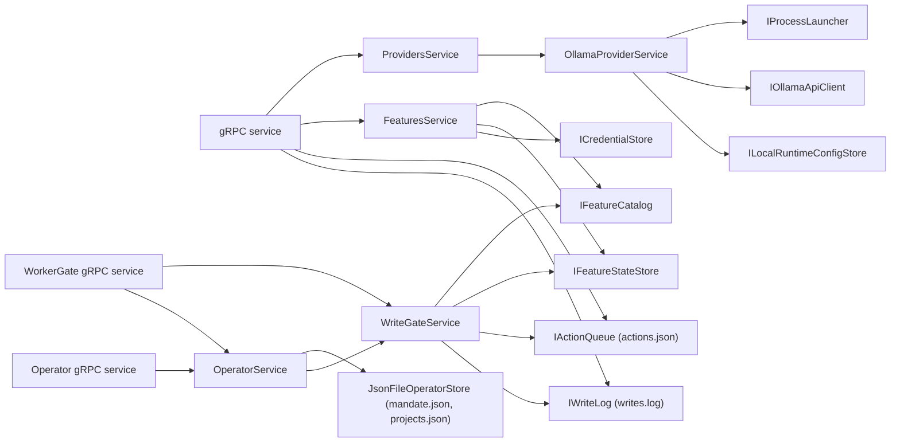

# ControlPlane

> What the desktop app asks Scout to do on the user's machine: run Ollama, pull models, store feature settings.

## To change here, read

- [[pages/invariants/no-executive-writes]]
- [[pages/decisions/0032-per-feature-write-permissions]]
- [[pages/decisions/0033-channel-operator-architecture]]
- [[pages/invariants/secrets-never-in-source]]
- [[pages/invariants/local-first-default]]
- [[pages/services/host-control-plane]]
- [[pages/services/control-plane-contracts]]
- [[pages/conventions/testing]]

## Responsibility

Owns the provider and feature domain services, the write gate and the channel operator's state, with no transport. [[pages/services/host-control-plane]] exposes them over gRPC. It does not run in the chat host ([[pages/services/host-console]]); the chat host reaches it only through the WorkerGate service, as a gRPC client, and shares no code path with it.

## Public contract

- **Entry point:** `AddControlPlaneDomain(IServiceCollection, IConfiguration)` at `src/Scout.ControlPlane/ControlPlaneServiceCollectionExtensions.cs:14`.
- **Providers:** `ProvidersService` (`src/Scout.ControlPlane/Providers/ProvidersService.cs:11`), `OllamaProviderService` for start, stop, status, model pull and delete (`src/Scout.ControlPlane/Providers/OllamaProviderService.cs:12`), seams `IProcessLauncher`, `IOllamaApiClient`, `IBinaryLocator`, `ILocalRuntimeRegistry`, `ILocalRuntimeConfigStore` and `IOllamaReadinessProbe`.
- **Features:** `FeaturesService` (`src/Scout.ControlPlane/Features/FeaturesService.cs:9`), `IFeatureCatalog` (`src/Scout.ControlPlane/Features/IFeatureCatalog.cs:6`) with GitHub, Kubernetes and YouTube entries (`src/Scout.ControlPlane/Features/FeatureCatalog.cs:7,10,13`), `IFeatureStateStore` (`src/Scout.ControlPlane/Features/IFeatureStateStore.cs:22`), `ICredentialStore` (`src/Scout.ControlPlane/Features/ICredentialStore.cs:9`), `IFeatureActivator` (`src/Scout.ControlPlane/Features/IFeatureActivator.cs:9`), `IFeatureCredentialValidator` (`src/Scout.ControlPlane/Features/FeatureCredentialValidation.cs:50`).
- **Write declarations and grants** ([[pages/decisions/0032-per-feature-write-permissions]]): every scope row carries `ScopeAccess` `Read`, `Write` or `IrreversibleWrite` (`src/Scout.ControlPlane/Features/FeatureFields.cs:29`, `:42`); `FeatureMetadata.HasWriteRows` (`src/Scout.ControlPlane/Features/FeatureMetadata.cs:42`); `FeatureCatalog.Validate` rejects a write row under `WriteClass.None` and runs in the catalog's constructor (`src/Scout.ControlPlane/Features/FeatureCatalog.cs:174`, `:181`). `EnableAsync(id, confirmWrites, ct)` (`src/Scout.ControlPlane/Features/FeaturesService.cs:248`) and `SetWriteGrantAsync(id, granted, confirmWrites, ct)` (`src/Scout.ControlPlane/Features/FeaturesService.cs:307`) throw `WriteConfirmationRequiredException` (`src/Scout.ControlPlane/Features/FeatureExceptions.cs:56`) for a feature with write rows when the confirmation is missing. `FeatureSnapshot` carries `WriteClass`, `Granted` and `GrantedAt`.
- **Actions:** `IActionQueue` (`src/Scout.ControlPlane/Actions/IActionQueue.cs:7`, with `ApproveAsync` and `RejectAsync` taking the owner's optional reason, `:23`, `MarkExecutedAsync`, `:33`, and `FindAsync` by id in any status, `:36`) over `JsonFileActionQueue` (`src/Scout.ControlPlane/Actions/JsonFileActionQueue.cs:17`) with `PendingAction` (`src/Scout.ControlPlane/Actions/PendingAction.cs:24`); `IWriteLog` (`src/Scout.ControlPlane/Actions/IWriteLog.cs:4`) over `JsonLinesWriteLog` (`src/Scout.ControlPlane/Actions/JsonLinesWriteLog.cs:13`) with `WriteLogEntry` (`src/Scout.ControlPlane/Actions/WriteLogEntry.cs:7`); registered with `TryAdd` (`src/Scout.ControlPlane/ControlPlaneServiceCollectionExtensions.cs:72`, `:73`).
- **Write gate:** `WriteGateService` (`src/Scout.ControlPlane/WriteGate/WriteGateService.cs:39`) with `RequestAsync` (`:62`) returning a `WriteDecision` (`:20`) of `Allowed`, `Queued` or `Refused` (`:7`) and `RecordAsync` (`:109`), which throws `WriteNotRecordableException` (`:23`); registered as a singleton (`src/Scout.ControlPlane/ControlPlaneServiceCollectionExtensions.cs:76`).
- **Operator** ([[pages/decisions/0033-channel-operator-architecture]]): records `Mandate`, `OperatorProject`, `TopicCandidate`, `Script`, `ScriptSection`, `Chapter` and `Claim` (`src/Scout.ControlPlane/Operator/OperatorModels.cs:4`, `:25`, `:39`, `:42`, `:52`, `:55`, `:61`); `JsonFileOperatorStore` (`src/Scout.ControlPlane/Operator/JsonFileOperatorStore.cs:17`) with `ReadMandateAsync`, `WriteMandateAsync`, `ReadProjectsAsync` and `UpdateProjectsAsync` (`:47`, `:61`, `:77`, `:94`); `OperatorService` (`src/Scout.ControlPlane/Operator/OperatorService.cs:15`) with the desktop side `GetMandateAsync`, `SaveMandateAsync`, `ListProjectsAsync`, `GetProjectAsync`, `StartProjectAsync`, `DecideClaimAsync` (`:54`, `:59`, `:103`, `:112`, `:122`, `:134`) and the worker side `GetMandateAsync`, `SaveProjectFromWorkerAsync` (`:183`), `GetProjectForWorkerAsync` (`:248`), `ListProjectsForWorkerAsync` (`:256`) and `NextQueuedProjectAsync` (`:269`); exceptions `OperatorValidationException`, `OperatorNotFoundException`, `OperatorWriteRefusedException` and `OperatorTamperingException` (`src/Scout.ControlPlane/Operator/OperatorExceptions.cs:4`, `:14`, `:24`, `:34`); both registered as singletons (`src/Scout.ControlPlane/ControlPlaneServiceCollectionExtensions.cs:77`, `:78`).
- **Configuration keys:** `Scout:Providers:Ollama` (`Endpoint`, `PingTimeout`, `StartTimeout`, `WarmupBudget`; `src/Scout.ControlPlane/Providers/OllamaProviderOptions.cs:9`), `Scout:LocalRuntime:Config` (`src/Scout.ControlPlane/Providers/ILocalRuntimeConfigStore.cs:24`), `Scout:Features:StateStore` with `FilePath` (`src/Scout.ControlPlane/Features/FeatureStateStoreOptions.cs:11`); the queue, the log and the operator's files take the folder of that file (`src/Scout.ControlPlane/Features/FeatureStateStoreOptions.cs:23`).
- **External boundaries:** HTTP to the Ollama daemon, including a streamed model pull with no global timeout (`src/Scout.ControlPlane/ControlPlaneServiceCollectionExtensions.cs:43`); spawn and kill of the `ollama serve` process (`src/Scout.ControlPlane/Providers/OllamaProviderService.cs:192`, `src/Scout.ControlPlane/Providers/SystemProcessLauncher.cs:173`); JSON files `local-runtimes.json`, `features.json` and `actions.json` under local application data, written through a temp file and atomic move (`src/Scout.ControlPlane/Providers/JsonFileLocalRuntimeConfigStore.cs:123`, `src/Scout.ControlPlane/Features/JsonFileFeatureStateStore.cs:165`, `src/Scout.ControlPlane/Actions/JsonFileActionQueue.cs:240`), and the append-only `writes.log` beside them, one JSON object per line (`src/Scout.ControlPlane/Actions/JsonLinesWriteLog.cs:51`); the operator's `mandate.json` and `projects.json` in the same folder, written the same way (`src/Scout.ControlPlane/Operator/JsonFileOperatorStore.cs:36`, `:37`, `:161`).

## How it works

The daemon is launched with both control-plane tokens, the desktop's `SCOUT_CONTROLPLANE_TOKEN` and the worker's `SCOUT_CONTROLPLANE_WORKER_TOKEN`, removed from the child environment (`src/Scout.ControlPlane/Providers/OllamaProviderService.cs:200`, `:201`); the code carries no comment about the worker token, and `tests/Scout.ControlPlane.Tests/Security/CallerTokensTests.cs:58` keeps its literal in step with the host's. The credential store falls back to `InMemoryCredentialStore` (`src/Scout.ControlPlane/ControlPlaneServiceCollectionExtensions.cs:69`) and the activator to `NullFeatureActivator` (`:70`), which makes `Enable` answer not-yet-implemented (`src/Scout.ControlPlane/Features/FeaturesService.cs:270`). No `IFeatureCredentialValidator` implementation exists outside `src/old`.

**Write grants.** A feature whose matrix has a `Write` or `IrreversibleWrite` row needs the owner's confirmation of those rows. `EnableAsync` checks it after the credentials and before the activator (`src/Scout.ControlPlane/Features/FeaturesService.cs:263`), so even with the confirmation the default activator still ends in not-yet-implemented; a successful enable records `Granted` and `GrantedAt` (`:283`), and a failed activation clears them (`:294`). A connection card with no toggle, such as YouTube, grants through `SetWriteGrantAsync` (`src/Scout.ControlPlane/Features/FeaturesService.cs:307`): granting needs the confirmation, revoking does not, a feature without write rows is a validation error, and `Enabled` is left alone. `DisableAsync` and `DeleteCredentialsAsync` reset the state and so revoke the grant (`src/Scout.ControlPlane/Features/FeaturesService.cs:345`, `:240`). `FeatureState` keeps `Granted` and `GrantedAt` (`src/Scout.ControlPlane/Features/IFeatureStateStore.cs:11`); the JSON store writes them only while granted, so a state file without them reads as not granted (`src/Scout.ControlPlane/Features/JsonFileFeatureStateStore.cs:172`). The worker learns the grants at start from `SCOUT__FEATURES__GRANTEDWRITES`, set by the desktop ([[pages/services/llm]]).

**Approval queue and write log.** `JsonFileActionQueue` keeps every action in `actions.json` beside `features.json`; enqueue, list, find and each decision run their read, check and write under one gate (`src/Scout.ControlPlane/Actions/JsonFileActionQueue.cs:167`), so two approvals of one action let one through and the other fails as already decided. The worker never writes the file: it enqueues through the WorkerGate service, so every writer is the control-plane process. A decision records the status, `DecidedAt` and the owner's reason when one was given, on an approval as on a rejection. `MarkExecutedAsync` moves an `Approved` action to `Executed` under the same gate and fails with `PendingActionNotApprovedException` for any other status, an executed one included (`src/Scout.ControlPlane/Actions/JsonFileActionQueue.cs:109`); an executed action is no longer pending. A queue file that does not parse is moved aside to `actions.json.corrupt-<UTC yyyyMMddHHmmss>` and logged once as a warning naming both paths, and the queue starts empty (`src/Scout.ControlPlane/Actions/JsonFileActionQueue.cs:213`); the move never overwrites, so a second corruption within the same second fails the call instead of losing the first file. Only malformed content is moved aside (`:211`): a file that cannot be opened or read (an `IOException` or `UnauthorizedAccessException`) fails the call and stays where it is, so a transient lock never empties the queue (`tests/Scout.ControlPlane.Tests/Actions/ActionQueueTests.cs:156`). `JsonLinesWriteLog` appends one line per write to `writes.log` and lists the last N newest first, skipping and logging a line that does not parse.

**Write gate.** `WriteGateService` is what the worker reaches through the WorkerGate service ([[pages/services/host-control-plane]]); it never grants a permission and never decides an action. `RequestAsync` looks the scope up among the catalog rows of the feature by exact, case-sensitive scope text (`src/Scout.ControlPlane/WriteGate/WriteGateService.cs:177`) and answers, in order: an unknown feature or a scope the feature does not declare is `Refused` with "<scope> is not declared by <feature>"; a `Read` row is `Refused` with "<scope> is a read"; a feature whose state is not `Granted` is `Refused` with "The owner has not allowed <feature> to write; allow it on the Features screen of Scout Desktop."; a `Write` row is `Allowed` with an empty reason; an `IrreversibleWrite` row enqueues a pending action (feature, the scope as the action, target, summary) and is `Queued` with its id and "Waiting for the owner's approval on the Review screen of Scout Desktop." (`:96`). The grant is read from the state store on every request (`:86`), so a grant or a revocation on the Features screen applies to the next request without a restart. `RecordAsync` appends a `WriteLogEntry` with the time, feature, scope, target and outcome; it refuses an undeclared scope or a read row, refuses a reversible `Write` row while the feature is not granted, with the same "has not allowed" text, read live like a request (`src/Scout.ControlPlane/WriteGate/WriteGateService.cs:129`), refuses an `IrreversibleWrite` row recorded without an action id with "<scope> is irreversible; it is recorded only with an action the owner approved.", even under the grant (`src/Scout.ControlPlane/WriteGate/WriteGateService.cs:135`), and with an action id it requires an action the owner approved for the same feature and scope (`:146`), then marks it executed before appending (`:161`), recording `ApprovedBy` `owner`; a second record with the same action id, sequential or concurrent, fails as not approved, so an approval covers one write. So every logged irreversible write carries the owner as its approver; the WorkerGate service answers each refusal with `FailedPrecondition` and the log is left untouched.

**Operator state.** The control plane is the only writer of the channel operator's state ([[pages/decisions/0033-channel-operator-architecture]]); the desktop reaches it through the `Operator` gRPC service and the worker through five `WorkerGate` methods ([[pages/services/host-control-plane]]). `JsonFileOperatorStore` keeps the mandate in `mandate.json` and every project, in creation order, in `projects.json`, both beside `features.json`. `UpdateProjectsAsync` reads the list, runs the caller's check-and-change and writes the list back under one gate (`src/Scout.ControlPlane/Operator/JsonFileOperatorStore.cs:26`, `:94`); when the change throws or answers null, nothing is written (`:103`). A file that does not parse is moved aside to `<name>.corrupt-<UTC yyyyMMddHHmmss>`, never overwritten, logged once as "Operator file at <path> is malformed; moved it to <aside> and started empty", and read as empty (`src/Scout.ControlPlane/Operator/JsonFileOperatorStore.cs:132`, `:136`); a file that cannot be opened fails the call and stays where it is.

The desktop side: `GetMandateAsync` answers the empty mandate when none is saved. `SaveMandateAsync` trims every field, drops blank pillars and blocked topics, stamps `UpdatedAt`, and refuses an empty objective or language, more than 5 pillars or a pillar over 80 characters, joining the messages ("The objective is required.", "At most 5 pillars.", "Each pillar is at most 80 characters.", "The language is required."). `ListProjectsAsync` returns the newest first; a limit of 0 or less means 50 and at most 200 are returned. `StartProjectAsync` trims the topic, refuses one outside 3 to 200 characters ("The topic must be 3 to 200 characters."), then asks the write gate for the `youtube` grant like a worker save and, without it, refuses with the gate's text as `OperatorWriteRefusedException` (`src/Scout.ControlPlane/Operator/OperatorService.cs:125`), which the desktop receives as `PERMISSION_DENIED`; with it, it queues a project with status `queued` and origin `desktop`. `DecideClaimAsync` takes `supported`, `unsupported` or `waived`, anything else being "A claim is decided as supported, unsupported or waived.", needs a note for `waived` ("A waived claim needs a note saying why."), and stamps the claim's `DecidedAt`, which marks it as the owner's decision. An unknown project or claim is `OperatorNotFoundException`. No desktop method returns a project's `OriginReference` (`src/Scout.ControlPlane/Operator/OperatorService.cs:321`).

The worker side: `SaveProjectFromWorkerAsync`, `GetProjectForWorkerAsync`, `ListProjectsForWorkerAsync` and `NextQueuedProjectAsync` first ask `WriteGateService.RequestAsync` for the `youtube` feature's `Write` row "Scout's data folder", so the grant is read live and a refusal carries the gate's own text, "The owner has not allowed youtube to write; allow it on the Features screen of Scout Desktop." (`src/Scout.ControlPlane/Operator/OperatorService.cs:429`). The mandate read is not gated: it is a read of the owner's brief. The two reads return what the desktop sees, owner-decided claims with their status and note included, with the desktop's limit rules and without the origin reference on the wire, so the worker can send an owner's decision back unchanged. A save then refuses, as `OperatorValidationException`, a status other than `researching`, `scripting`, `script_ready` or `failed`, a claim without an id, duplicate claim ids and a claim status outside `pending`, `unsupported`, `supported` and `waived` (`:191`, `:357`); and, as `OperatorTamperingException`, a claim the worker marks `supported` or `waived` unless the stored claim already has that status (`:377`), a claim the owner decided that comes back changed in text, status, note, risk or source links (the links compared in order) or does not come back (`:391`), and a different topic or origin on an existing project (`:224`). Each save that succeeds appends one `WriteLogEntry` to `writes.log` as a reversible write under [[pages/decisions/0032-per-feature-write-permissions]]: feature `youtube`, action "Scout's data folder", the project id as target, outcome `saved <status>`, no approver (`:417`); a refused save appends nothing. An empty id creates a project of origin `chat` that stores the origin reference; an existing project keeps its topic, origin, creation time, owner decisions and reference. `NextQueuedProjectAsync` takes the oldest `queued` project or, when none is queued, the oldest project left in `researching` or `scripting` whose `UpdatedAt` is more than 15 minutes old (`:36`, `:300`); the pipeline saves at every stage, so a live run is never that stale, and a run a worker shutdown cut short is taken again. It moves the project to `researching` with a fresh `UpdatedAt` inside one `UpdateProjectsAsync`, so two callers never take the same project, appends `saved researching` for it to the write log, and returns it with its reference. It first reads the list outside the store's write path and returns null when nothing waits, and the change answers null under the gate when another caller took it first, so an idle poll never rewrites `projects.json`.

## Invariants

- [[pages/decisions/0032-per-feature-write-permissions]]: the write gate refuses an undeclared scope and a read row even under the grant (`tests/Scout.ControlPlane.Tests/WriteGate/WriteGateServiceTests.cs:61`, `:72`), refuses a declared write without the grant (`:84`), allows a reversible write under it (`:93`), queues an irreversible one for the owner (`:104`), reads the grant live (`:118`), and records a write with an action id only once the owner approved that action for that scope (`:134`, `:197`, `:219`), once per approval (`:154`, `:172`), refuses an irreversible write recorded without one (`:234`) and a reversible one without the grant (`:246`); a corrupt queue file is moved aside, never overwritten (`tests/Scout.ControlPlane.Tests/Actions/ActionQueueTests.cs:133`). Every catalog row declares its `ScopeAccess`; a write row under `WriteClass.None` fails `FeatureCatalog.Validate` (`tests/Scout.ControlPlane.Tests/Features/FeatureCatalogTests.cs:137`); a feature with write rows is enabled or granted only with the owner's confirmation (`tests/Scout.ControlPlane.Tests/Features/FeaturesServiceTests.cs:211`, `:288`) and the grant is revoked by disable, credential deletion or an explicit revoke (`tests/Scout.ControlPlane.Tests/Features/FeaturesServiceTests.cs:258`, `:274`, `:311`). The queue and the log are Scout's own files (`tests/Scout.ControlPlane.Tests/Actions/ActionQueueTests.cs:21`, `tests/Scout.ControlPlane.Tests/Actions/WriteLogTests.cs:26`).
- [[pages/decisions/0033-channel-operator-architecture]]: the worker's operator writes and reads refuse without the grant and leave a queued project queued (`tests/Scout.ControlPlane.Tests/Operator/OperatorServiceTests.cs:263`, `:280`, `:567`), and so does the desktop's start (`:152`); the worker reads projects newest first with the owner's decisions (`:549`); each save and each taken project appends one write-log entry, a refused save or an idle poll none (`:580`); the worker cannot mark a claim supported or waived (`:295`), overwrite or drop an owner's decision (`:314`, `:328`), change its risk or sources (`:343`), or change a topic or origin (`:379`); a status outside its set is refused (`:395`); the desktop never sees the origin reference (`:429`); a project stuck 15 minutes in researching or scripting is taken again after every queued one (`:476`); an idle poll leaves `projects.json` untouched (`:513`, `tests/Scout.ControlPlane.Tests/Operator/JsonFileOperatorStoreTests.cs:41`); two concurrent takers never share a queued project (`tests/Scout.ControlPlane.Tests/Operator/OperatorServiceTests.cs:537`, `tests/Scout.ControlPlane.Tests/Operator/JsonFileOperatorStoreTests.cs:104`); a malformed operator file is moved aside, an unreadable one fails (`tests/Scout.ControlPlane.Tests/Operator/JsonFileOperatorStoreTests.cs:132`, `:153`).
- [[pages/invariants/no-executive-writes]]: start, stop, pull and delete mutate the host. The GitHub catalog entry lists only the read-only GitHub App permissions Metadata, Contents, Pull requests and Issues, each `ScopeAccess.Read` (`src/Scout.ControlPlane/Features/FeatureCatalog.cs:46`, guarded by `tests/Scout.ControlPlane.Tests/Features/FeatureCatalogTests.cs:19`), and its setup steps describe "Connect with GitHub" ([[pages/decisions/0019-github-app-device-flow]]). The `pat` credential field stays for a host without the desktop sign-in. The Kubernetes entry says it reads pods, deployments and events using the Kubernetes configuration on this computer, with consent, read-only (`src/Scout.ControlPlane/Features/FeatureCatalog.cs:73`, guarded by `tests/Scout.ControlPlane.Tests/Features/FeatureCatalogTests.cs:59`); its setup steps name `KUBECONFIG` and `~/.kube/config`, recommend a read-only user, and no longer promise a keyring or ask for a pasted kubeconfig (`tests/Scout.ControlPlane.Tests/Features/FeatureCatalogTests.cs:68`). It asks for no credentials (`tests/Scout.ControlPlane.Tests/Features/FeatureCatalogTests.cs:80`): the desktop card reads the local kubeconfig, and a host without the desktop configures `Scout:Plugins:Kubernetes` ([[pages/decisions/0020-kubernetes-from-local-kubeconfig]]). The YouTube entry is the channel operator's contract under `WriteClass.Executive` (`src/Scout.ControlPlane/Features/FeatureCatalog.cs:89`, guarded by `tests/Scout.ControlPlane.Tests/Features/FeatureCatalogTests.cs:87`): reads `channels.list`, `playlistItems.list`, `videos.list`, `search.list`, `commentThreads.list` and the YouTube Analytics v2 reports; one `Write` row for scripts, narration, images, the scene list, the video and thumbnails under Scout's data folder; `IrreversibleWrite` rows `videos.insert`, `videos.update`, `thumbnails.set`, `playlistItems.insert`, `comments.insert` and `comments.setModerationStatus`. Its description says the write side is not implemented yet; the plugin stays GET-only ([[pages/decisions/0030-youtube-plugin-read-only-with-browser-sign-in]], amended). It asks for one `api_key` field whose help points to the Google Cloud Console; its setup steps offer the key or the sign-in from the Scout app (`tests/Scout.ControlPlane.Tests/Features/FeatureCatalogTests.cs:120`, [[pages/services/plugin-youtube]]).
- [[pages/invariants/secrets-never-in-source]]: credentials go to `ICredentialStore` (in memory by default), not to the JSON state file, whose record holds only `Enabled`, `LastError`, `Settings`, `Granted` and `GrantedAt` (`src/Scout.ControlPlane/Features/IFeatureStateStore.cs:11`); the queue and the log hold no secret either.
- [[pages/invariants/local-first-default]]: the default endpoint is localhost (`src/Scout.ControlPlane/Providers/OllamaProviderOptions.cs:12`).

## Hot spots

- `src/Scout.ControlPlane/Providers/SystemProcessLauncher.cs:13`: process spawn, kill of the whole tree, cross-platform.
- `src/Scout.ControlPlane/Providers/OllamaProviderService.cs:319`: streamed pull progress.
- `src/Scout.ControlPlane/Features/FeaturesService.cs:97`: setup flow combining validation, persistence and activation.
- `src/Scout.ControlPlane/Features/FeaturesService.cs:248` and `:307`: the only two paths that grant a write; both need the owner's confirmation.
- `src/Scout.ControlPlane/WriteGate/WriteGateService.cs:62`: the only path through which the worker's write is allowed or queued; a new scope access value must be decided here.
- `src/Scout.ControlPlane/Operator/OperatorService.cs:183`: the worker's only way to change operator state; a new field on `OperatorProject` must be decided here as the worker's to set or the owner's to keep.

## Testing footprint

`tests/Scout.ControlPlane.Tests` (178 test attributes, 27 files, shared with the host and contracts): `Providers/` (Ollama service with a harness and stubs, providers service), `Features/` (catalog rows and the consistency check, the service with the confirmation and grant tests over a real state file, the JSON state store's round trip, legacy file and corrupt-file fallback), `Actions/` (the queue's pending, decision, decide-once, execute-once, concurrent-approval, moved-aside corrupt-file and unreadable-file tests; the log's newest-first listing and corrupt-line skip), `WriteGate/` (the gate's decisions and records over the real catalog and Scout's own files in a temp folder), `Operator/` (the store's round trip, atomic update, concurrency, moved-aside and unreadable files; the service's validation, grant, claim and origin rules, the stuck-project take and the idle poll that writes nothing, over the real gate and files in a temp folder). Integration tests live under `Integration/` and are described in [[pages/services/host-control-plane]].

## Related

Direct project references: none. Referenced by [[pages/services/host-control-plane]]. Map: [[pages/architecture/project-map]].
