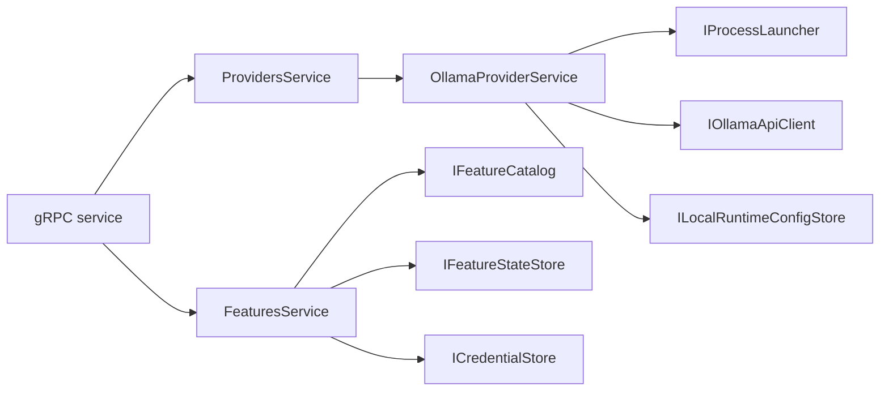

# ControlPlane

> What the desktop app asks Scout to do on the user's machine: run Ollama, pull models, store feature settings.

## To change here, read

- [[pages/invariants/no-executive-writes]]
- [[pages/invariants/secrets-never-in-source]]
- [[pages/invariants/local-first-default]]
- [[pages/services/host-control-plane]]
- [[pages/services/control-plane-contracts]]
- [[pages/conventions/testing]]

## Responsibility

Owns the provider and feature domain services, with no transport. [[pages/services/host-control-plane]] exposes them over gRPC. It is hosted twice: by [[pages/services/host-control-plane]] (gRPC) and by the chat host, which serves it over loopback HTTP ([[pages/services/host-console]]).

## Public contract

- **Entry point:** `AddControlPlaneDomain(IServiceCollection, IConfiguration)` at `src/Scout.ControlPlane/ControlPlaneServiceCollectionExtensions.cs:13`.
- **Providers:** `ProvidersService` (`src/Scout.ControlPlane/Providers/ProvidersService.cs:11`), `OllamaProviderService` for start, stop, status, model pull and delete (`src/Scout.ControlPlane/Providers/OllamaProviderService.cs:12`), seams `IProcessLauncher`, `IOllamaApiClient`, `IBinaryLocator`, `ILocalRuntimeRegistry`, `ILocalRuntimeConfigStore` and `IOllamaReadinessProbe`.
- **Features:** `FeaturesService` (`src/Scout.ControlPlane/Features/FeaturesService.cs:9`), `IFeatureCatalog` (`src/Scout.ControlPlane/Features/IFeatureCatalog.cs:6`) with GitHub, Kubernetes and Code Review entries (`src/Scout.ControlPlane/Features/FeatureCatalog.cs:7,10,13`), `IFeatureStateStore` (`src/Scout.ControlPlane/Features/IFeatureStateStore.cs:18`), `ICredentialStore` (`src/Scout.ControlPlane/Features/ICredentialStore.cs:9`), `IFeatureActivator` (`src/Scout.ControlPlane/Features/IFeatureActivator.cs:9`), `IFeatureCredentialValidator` (`src/Scout.ControlPlane/Features/FeatureCredentialValidation.cs:50`).
- **Configuration keys:** `Scout:Providers:Ollama` (`Endpoint`, `PingTimeout`, `StartTimeout`, `WarmupBudget`; `src/Scout.ControlPlane/Providers/OllamaProviderOptions.cs:9`), `Scout:LocalRuntime:Config` (`src/Scout.ControlPlane/Providers/ILocalRuntimeConfigStore.cs:24`), `Scout:Features:StateStore` with `FilePath` (`src/Scout.ControlPlane/Features/FeatureStateStoreOptions.cs:11`).
- **External boundaries:** HTTP to the Ollama daemon, including a streamed model pull with no global timeout (`src/Scout.ControlPlane/ControlPlaneServiceCollectionExtensions.cs:42`); spawn and kill of the `ollama serve` process (`src/Scout.ControlPlane/Providers/OllamaProviderService.cs:193`, `src/Scout.ControlPlane/Providers/SystemProcessLauncher.cs:173`); JSON files `local-runtimes.json` and `features.json` under local application data, written through a temp file and atomic move (`src/Scout.ControlPlane/Providers/JsonFileLocalRuntimeConfigStore.cs:123`, `src/Scout.ControlPlane/Features/JsonFileFeatureStateStore.cs:161`).

## How it works

The daemon is launched with the control-plane session token removed from the child environment (`src/Scout.ControlPlane/Providers/OllamaProviderService.cs:197`). The credential store defaults to `InMemoryCredentialStore` (`src/Scout.ControlPlane/ControlPlaneServiceCollectionExtensions.cs:68`) and the activator to `NullFeatureActivator` (`:69`, class at `src/Scout.ControlPlane/Features/IFeatureActivator.cs:29`), which makes `Enable` throw not-implemented (`src/Scout.ControlPlane/Features/FeaturesService.cs:290`). The default credential store is fail-closed: it reports `IsAvailable` false and `StoreAsync` returns false (`src/Scout.ControlPlane/Features/InMemoryCredentialStore.cs:21,47`), so `SetCredentials` and `Setup` throw `FeaturePersistFailedException` instead of keeping the secret in memory (`src/Scout.ControlPlane/Features/FeaturesService.cs:96,188`). No code in `src/` registers a durable `ICredentialStore`, a real `IFeatureActivator` or any `IFeatureCredentialValidator`; there is no OS keyring implementation, although the interface comment still mentions one (`src/Scout.ControlPlane/Features/ICredentialStore.cs:4`). The GitHub and Kubernetes setup text shown to the user still says secrets are held in process memory only (`src/Scout.ControlPlane/Features/FeatureCatalog.cs:26,68`).

## Invariants

- [[pages/invariants/no-executive-writes]]: start, stop, pull and delete mutate the host; the catalog marks all three features `WriteClass.None` (`src/Scout.ControlPlane/Features/FeatureCatalog.cs:41`), yet the GitHub scope matrix lists "Create issues (descriptive write per ADR)" under `repo` (`:51`); `WriteClass` defines Descriptive as permitted and Executive as forbidden (`src/Scout.ControlPlane/Features/FeatureMetadata.cs:6`).
- [[pages/invariants/secrets-never-in-source]]: credentials go to `ICredentialStore`, which by default stores nothing (fail-closed), never to the JSON state file, whose record holds only `Enabled`, `LastError` and `Settings` (`src/Scout.ControlPlane/Features/IFeatureStateStore.cs:9`).
- [[pages/invariants/local-first-default]]: the default endpoint is localhost (`src/Scout.ControlPlane/Providers/OllamaProviderOptions.cs:12`).

## Hot spots

- `src/Scout.ControlPlane/Providers/SystemProcessLauncher.cs:13`: process spawn, kill of the whole tree, cross-platform.
- `src/Scout.ControlPlane/Providers/OllamaProviderService.cs:317`: streamed pull progress.
- `src/Scout.ControlPlane/Features/FeaturesService.cs:115`: `SetupAsync`, validation then fail-closed credential persistence then settings.

## Testing footprint

`tests/Scout.ControlPlane.Tests` (66 test attributes, 10 files, shared with the host and contracts): `Providers/` (Ollama service with a harness and stubs, providers service), `Features/FeaturesServiceTests.cs`, `Features/InMemoryCredentialStoreTests.cs`. Integration tests live under `Integration/` and are described in [[pages/services/host-control-plane]].

## Related

Direct project references: none. Referenced by [[pages/services/host-control-plane]] and [[pages/services/host-console]]. Map: [[pages/architecture/project-map]].
