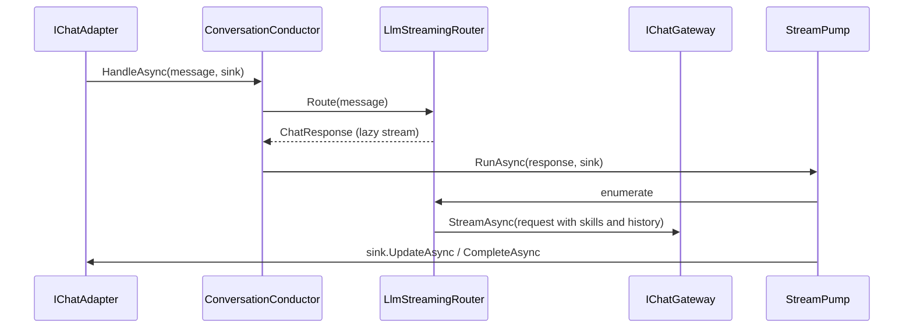

# Conversation

> Turns one inbound chat message into one streamed reply, without knowing which chat platform or which model is on either end.

## To change here, read

- [[pages/invariants/pluggable-boundaries]]
- [[pages/invariants/no-executive-writes]]
- [[pages/decisions/0021-allowed-users]] - who may use Scout at all
- [[pages/decisions/0024-voice-messages-transcribed-locally]] - voice messages
- [[pages/decisions/0028-local-quick-ask-assistant]] - the local owner from the quick-ask window
- [[pages/decisions/0033-channel-operator-architecture]] - progress posted later into the originating conversation
- [[pages/services/llm]]
- [[pages/services/skills]]
- [[pages/conventions/testing]]

## Responsibility

Owns the adapter contract, message and response shapes, routing, per-channel memory, the streaming edit loop and the voice-message flow (limits, download through the adapter's delegate, transcription through `IAudioTranscriber`). Does not own a speech model ([[pages/services/transcription-whisper]]) nor platform SDK calls ([[pages/services/adapter-discord]], [[pages/services/adapter-slack]], [[pages/services/adapter-teams]]) nor model access ([[pages/services/llm]]).

## Public contract

- **Entry point:** `AddScoutConversation(IServiceCollection, IConfiguration)` at `src/Scout.Conversation/ConversationServiceCollectionExtensions.cs:24`.
- **Adapter side:** `IChatAdapter` (`src/Scout.Conversation/Abstractions/IChatAdapter.cs:11`), `IResponseSink` with `BeginAsync`, `UpdateAsync`, `CompleteAsync`, `FailAsync` (`src/Scout.Conversation/Abstractions/IResponseSink.cs:17`), `RenderCapabilities` (`src/Scout.Conversation/Abstractions/RenderCapabilities.cs:10`), `ChatMessage` with an optional `Audio` and an optional `IsDirectMessage` the adapters set (`src/Scout.Conversation/Abstractions/ChatMessage.cs:8`; empty text is allowed only with audio, `:26`) and an init-only `IsLocalOwner`, false by default, that only [[pages/services/adapter-local]] sets (`src/Scout.Conversation/Abstractions/ChatMessage.cs:54`), `IPairingSignal`, which the host implements (`src/Scout.Conversation/Access/IPairingSignal.cs:7`), `AudioAttachment` (content type, size, duration and an `OpenAsync` download delegate; `src/Scout.Conversation/Abstractions/AudioAttachment.cs:13`), `Citation` (`src/Scout.Conversation/Abstractions/Citation.cs:10`).
- **Origin of a turn** ([[pages/decisions/0033-channel-operator-architecture]]): `ChatMessage.OriginReference`, an init-only opaque `<adapter>:<payload>` string the adapter fills (`src/Scout.Conversation/Abstractions/ChatMessage.cs:60`); `ChatOrigin.Current`, the reference of the turn on the current async flow (`src/Scout.Conversation/Abstractions/ChatOrigin.cs:20`); `ChatOrigin.IsOwner`, true only while a turn of Scout's owner runs: the local quick-ask user, or an allowed chat user listed in `Scout:Access:OwnerUserIds` (`src/Scout.Conversation/Abstractions/ChatOrigin.cs:27`), which the operator's owner-only functions read ([[pages/services/operator]]); `ChatOrigin.Remember(mark, lifetime)` and `ChatOrigin.Remembers(mark)` (`src/Scout.Conversation/Abstractions/ChatOrigin.cs:45`, `:79`): a mark is kept for the rest of the running turn and, when the turn has a conversation key, for `lifetime` in every later turn with the same key, whatever its origin reference, measured on the conductor's clock. The conductor enters each turn with `ChatOrigin.Enter(originReference, isOwner, time, conversationKey)` (`src/Scout.Conversation/Abstractions/ChatOrigin.cs:102`), the key coming from the registered `IConversationKeyProvider`, the same one the memory uses: channel and sender (`src/Scout.Conversation/Memory/ConversationKeyProvider.cs:18`). Every turn the conductor enters has a key, Teams' too; only a turn entered with a null key keeps its marks until it ends, which no caller does today. The marks kept past their turn live in one process-wide store under a lock, at most 256 (`ChatOrigin.KeptCap`): each write first drops the expired ones and, when the store is still full, the one closest to expiring. The operator's project-state read fills it for 10 minutes, so its change functions run only after a state read in the same conversation within 10 minutes (`tests/Scout.Operator.Tests/YouTubeOperatorPluginTests.cs:600`); `IOriginNotifier.PostAsync(string originReference, string text, CancellationToken ct)` returning `Task<bool>` (`src/Scout.Conversation/Abstractions/IOriginNotifier.cs:14`), implemented by `OriginNotifier` (`src/Scout.Conversation/OriginNotifier.cs:11`, registered at `src/Scout.Conversation/ConversationServiceCollectionExtensions.cs:51`) over the `IOriginPoster` each adapter registers, with `Kind` and `PostAsync(string payload, string text, CancellationToken ct)` (`src/Scout.Conversation/Abstractions/IOriginPoster.cs:17`).
- **Transcription:** `IAudioTranscriber.TranscribeAsync(Stream, string contentType, CancellationToken)` (`src/Scout.Conversation/Abstractions/IAudioTranscriber.cs:8`); optional constructor dependency of the conductor, registered by the host only when a model exists. Its second member, `TranscribeSegmentsAsync(Stream wav, TimeSpan maxDuration, CancellationToken)` (`:20`), yields the `TranscribedSegment(TimeSpan Start, TimeSpan End, string Text)` records (`:24`) of a 16 kHz mono WAV recording up to the caller's limit; the conductor never calls it, the YouTube operator does for the owner's own video ([[pages/services/operator]]). `TranscriptionBusyException` (`:27`) is what `TranscribeAsync` throws when another transcription held the model too long, in the Whisper transcriber 30 seconds behind a recording ([[pages/services/transcription-whisper]]).
- **Core:** `ConversationConductor.HandleAsync` (`src/Scout.Conversation/ConversationConductor.cs:108`), `IConversationRouter` (`src/Scout.Conversation/Abstractions/IConversationRouter.cs:9`) implemented by `LlmStreamingRouter` (`src/Scout.Conversation/Routing/LlmStreamingRouter.cs:20`), `StreamPump.RunAsync` (`src/Scout.Conversation/Streaming/StreamPump.cs:50`), `IConversationMemoryStore` with an in-memory store (`src/Scout.Conversation/Memory/InMemoryConversationMemoryStore.cs:20`; an entry idle past `IdleTtl` is dropped when it is next read, and every `Append` sweeps the other expired entries (`:94`), so one-shot keys such as a Discord thread per question do not accumulate), `ScoutActivitySource` for tracing (`src/Scout.Conversation/Telemetry/ScoutActivitySource.cs:9`).
- **Configuration keys:** `Scout:Conversation` (`SystemPrompt`, `Temperature`, `MaxTokens`; `src/Scout.Conversation/Routing/LlmStreamingRouterOptions.cs:7`), `Scout:Conversation:Memory` (`Enabled`, `MaxTurns`, `MaxReplayedChars`, `IdleTtl`; `src/Scout.Conversation/Memory/ConversationMemoryOptions.cs:11`), `Scout:Access` (`AllowedUserIds`, `RequireAllowList`, `PairingCode`, `PairingExpiresAt`, `OwnerUserIds`; `src/Scout.Conversation/Access/AccessOptions.cs:8`, `OwnerUserIds` at `:34`, empty by default, bound at `src/Scout.Conversation/ConversationServiceCollectionExtensions.cs:34`).
- **External boundaries:** none directly; all I/O goes through `IChatGateway`, `IResponseSink` and the adapters' `IOriginPoster`s.

## How it works

`Route` defers all work to enumeration (`src/Scout.Conversation/Routing/LlmStreamingRouter.cs:59`). History is written only after a stream completes without error, so a failed turn never enters memory (`:101`). Failures reach the user through `sink.FailAsync` (`src/Scout.Conversation/ConversationConductor.cs:184`).

- **Local owner:** a message with `IsLocalOwner` set skips both the pairing check and the allow-list (`src/Scout.Conversation/ConversationConductor.cs:122`, `:137`) and goes straight to voice handling and routing; the flag is kept when a voice message is rewritten to its transcript (`:159`). Trust comes from the local adapter's stdin transport, never from the user id: a chat message with the user id `local-owner` is refused like any other ([[pages/decisions/0028-local-quick-ask-assistant]]).
- **Pairing:** first of all, a message whose trimmed text is `pair` in any case, one or more spaces and six digits is a pairing attempt; so is a message of exactly six digits, but only in a direct message while a code is pending (`src/Scout.Conversation/ConversationConductor.cs:122`, pending check at `:194`). Outside a direct message, six bare digits are an attempt only when they are exactly the pending code (`src/Scout.Conversation/ConversationConductor.cs:201`); other bare digits in a channel, or any with no code pending, are an ordinary message and never count as a wrong code. It succeeds once per process, only in a direct message, only with the configured unexpired `PairingCode` and only when an `IPairingSignal` is registered (`:204`). The correct code sent outside a direct message, bare or as `pair <code>`, or five wrong codes, burn it for the process, and the signal's `Burned` is called (`:231`). The signal gets the sender id, and the reply is "Paired. Scout will answer you from now on."; any failure replies "That pairing code is not valid. Check the code in Scout's Settings and send it again." Nothing is routed either way, and the log line carries the channel id and the outcome only. The sender still goes through the allow-list on the next message, until the desktop adds the id and restarts the worker ([[pages/decisions/0021-allowed-users]]).
- **Allowed users:** next, after the pairing check, `HandleAsync` checks `ChatMessage.UserId` with `AccessPolicy` (`src/Scout.Conversation/Access/AccessPolicy.cs:9`, registered as a singleton from `Scout:Access` and injected into the conductor, which reads the pairing code and its expiry from the same instance, without them ever changing who is allowed; the Discord adapter uses the same instance to decide whether to open a thread) against `Scout:Access` (`src/Scout.Conversation/ConversationConductor.cs:137`, rule at `:342`). A sender outside a non-empty list gets "Scout only answers its configured users."; with an empty list and `RequireAllowList` set, everyone gets "Scout is not set up for anyone yet. If you are the owner, open the Scout desktop app, go to Settings, choose Pair from chat and send the 6-digit code here in a direct message."; otherwise the message is routed as before. A refusal is `BeginAsync` then `CompleteAsync` with that text, no router, pump, model or plugin call, and one Information log line with the channel id only. The desktop sets `RequireAllowList` when an owner credential is connected ([[pages/decisions/0021-allowed-users]]).
- **Voice messages:** after the allowed-users check, a message with `Audio` opens the sink and is transcribed before routing (`src/Scout.Conversation/ConversationConductor.cs:147`, `:248`). With no `IAudioTranscriber` the reply is exactly "Voice messages need a Whisper model. Download one in the Scout app under AI Sources, Local Models." and nothing is downloaded. A reported size over 25 MB or duration over 5 minutes is refused before the download (`:257`, `:261`); the download reads at most 25 MB and refuses more (`:321`), and the whole download, body included, is cancelled after 30 s (`AudioDownloadTimeout`, `:270`), because the HTTP client's own timeout stops at the response headers. A failed or timed-out download, a failed transcription and an empty transcript each complete the reply with a fixed sentence, logged with the channel id only (`:276`, `:300`, `:307`), and a transcriber busy with a recording with "Scout is transcribing a recording right now; try the voice message again in a few minutes." (`:46`, `:292`, `tests/Scout.Conversation.Tests/ConversationConductorVoiceTests.cs:217`); a successful transcription logs the transcript length and the duration in ms, never the text. Otherwise the transcript becomes the message text, so the router, memory and model see what was said, and the sink is wrapped in `VoiceReplySink` (`src/Scout.Conversation/Streaming/VoiceReplySink.cs:10`), which prefixes every rendered body with `> (voice) ` and the transcript's first 200 characters on one line, and turns the pump's Begin into a no-op because the reply is already open ([[pages/decisions/0024-voice-messages-transcribed-locally]]).
- **Origin and later posts:** `HandleAsync` enters `ChatOrigin` with the message's `OriginReference`, its conversation key, and whether the sender is the owner, `IsLocalOwner` or `AccessPolicy.IsOwner` (`src/Scout.Conversation/Access/AccessPolicy.cs:48`), an allowed id also listed in `OwnerUserIds`, compared ordinally after trimming, before anything else runs and leaves it when the turn ends (`src/Scout.Conversation/ConversationConductor.cs:118`); both come from the platform event, never from the message text or a function parameter, so a prompt can make the model call a function but cannot make the caller the owner; the value lives in an `AsyncLocal`, so a function the model calls while the reply streams reads its own turn's reference and owner flag and never another concurrent turn's, and the caller sees null and not the owner after the turn. The voice rewrite keeps the reference (`:159`). `OriginNotifier` splits a reference at its first colon and hands the rest to the poster whose `Kind` is the prefix: `discord`, `slack` or `local` ([[pages/services/adapter-discord]], [[pages/services/adapter-slack]], [[pages/services/adapter-local]]). A null or empty reference, no prefix, a prefix no running adapter registered (Teams registers none) or a poster that throws returns false with a Warning that carries no reference contents; it never throws for a closed or missing channel, and only a cancellation of the caller's own token propagates (`src/Scout.Conversation/OriginNotifier.cs:18`). Each poster caps the text to its platform's limit. Rules: the reference is never shown to the model or logged, and `ChatMessage`'s generated `ToString` omits it (`src/Scout.Conversation/Abstractions/ChatMessage.cs:62`); the target of a later post comes only from a reference an adapter captured (through `ChatOrigin.Current` or stored with the job), never from an argument the model supplies; the post is plain text into that same conversation, a descriptive write ([[pages/invariants/no-executive-writes]]).
- **Sign-in required:** an `LlmSignInRequiredException` from the provider completes the reply with `StreamPumpOptions.SignInRequiredMessage` (`src/Scout.Conversation/Streaming/StreamPumpOptions.cs:56`, caught at `src/Scout.Conversation/Streaming/StreamPump.cs:134`), so the chat user is told to sign in again instead of seeing a generic error.

## Invariants

- [[pages/invariants/pluggable-boundaries]]: this project is the seam the adapters and the host plug into.
- [[pages/invariants/no-executive-writes]]: the only write it performs is the reply through the sink; the voice download it triggers is a read through the adapter's delegate.

## Hot spots

- `src/Scout.Conversation/Streaming/StreamPump.cs:50`: edit throttling, timeout and truncation for every platform.
- `src/Scout.Conversation/ConversationServiceCollectionExtensions.cs:49`: `NoOpSkillSelector` is a `TryAdd` fallback, so `AddScoutSkills` must run first (`src/Scout.Host.Console/HostComposition.cs:47`).

## Testing footprint

`tests/Scout.Conversation.Tests` (146 test attributes, 172 test cases, 18 files): conductor, the kept marks (`Abstractions/ChatOriginMarksTests.cs`: a mark seen in a later turn with the same conversation key and another origin reference within 10 minutes, never under another key even from the same origin, kept for a key whose turns carry no origin, gone after 10 minutes, only the turn's own without a key, and never more than 256 kept, the one closest to expiring giving way), the turn origin (`ConversationConductorOriginTests.cs`: `ChatOrigin.Current` equals the reference while the reply streams and is null after, two concurrent turns each see only their own, a voice message keeps its reference; `IsOwner` true for the local owner and for an allowed sender listed in `OwnerUserIds`, false for an allowed sender not listed and for everyone with no owner ids, and only each turn's own across concurrent turns, `tests/Scout.Conversation.Tests/ConversationConductorOriginTests.cs:145` to `:175`), the dispatcher (`OriginNotifierTests.cs`: the payload after the prefix reaches that adapter's poster, Teams, unknown, empty and prefix-less references return false with a Warning, a throwing poster returns false without naming the channel), the allowed-users gate and the owner, an allowed id listed in `OwnerUserIds` after trimming (`ConversationConductorAccessTests.cs`), the local owner (`ConversationConductorLocalOwnerTests.cs`: answered with an empty list and `RequireAllowList`, answered when the list names only chat users, a chat message with the `local-owner` id still refused, a `pair <code>` text routed without pairing or burning, a WAV voice message transcribed and still local-owner), pairing by code (`ConversationConductorPairingTests.cs`: `pair <code>` in any case, the bare code in a direct message, the bare correct code in a channel burned, other bare digits in a channel routed as ordinary messages), voice messages (`ConversationConductorVoiceTests.cs`: transcript routed and quoted, a refused user's audio never downloaded, size, read size and duration limits, download and transcriber failures, no speech, the exact no-model text, a stalled download body, the duration in the log line), memory sweep of idle keys, router and memory interplay, key derivation, memory store expiry, DI registration including `Scout:Access` binding, and the stream pump including failure paths. Fakes: `Fakes/RecordingResponseSink.cs`, `Fakes/RecordingLogger.cs`.

## Related

Direct project references: [[pages/services/llm]], [[pages/services/skills]]. Referenced by the four adapters, [[pages/services/adapter-local]] among them, and [[pages/services/host-console]]. Map: [[pages/architecture/project-map]].
