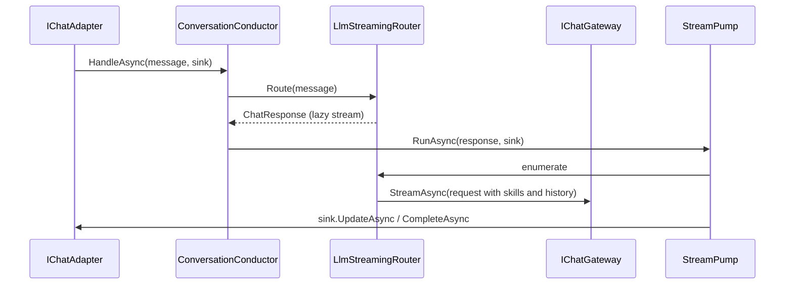

# Conversation

> Turns one inbound chat message into one streamed reply, without knowing which chat platform or which model is on either end.

## To change here, read

- [[pages/invariants/pluggable-boundaries]]
- [[pages/invariants/no-executive-writes]]
- [[pages/services/llm]]
- [[pages/services/skills]]
- [[pages/conventions/testing]]

## Responsibility

Owns the adapter contract, message and response shapes, routing, per-channel memory and the streaming edit loop. Does not own platform SDK calls ([[pages/services/adapter-discord]], [[pages/services/adapter-slack]], [[pages/services/adapter-teams]]) nor model access ([[pages/services/llm]]).

## Public contract

- **Entry point:** `AddScoutConversation(IServiceCollection, IConfiguration)` at `src/Scout.Conversation/ConversationServiceCollectionExtensions.cs:23`; it also calls `AddScoutRequestContext()` from Scout.Contracts (`:36`).
- **Adapter side:** `IChatAdapter` (`src/Scout.Conversation/Abstractions/IChatAdapter.cs:11`), `IResponseSink` with `BeginAsync`, `UpdateAsync`, `CompleteAsync`, `FailAsync` (`src/Scout.Conversation/Abstractions/IResponseSink.cs:17`), `RenderCapabilities` (`src/Scout.Conversation/Abstractions/RenderCapabilities.cs:10`), `ChatMessage` (`src/Scout.Conversation/Abstractions/ChatMessage.cs:7`), `Citation` (`src/Scout.Conversation/Abstractions/Citation.cs:10`).
- **Core:** `ConversationConductor.HandleAsync` (`src/Scout.Conversation/ConversationConductor.cs:48`), which opens an `IScoutRequestContext` scope carrying the caller identity for the whole turn (`:65`), `IConversationRouter` (`src/Scout.Conversation/Abstractions/IConversationRouter.cs:9`) implemented by `LlmStreamingRouter` (`src/Scout.Conversation/Routing/LlmStreamingRouter.cs:20`), `StreamPump.RunAsync` (`src/Scout.Conversation/Streaming/StreamPump.cs:51`), `IConversationMemoryStore` with an in-memory store (`src/Scout.Conversation/Memory/InMemoryConversationMemoryStore.cs:20`), `ScoutActivitySource` for tracing (`src/Scout.Conversation/Telemetry/ScoutActivitySource.cs:9`). `IChatGateway` lives in [[pages/services/llm]] (`src/Scout.Llm/Abstractions/IChatGateway.cs:8`) and `ISkillSelector` in [[pages/services/skills]] (`src/Scout.Skills/ISkillSelector.cs:8`).
- **Configuration keys:** `Scout:Conversation` (`SystemPrompt`, `Temperature`, `MaxTokens`; `src/Scout.Conversation/Routing/LlmStreamingRouterOptions.cs:7`), `Scout:Conversation:Memory` (`Enabled`, `MaxTurns`, `MaxReplayedChars`, `IdleTtl`; `src/Scout.Conversation/Memory/ConversationMemoryOptions.cs:11`).
- **External boundaries:** none directly; all I/O goes through `IChatGateway` and `IResponseSink`.

## How it works

`Route` defers all work to enumeration (`src/Scout.Conversation/Routing/LlmStreamingRouter.cs:59`). History is written only after a stream completes without error, so a failed turn never enters memory (`:101`). Routing or sink failures reach the user through `sink.FailAsync` (`src/Scout.Conversation/ConversationConductor.cs:91`). The pump handles two model errors itself: a rate limit (`LlmRateLimitException`) and an unreachable provider (`LlmProviderUnavailableException`) both finish the reply through `CompleteAsync` with a friendly message (`src/Scout.Conversation/Streaming/StreamPump.cs:109,123`; messages in `src/Scout.Conversation/Streaming/StreamPumpOptions.cs:41,49`). Streaming cadence defaults to a 750 ms edit interval (`:14`).

## Invariants

- [[pages/invariants/pluggable-boundaries]]: this project is the seam the adapters and the host plug into.
- [[pages/invariants/no-executive-writes]]: the only write it performs is the reply through the sink.

## Hot spots

- `src/Scout.Conversation/Streaming/StreamPump.cs:51`: edit throttling, timeout and truncation for every platform.
- `src/Scout.Conversation/ConversationServiceCollectionExtensions.cs:50`: `NoOpSkillSelector` (defined in `src/Scout.Skills/NoOpSkillSelector.cs:7`) is a `TryAdd` fallback, so `AddScoutSkills` must run first (`src/Scout.Host.Console/HostComposition.cs:69`, conversation at `:70`).

## Testing footprint

`tests/Scout.Conversation.Tests` (80 test attributes, 13 files): conductor and its identity scope, router and memory interplay, key derivation, memory store expiry, DI registration, and the stream pump including failure paths. Fakes: `Fakes/RecordingResponseSink.cs`.

## Related

Direct project references: Scout.Contracts, [[pages/services/llm]], [[pages/services/skills]]. Referenced by the three adapters and [[pages/services/host-console]]. Map: [[pages/architecture/project-map]].
