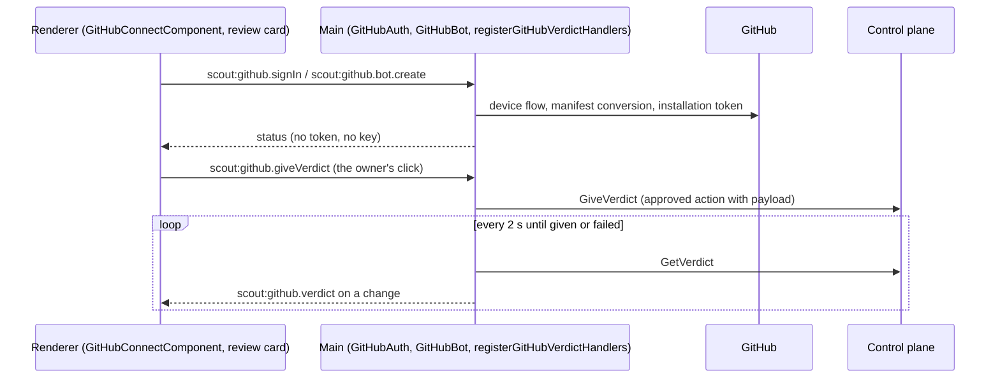

# Desktop GitHub card

> Main owns every GitHub credential the desktop holds and every GitHub call it makes; the renderer sees statuses, never a token or a key.

## To change here, read

- [[pages/decisions/0019-github-app-device-flow]] - the owner's sign-in and the pasted token
- [[pages/decisions/0044-scout-acts-on-github-as-its-own-app]] - the optional Scout bot
- [[pages/decisions/0043-the-verdict-on-a-pull-request]] - the verdict, v1.1: the card click is the approval
- [[pages/decisions/0032-per-feature-write-permissions]]
- [[pages/invariants/secrets-never-in-source]]
- [[pages/invariants/no-executive-writes]]
- [[pages/services/desktop-ui]] - the app around the card

## Responsibility

Owns the GitHub card on the Features screen, the owner's GitHub session or token, the Scout bot's App key and installation token, and following a verdict the owner gives from a review card. Does not own the worker's GitHub functions ([[pages/services/plugin-github]]), the review card itself ([[pages/services/desktop-quick-ask]]) or the approval queue ([[pages/services/control-plane]]).

## Public contract

- **Channels:** `scout:github.signIn`, `status`, `cancel`, `signOut`, `saveToken`; `scout:github.bot.status`, `create`, `cancel`, `remove`, `setWrites`; `scout:github.giveVerdict`, `scout:github.verdictStatus`, and the push `scout:github.verdict`.
- **Worker variables:** `SCOUT__PLUGINS__GITHUB__TOKENFILE` or `SCOUT__PLUGINS__GITHUB__TOKEN`, and with a bot token `SCOUT__PLUGINS__GITHUB__BOTTOKENFILE`, `BOTWRITES` and `BOTLOGIN`.
- **External boundaries:** github.com's device flow and api.github.com from main only; the control plane over gRPC for the verdict.

## How it works

The GitHub card does not use the control plane's credential dialog: `ui/packages/renderer/src/app/features/features.component.ts:62` projects `sc-github-connect` into the card and passes the card a `connection` state, so the GitHub card shows "Connected" or "Not connected" from the main-owned status instead of the control-plane badge, and has no toggle and no credential buttons (`ui/packages/renderer/src/app/features/github-connect.component.spec.ts:302`). The Kubernetes card works the same way, see Kubernetes connection. The component (`ui/packages/renderer/src/app/features/github-connect.component.ts:404`) calls five channels, `scout:github.signIn`, `status`, `cancel`, `signOut` and `saveToken`, handled in `ui/packages/main/src/ipc/github.ts:80`, and polls the status 3 s after each answer, never with two requests in flight and never after the card is gone, while a code is pending or the App is not installed and an install page exists. "Open GitHub" and "Install Scout on your GitHub account" go through the existing `scout:app.openExternal` allow-list (https, `github.com` only).

`GitHubAuth` (`ui/packages/main/src/oauth/github-auth.ts:91`) runs the device flow, keeps the session in the vault, writes `<userData>/github-token.json` with mode `0600` (`ui/packages/main/src/oauth/github-auth.ts:503`), refreshes every minute and when the system wakes from sleep (`powerMonitor` resume) once less than 5 minutes remain, through one serial queue so two checks never both rotate the token, and on disconnect or `bad_refresh_token` deletes the token file first and the vault session second; if the file cannot be removed the owner stays connected and sees "Could not remove the GitHub token file, so Scout is still connected. Try Disconnect again." (`ui/packages/main/src/oauth/github-auth.ts:487`). On connect and disconnect it calls `restartWorkerIfRunning` (`ui/packages/main/src/ipc/github.ts:19`). "Use a token" is the second method: main checks the pasted token against `GET /user`, keeps it under `github.token`, warns when a classic token's `X-OAuth-Scopes` can write, and removes any browser session, as a browser connect removes a saved token ([[pages/decisions/0019-github-app-device-flow]]). `GitHubAuth.workerEnv()` gives the worker `SCOUT__PLUGINS__GITHUB__TOKENFILE` for the browser method or `SCOUT__PLUGINS__GITHUB__TOKEN` for a pasted token, and nothing when disconnected (`ui/packages/main/src/main.ts:546`, `ui/packages/main/src/worker/build-env.ts:79`). What the owner sees:

- **No client id:** "The Scout GitHub App is not configured yet." and a disabled Connect button; "Use a token" still works.
- **Use a token:** a password field, Save, the helper text recommending a read-only fine-grained token and a "Create a fine-grained token" link. The client id and slug come from `SCOUT_GITHUB_APP_CLIENT_ID` and `SCOUT_GITHUB_APP_SLUG`, else from constants that are empty until the App is registered.
- **Pending:** the one-time code in large type, Open GitHub, Copy code and Cancel.
- **Connected:** "Connected as <login>" and Disconnect; for a write-capable classic token, "This token can write to your repositories. A read-only fine-grained token is safer."; for the browser method when the App has no installation, also "Install Scout on your GitHub account".
- **Failed:** the reason above Connect, for example "The sign-in was cancelled on GitHub." or "The code expired. Click Connect with GitHub to get a new one."

## Scout bot (optional)

Below Connect, and only once GitHub is connected, the card offers "Use a Scout bot on GitHub (optional)" ([[pages/decisions/0044-scout-acts-on-github-as-its-own-app]]): the owner's own GitHub App, so the reviews, verdicts, comments and issues Scout posts show as its bot. `GitHubBot` (`ui/packages/main/src/oauth/github-bot.ts:89`) owns it in main: **Create** (`ui/packages/main/src/oauth/github-bot.ts:144`), on the owner's click, for their account or an organization: a loopback listener on a random free port from 49152 for one request and 5 minutes, a random `state`, and a local page that posts the manifest to `https://github.com/settings/apps/new` or `organizations/<org>/settings/apps/new`. The manifest names the App `Scout (<login>)`, not public, webhook inactive, with exactly Metadata, Contents, Checks and Commit statuses read and Pull requests and Issues write (`ui/packages/main/src/oauth/github-bot.ts:33`). The callback page is served through the shared `awaitCallback`'s `pages` option (`ui/packages/main/src/oauth/loopback-server.ts:71`). A wrong or missing `state` or the timeout stores nothing; then `POST /app-manifests/{code}/conversions` once (`ui/packages/main/src/oauth/github-bot.ts:288`), and the App id, client id, slug, account and private key go into the vault under the main-only key `github.bot`, writes all switched to the bot; the client secret and the webhook secret are discarded. A conversion that times out or answers 401, 422 or 5xx says why on the card and stores nothing. Cancel stops waiting. **Token** (`ui/packages/main/src/oauth/github-bot.ts:322`): a JSON Web Token signed with `node:crypto`, RS256, issued 60 seconds in the past, valid 9 minutes, issued by the client id (`ui/packages/main/src/oauth/github-bot.ts:488`); `GET /app/installations`, the first installation's `POST /app/installations/{id}/access_tokens`, written as `{"access_token"}` to `<userData>/github-bot-token.json` through a temporary file and a rename, mode `0600`, then `GET /installation/repositories` for the list on the card; a failed listing keeps the token and the last list, and a token file that cannot be written leaves the worker on the owner's identity with "Scout could not write the bot's token file; it will try again.". Refreshed when less than 5 minutes remain, every minute and on wake, through one serial queue; a failed refresh keeps the current file and retries. An uninstalled App removes the file. The worker is restarted when the bot is created, first gets a token, loses its installation, is removed or has its writes switched; at launch a worker built while the first token is being minted waits for it instead of being restarted (`ui/packages/main/src/oauth/github-bot.ts:131`). **Worker:** `buildEnv` adds `SCOUT__PLUGINS__GITHUB__BOTTOKENFILE`, `SCOUT__PLUGINS__GITHUB__BOTWRITES` (a comma list of `review`, `verdict`, `comment`, `issue`) and `SCOUT__PLUGINS__GITHUB__BOTLOGIN` (`<slug>[bot]`) only while the bot has a token (`ui/packages/main/src/worker/build-env.ts:80`); without a bot it emits exactly what it did before ([[pages/services/plugin-github]] reads them). **Card** (`ui/packages/renderer/src/app/features/github-connect.component.ts:67`), through `scout:github.bot.status`, `create`, `cancel`, `remove` and `setWrites` (`ui/packages/main/src/ipc/github.ts:35`): none (help, account or organization, Create the bot on GitHub), creating (finish on GitHub, Cancel), created (Install the bot, Remove), installed (the repositories, one switch per action: Post reviews, Give verdicts, Comment on pull requests and issues, Open issues; an action switched off is signed as the owner; Change repositories, Remove), and the last error. The card polls the status every 3 s while creating or not installed. Remove deletes the key and the token file and links to the App's settings page on GitHub, where only the owner can delete the App. **Custody:** the private key and the installation token never reach the renderer, a log line or a file other than the token file (`ui/packages/main/test/oauth-github-bot.test.ts:495`, `ui/packages/main/test/ipc-github.test.ts:188`). Tests: the manifest, state, timeout, single conversion and failing conversions (`ui/packages/main/test/oauth-github-bot.test.ts:48`, `:115`, `:145`, `:178`), the token, refresh and their failures (`:221`, `:243`, `:274`, `:299`, `:320`, `:339`, `:368`, `:386`, `:412`), switches and Remove (`:461`, `:478`); the card's state-by-action matrix (`ui/packages/renderer/src/app/features/github-connect.component.spec.ts:398`); the worker variables (`ui/packages/main/test/worker-build-env.test.ts:474`, `:497`).

The GitHub card sits in the Features grid, so it is hidden with the grid when the control plane is not running, although the sign-in does not need it.

## Verdict from the review card

ADR 0043 v1.1: the card's Approve or Request changes click is the owner's approval of that one action, so there is no confirmation dialog and no chat turn. `scout:github.giveVerdict` takes `{repository, number, verdict: approve | request_changes, body, comments: [{path, line, body}], commit, testsLine}`, checks every field before any call (`ui/packages/main/src/ipc/github-verdict.ts:61`: `owner/name`, a positive number, one of the two verdicts, a body of at most 65,000 characters, at most 50 comments each with a path, a line and a body, a hex commit of 7 to 40 characters, a tests line of at most 4,000 characters), and refuses anything else with "Scout could not read that verdict.". It then calls the control plane's `GiveVerdict` through the gRPC client (`ui/packages/main/src/control-plane/client.ts:958`), which enqueues an approved `github` action with that payload and answers its id. Main follows the action with `GetVerdict` every 2 seconds (`ui/packages/main/src/ipc/github-verdict.ts:95`), pushes `scout:github.verdict` with `{actionId, state: queued | running | given | failed, url, reason}` to every window only when it changes, and stops when it is given or failed, after five failed reads in a row, or when main shuts down. `scout:github.verdictStatus` reads one action on demand. The `GiveVerdict` and `GetVerdict` RPC names are the desktop's side of the contract; until the control plane offers them, the client answers "The control plane does not offer GiveVerdict yet.". The log carries the repository, the number and the verdict, never the body or the comments.

## Invariants

- [[pages/invariants/secrets-never-in-source]]: the session, the pasted token, the bot's private key and its installation token stay in the vault or the 0600 token files; never in a log line or the renderer.
- [[pages/invariants/no-executive-writes]]: the bot's creation and every verdict start from the owner's click in the desktop; the verdict runs as an approved action under ADR 0032.

## Hot spots

- `ui/packages/main/src/oauth/github-bot.ts:89` - the bot's custody and token refresh.
- `ui/packages/main/src/ipc/github-verdict.ts:95` - following a verdict's action.

## Testing footprint

`ui/packages/main/test/oauth-github.test.ts`, `oauth-github-token.test.ts`, `oauth-github-bot.test.ts`, `ipc-github.test.ts`, `ipc-github-verdict.test.ts` (the click sent once, the 2-second follow pushing each change once and stopping when given or failed, an unreachable control plane, five failed reads, eight malformed requests refused before any call, the status channel and shutdown), and `ui/packages/renderer/src/app/features/github-connect.component.spec.ts`.

## Related

[[pages/services/desktop-ui]], [[pages/services/plugin-github]], [[pages/services/desktop-quick-ask]], [[pages/services/control-plane]].
