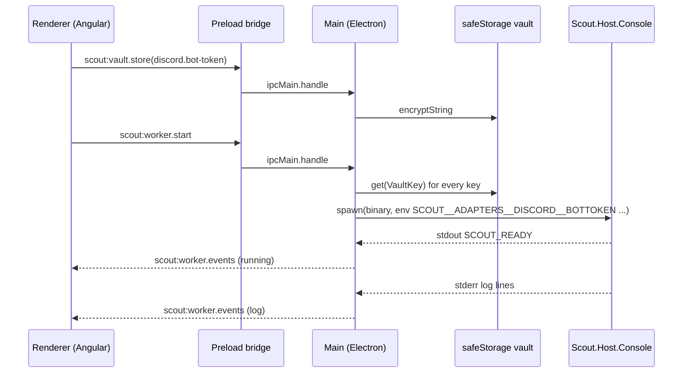

# Desktop UI

> Onboards a chat bot, stores its secrets, launches and supervises the .NET worker, and manages local models; it never calls the LLM itself.

## To change here, read

- [[pages/invariants/secrets-never-in-source]] - credentials go to the OS keychain through `safeStorage`, never to a file in the repo.
- [[pages/invariants/no-executive-writes]] - the UI is the one place Scout mutates the host on the user's behalf (model pulls, worker process); the ADR does not yet classify this.
- [[pages/decisions/0004-web-stack-angular]] and [[pages/decisions/0005-scout-desktop-m1-scope]] - the stack and the M1 deferrals.
- [[pages/decisions/0011-backend-frontend-grpc-uds]] - the transport; the Features screen uses it, the Providers screen does not yet (see Control plane below).
- [[pages/roadmap/control-plane-client]] - the open initiative that moves the remaining screens.
- [[pages/decisions/0019-github-app-device-flow]] - the GitHub sign-in that main owns.
- [[pages/decisions/0020-kubernetes-from-local-kubeconfig]] - the Kubernetes contexts main reads from the owner's kubeconfig.
- [[pages/decisions/0021-allowed-users]] - the allowed-users list main keeps and passes to the worker.
- [[pages/conventions/testing]] - `bun run test` per package, Vitest in the renderer.

## Responsibility

Owns: first-run wizard and Discord OAuth install, the GitHub sign-in and its token refresh, finding the owner's kubeconfig and keeping the contexts the owner allowed, the credential vault, worker lifecycle and log streaming, detection of installed chat clients and local inference backends, Ollama and Whisper model downloads, packaging.

Also owns the lifecycle of [[pages/services/host-control-plane]] and the gRPC client the Features screen uses to reach it.

Does not own: any conversation, LLM call or plugin; those live in [[pages/services/host-console]] and behind it.

## Layout

Four Bun packages under `ui/packages/`:

| Package | Role | Built with |
|---|---|---|
| `shared` | IPC channel names, request and response types, `VaultKey` union | type-only |
| `main` | Electron main process: IPC handlers, vault, supervisor, OAuth loopback, tray | `bun build` to ESM |
| `preload` | Context bridge that exposes the typed channels to the renderer | `bun build` to CJS |
| `renderer` | Angular 22 app: wizard, status, sources, features, llm, logs screens | `ng build` |

Packaging: `ui/build/scripts/publish-worker.sh:14` lists the two hosts, `Scout.Host.Console` and `Scout.Host.ControlPlane`, and publishes each self-contained single-file per RID into the same `ui/build/worker/<rid>/` folder (`publish-worker.ps1` does the same). `ui/build/electron-builder.yml:40` copies `src/Scout.ControlPlane.Contracts/protos/*.proto` into `resources/protos`, because the client loads the protos at runtime. The electron-builder config targets AppImage and deb on Linux, dmg on macOS, nsis on Windows. The control-plane host runs with the worker folder as its working directory, so it also reads the console host's `appsettings.json`; no section overlaps today (the console reads `Scout:Llm`, the control plane `Scout:Providers`, `Scout:Features` and `Scout:LocalRuntime`).

## Public contract

- **IPC channels** - 58 `scout:*` channels declared in `ui/packages/shared/src/ipc-contract.ts:5`, grouped as detect, discord, vault, worker, app, diagnostics, llm, whisper, shell, providers, features, chatgpt, github, kubernetes and access. Two channels call a cloud LLM provider, both a `GET` of its model list: `scout:providers.validateKey` (`ui/packages/main/src/ipc/provider-keys.ts:44`) checks an API key before it is stored, and `scout:llm.listModels` (`ui/packages/main/src/ipc/provider-keys.ts:161`) lists a connected provider's chat models with the stored key. `scout:vault.getPublic` (`ui/packages/main/src/ipc/vault.ts:89`) is the renderer's only vault read, limited to `llm.provider` and `llm.cloud-model`. The renderer sees only what `ui/packages/preload/src/preload.ts` bridges.
- **Vault keys** - the closed `VaultKey` union in `ui/packages/shared/src/client-kinds.ts:3` (Discord bot token, client and guild ids, LLM provider, model and endpoint, one API key per cloud provider (`llm.openai.api-key`, `llm.gemini.api-key`), the legacy shared `llm.api-key` kept only for migration, cloud model, STT provider and model, TypeSafe guard API key `guard.typesafe-api-key`). Main-only keys (`ui/packages/main/src/vault/safe-storage-vault.ts:6`), not in `VAULT_KEYS` so the renderer's vault channels reject them: `chatgpt.session`, `chatgpt.client-id`, `chatgpt.host-id`, `github.session`, `github.token`, `kubernetes.selection` and `access.allowed-users`.
- **Cloud LLM cards** - the OpenAI API and Google Gemini cards on the AI Sources screen have three states (`ui/packages/renderer/src/app/sources/sources.component.ts:1187`): Not Connected (Connect opens a key form; the key is checked with the provider, then stored under that provider's own vault key), Connected (Disconnect, Change key) and In use (the model, Disconnect). AI Sources only connects and disconnects: a connected card shows the link "Choose a model in Models → Analysis" (`/llm?tab=analysis`) instead of a Use button or a model field, and the model is chosen on the Models screen (see Models → Analysis below). The first connect while no cloud provider is in use also makes that provider the one in use; disconnecting the provider in use switches to the other connected cloud provider or, with none left, to provider `None` (Scout replies that no AI provider is connected), never to Ollama, and restarts a running worker. The Ollama card offers Use while its server answers and then shows In use; Ollama and LM Studio have no Disconnect. OpenRouter and Custom API stay disabled. [[pages/decisions/0015-cloud-llm-providers-by-api-key]], [[pages/decisions/0017-provider-connect-disconnect]]. The OpenAI (also on ChatGPT Plus), Gemini, OpenRouter and Ollama cards show the brand marks from Simple Icons 15.22.0, licensed CC0-1.0, in the `ICONS` map (`ui/packages/renderer/src/app/sources/sources.component.ts:72`); LM Studio and Custom API keep generic icons. The marks are the providers' trademarks; CC0 covers the drawing data only.
- **ChatGPT Plus card** - ChatGPT Plus signs in through the system browser with OpenAI's Sign in with ChatGPT ([[pages/decisions/0018-chatgpt-plan-sign-in]]): the main process runs the OAuth flow (`ui/packages/main/src/oauth/chatgpt-auth.ts:77`), keeps the session in main-only vault keys (`ui/packages/main/src/vault/safe-storage-vault.ts:6`), refreshes it, and writes the access token to a 0600 file the worker reads; the renderer works through `scout:chatgpt.signIn`, `listModels`, `cancelSignIn`, `signOut` and `status` (`ui/packages/shared/src/ipc-contract.ts:10`). The card offers Continue with ChatGPT, Cancel while waiting for the browser, the link "Choose a model in Models → Analysis" while plan usage is granted, and Sign out; it has no model select and does not load the model list. A signed-in plan with plan usage counts as a connected cloud provider for the rule above (`ui/packages/renderer/src/app/core/llm-config.store.ts:298`): signing in while no cloud provider is in use makes it the one in use with `gpt-5.6-luna` (`ui/packages/renderer/src/app/sources/sources.component.ts:1126`), and signing out while it is in use switches to another connected cloud provider or to `None` through the same path as Disconnect (`:1135`, `ui/packages/renderer/src/app/core/llm-config.store.ts:308`).
- **Models → Analysis** - the Analysis tab of the Models screen (route `llm`, opened on Analysis by `?tab=analysis`, `ui/packages/renderer/src/app/models/models.component.ts:639`) is where the chat model is chosen. It shows the downloaded local models in the On Device block, as before, and one block per connected cloud provider (ChatGPT Plus while signed in with plan usage, OpenAI API and Google Gemini while their key is stored); a provider that is not connected shows no block and its list is never requested (`:678`). On open it reloads the provider state from the vault and the ChatGPT status, then fills each block from `scout:chatgpt.listModels` or `scout:llm.listModels` (`:688`, `:756`); a block whose list fails says "Could not load the <provider> model list." Main keeps OpenAI ids starting with `gpt-`, `o` or `chatgpt-` and drops embedding, whisper, tts, dall-e, moderation, realtime, audio, image, transcribe and search ids, and keeps Gemini models whose `supportedGenerationMethods` include `generateContent`, with the id without `models/` and the API's display name (`ui/packages/main/src/ipc/provider-keys.ts:123`, `:138`); errors arrive as `providers/key-rejected`, `providers/unreachable`, `providers/request-failed` or `providers/not-connected`. Clicking a cloud model writes `llm.cloud-model` and `llm.provider` through `LlmConfigStore.use` (`:740`); clicking a local model writes `llm.provider = Ollama` through `LlmConfigStore.useOllama` and then `llm.model`, leaving `llm.endpoint` as it is (`:723`); both restart a running worker after the writes. Exactly one model is marked Selected across the blocks: the cloud model of the provider in use, or the local selection while the provider is Ollama or unset (`:667`), because a blank provider means Ollama to the worker.
- **TypeSafe (Jev) card** - a key-only form on the same screen (`ui/packages/renderer/src/app/sources/sources.component.ts:1041`) stores the read-only guard key under `guard.typesafe-api-key` and never touches `llm.provider` (`:1331`); the badge reads Connected from `vault.has` on load (`:1379`). If that check fails, the card shows "Could not check the TypeSafe key; the read-only guard may still be on." in an alert and still offers Disconnect, so a key that exists can be removed. While Connected (or after a failed check), a Disconnect button (`:538`) deletes only that key, turns the badge Not Connected and says "Disconnected. The read-only guard is off." without any "Saved." text (`:1357`). Saving and disconnecting both restart a running worker through the same helper as the cloud cards (`:1423`); a failed store or delete shows the error in an alert and leaves the badge as it was. `buildEnv` passes the key as `SCOUT__GUARD__TYPESAFE__APIKEY` for every provider (`ui/packages/main/src/worker/build-env.ts:65`). [[pages/decisions/0016-jev-read-only-guard]].
- **GitHub card** - "Connect with GitHub" on the Features screen, see GitHub connection below. [[pages/decisions/0019-github-app-device-flow]].
- **Kubernetes card** - "Use the Kubernetes configuration on this computer?" on the Features screen, see Kubernetes connection below. [[pages/decisions/0020-kubernetes-from-local-kubeconfig]].
- **Worker handshake** - the main process spawns the worker binary (`ui/packages/main/src/worker/supervisor.ts:181`) and waits for the `SCOUT_READY` marker on stdout (`ui/packages/main/src/worker/log-stream.ts:13`); readiness times out after 45 s.
- **Routes** - `''`, `provision`, `token`, `oauth`, `launch`, `ready`, `status`, `sources`, `sources/local-models`, `features`, `llm`, `logs` in `ui/packages/renderer/src/app/app.routes.ts:7`.

## How it works

The vault to environment mapping is `ui/packages/main/src/worker/build-env.ts`; at app start `migrateLegacyApiKey` (`ui/packages/main/src/worker/build-env.ts:121`, called from `ui/packages/main/src/main.ts:159`) moves a legacy shared cloud key into the active provider's own slot; the binary is resolved per platform and packaging mode in `ui/packages/main/src/worker/resolve-binary.ts:38`. Crash handling is a bounded restart policy with backoff (`ui/packages/main/src/worker/supervisor.ts:132`).

## Control plane

At app start `ui/packages/main/src/main.ts:299` calls `connectControlPlane` (`ui/packages/main/src/control-plane/launcher.ts:208`). It launches the host through `launchControlPlane`, waits up to 10 s for the socket file (`ui/packages/main/src/control-plane/launcher.ts:167`), then opens the gRPC client with the protos from `resolveProtoDir` (`ui/packages/main/src/worker/resolve-binary.ts:70`): `resources/protos` when packaged, the source tree otherwise. Any failure on the way, whether a missing binary, a host that exits, a socket that never appears, an insecure socket directory or `win32`, becomes `ControlPlaneUnavailableError` on the client promise and one `warn` log line; the app keeps running. A failure after the spawn kills the host it started, and a host that exits mid-session closes the client so later calls fail at once. `before-quit` closes the client and kills the host (`ui/packages/main/src/main.ts:405`, `:435`). There is no restart: a host that dies stays down until the app restarts.

The Features IPC handlers (`ui/packages/main/src/ipc/features.ts:39`) call that client: list, set credentials, setup, delete credentials, enable and disable map one to one onto the `scout.controlplane.v1.Features` RPCs, and the client maps the wire messages onto the `FeatureDto` shapes in `ui/packages/shared/src/ipc-contract.ts`. What the owner sees:

- **Control plane not running:** "The Scout control plane is not running, so features cannot be shown." (`ui/packages/renderer/src/app/features/features.component.ts:37`).
- **Running:** the GitHub and Kubernetes cards, and under the grid one note: "GitHub and Kubernetes are used by the chat bot once connected." Both cards show a main-owned connection instead of the control-plane toggle and credential dialog, so no card in the catalog reaches `Enable` today; the host would answer `UNIMPLEMENTED` (it registers `NullFeatureActivator`), which the client maps to `ControlPlaneNotImplementedError` and a card would show as "Turning this feature on is not available yet." See [[pages/roadmap/followups]].

**Error codes across IPC.** Electron forwards only the message of an error thrown in an `ipcMain.handle` handler; a `code` property set in main never reaches the renderer (checked on Electron 41.3.0: the renderer receives `Error invoking remote method '<channel>': Error: <message>` with no `code`). The Features handlers therefore write the code into the message through `encodeIpcErrorMessage` (`ui/packages/shared/src/errors.ts:223`), and the store reads it back with `readIpcError` (`ui/packages/shared/src/errors.ts:231`). The other handlers still rely on the `code` property, so their code-based renderer branches never fire in the running app; see [[pages/roadmap/followups]].

The Providers handlers still call the worker over HTTP through `ui/packages/main/src/worker/http-client.ts:43`, whose endpoint comes from a `SCOUT_HTTP=` stdout line (`ui/packages/main/src/worker/log-stream.ts:14`) that only the retired `src/old/Scout.Host.Worker` printed, so the Providers screen still shows its unavailable state. The main process also still pulls Ollama models (`ui/packages/main/src/ipc/llm-pull.ts`) and downloads Whisper weights (`ui/packages/main/src/ipc/whisper.ts`) itself, from Node.

## GitHub connection

The GitHub card does not use the control plane's credential dialog: `ui/packages/renderer/src/app/features/features.component.ts:50` projects `sc-github-connect` into the card and passes the card a `connection` state, so the GitHub card shows "Connected" or "Not connected" from the main-owned status instead of the control-plane badge, and has no toggle and no credential buttons (`ui/packages/renderer/src/app/features/github-connect.component.spec.ts:232`). The Kubernetes card works the same way, see Kubernetes connection. The component (`ui/packages/renderer/src/app/features/github-connect.component.ts:225`) calls five channels, `scout:github.signIn`, `status`, `cancel`, `signOut` and `saveToken`, handled in `ui/packages/main/src/ipc/github.ts:30`, and polls the status 3 s after each answer, never with two requests in flight and never after the card is gone, while a code is pending or the App is not installed and an install page exists. "Open GitHub" and "Install Scout on your GitHub account" go through the existing `scout:app.openExternal` allow-list (https, `github.com` only).

`GitHubAuth` (`ui/packages/main/src/oauth/github-auth.ts:91`) runs the device flow, keeps the session in the vault, writes `<userData>/github-token.json` with mode `0600` (`ui/packages/main/src/oauth/github-auth.ts:498`), refreshes every minute and when the system wakes from sleep (`powerMonitor` resume) once less than 5 minutes remain, through one serial queue so two checks never both rotate the token, and on disconnect or `bad_refresh_token` deletes the token file first and the vault session second; if the file cannot be removed the owner stays connected and sees "Could not remove the GitHub token file, so Scout is still connected. Try Disconnect again." (`ui/packages/main/src/oauth/github-auth.ts:482`). On connect and disconnect it calls `restartWorkerIfRunning` (`ui/packages/main/src/ipc/github.ts:15`). "Use a token" is the second method: main checks the pasted token against `GET /user`, keeps it under `github.token`, warns when a classic token's `X-OAuth-Scopes` can write, and removes any browser session, as a browser connect removes a saved token ([[pages/decisions/0019-github-app-device-flow]]). `GitHubAuth.workerEnv()` gives the worker `SCOUT__PLUGINS__GITHUB__TOKENFILE` for the browser method or `SCOUT__PLUGINS__GITHUB__TOKEN` for a pasted token, and nothing when disconnected (`ui/packages/main/src/main.ts:268`, `ui/packages/main/src/worker/build-env.ts:46`). What the owner sees:

- **No client id:** "The Scout GitHub App is not configured yet." and a disabled Connect button; "Use a token" still works.
- **Use a token:** a password field, Save, the helper text recommending a read-only fine-grained token and a "Create a fine-grained token" link. The client id and slug come from `SCOUT_GITHUB_APP_CLIENT_ID` and `SCOUT_GITHUB_APP_SLUG`, else from constants that are empty until the App is registered.
- **Pending:** the one-time code in large type, Open GitHub, Copy code and Cancel.
- **Connected:** "Connected as <login>" and Disconnect; for a write-capable classic token, "This token can write to your repositories. A read-only fine-grained token is safer."; for the browser method when the App has no installation, also "Install Scout on your GitHub account".
- **Failed:** the reason above Connect, for example "The sign-in was cancelled on GitHub." or "The code expired. Click Connect with GitHub to get a new one."

The GitHub card sits in the Features grid, so it is hidden with the grid when the control plane is not running, although the sign-in does not need it.

## Kubernetes connection

The Kubernetes card projects `sc-kubernetes-connect` (`ui/packages/renderer/src/app/features/kubernetes-connect.component.ts:251`) and gets a `connection` state like the GitHub card (`ui/packages/renderer/src/app/features/features.component.ts:150`), so it has no toggle and no credential dialog. It calls four channels, `scout:kubernetes.detect`, `use`, `status` and `disconnect`, handled in `ui/packages/main/src/ipc/kubernetes.ts:51`. `detectKubeconfig` (`ui/packages/main/src/kubernetes/kubeconfig.ts:32`) reads the first `KUBECONFIG` entry or `~/.kube/config` with `js-yaml` and returns each context's name, cluster, server, namespace, how its user signs in (token, client certificate, exec command, auth provider, username and password) and, for an exec user, the command and its arguments, with the value of any flag whose name contains secret, token, password, passwd, key or credential shown as `***` (`ui/packages/main/src/kubernetes/kubeconfig.ts:116`). It never returns or logs a token, key, certificate, password or exec env value; a malformed file logs only its path. `use` takes `{name, label}` pairs only, checks each name against the file main located itself and each label with the shared rule (`ui/packages/shared/src/kubernetes-labels.ts:9`), stores `{path, contexts: [{name, label}]}` under `kubernetes.selection` (a selection stored before labels reads with each name as its label) and restarts a running worker through `restartWorkerIfRunning`; `disconnect` deletes it and restarts the worker. `buildEnv` turns the selection into `SCOUT__PLUGINS__KUBERNETES__KUBECONFIGPATH` and `SCOUT__PLUGINS__KUBERNETES__CONTEXTS__<n>__NAME` and `__LABEL` (`ui/packages/main/src/worker/build-env.ts:47`), read at every worker start (`ui/packages/main/src/main.ts:269`) and used by the worker's [[pages/services/plugin-kubernetes]]. What the owner sees:

- **No kubeconfig:** "No Kubernetes configuration found on this computer (looked in $KUBECONFIG and ~/.kube/config)."
- **Unreadable kubeconfig:** "The Kubernetes configuration at <path> could not be read."
- **Detected:** "Use the Kubernetes configuration on this computer?", the path, one checkbox per context with its server and sign-in kind, "Runs <command> to get a token" under an exec context, and "Use selected contexts", disabled until a box is ticked. Under it, always: "Scout only reads from your clusters, but these credentials may allow changes. A read-only user is safer:" and three copyable `kubectl` commands that create a `scout-reader` service account bound to the `view` cluster role and a token for it.
- **Labels:** each ticked context gets a "Label" field prefilled with its name; an invalid or repeated label shows the reason under the list and disables "Use selected contexts". The chat bot and the model see only the labels ([[pages/decisions/0020-kubernetes-from-local-kubeconfig]]).
- **Connected:** "Using dev, qa, prod from <path>", the labels and never the context names or servers, and Disconnect.

## Allowed users

Settings has a "Who can use Scout" section (`ui/packages/renderer/src/app/wizard/settings/settings.component.ts:17`): an id field with Add, the list with Remove per id, and the line "Discord: turn on Developer Mode, right-click a user, Copy User ID. Slack: profile, More, Copy member ID. Teams: the user's Bot Framework user ID, which starts with 29:." Add and Remove send the whole list through `scout:access.set`; a refused list shows main's reason and keeps the typed id. Main (`ui/packages/main/src/ipc/access.ts:58`) trims each id, accepts 1 to 64 characters from `[A-Za-z0-9._:@-]`, de-duplicates, caps the list at 50, stores it under `access.allowed-users` (deleted when empty) and restarts a running worker through `restartWorkerIfRunning` only when the list changed. `buildEnv` passes each id as `SCOUT__ACCESS__ALLOWEDUSERIDS__<n>` and sets `SCOUT__ACCESS__REQUIREALLOWLIST=true` when GitHub is connected, a Kubernetes selection exists or `llm.provider` is `ChatGptPlan` (`ui/packages/main/src/worker/build-env.ts:55`, `:58`), so the worker refuses everyone until ids are added ([[pages/decisions/0021-allowed-users]], [[pages/services/conversation]]). While the list is empty, the connected GitHub and Kubernetes cards (`ui/packages/renderer/src/app/features/features.component.ts:61`) and the ChatGPT Plus card while it is the provider in use (`ui/packages/renderer/src/app/sources/sources.component.ts:291`) say "Nobody can use this connection from chat until you add allowed users in Settings."

## Invariants

- [[pages/invariants/secrets-never-in-source]] - `ui/packages/main/src/vault/safe-storage-vault.ts:113` encrypts with the OS keychain; the renderer never receives a secret back, only `has`, `isAvailable` and the two non-secret keys of `scout:vault.getPublic`. A cloud API key leaves the machine only in the header of the key check and of the model list (`ui/packages/main/src/ipc/provider-keys.ts:70`, `:188`) and in the worker's environment.
- [[pages/invariants/secrets-never-in-source]] - GitHub tokens and the device code stay in main: the status and sign-in payloads carry the user code, the login and flags only, and no log line carries a token (`ui/packages/main/test/oauth-github.test.ts:481`, `ui/packages/main/test/ipc-github.test.ts:55`). The token file is the one copy on disk, mode `0600`.
- [[pages/invariants/secrets-never-in-source]] - the kubeconfig stays where it is: main stores only its path and the allowed context names, and no detect, use, status or disconnect payload and no log line carries a token, key, certificate, password or exec env value (`ui/packages/main/test/ipc-kubernetes.test.ts:222`, `ui/packages/main/test/kubeconfig.test.ts:114`).
- [[pages/invariants/no-executive-writes]] - main sends only GETs to `api.github.com` (`/user`, `/user/installations`) and POSTs only to GitHub's two sign-in endpoints (`ui/packages/main/test/oauth-github.test.ts:455`).
- [[pages/invariants/secrets-never-in-source]] - feature credentials travel renderer to main to gRPC and are never logged: the Features handlers log the feature id and the error only, and the launcher never logs the session token (`ui/packages/main/test/ipc-features.test.ts`, `ui/packages/main/test/control-plane-launcher.test.ts`).
- [[pages/invariants/pluggable-boundaries]] - the UI reaches the console worker only through environment variables and stdout markers, and the control plane only through gRPC; no .NET type crosses, and `@grpc/grpc-js` stays under `ui/packages/main/src/control-plane/` (ADR 0011: the renderer never sees it).

## Hot spots

- `ui/packages/main/src/worker/supervisor.ts:132` - restart policy; the watchdog test race fixed in PR 55 lives in its spec.
- `ui/packages/main/src/vault/safe-storage-vault.ts:113` - synchronous `safeStorage` API, deprecated in Electron 45, removed in 46 (tracked in [[pages/roadmap/followups]]).
- `ui/packages/main/src/worker/http-client.ts:43` - dead path for the Providers screen, see Control plane.
- `ui/packages/main/src/control-plane/launcher.ts:208` - the host is started once per app run with no restart policy.
- `ui/build/electron-builder.yml` - `executableName` must stay filesystem-safe for AppImage; `ui/packages/main/test/packaging-config.test.ts` guards it.

## Tests

As of 2026-10-23, 75 spec files and 955 tests across the four packages (shared 45 in 4 files, main 493 in 40, preload 26 in 1, renderer 391 in 30), run by `bun run test` at the workspace root. `ui/packages/main/test/control-plane-integration.test.ts` launches the real `Scout.Host.ControlPlane` and points its feature state file at a temp file, so it never writes the developer's `features.json`; `ui-ci.yml` runs lint, typecheck, Prettier check, tests, worker publish and the package step on Linux, macOS and Windows. The `ui/e2e` folder holds only a `package.json`; there is no end-to-end suite yet.
