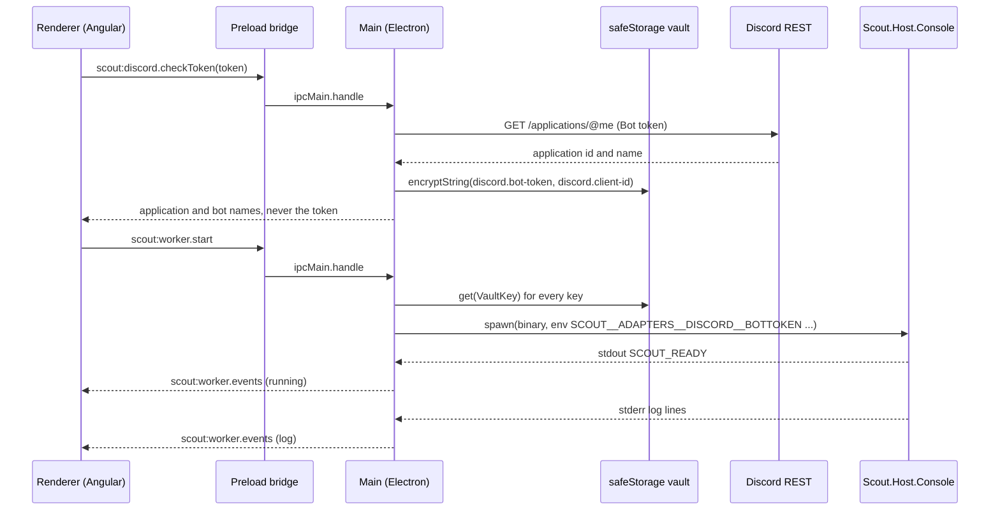

# Desktop UI

> Onboards a chat bot, stores its secrets, launches and supervises the .NET worker, and manages local models; it never calls the LLM itself.

## To change here, read

- [[pages/invariants/secrets-never-in-source]] - credentials go to the OS keychain through `safeStorage`, never to a file in the repo.
- [[pages/invariants/no-executive-writes]] - the UI is the one place Scout mutates the host on the user's behalf (model pulls, worker process); the ADR does not yet classify this.
- [[pages/decisions/0004-web-stack-angular]] and [[pages/decisions/0005-scout-desktop-m1-scope]] - the stack and the M1 deferrals.
- [[pages/decisions/0011-backend-frontend-grpc-uds]] - the transport; the Features screen uses it, the Providers screen does not yet (see Control plane below).
- [[pages/roadmap/control-plane-client]] - the open initiative that moves the remaining screens.
- [[pages/decisions/0019-github-app-device-flow]] - the GitHub sign-in that main owns.
- [[pages/decisions/0020-kubernetes-from-local-kubeconfig]] - the Kubernetes contexts main reads from the owner's kubeconfig.
- [[pages/decisions/0021-allowed-users]] - the allowed-users list main keeps and passes to the worker.
- [[pages/decisions/0022-discord-setup-from-the-bot-token]] - how the wizard sets up the Discord bot, and why its one PATCH is Scout's own configuration.
- [[pages/decisions/0023-slack-setup-from-a-manifest]] - the Slack app manifest and the two tokens main checks and keeps.
- [[pages/decisions/0027-desktop-presence]] - the tray, keep running, start at login and the three notifications, and why the autostart entry is Scout's own configuration.
- [[pages/decisions/0028-local-quick-ask-assistant]] - the quick-ask window, its shortcut, the microphone and the stdio transport to the worker.
- [[pages/conventions/testing]] - `bun run test` per package, Vitest in the renderer.

## Responsibility

Owns: first-run wizard that sets up the Discord bot from its token, the Slack setup, the GitHub sign-in and its token refresh, finding the owner's kubeconfig and keeping the contexts the owner allowed, the credential vault, worker lifecycle and log streaming, detection of installed chat clients and local inference backends, Ollama and Whisper model downloads, the tray, keep running and start at login, packaging.

Also owns the quick-ask window: the global shortcut that opens it, the microphone capture and WAV encoding in the renderer, and the questions main writes to the worker's stdin ([[pages/services/adapter-local]] answers them).

Also owns the lifecycle of [[pages/services/host-control-plane]] and the gRPC client the Features screen uses to reach it.

Does not own: any conversation, LLM call or plugin; those live in [[pages/services/host-console]] and behind it.

## Layout

Four Bun packages under `ui/packages/`:

| Package | Role | Built with |
|---|---|---|
| `shared` | IPC channel names, request and response types, `VaultKey` union | type-only |
| `main` | Electron main process: IPC handlers, vault, supervisor, Discord REST calls, OAuth loopback (ChatGPT sign-in), tray | `bun build` to ESM |
| `preload` | Context bridge that exposes the typed channels to the renderer | `bun build` to CJS |
| `renderer` | Angular 22 app: wizard, chat, sources, features, llm, logs and settings screens | `ng build` |

Packaging: `ui/build/scripts/publish-worker.sh:14` lists the two hosts, `Scout.Host.Console` and `Scout.Host.ControlPlane`, and publishes each self-contained single-file per RID into the same `ui/build/worker/<rid>/` folder (`publish-worker.ps1` does the same). `ui/build/electron-builder.yml:40` copies `src/Scout.ControlPlane.Contracts/protos/*.proto` into `resources/protos`, because the client loads the protos at runtime. The electron-builder config targets AppImage and deb on Linux, dmg on macOS, nsis on Windows, and names every package `Scout-Desktop-<version>-<os>-<arch>.<ext>` without a space (`ui/build/electron-builder.yml:7`), because GitHub rewrites spaces in release asset names. A version tag such as `v1.2.3` runs `.github/workflows/release.yml`, which writes the tag's version into `ui/package.json` on the runner (the repository keeps a placeholder `0.0.1`), builds the AppImage, the deb, the Apple silicon dmg and the Windows installer and publishes them as a GitHub Release with one `SHA256SUMS-<os>.txt` per platform; the project site links to them ([[pages/decisions/0029-project-site-and-releases]], [[pages/runbooks/release]]). The control-plane host runs with the worker folder as its working directory, so it also reads the console host's `appsettings.json`; no section overlaps today (the console reads `Scout:Llm`, the control plane `Scout:Providers`, `Scout:Features` and `Scout:LocalRuntime`).

## Public contract

- **IPC channels** - 78 `scout:*` channels declared in `ui/packages/shared/src/ipc-contract.ts:5`, grouped as detect, discord, vault, worker, app, diagnostics, llm, whisper, shell, providers, features, chatgpt, github, kubernetes, access, slack, desktop and local (`scout:local.ask`, `cancel`, `getTurns`, `clearTurns`, `turns`, `hide`, `getShortcut`, `setShortcut`, `open`, `getBubble`, `setBubble`, `ui/packages/shared/src/ipc-contract.ts:73`). Two channels call a cloud LLM provider, both a `GET` of its model list: `scout:providers.validateKey` (`ui/packages/main/src/ipc/provider-keys.ts:44`) checks an API key before it is stored, and `scout:llm.listModels` (`ui/packages/main/src/ipc/provider-keys.ts:161`) lists a connected provider's chat models with the stored key. `scout:vault.getPublic` (`ui/packages/main/src/ipc/vault.ts:89`) is the renderer's only vault read, limited to `llm.provider` and `llm.cloud-model`. The renderer sees only what `ui/packages/preload/src/preload.ts` bridges.
- **Vault keys** - the closed `VaultKey` union in `ui/packages/shared/src/client-kinds.ts:3` (Discord bot token, client and guild ids, LLM provider, model and endpoint, one API key per cloud provider (`llm.openai.api-key`, `llm.gemini.api-key`), the legacy shared `llm.api-key` kept only for migration, cloud model, STT provider and model, TypeSafe guard API key `guard.typesafe-api-key`). Main-only keys (`ui/packages/main/src/vault/safe-storage-vault.ts:6`), not in `VAULT_KEYS` so the renderer's vault channels reject them: `chatgpt.session`, `chatgpt.client-id`, `chatgpt.host-id`, `github.session`, `github.token`, `kubernetes.selection`, `access.allowed-users`, `slack.connection`, `app.keep-running`, `app.tray-notice-shown`, `quick-ask.shortcut`, `quick-ask.bubble` and `quick-ask.window`.
- **Cloud LLM cards** - the OpenAI API and Google Gemini cards on the AI Sources screen have three states (`ui/packages/renderer/src/app/sources/sources.component.ts:1187`): Not Connected (Connect opens a key form; the key is checked with the provider, then stored under that provider's own vault key), Connected (Disconnect, Change key) and In use (the model, Disconnect). AI Sources only connects and disconnects: a connected card shows the link "Choose a model in Models → Analysis" (`/llm?tab=analysis`) instead of a Use button or a model field, and the model is chosen on the Models screen (see Models → Analysis below). The first connect while no cloud provider is in use also makes that provider the one in use; disconnecting the provider in use switches to the other connected cloud provider or, with none left, to provider `None` (Scout replies that no AI provider is connected), never to Ollama, and restarts a running worker. The Ollama card offers Use while its server answers and then shows In use; Ollama and LM Studio have no Disconnect. OpenRouter and Custom API stay disabled. [[pages/decisions/0015-cloud-llm-providers-by-api-key]], [[pages/decisions/0017-provider-connect-disconnect]]. The OpenAI (also on ChatGPT Plus), Gemini, OpenRouter and Ollama cards show the brand marks from Simple Icons 15.22.0, licensed CC0-1.0, in the `ICONS` map (`ui/packages/renderer/src/app/sources/sources.component.ts:72`); LM Studio and Custom API keep generic icons. The marks are the providers' trademarks; CC0 covers the drawing data only.
- **ChatGPT Plus card** - ChatGPT Plus signs in through the system browser with OpenAI's Sign in with ChatGPT ([[pages/decisions/0018-chatgpt-plan-sign-in]]): the main process runs the OAuth flow (`ui/packages/main/src/oauth/chatgpt-auth.ts:77`), keeps the session in main-only vault keys (`ui/packages/main/src/vault/safe-storage-vault.ts:6`), refreshes it, and writes the access token to a 0600 file the worker reads; the renderer works through `scout:chatgpt.signIn`, `listModels`, `cancelSignIn`, `signOut` and `status` (`ui/packages/shared/src/ipc-contract.ts:11`). The card offers Continue with ChatGPT, Cancel while waiting for the browser, the link "Choose a model in Models → Analysis" while plan usage is granted, and Sign out; it has no model select and does not load the model list. A signed-in plan with plan usage counts as a connected cloud provider for the rule above (`ui/packages/renderer/src/app/core/llm-config.store.ts:298`): signing in while no cloud provider is in use makes it the one in use with `gpt-5.6-luna` (`ui/packages/renderer/src/app/sources/sources.component.ts:1126`), and signing out while it is in use switches to another connected cloud provider or to `None` through the same path as Disconnect (`:1135`, `ui/packages/renderer/src/app/core/llm-config.store.ts:308`).
- **Models → Analysis** - the Analysis tab of the Models screen (route `llm`, opened on Analysis by `?tab=analysis`, `ui/packages/renderer/src/app/models/models.component.ts:639`) is where the chat model is chosen. It shows the downloaded local models in the On Device block, as before, and one block per connected cloud provider (ChatGPT Plus while signed in with plan usage, OpenAI API and Google Gemini while their key is stored); a provider that is not connected shows no block and its list is never requested (`:678`). On open it reloads the provider state from the vault and the ChatGPT status, then fills each block from `scout:chatgpt.listModels` or `scout:llm.listModels` (`:688`, `:756`); a block whose list fails says "Could not load the <provider> model list." Main keeps OpenAI ids starting with `gpt-`, `o` or `chatgpt-` and drops embedding, whisper, tts, dall-e, moderation, realtime, audio, image, transcribe and search ids, and keeps Gemini models whose `supportedGenerationMethods` include `generateContent`, with the id without `models/` and the API's display name (`ui/packages/main/src/ipc/provider-keys.ts:123`, `:138`); errors arrive as `providers/key-rejected`, `providers/unreachable`, `providers/request-failed` or `providers/not-connected`. Clicking a cloud model writes `llm.cloud-model` and `llm.provider` through `LlmConfigStore.use` (`ui/packages/renderer/src/app/models/models.component.ts:740`); clicking a local model writes `llm.provider = Ollama` through `LlmConfigStore.useOllama` and then `llm.model`, leaving `llm.endpoint` as it is (`ui/packages/renderer/src/app/models/models.component.ts:723`); both restart a running worker after the writes. Exactly one model is marked Selected across the blocks: the cloud model of the provider in use, or the local selection while the provider is Ollama or unset (`ui/packages/renderer/src/app/models/models.component.ts:667`), because a blank provider means Ollama to the worker.
- **TypeSafe (Jev) card** - a key-only form on the same screen (`ui/packages/renderer/src/app/sources/sources.component.ts:1041`) stores the read-only guard key under `guard.typesafe-api-key` and never touches `llm.provider` (`:1331`); the badge reads Connected from `vault.has` on load (`:1379`). If that check fails, the card shows "Could not check the TypeSafe key; the read-only guard may still be on." in an alert and still offers Disconnect, so a key that exists can be removed. While Connected (or after a failed check), a Disconnect button (`:538`) deletes only that key, turns the badge Not Connected and says "Disconnected. The read-only guard is off." without any "Saved." text (`:1357`). Saving and disconnecting both restart a running worker through the same helper as the cloud cards (`:1423`); a failed store or delete shows the error in an alert and leaves the badge as it was. `buildEnv` passes the key as `SCOUT__GUARD__TYPESAFE__APIKEY` for every provider (`ui/packages/main/src/worker/build-env.ts:81`). [[pages/decisions/0016-jev-read-only-guard]].
- **GitHub card** - "Connect with GitHub" on the Features screen, see GitHub connection below. [[pages/decisions/0019-github-app-device-flow]].
- **Kubernetes card** - "Use the Kubernetes configuration on this computer?" on the Features screen, see Kubernetes connection below. [[pages/decisions/0020-kubernetes-from-local-kubeconfig]].
- **Worker handshake** - the main process spawns the worker binary (`ui/packages/main/src/worker/supervisor.ts:216`) and waits for the `SCOUT_READY` marker on stdout (`ui/packages/main/src/worker/log-stream.ts:17`); readiness times out after 45 s. A `SCOUT_PAIRED=<userId>` or `SCOUT_PAIRING_BURNED` line on stdout, never stderr, goes to the pairing handlers (`:52`, `:54`, see Allowed users). A `SCOUT_LOCAL ` line on stdout goes to the quick-ask router only and never into the log ring, the log viewer or the diagnostics export (`ui/packages/main/src/worker/log-stream.ts:34`); main writes quick-ask questions to the worker's stdin through `writeStdin` (`ui/packages/main/src/worker/supervisor.ts:366`), see Quick ask.
- **Routes** - `''`, `provision`, `token`, `oauth`, `launch`, `ready`, `status`, `sources`, `sources/local-models`, `features`, `llm`, `logs`, `slack`, `settings`, `chat`, `quick-ask` and `floating-button` in `ui/packages/renderer/src/app/app.routes.ts:10`; `status` only redirects to `logs` (`:40`), and `logs` redirects to `settings` while Logs is hidden from the menu (`:60`); `quick-ask` (`:78`) and `floating-button` (`:82`) render without the wizard shell (`ui/packages/renderer/src/app/app.component.ts:21`).

## How it works

The vault to environment mapping is `ui/packages/main/src/worker/build-env.ts`; at app start `migrateLegacyApiKey` (`ui/packages/main/src/worker/build-env.ts:137`, called from `ui/packages/main/src/main.ts:256`) moves a legacy shared cloud key into the active provider's own slot; the binary is resolved per platform and packaging mode in `ui/packages/main/src/worker/resolve-binary.ts:38`. Crash handling is a bounded restart policy with backoff (`ui/packages/main/src/worker/supervisor.ts:161`); a crash after which no restart is scheduled carries `gaveUp: true`. `stop()` cancels a scheduled restart and resolves at once when no worker process is alive, so Quit exits during the backoff or after a crash (`ui/packages/main/src/worker/supervisor.ts:327`).

## Control plane

At app start `ui/packages/main/src/main.ts:449` calls `connectControlPlane` (`ui/packages/main/src/control-plane/launcher.ts:208`). It launches the host through `launchControlPlane`, waits up to 10 s for the socket file (`ui/packages/main/src/control-plane/launcher.ts:167`), then opens the gRPC client with the protos from `resolveProtoDir` (`ui/packages/main/src/worker/resolve-binary.ts:70`): `resources/protos` when packaged, the source tree otherwise. Any failure on the way, whether a missing binary, a host that exits, a socket that never appears, an insecure socket directory or `win32`, becomes `ControlPlaneUnavailableError` on the client promise and one `warn` log line; the app keeps running. A failure after the spawn kills the host it started, and a host that exits mid-session closes the client so later calls fail at once. `before-quit` closes the client and kills the host (`ui/packages/main/src/shell/app-lifecycle.ts:88`, `ui/packages/main/src/main.ts:187`). There is no restart: a host that dies stays down until the app restarts.

The Features IPC handlers (`ui/packages/main/src/ipc/features.ts:39`) call that client: list, set credentials, setup, delete credentials, enable and disable map one to one onto the `scout.controlplane.v1.Features` RPCs, and the client maps the wire messages onto the `FeatureDto` shapes in `ui/packages/shared/src/ipc-contract.ts`. What the owner sees:

- **Control plane not running:** "The Scout control plane is not running, so features cannot be shown." (`ui/packages/renderer/src/app/features/features.component.ts:37`).
- **Running:** the GitHub and Kubernetes cards, and under the grid one note: "GitHub and Kubernetes are used by the chat bot once connected." Both cards show a main-owned connection instead of the control-plane toggle and credential dialog, so no card in the catalog reaches `Enable` today; the host would answer `UNIMPLEMENTED` (it registers `NullFeatureActivator`), which the client maps to `ControlPlaneNotImplementedError` and a card would show as "Turning this feature on is not available yet." See [[pages/roadmap/followups]].

**Error codes across IPC.** Electron forwards only the message of an error thrown in an `ipcMain.handle` handler; a `code` property set in main never reaches the renderer (checked on Electron 41.3.0: the renderer receives `Error invoking remote method '<channel>': Error: <message>` with no `code`). The Features handlers therefore write the code into the message through `encodeIpcErrorMessage` (`ui/packages/shared/src/errors.ts:232`), and the store reads it back with `readIpcError` (`ui/packages/shared/src/errors.ts:240`). The other handlers still rely on the `code` property, so their code-based renderer branches never fire in the running app; see [[pages/roadmap/followups]].

The Providers handlers still call the worker over HTTP through `ui/packages/main/src/worker/http-client.ts:43`, whose endpoint comes from a `SCOUT_HTTP=` stdout line (`ui/packages/main/src/worker/log-stream.ts:18`) that only the retired `src/old/Scout.Host.Worker` printed, so the Providers screen still shows its unavailable state. The main process also still pulls Ollama models (`ui/packages/main/src/ipc/llm-pull.ts`) and downloads Whisper weights (`ui/packages/main/src/ipc/whisper.ts`) itself, from Node. At every worker start `findBestWhisperModel` (`ui/packages/main/src/worker/whisper-model.ts:13`) picks `ggml-large-v3-turbo.bin`, else `ggml-large-v3.bin`, from `userData/whisper-models`, skipping an empty file, and `buildEnv` passes it as `SCOUT__TRANSCRIPTION__MODELPATH` (`ui/packages/main/src/worker/build-env.ts:78`), nothing when none is installed, so Discord voice messages are transcribed locally ([[pages/decisions/0024-voice-messages-transcribed-locally]]). A model downloaded while the worker runs is used from the next worker start.

## GitHub connection

The GitHub card does not use the control plane's credential dialog: `ui/packages/renderer/src/app/features/features.component.ts:50` projects `sc-github-connect` into the card and passes the card a `connection` state, so the GitHub card shows "Connected" or "Not connected" from the main-owned status instead of the control-plane badge, and has no toggle and no credential buttons (`ui/packages/renderer/src/app/features/github-connect.component.spec.ts:232`). The Kubernetes card works the same way, see Kubernetes connection. The component (`ui/packages/renderer/src/app/features/github-connect.component.ts:225`) calls five channels, `scout:github.signIn`, `status`, `cancel`, `signOut` and `saveToken`, handled in `ui/packages/main/src/ipc/github.ts:30`, and polls the status 3 s after each answer, never with two requests in flight and never after the card is gone, while a code is pending or the App is not installed and an install page exists. "Open GitHub" and "Install Scout on your GitHub account" go through the existing `scout:app.openExternal` allow-list (https, `github.com` only).

`GitHubAuth` (`ui/packages/main/src/oauth/github-auth.ts:91`) runs the device flow, keeps the session in the vault, writes `<userData>/github-token.json` with mode `0600` (`ui/packages/main/src/oauth/github-auth.ts:498`), refreshes every minute and when the system wakes from sleep (`powerMonitor` resume) once less than 5 minutes remain, through one serial queue so two checks never both rotate the token, and on disconnect or `bad_refresh_token` deletes the token file first and the vault session second; if the file cannot be removed the owner stays connected and sees "Could not remove the GitHub token file, so Scout is still connected. Try Disconnect again." (`ui/packages/main/src/oauth/github-auth.ts:482`). On connect and disconnect it calls `restartWorkerIfRunning` (`ui/packages/main/src/ipc/github.ts:15`). "Use a token" is the second method: main checks the pasted token against `GET /user`, keeps it under `github.token`, warns when a classic token's `X-OAuth-Scopes` can write, and removes any browser session, as a browser connect removes a saved token ([[pages/decisions/0019-github-app-device-flow]]). `GitHubAuth.workerEnv()` gives the worker `SCOUT__PLUGINS__GITHUB__TOKENFILE` for the browser method or `SCOUT__PLUGINS__GITHUB__TOKEN` for a pasted token, and nothing when disconnected (`ui/packages/main/src/main.ts:374`, `ui/packages/main/src/worker/build-env.ts:56`). What the owner sees:

- **No client id:** "The Scout GitHub App is not configured yet." and a disabled Connect button; "Use a token" still works.
- **Use a token:** a password field, Save, the helper text recommending a read-only fine-grained token and a "Create a fine-grained token" link. The client id and slug come from `SCOUT_GITHUB_APP_CLIENT_ID` and `SCOUT_GITHUB_APP_SLUG`, else from constants that are empty until the App is registered.
- **Pending:** the one-time code in large type, Open GitHub, Copy code and Cancel.
- **Connected:** "Connected as <login>" and Disconnect; for a write-capable classic token, "This token can write to your repositories. A read-only fine-grained token is safer."; for the browser method when the App has no installation, also "Install Scout on your GitHub account".
- **Failed:** the reason above Connect, for example "The sign-in was cancelled on GitHub." or "The code expired. Click Connect with GitHub to get a new one."

The GitHub card sits in the Features grid, so it is hidden with the grid when the control plane is not running, although the sign-in does not need it.

## Kubernetes connection

The Kubernetes card projects `sc-kubernetes-connect` (`ui/packages/renderer/src/app/features/kubernetes-connect.component.ts:251`) and gets a `connection` state like the GitHub card (`ui/packages/renderer/src/app/features/features.component.ts:150`), so it has no toggle and no credential dialog. It calls four channels, `scout:kubernetes.detect`, `use`, `status` and `disconnect`, handled in `ui/packages/main/src/ipc/kubernetes.ts:51`. `detectKubeconfig` (`ui/packages/main/src/kubernetes/kubeconfig.ts:32`) reads the first `KUBECONFIG` entry or `~/.kube/config` with `js-yaml` and returns each context's name, cluster, server, namespace, how its user signs in (token, client certificate, exec command, auth provider, username and password) and, for an exec user, the command and its arguments, with the value of any flag whose name contains secret, token, password, passwd, key or credential shown as `***` (`ui/packages/main/src/kubernetes/kubeconfig.ts:116`). It never returns or logs a token, key, certificate, password or exec env value; a malformed file logs only its path. `use` takes `{name, label}` pairs only, checks each name against the file main located itself and each label with the shared rule (`ui/packages/shared/src/kubernetes-labels.ts:9`), stores `{path, contexts: [{name, label}]}` under `kubernetes.selection` (a selection stored before labels reads with each name as its label) and restarts a running worker through `restartWorkerIfRunning`; `disconnect` deletes it and restarts the worker. `buildEnv` turns the selection into `SCOUT__PLUGINS__KUBERNETES__KUBECONFIGPATH` and `SCOUT__PLUGINS__KUBERNETES__CONTEXTS__<n>__NAME` and `__LABEL` (`ui/packages/main/src/worker/build-env.ts:57`), read at every worker start (`ui/packages/main/src/main.ts:375`) and used by the worker's [[pages/services/plugin-kubernetes]]. What the owner sees:

- **No kubeconfig:** "No Kubernetes configuration found on this computer (looked in $KUBECONFIG and ~/.kube/config)."
- **Unreadable kubeconfig:** "The Kubernetes configuration at <path> could not be read."
- **Detected:** "Use the Kubernetes configuration on this computer?", the path, one checkbox per context with its server and sign-in kind, "Runs <command> to get a token" under an exec context, and "Use selected contexts", disabled until a box is ticked. Under it, always: "Scout only reads from your clusters, but these credentials may allow changes. A read-only user is safer:" and three copyable `kubectl` commands that create a `scout-reader` service account bound to the `view` cluster role and a token for it.
- **Labels:** each ticked context gets a "Label" field prefilled with its name; an invalid or repeated label shows the reason under the list and disables "Use selected contexts". The chat bot and the model see only the labels ([[pages/decisions/0020-kubernetes-from-local-kubeconfig]]).
- **Connected:** "Using dev, qa, prod from <path>", the labels and never the context names or servers, and Disconnect.

## Discord setup

The wizard needs only the bot token ([[pages/decisions/0022-discord-setup-from-the-bot-token]]). Its three steps are the routes `provision` (open the Developer Portal), `token` and `oauth` (add the bot to a server). All Discord HTTP lives in `ui/packages/main/src/discord/discord-setup.ts`, which takes `fetch` as a parameter so tests can fake it:

- `checkBotToken` reads `GET /applications/@me` (`:62`).
- `enableMessageContent` adds `GATEWAY_MESSAGE_CONTENT_LIMITED` to the existing flags with one PATCH when the application is in under 100 servers. It returns the portal bot page otherwise (`:77`).
- `inviteUrl` builds a `scope=bot` invite with the permissions integer `309237730304` from six named constants, including Create Public Threads for the reply thread per conversation (`:27`, `:52`).
- `listGuilds` reads `GET /users/@me/guilds` (`:109`).

The handlers in `ui/packages/main/src/ipc/discord.ts` work as follows:

- The token arrives once through `scout:discord.checkToken` (`:61`).
- That handler stores the token as `discord.bot-token` and the application id as `discord.client-id` (`:75`). When the application differs from the stored one, it first deletes `discord.guild-id` and `discord.guild-name`. A token that replaces a different stored token restarts a running worker.
- The other handlers read the token from the vault, so the renderer never sends it again and never receives it.

The `token` step continues only once Message Content is on. The `oauth` step polls the bot's servers every 3 s, at most 100 times, until a new one appears. It then stores `discord.guild-id` and `discord.guild-name` (`ui/packages/renderer/src/app/wizard/oauth-install/oauth-install.component.ts:280`, stored at `:239`). The invite opens only after the first server list has loaded, so a server the bot was already in is never taken for the new one.

## Allowed users

Settings has a "Who can use Scout" section (`ui/packages/renderer/src/app/wizard/settings/settings.component.ts:40`): an id field with Add, the list with Remove per id, and the line "Discord: turn on Developer Mode, right-click a user, Copy User ID. Slack: profile, More, Copy member ID. Teams: the user's Bot Framework user ID, which starts with 29:." Add and Remove send the whole list through `scout:access.set`; a refused list shows main's reason and keeps the typed id. Main (`ui/packages/main/src/ipc/access.ts:73`) trims each id, accepts 1 to 64 characters from `[A-Za-z0-9._:@-]`, de-duplicates, caps the list at 50, stores it under `access.allowed-users` (deleted when empty) and restarts a running worker through `restartWorkerIfRunning` only when the list changed. `buildEnv` passes each id as `SCOUT__ACCESS__ALLOWEDUSERIDS__<n>` and sets `SCOUT__ACCESS__REQUIREALLOWLIST=true` when GitHub is connected, a Kubernetes selection exists or `llm.provider` is `ChatGptPlan` (`ui/packages/main/src/worker/build-env.ts:65`, `:68`), so the worker refuses everyone until ids are added ([[pages/decisions/0021-allowed-users]], [[pages/services/conversation]]). While the list is empty, the connected GitHub and Kubernetes cards (`ui/packages/renderer/src/app/features/features.component.ts:61`) and the ChatGPT Plus card while it is the provider in use (`ui/packages/renderer/src/app/sources/sources.component.ts:291`) say "Nobody can use this connection from chat until you add allowed users in Settings."

"Pair from chat" in the same section (`ui/packages/renderer/src/app/wizard/settings/settings.component.ts:65`) calls `scout:access.startPairing`. Main draws a 6-digit code with `crypto.randomInt`, valid for 10 minutes, keeps it in memory only and restarts a running worker (`ui/packages/main/src/ipc/access.ts:114`). The renderer shows "Send `482913` to Scout in a direct message on Discord.", with the real code, which the worker also accepts as `pair 482913`; a refusal shows main's reason. While the code is pending, `buildEnv` adds `SCOUT__ACCESS__PAIRINGCODE` and `SCOUT__ACCESS__PAIRINGEXPIRESAT` (`ui/packages/main/src/worker/build-env.ts:74`). When the worker prints `SCOUT_PAIRED=<userId>`, the supervisor's `onPaired` (`ui/packages/main/src/main.ts:381`) calls `paired` (`ui/packages/main/src/ipc/access.ts:124`). That handler ignores the line unless an unexpired code is pending, clears the code, and adds the id through the same validation and storage as `scout:access.set`, which restarts the worker. On `SCOUT_PAIRING_BURNED` (the worker burned the code after it was sent outside a direct message or after five wrong codes) main drops the pending code (`ui/packages/main/src/ipc/access.ts:157`), and Settings, which listens to the worker's stdout events, replaces the code with "Pairing expired. Start again." (`ui/packages/renderer/src/app/wizard/settings/settings.component.ts:388`). No main log line carries the code. The list on screen does not refresh by itself; it shows the new id the next time Settings opens ([[pages/decisions/0021-allowed-users]]).

## Slack setup

The welcome screen's Slack card ("Set up", or "Connected" once Slack is connected) opens the `slack` route, and the Slack card under Chat clients in Settings expands the same `sc-slack-setup` component (`ui/packages/renderer/src/app/wizard/slack/slack-setup.component.ts:139`), so an owner who started with Discord adds Slack later ([[pages/decisions/0023-slack-setup-from-a-manifest]]). It calls four channels, `scout:slack.manifestUrl`, `save`, `status` and `disconnect`, handled in `ui/packages/main/src/ipc/slack.ts:58`. What the owner sees:

- **Step 1, Create the Slack app:** the button opens the link from `manifestUrl()` (`ui/packages/main/src/slack/slack-setup.ts:38`) through `scout:app.openExternal`, whose allow-list now includes `api.slack.com`, then four lines: pick the workspace and click Create; Install to Workspace and copy the Bot User OAuth Token; Basic Information, App-Level Tokens, Generate Token and Scopes with `connections:write`, copy the token; invite @scout to each channel where it should answer.
- **Step 2:** two password fields, "Bot User OAuth Token (xoxb-)" and "App-level token (xapp-)", and Save, disabled until both are filled. A refusal shows main's reason, for example "The bot token starts with xoxb-." or "Slack rejected the app-level token.", and keeps the form.
- **Connected:** "Connected to <team> as <botUser>" and Disconnect.

Main refuses a token without its prefix before any request, checks the bot token with `auth.test` and the app-level token with `apps.connections.open` (`ui/packages/main/src/slack/slack-setup.ts:58`, `:74`), and only then stores both tokens with the `auth.test` team and bot user as one entry, `slack.connection`, in a single vault write (so a failed write leaves the previous pair whole), and restarts a running worker through `restartWorkerIfRunning`. When no worker has started yet in this session, the renderer starts it after Save (`ui/packages/renderer/src/app/wizard/slack/slack-setup.component.ts:182`), so a Slack-only owner reaches a running Scout from the welcome screen. `readSlackTokens` (`ui/packages/main/src/ipc/slack.ts:34`) feeds `buildEnv`, which sets `SCOUT__ADAPTERS__SLACK__BOTTOKEN` and `SCOUT__ADAPTERS__SLACK__APPLEVELTOKEN` when both exist (`ui/packages/main/src/worker/build-env.ts:52`) and, since [[pages/decisions/0028-local-quick-ask-assistant]], starts even when neither is connected, with only the local adapter. Slack does not set `SCOUT__ACCESS__REQUIREALLOWLIST`.

`WizardStore` keeps the two platforms apart (`ui/packages/renderer/src/app/core/wizard.store.ts:63`, `:71`): `hasDiscord` drives the Discord card, and `hasProvisioning`, Discord, Slack or the local-only choice (see Quick ask), decides the post-connect shell and the welcome screen's worker start. Disconnect on the Discord card in Settings forgets only the Discord app (see Settings).

## Settings

Settings opens with Chat clients, then Scout worker, then "Who can use Scout", "Floating button and quick ask", Desktop, About and Theme (`ui/packages/renderer/src/app/wizard/settings/settings.component.ts:36`, `:38`, `:40`). There is no Status screen any more: its worker controls and its Reprovision moved here, the sidebar reads Chat, AI Sources, Models, Features, Logs, Settings (`ui/packages/renderer/src/app/shell/post-connect-shell.component.ts:170`), and the welcome screen's Connected or Error Discord card opens Settings (`ui/packages/renderer/src/app/wizard/welcome/welcome.component.ts:178`). The `ready` route stays as the first-run step that `launch` opens.

- **Chat clients** (`ui/packages/renderer/src/app/wizard/settings/chat-clients.component.ts:16`), one card per client, one action at a time per card:
  - **Discord.** Connected shows "Server: <name>" and Disconnect; not connected shows Connect, which opens the existing `provision` step (`:125`). Disconnect asks "This will disconnect Scout from Discord and forget the current Discord app. Continue?". On yes (`:134`) it stops a running worker, deletes the four `discord.*` vault keys through `WizardStore.reprovision` (`:144`) and, while Slack or the local-only choice still counts as provisioned, starts the worker again so they keep answering (`:149`); with nothing left it opens the welcome screen (`:146`). It never calls a Slack channel. A vault delete does not restart the worker in main, so the restart is the renderer's stop then start.
  - **Slack.** Connected shows `sc-slack-setup`'s "Connected to <team> as <botUser>" and Disconnect (see Slack setup); not connected shows Connect, which expands that setup in place (`:54`).
  - **Teams.** "Coming soon" and a disabled Connect.
- **Scout worker** (`ui/packages/renderer/src/app/wizard/settings/worker-settings.component.ts:21`): the state badge, PID, uptime (the same `formatUptime` the `ready` step uses, `ui/packages/renderer/src/app/core/uptime.ts:2`), restarts, and Stop and Restart while running, Stop while starting, Start otherwise, through `scout:worker.start` and `stop`, Restart being stop then start (`ui/packages/renderer/src/app/wizard/settings/worker-settings.component.ts:153`). "Show Logs in the menu" (`ui/packages/renderer/src/app/wizard/settings/worker-settings.component.ts:50`), on by default, is kept in `localStorage` as `scout:show-logs` (`ui/packages/renderer/src/app/core/menu-preferences.ts:21`); off drops Logs from the sidebar and sends `/logs` to Settings. Log verbosity is listed here as coming soon (`ui/packages/renderer/src/app/wizard/settings/worker-settings.component.ts:56`). The Logs screen stays a plain log viewer.
- **Who can use Scout** says "No one is listed yet. The list only matters once Discord or Slack is connected; chat on this computer never needs it." while the list is empty (`ui/packages/renderer/src/app/wizard/settings/settings.component.ts:86`); see Allowed users.

## Quick ask

The owner's way to ask Scout from anywhere on the desktop, without a chat platform ([[pages/decisions/0028-local-quick-ask-assistant]]).

- **Shortcut.**
  - `registerQuickAsk` (`ui/packages/main/src/quick-ask/quick-ask.ts:220`, called at `ui/packages/main/src/main.ts:531`) registers `CommandOrControl+Alt+Space`, or the shortcut stored under the main-only vault key `quick-ask.shortcut` (`ui/packages/main/src/vault/safe-storage-vault.ts:17`), with `globalShortcut`. `disposeAll`, run by the single `before-quit`, unregisters it (`ui/packages/main/src/main.ts:181`).
  - Settings, "Floating button and quick ask", shows it and saves a new one through `scout:local.setShortcut` (`ui/packages/renderer/src/app/wizard/settings/settings.component.ts:107`, `:436`). `scout:local.getShortcut` and `setShortcut` answer the accelerator, `registered` (what `globalShortcut.register` returned) and `hint` (`ui/packages/main/src/quick-ask/quick-ask.ts:411`). On Wayland the hint is "Your desktop (Wayland) does not let apps register global shortcuts. Add a custom shortcut in your system settings that runs: <command>", the command being the `APPIMAGE` path or the running executable followed by `--ask`, quoted when the path holds a space (`ui/packages/main/src/quick-ask/quick-ask.ts:408`); main passes `process.execPath`. Settings shows it under the shortcut while the input stays usable (`ui/packages/renderer/src/app/wizard/settings/settings.component.ts:177`); elsewhere it is null.
  - Main registers the new shortcut before it releases the old one. A `false` from `register` keeps the old shortcut and returns "That shortcut is taken"; an accelerator `register` throws on also keeps the old one (`ui/packages/main/src/quick-ask/quick-ask.ts:438`).
- **Window.**
  - `openQuickAsk()` (`ui/packages/main/src/quick-ask/quick-ask.ts:97`) is what the shortcut calls, and what the tray's Ask Scout... item calls.
  - It shows one 640 by 420 frameless, always-on-top window, resizable down to 360 by 240, sandboxed, with context isolation and the existing preload. Navigation and new windows are blocked. A 14 px strip labelled "Scout" across the top of the page drags the window; its input and buttons are marked `no-drag` so they stay clickable (`ui/packages/renderer/src/app/quick-ask/quick-ask.component.ts:36`).
  - The window loads `index.html` at `#/quick-ask`. When it is created it goes back to the bounds it was last left at, stored as JSON `{ x, y, width, height }` under the main-only vault key `quick-ask.window` whenever it hides or closes (`ui/packages/main/src/quick-ask/quick-ask.ts:317`), if their top-left point lies in the work area of a current display; otherwise, and when nothing or something malformed is stored, it goes to the floating button's corner of the chosen display (see Floating button). A failed save is a warning. A window that was only hidden shows again where it was. It is focused, and hidden on blur or on `scout:local.hide`, which Escape and the page's Close button call (`ui/packages/renderer/src/app/quick-ask/quick-ask.component.ts:269`); hiding it shows the floating button again (`ui/packages/main/src/quick-ask/quick-ask.ts:335`).
- **Floating button.**
  - A 64 by 64 window of its own (`ui/packages/main/src/quick-ask/quick-ask.ts:289`), created at startup unless the owner turned it off: transparent, frameless, always on top, out of the taskbar, not resizable, not focusable, no shadow, `acceptFirstMouse` so a click on the inactive window reaches the page on macOS, the same sandboxed web preferences as the quick-ask window, shown with `showInactive` so it never takes focus. It loads `#/floating-button`, `FloatingButtonComponent` (`ui/packages/renderer/src/app/floating-button/floating-button.component.ts:56`): one 56 px blue round button labelled "Ask Scout", on a page whose background it makes transparent and whose margin it removes (`:59`). The window is a 64 px square around the 56 px circle, so it takes clicks only in that square.
  - A click calls `scout:local.open` (`:67`), which runs the quick-ask `open()` (`ui/packages/main/src/quick-ask/quick-ask.ts:514`); the bubble hides while the quick-ask window is shown (`:343`).
  - `placeInCorner` (`ui/packages/main/src/quick-ask/placement.ts:11`) gives the point 16 px inside a corner of a display's work area; `place` (`ui/packages/main/src/quick-ask/quick-ask.ts:279`) uses the display nearest the mouse cursor, or the primary display, as stored. It positions on Wayland too. On Linux in a Wayland session that also has XWayland (`DISPLAY` set), main relaunches Scout once with `--ozone-platform=x11` before anything else starts (`ui/packages/main/src/shell/x11-relaunch.ts:12`, `ui/packages/main/src/main.ts:87`), exiting only once the new process has started and otherwise staying a native Wayland client with a warning (`ui/packages/main/src/shell/x11-relaunch.ts:41`), the AppImage from `APPIMAGE` when the app is packaged, and never when an ozone platform is already on the command line; the position and always-on-top then go through XWayland. COSMIC's X window manager overrides the position, always-on-top and frame of every window it manages and leaves unfocusable windows alone, but an unmanaged window never gets the keyboard there, so only the bubble is created with `focusable: false`; the quick-ask window is focusable on every platform (`ui/packages/main/src/quick-ask/quick-ask.ts:343`), and on COSMIC it opens where the window manager places it, with a frame. Without XWayland Scout stays a native Wayland client and the compositor places the windows. A runtime `appendSwitch('ozone-platform', 'x11')` from main does not change the browser process's platform and crashes the GPU process, hence the relaunch. On macOS both windows join every Space and stay above full-screen apps (`ui/packages/main/src/quick-ask/quick-ask.ts:268`).
  - Settings, "Floating button and quick ask" (`ui/packages/renderer/src/app/wizard/settings/settings.component.ts:107`), has the "Show the floating button" switch, Top left, Top right, Bottom left and Bottom right, and "Display with the mouse cursor" or "Primary display", each with `aria-pressed`. Every change sends the whole `{ enabled, corner, display }` through `scout:local.setBubble` and shows what main returned, or main's refusal (`:422`).
  - Main validates the three fields (otherwise `quick-ask/invalid-bubble`), stores the JSON under the main-only vault key `quick-ask.bubble` (`ui/packages/main/src/vault/safe-storage-vault.ts:18`) and applies it: off destroys the window, on creates it if missing, a new corner or display moves it (`ui/packages/main/src/quick-ask/quick-ask.ts:419`). An unreadable or malformed stored value means the default, bottom-right on the cursor's display, with a warning (`:372`).
  - `--ask` opens quick ask: a second launch with it calls `onAsk` instead of showing the main window (`ui/packages/main/src/shell/app-lifecycle.ts:110`). On a first launch `launchWindow` opens quick ask at once when the launch is hidden, and otherwise only when the main window emits `show` (`:65`, `:66`), so the main window's show does not take the focus and hide quick ask. This is the command the Wayland hint tells the owner to bind.
- **Asking.**
  - The renderer's `LocalConversation` (`ui/packages/renderer/src/app/core/local-conversation.ts:13`) picks a UUID per question and calls `scout:local.ask` with the text or the recording.
  - Main validates it (`ui/packages/main/src/quick-ask/quick-ask.ts:134`): an id of 1 to 64 letters, digits and hyphens, text of 1 to 4,000 characters, `audio/wav` base64 of at most 14,000,000 characters. An id already in the conversation is refused. It then appends a running turn with the question, or "(voice message)" for a recording, and writes one JSON line to the worker's stdin (`:467`).
  - With no running worker the turn fails with "Scout is not running. Start it from the tray or the app." as its reply and the call is refused with `local/not-running`. A refusal that never became a turn shows on the window's error line (`ui/packages/renderer/src/app/core/local-conversation.ts:62`).
  - A new question while a turn is still being answered sends `scout:local.cancel` for it (`ui/packages/renderer/src/app/quick-ask/quick-ask.component.ts:286`), so the worker stops that reply.
- **Replies.**
  - The supervisor hands each `SCOUT_LOCAL` JSON to `handleWorkerLine`, which applies it to the running turn whose id it carries: `update` sets the reply, `complete` the reply, citations and `done`, `fail` the reply and `failed` (`ui/packages/main/src/quick-ask/quick-ask.ts:520`). Unknown ids, events after `complete` or `fail`, and lines that are not one of the four events are dropped.
  - A failed stdin write, or a worker exit, ends every running turn with "Scout stopped before it finished answering." (`:262`, `:503`).
  - Every change sends the whole conversation on `scout:local.turns` to every open window (`:240`). `scout:local.getTurns` returns it, and `scout:local.clearTurns` empties it unless a turn is running (`:497`). It keeps the last 200 turns, in memory only.
  - The box lists every turn, the question then the reply as plain text with its line breaks, scrolled to the newest. Citations with a URL open through `scout:app.openExternal` and its host allow-list.
- **Microphone.**
  - Holding Space while the question box is empty, or holding the microphone button, records (`ui/packages/renderer/src/app/quick-ask/quick-ask.component.ts:245`).
  - `WavRecorder` (`ui/packages/renderer/src/app/quick-ask/wav-recorder.ts:51`) captures with `getUserMedia`, an `AudioContext` at 16 kHz and a `ScriptProcessorNode`, because the CSP blocks a blob-URL `AudioWorklet`. The processor reaches the output only through a gain node at 0 (`:105`), so the microphone is never played back through the speakers, where echo cancellation could take the owner's voice for echo.
  - It keeps the samples in memory, stops at 5 minutes, and encodes 16-bit PCM WAV on release. A stop that arrives while the microphone is still opening waits for it and then stops the stream and closes the context, and each start first releases any microphone still open. Escape, or the window losing focus, discards the recording and sends nothing.
  - `allowMicrophoneOnlyForApp` (`ui/packages/main/src/quick-ask/quick-ask.ts:102`, applied at `ui/packages/main/src/main.ts:527`) grants `media` only to the app's own page (the `file:` URL of `index.html`, or the dev server origin) and only for audio. Other permissions keep Electron's default grant.
  - macOS gets `NSMicrophoneUsageDescription` (`ui/build/electron-builder.yml:64`) and the audio-input entitlement (`ui/build/entitlements.mac.plist:11`).
- **Worker side.** `buildEnv` sets `SCOUT__ADAPTERS__LOCAL__ENABLED=true` (`ui/packages/main/src/worker/build-env.ts:48`), so the worker always runs [[pages/services/adapter-local]], next to Discord or Slack or on its own: with neither connected `buildEnv` no longer throws and the worker starts with only the local adapter.
- **No chat platform.** The welcome screen shows "Skip for now — use Scout from this computer" and "No Discord or Slack needed: chat with Scout in this window." while nothing is set up and client detection has finished (`ui/packages/renderer/src/app/wizard/welcome/welcome.component.ts:61`), so the skip cannot race the launch's own worker start. It calls `WizardStore.useLocalOnly` (`ui/packages/renderer/src/app/core/wizard.store.ts:91`), which keeps `scout:local-only` in `localStorage` and counts as provisioned, then starts the worker and opens Chat (`ui/packages/renderer/src/app/wizard/welcome/welcome.component.ts:195`). On later launches the welcome screen starts the worker by itself, as for Discord or Slack, and then, once per launch, opens Chat while neither Discord nor Slack is connected (`WizardStore.takeLandingUrl`, `ui/packages/renderer/src/app/core/wizard.store.ts:84`).
- **Chat screen.** The main window's Chat screen (route `chat`, first in the sidebar) asks Scout over the same `scout:local.*` channels, for owners whose desktop does not deliver the global shortcut or show the tray (COSMIC on Wayland). It and the quick-ask window show one and the same conversation, held in main.
  - `LocalConversation` (`ui/packages/renderer/src/app/core/local-conversation.ts:13`) is provided in root in each window; it loads the list with `scout:local.getTurns` and follows `scout:local.turns`, so a reply that finishes while another screen is open, or a question asked from the quick-ask window, still lands in the history. The history is in memory only, never on disk, and Clear empties it for both windows (`:52`).
  - Enter sends and Shift+Enter adds a line. One question runs at a time: Send, the microphone and Clear wait, and Stop sends `scout:local.cancel` for the running turn (`:44`).
  - Holding the microphone button records with the same `WavRecorder` and sends the voice request. Releasing the button, or the window losing focus or the screen closing, ends the recording (`ui/packages/renderer/src/app/chat/chat.component.ts:262`, `:280`).
  - With no running worker the turn's reply is "Scout is not running. Start it from the tray or the app.", and for that `local/not-running` refusal only the turn also shows Start Scout (`:48`), which calls `scout:worker.start` once and then disappears (`:249`); the owner asks again with Send. Any other refusal shows on the error line.
  - Clear empties only the conversation main holds. The worker's conversation memory for the local channel survives until it expires or the worker restarts, so a question after Clear can still draw on earlier turns (followup in [[pages/roadmap/followups]]).

## Desktop presence

Settings has a Desktop section with "Keep Scout running when the window is closed" (on by default) and "Start Scout when I log in" (off by default), served by `scout:desktop.getSettings`, `setKeepRunning` and `setStartAtLogin` (`ui/packages/main/src/ipc/desktop.ts:60`) ([[pages/decisions/0027-desktop-presence]]). `main.ts` creates the tray after the supervisor (`ui/packages/main/src/main.ts:388`): Open Scout, Ask Scout..., Start Scout or Stop Scout, Quit Scout, tooltip `Scout - <state>`. `installAppLifecycle` (`ui/packages/main/src/shell/app-lifecycle.ts:69`) owns `window-all-closed`, `before-quit`, `second-instance` and `activate`: with keep running on, closing the window hides it and the worker keeps running; Quit Scout goes through `app.quit()` and the same `before-quit` that stops the worker. If the tray cannot be created, keep running is off for the session and Settings says "This desktop has no system tray, so Scout quits when its window is closed." Start at login uses the OS login item on macOS and Windows and `~/.config/autostart/scout.desktop` on Linux (`ui/packages/main/src/shell/login-item.ts:41`); a login launch carries `--hidden`, which loads the window without showing it, so the welcome screen's worker auto-start still runs. Ask Scout... calls the quick-ask module's `openQuickAsk` (`ui/packages/main/src/main.ts:399`), which creates and shows the quick-ask window (see Quick ask). The hidden quick-ask window never keeps Scout alive: with keep running off, closing the main window quits through `before-quit` even while that window exists, except on macOS (`ui/packages/main/src/shell/app-lifecycle.ts:118`), and a second launch or `activate` shows the main window, never the quick-ask one, unless the launch carries `--ask` (see Quick ask). Native notifications (`ui/packages/main/src/shell/notifications.ts:24`): the supervisor gave up on the worker (status `crashed` with `gaveUp`, `ui/packages/main/src/worker/supervisor.ts:133`), as "could not restart" or "could not start"; a pairing completed; the first hide to the tray; and, on Linux, every `--hidden` start, because a tray icon may be invisible there. A Linux desktop without notifications never starts hidden (`ui/packages/main/src/shell/app-lifecycle.ts:57`).

## Invariants

- [[pages/invariants/secrets-never-in-source]] - `ui/packages/main/src/vault/safe-storage-vault.ts:118` encrypts with the OS keychain; the renderer never receives a secret back, only `has`, `isAvailable` and the two non-secret keys of `scout:vault.getPublic`. A cloud API key leaves the machine only in the header of the key check and of the model list (`ui/packages/main/src/ipc/provider-keys.ts:70`, `:188`) and in the worker's environment.
- [[pages/invariants/secrets-never-in-source]] - GitHub tokens and the device code stay in main: the status and sign-in payloads carry the user code, the login and flags only, and no log line carries a token (`ui/packages/main/test/oauth-github.test.ts:481`, `ui/packages/main/test/ipc-github.test.ts:55`). The token file is the one copy on disk, mode `0600`.
- [[pages/invariants/secrets-never-in-source]] - the kubeconfig stays where it is: main stores only its path and the allowed context names, and no detect, use, status or disconnect payload and no log line carries a token, key, certificate, password or exec env value (`ui/packages/main/test/ipc-kubernetes.test.ts:222`, `ui/packages/main/test/kubeconfig.test.ts:114`).
- [[pages/invariants/secrets-never-in-source]] - the Slack tokens travel renderer to main once, in `scout:slack.save`; the status answer carries the team and bot user names only, and no log line, answer or error message carries a token or the Socket Mode URL `apps.connections.open` returns (`ui/packages/main/test/ipc-slack.test.ts:132`, `:148`, `:188`).
- [[pages/invariants/no-executive-writes]] - main's calls to Slack are `auth.test` and `apps.connections.open`, a read and a handshake whose URL is dropped unopened ([[pages/decisions/0023-slack-setup-from-a-manifest]]).
- [[pages/invariants/no-executive-writes]] - main sends only GETs to `api.github.com` (`/user`, `/user/installations`) and POSTs only to GitHub's two sign-in endpoints (`ui/packages/main/test/oauth-github.test.ts:455`).
- [[pages/invariants/secrets-never-in-source]] - feature credentials travel renderer to main to gRPC and are never logged: the Features handlers log the feature id and the error only, and the launcher never logs the session token (`ui/packages/main/test/ipc-features.test.ts`, `ui/packages/main/test/control-plane-launcher.test.ts`).
- [[pages/invariants/no-executive-writes]] - the login item and `~/.config/autostart/scout.desktop` are Scout's own startup entry, written only on the owner's toggle in Settings and never reachable from the worker or chat ([[pages/decisions/0027-desktop-presence]]); turning the toggle off deletes that file and nothing else in the folder (`ui/packages/main/test/shell-login-item.test.ts`).
- [[pages/invariants/no-executive-writes]] - a quick-ask reply is shown only in the owner's quick-ask window and Chat screen, which share one conversation held in main; main's stdin line and the microphone capture are reads the owner starts ([[pages/decisions/0028-local-quick-ask-assistant]]).
- [[pages/invariants/secrets-never-in-source]] - quick-ask recordings stay in renderer memory until sent and are never written to disk; `SCOUT_LOCAL` lines, which carry the question and the reply, never enter the log ring or the diagnostics export (`ui/packages/main/test/worker-log-stream.test.ts`).
- [[pages/invariants/pluggable-boundaries]] - the UI reaches the console worker only through environment variables, stdout markers and quick-ask JSON lines on stdin, and the control plane only through gRPC; no .NET type crosses, and `@grpc/grpc-js` stays under `ui/packages/main/src/control-plane/` (ADR 0011: the renderer never sees it).

## Hot spots

- `ui/packages/main/src/worker/supervisor.ts:161` - restart policy; the watchdog test race fixed in PR 55 lives in its spec.
- `ui/packages/main/src/vault/safe-storage-vault.ts:118` - synchronous `safeStorage` API, deprecated in Electron 45, removed in 46 (tracked in [[pages/roadmap/followups]]).
- `ui/packages/main/src/worker/http-client.ts:43` - dead path for the Providers screen, see Control plane.
- `ui/packages/main/src/control-plane/launcher.ts:208` - the host is started once per app run with no restart policy.
- `ui/build/electron-builder.yml` - `executableName` must stay filesystem-safe for AppImage; `ui/packages/main/test/packaging-config.test.ts` guards it.

## Tests

As of 2026-11-02, 92 spec files and 1292 tests across the four packages (shared 46 in 4 files, main 712 in 50, preload 32 in 1, renderer 502 in 37), run by `bun run test` at the workspace root. The shared conversation is covered by the shared conversation block in `ui/packages/main/test/quick-ask.test.ts` (turns, the push to every window, get, clear, the 200-turn cap) and by `ui/packages/renderer/src/app/quick-ask/quick-ask.component.spec.ts` and `ui/packages/renderer/src/app/chat/chat.component.spec.ts`, whose fake bridge plays main's part. The floating button is covered by the floating button block in `ui/packages/main/test/quick-ask.test.ts` (window options, corner and display placement against a fake `screen` with two displays, Wayland, macOS, stored and invalid settings), the quick-ask window's resize options, remembered bounds and their fallback to the corner by the window-and-shortcut block of the same file, `ui/packages/main/test/placement.test.ts`, the `--ask` tests in `ui/packages/main/test/shell-app-lifecycle.test.ts`, `ui/packages/renderer/src/app/floating-button/floating-button.component.spec.ts`, the route and shell tests in `ui/packages/renderer/src/app/app.routes.spec.ts` and the floating button block in `ui/packages/renderer/src/app/wizard/settings/settings.component.spec.ts`. `ui/packages/main/test/control-plane-integration.test.ts` launches the real `Scout.Host.ControlPlane` and points its feature state file at a temp file, so it never writes the developer's `features.json`; `ui-ci.yml` runs lint, typecheck, Prettier check, tests, worker publish and the package step on Linux, macOS and Windows. The `ui/e2e` folder holds only a `package.json`; there is no end-to-end suite yet.
