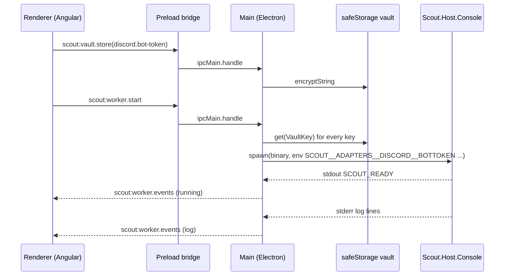

# Desktop UI

> Onboards a chat bot, stores its secrets, launches and supervises the .NET worker, and manages local models; it never calls the LLM itself.

## To change here, read

- [[pages/invariants/secrets-never-in-source]] - credentials go to the OS keychain through `safeStorage`, never to a file in the repo.
- [[pages/invariants/no-executive-writes]] - the UI is the one place Scout mutates the host on the user's behalf (model pulls, worker process); the ADR does not yet classify this.
- [[pages/decisions/0004-web-stack-angular]] and [[pages/decisions/0005-scout-desktop-m1-scope]] - the stack and the M1 deferrals.
- [[pages/decisions/0011-backend-frontend-grpc-uds]] - the target transport; see Current gap below.
- [[pages/roadmap/control-plane-client]] - the open initiative that closes that gap.
- [[pages/conventions/testing]] - `bun run test` per package, Vitest in the renderer.

## Responsibility

Owns: first-run wizard and Discord OAuth install, the credential vault, worker lifecycle and log streaming, detection of installed chat clients and local inference backends, Ollama and Whisper model downloads, packaging.

Does not own: any conversation, LLM call or plugin; those live in [[pages/services/host-console]] and behind it. Does not yet own a client to [[pages/services/host-control-plane]].

## Layout

Four Bun packages under `ui/packages/`:

| Package | Role | Built with |
|---|---|---|
| `shared` | IPC channel names, request and response types, `VaultKey` union | type-only |
| `main` | Electron main process: IPC handlers, vault, supervisor, OAuth loopback, tray | `bun build` to ESM |
| `preload` | Context bridge that exposes the typed channels to the renderer | `bun build` to CJS |
| `renderer` | Angular 22 app: wizard, status, sources, features, llm, logs screens | `ng build` |

Packaging: `ui/build/scripts/publish-worker.sh:13` publishes `src/Scout.Host.Console` self-contained per RID into `ui/build/worker/<rid>/`; `ui/build/electron-builder.yml:74` targets AppImage and deb on Linux, dmg on macOS, nsis on Windows.

## Public contract

- **IPC channels** - 39 `scout:*` channels declared in `ui/packages/shared/src/ipc-contract.ts:5`, grouped as detect, discord, vault, worker, app, diagnostics, llm, whisper, shell, providers and features. The renderer sees only what `ui/packages/preload/src/preload.ts` bridges.
- **Vault keys** - the closed `VaultKey` union in `ui/packages/shared/src/client-kinds.ts:3` (Discord bot token, client and guild ids, LLM provider, model and endpoint, STT provider and model).
- **Worker handshake** - the main process spawns the worker binary (`ui/packages/main/src/worker/supervisor.ts:181`) and waits for the `SCOUT_READY` marker on stdout (`ui/packages/main/src/worker/log-stream.ts:13`); readiness times out after 45 s.
- **Routes** - `''`, `provision`, `token`, `oauth`, `launch`, `ready`, `status`, `sources`, `sources/local-models`, `features`, `llm`, `logs` in `ui/packages/renderer/src/app/app.routes.ts:7`.

## How it works

The vault to environment mapping is `ui/packages/main/src/worker/build-env.ts`; the binary is resolved per platform and packaging mode in `ui/packages/main/src/worker/resolve-binary.ts:22`. Crash handling is a bounded restart policy with backoff (`ui/packages/main/src/worker/supervisor.ts:132`).

## Current gap: the control plane has no client

The Providers and Features IPC handlers call the worker over HTTP through `ui/packages/main/src/worker/http-client.ts:68`, whose endpoint is learned from a `SCOUT_HTTP=` stdout line (`ui/packages/main/src/worker/log-stream.ts:14`). Only the retired `src/old/Scout.Host.Worker` ever printed that line; the current `Scout.Host.Console` does not, so the endpoint stays `null` and every call throws `WorkerHttpUnavailableError`. The Providers and Features screens therefore render their "backend unavailable" state on every run. The .NET side of the replacement, [[pages/services/control-plane]] behind [[pages/services/host-control-plane]] over gRPC, is complete and tested but has no consumer; `ui/` contains no gRPC dependency. Closing this is [[pages/roadmap/control-plane-client]].

Until then the main process does the control plane's job itself: `ui/packages/main/src/ipc/llm-pull.ts` pulls Ollama models and `ui/packages/main/src/ipc/whisper.ts` downloads Whisper weights, both from Node.

## Invariants

- [[pages/invariants/secrets-never-in-source]] - `ui/packages/main/src/vault/safe-storage-vault.ts:101` encrypts with the OS keychain; the renderer never receives a secret back, only `has` and `isAvailable`.
- [[pages/invariants/pluggable-boundaries]] - the UI reaches the worker only through environment variables and stdout markers; no .NET type crosses.

## Hot spots

- `ui/packages/main/src/worker/supervisor.ts:132` - restart policy; the watchdog test race fixed in PR 55 lives in its spec.
- `ui/packages/main/src/vault/safe-storage-vault.ts:101` - synchronous `safeStorage` API, deprecated in Electron 45, removed in 46 (tracked in [[pages/roadmap/followups]]).
- `ui/packages/main/src/worker/http-client.ts:68` - dead path today, see Current gap.
- `ui/build/electron-builder.yml` - `executableName` must stay filesystem-safe for AppImage; `ui/packages/main/test/packaging-config.test.ts` guards it.

## Tests

27 spec files across the four packages, 261 tests, run by `bun run test` at the workspace root; `ui-ci.yml` runs lint, typecheck, Prettier check, tests, worker publish and the package step on Linux, macOS and Windows. The `ui/e2e` folder holds only a `package.json`; there is no end-to-end suite yet.
