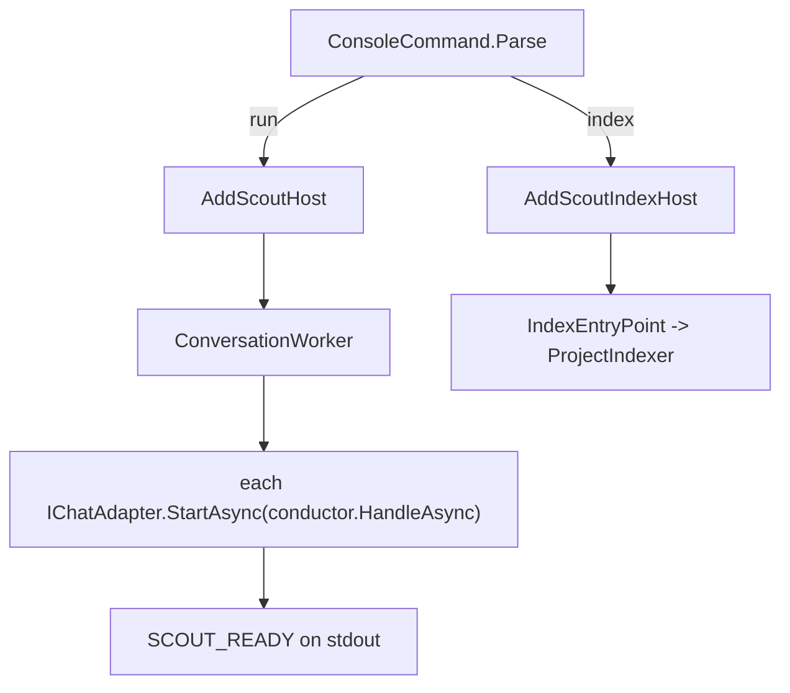

# Host.Console

> The process the desktop app launches and supervises: it starts whichever adapters are configured and answers until stopped.

## To change here, read

- [[pages/invariants/pluggable-boundaries]]
- [[pages/invariants/secrets-never-in-source]]
- [[pages/invariants/local-first-default]]
- [[pages/invariants/no-executive-writes]]
- [[pages/conventions/testing]]

## Responsibility

Owns composition, the conversation worker, the readiness marker, the parent watchdog and the `index` command. Does not own behaviour of any piece it wires.

## Public contract

- **Entry point:** `src/Scout.Host.Console/Program.cs`. `ConsoleCommand.Parse` selects run or `index <project>` (`src/Scout.Host.Console/ConsoleCommand.cs:22`); the index path builds a minimal graph (`src/Scout.Host.Console/Program.cs:14`).
- **Composition:** `AddScoutHost` (`src/Scout.Host.Console/HostComposition.cs:26`) registers in order: readiness signal (`:33`), LLM (`:35`), skills (`:39`), conversation (`:40`), knowledge (`:41`), three adapters (`:45` to `:47`), GitHub plugin (`:50`), worker (`:52`), watchdog (`:56`). `AddScoutIndexHost` (`:72`) registers LLM and knowledge only.
- **Runtime types:** `ConversationWorker` (`src/Scout.Host.Console/ConversationWorker.cs:14`), `IReadinessSignal` printing the `SCOUT_READY` marker on stdout (`src/Scout.Host.Console/IReadinessSignal.cs:18`), `ParentWatchdogService` (`src/Scout.Host.Console/ParentWatchdogService.cs:13`) with a stdin-EOF probe (`src/Scout.Host.Console/IParentLivenessProbe.cs:23`), `IndexEntryPoint` (`src/Scout.Host.Console/IndexEntryPoint.cs:12`).
- **Configuration keys read here:** `Scout:Adapters:Discord:BotToken`, `Scout:Adapters:Slack:BotToken`, `Scout:Adapters:Teams:AppId` (startup marker only, `src/Scout.Host.Console/Program.cs:47`); everything else is read by the wired projects. Environment variable `SCOUT__PARENT_WATCHDOG` enables the watchdog when set to `1` (`src/Scout.Host.Console/ParentWatchdogRegistration.cs:13`). Configuration root is the binary directory (`src/Scout.Host.Console/Program.cs:17`, `:32`).
- **External boundaries:** stdout carries only the readiness marker; all logs go to stderr (`src/Scout.Host.Console/Program.cs:38`). Network boundaries belong to the wired projects.

## How it works

With no adapter registered the worker writes a hint to stderr and stops the application (`src/Scout.Host.Console/ConversationWorker.cs:25`); a failing adapter start does the same (`:52`). Readiness is signalled only after every adapter has started (`:66`).

## Invariants

- [[pages/invariants/pluggable-boundaries]]: wires every adapter and plugin at compile time and lets configuration pick (`src/Scout.Host.Console/Scout.Host.Console.csproj:16`).
- [[pages/invariants/secrets-never-in-source]]: ships `appsettings.json` with empty credentials (`src/Scout.Host.Console/appsettings.json:31`, committed content) and a user-secrets id (`src/Scout.Host.Console/Scout.Host.Console.csproj:7`).
- [[pages/invariants/local-first-default]]: committed provider is Ollama (`src/Scout.Host.Console/appsettings.json:10`).
- [[pages/invariants/no-executive-writes]]: composes every plugin the model can call.

## Hot spots

- `src/Scout.Host.Console/HostComposition.cs:39`: registration order matters; skills must precede conversation.
- `src/Scout.Host.Console/ConversationWorker.cs:45`: adapters start sequentially, one failure aborts the host.

## Testing footprint

`tests/Scout.Host.Console.Tests` (20 test attributes, 6 files): command parsing, worker behaviour, full-graph and index-graph smoke tests with a throwing HTTP handler to prove no network on resolve (`HostCompositionSmokeTests.cs`, `IndexHostCompositionSmokeTests.cs`), and watchdog registration and service.

## Related

Direct project references: [[pages/services/llm]], [[pages/services/conversation]], [[pages/services/knowledge]], [[pages/services/adapter-discord]], [[pages/services/adapter-slack]], [[pages/services/adapter-teams]], [[pages/services/plugin-github]]. Skills arrives through Conversation. Map: [[pages/architecture/project-map]].
