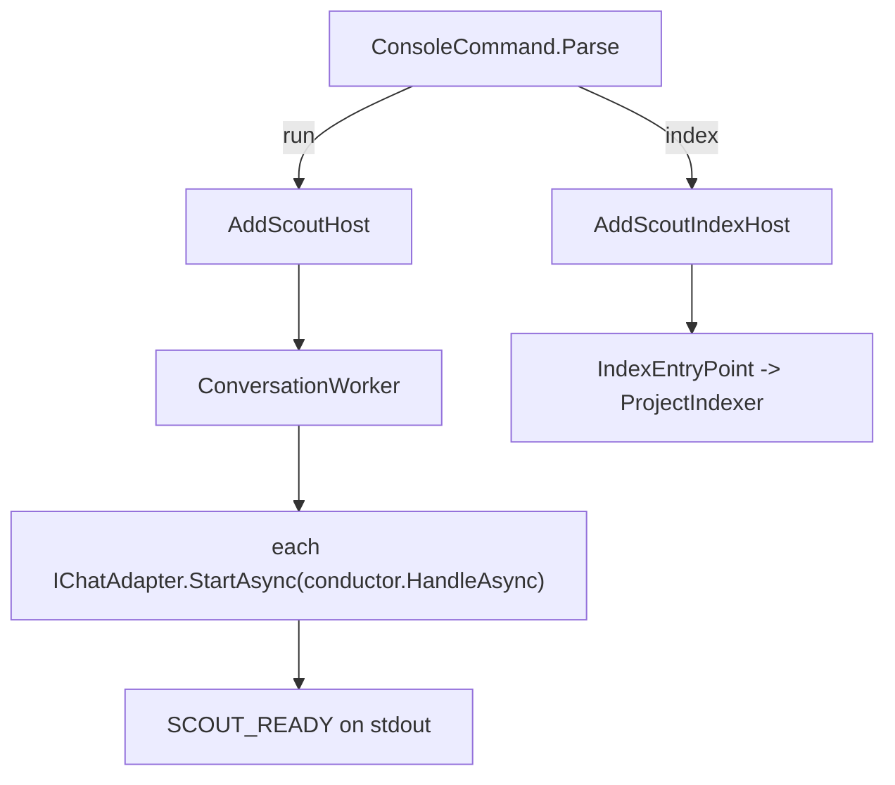

# Host.Console

> The process the desktop app launches and supervises: it starts whichever adapters are configured and answers until stopped.

## To change here, read

- [[pages/invariants/pluggable-boundaries]]
- [[pages/invariants/secrets-never-in-source]]
- [[pages/invariants/local-first-default]]
- [[pages/invariants/no-executive-writes]]
- [[pages/decisions/0028-local-quick-ask-assistant]] - stdin and stdout as the quick-ask transport
- [[pages/conventions/testing]]

## Responsibility

Owns composition, the conversation worker, the readiness marker, the parent watchdog and the `index` command. Does not own behaviour of any piece it wires.

## Public contract

- **Entry point:** `src/Scout.Host.Console/Program.cs`. `ConsoleCommand.Parse` selects run or `index <project>` (`src/Scout.Host.Console/ConsoleCommand.cs:22`); the index path builds a minimal graph (`src/Scout.Host.Console/Program.cs:14`).
- **Composition:** `AddScoutHost` (`src/Scout.Host.Console/HostComposition.cs:36`) registers in order: readiness signal (`:43`), pairing signal (`:44`), LLM (`:46`), skills (`:50`), conversation (`:51`), knowledge (`:52`), Whisper transcription when `Scout:Transcription:ModelPath` exists (`:55`, [[pages/services/transcription-whisper]]), the screenshot text reader when `Scout:Tools:TesseractPath` and `Scout:Tools:TessdataPath` exist (`:56`, [[pages/services/operator]], [[pages/decisions/0036-text-read-from-a-screenshot-by-a-local-ocr-program]]), which the local adapter takes as its optional `IScreenTextReader`, the kept meetings when `Scout:Meetings:DbPath` names a file whose folder exists (`:57`, [[pages/services/meetings]], [[pages/decisions/0037-meetings-kept-locally-in-sqlite]]), which the local adapter takes as its optional `IMeetingStore` and `Func<MeetingRecord, string>`, the local adapter when `Scout:Adapters:Local:Enabled` is true, first so stdin has a reader before any network adapter starts (`:61`, [[pages/services/adapter-local]]), three chat adapters (`:62` to `:64`), GitHub plugin (`:67`), Kubernetes plugin (`:68`), YouTube plugin (`:69`, [[pages/services/plugin-youtube]]), the write gate (`:70`), the YouTube channel operator (`:71`, [[pages/services/operator]]), worker (`:73`), watchdog (`:77`). The operator is composed only when the YouTube plugin registered its client (`:114`), the same self-gating as the plugin; it gets `GrpcOperatorControlPlane` when the write gate is open (`:121`) and `ClosedOperatorControlPlane` otherwise (`:125`), a `Func<CancellationToken, Task<string?>>` that reads the mandate through that control plane and answers its `Language`, or null when blank (`:128`), which the local adapter takes for a live translation set to `auto` ([[pages/services/adapter-local]]); a refused or unreachable control plane throws through it and the adapter then uses the interface language, and without the operator no delegate is registered, and its `OperatorMediaOptions` bound from `Scout:Operator` (`:133`); the operator's publishing and learning (`AddYouTubePublishing`, [[pages/services/operator]]) are added only when the YouTube plugin registered `IYouTubeWriteClient`, which it does only with the desktop sign-in (`:137`). `AddScoutIndexHost` (`:177`) registers LLM and knowledge only, and no write gate, because it composes no plugin. A publish target keeps the target platform's Whisper native libraries as loose files beside the single-file binary (`src/Scout.Host.Console/Scout.Host.Console.csproj:40`). The Kubernetes plugin builds its clients on the first call, so composing it reads no kubeconfig (`tests/Scout.Host.Console.Tests/HostCompositionSmokeTests.cs:158`); the YouTube plugin, configured with a dummy key, lands on the kernel without a call to YouTube (`tests/Scout.Host.Console.Tests/HostCompositionSmokeTests.cs:207`).
- **Runtime types:** `ConversationWorker` (`src/Scout.Host.Console/ConversationWorker.cs:14`), `IReadinessSignal` printing the `SCOUT_READY` marker on stdout (`src/Scout.Host.Console/IReadinessSignal.cs:18`), `StdoutPairingSignal`, the `IPairingSignal` of owner pairing, printing `SCOUT_PAIRED=<id>` when a user pairs and `SCOUT_PAIRING_BURNED` when the code is burned (`src/Scout.Host.Console/StdoutPairingSignal.cs:10`, [[pages/decisions/0021-allowed-users]]), `ParentWatchdogService` (`src/Scout.Host.Console/ParentWatchdogService.cs:13`) with a stdin-EOF probe (`src/Scout.Host.Console/IParentLivenessProbe.cs:23`), or, when the local adapter is registered, a probe that waits on that adapter's `InputClosed`, so stdin has one reader (`src/Scout.Host.Console/IParentLivenessProbe.cs:65`, chosen at `src/Scout.Host.Console/ParentWatchdogRegistration.cs:28`; `AddLocalAdapter` must run before `AddParentWatchdog`, as it does in `AddScoutHost`), `IndexEntryPoint` (`src/Scout.Host.Console/IndexEntryPoint.cs:12`), and the two `IWriteGate` implementations of [[pages/services/llm]]'s write gate: `GrpcWriteGate` (`src/Scout.Host.Console/GrpcWriteGate.cs:15`), registered as itself and as the `IWriteGate` when both the socket path and the token are set (`src/Scout.Host.Console/HostComposition.cs:100`), and `ClosedWriteGate` (`src/Scout.Host.Console/ClosedWriteGate.cs:9`) otherwise, which refuses every write with "Writes are off: Scout Desktop's control plane is not available." The two `IOperatorControlPlane` implementations of [[pages/services/operator]]: `GrpcOperatorControlPlane` (`src/Scout.Host.Console/GrpcOperatorControlPlane.cs:14`), which calls `WorkerGate` on the `GrpcWriteGate`'s own client, token header and deadline (`src/Scout.Host.Console/GrpcWriteGate.cs:60`), so there is one channel and one token; and `ClosedOperatorControlPlane` (`src/Scout.Host.Console/ClosedOperatorControlPlane.cs:9`), whose every call, the media directory, the readiness report, the approved actions, the comments and the owner's chat edits included, fails with a `ControlPlaneUnavailableException` "Scout Desktop's control plane is not available, so the video operator is off."
- **Configuration keys read here:** `Scout:Adapters:Discord:BotToken`, `Scout:Adapters:Slack:BotToken`, `Scout:Adapters:Teams:AppId`, `Scout:Adapters:Local:Enabled` (startup marker only, `src/Scout.Host.Console/Program.cs:47`, `:59`); everything else is read by the wired projects. `Scout:WorkerGate:SocketPath` and `Scout:WorkerGate:Token`, which the desktop sets as `SCOUT__WORKERGATE__SOCKETPATH` and `SCOUT__WORKERGATE__TOKEN` (empty when there is no control plane) and which are read through configuration binding only; the token goes on each call as `authorization: Bearer <token>` and is never logged. Right after composition reads the two values, it removes from the process environment every variable that configuration reads as the token, in any casing or ':' spelling and with or without the `DOTNET_` or `ASPNETCORE_` prefix, whether or not the gate is opened (`src/Scout.Host.Console/HostComposition.cs:93`, `:146`), so a process the worker starts, such as a kubeconfig exec credential plugin, does not inherit it; `GrpcWriteGate` keeps the value it was given. On Unix the removal changes .NET's own environment block, which `Process.Start` hands to children; native code that reads the C `environ` still sees the original. The `index` command never composes the write gate and so never removes the token. `Scout:Operator:FfmpegPath`, `Scout:Operator:FontPath` and `Scout:Operator:CategoryId` (the YouTube category of an upload, `22` People & Blogs when unset), which the desktop sets as `SCOUT__OPERATOR__FFMPEGPATH`, `SCOUT__OPERATOR__FONTPATH` and `SCOUT__OPERATOR__CATEGORYID` and which bind only when the operator is composed (`src/Scout.Host.Console/HostComposition.cs:133`); an empty program path means `ffmpeg` on the system path, then in `/opt/homebrew/bin` and `/usr/local/bin`, and an empty or missing font makes assembly unavailable ([[pages/services/operator]]). They carry paths, never credentials, and `appsettings.json` does not name them. `Scout:Tools:TesseractPath`, `Scout:Tools:TessdataPath` and `Scout:Tools:Locale`, which the desktop sets as `SCOUT__TOOLS__TESSERACTPATH`, `SCOUT__TOOLS__TESSDATAPATH` and `SCOUT__TOOLS__LOCALE`, are read by `AddScreenText` on every run (`src/Scout.Host.Console/HostComposition.cs:56`), whether or not YouTube is configured; without both paths existing no reader is registered and a `read` gets the not-installed sentence ([[pages/services/adapter-local]]); the locale is `en` when unset and nothing is read from the operating system. They are paths and a locale, never credentials, and `appsettings.json` does not name them. `Scout:Meetings:DbPath`, which the desktop sets as `SCOUT__MEETINGS__DBPATH` to `<userData>/meetings.db` on every worker start (`ui/packages/main/src/worker/build-env.ts:115`), is read by `AddMeetings` on every run (`src/Scout.Host.Console/HostComposition.cs:57`); without it, or when its folder does not exist, no store is registered and every meeting request gets the not-configured sentence ([[pages/services/adapter-local]]). It is a path, never a credential, and `appsettings.json` does not name it. Environment variable `SCOUT__PARENT_WATCHDOG` enables the watchdog when set to `1` (`src/Scout.Host.Console/ParentWatchdogRegistration.cs:13`). Configuration root is the binary directory (`src/Scout.Host.Console/Program.cs:17`, `:32`).
- **External boundaries:** stdout carries only the readiness and pairing markers and the local adapter's `SCOUT_LOCAL` reply lines; stdin carries the desktop's quick-ask requests to the local adapter; all logs go to stderr (`src/Scout.Host.Console/Program.cs:38`). Network boundaries belong to the wired projects, and so do the `ffmpeg` processes the operator starts, with standard input closed so they never read the local adapter's input ([[pages/services/operator]]), except one: `GrpcWriteGate` calls the control plane's `WorkerGate` service (`RequestWrite`, `RecordWrite`, [[pages/services/control-plane-contracts]]) over the Unix socket the desktop passes, through a `SocketsHttpHandler` whose `ConnectCallback` opens a `UnixDomainSocketEndPoint`, with a 10 s deadline per call (`src/Scout.Host.Console/GrpcWriteGate.cs:57`) and messages up to 16 MB both ways (`:19`, `:52`), because a full comments view, 1000 comments of up to 2000 characters, passes the 4 MB gRPC default once the text is not ASCII; the control plane takes and sends the same size ([[pages/services/host-control-plane]]). Only `allowed` and `queued` are read as such; an empty, unknown or differently cased decision is a refusal (`src/Scout.Host.Console/GrpcWriteGate.cs:82`). A call that fails or misses the deadline throws, and the write gate filter then refuses the write. `GrpcOperatorControlPlane` calls `GetOperatorMandate`, `SaveOperatorProject`, `NextQueuedProject`, `GetOperatorProject`, `ListOperatorProjects`, `GetOperatorMediaDirectory` (`src/Scout.Host.Console/GrpcOperatorControlPlane.cs:320`), `ReportReadiness` (`:329`) and `GetVoiceSamplesDirectory` (`:713`), and, for the owner's edits from the chat, `ChatEditSceneText`, `ChatRegenerateNarration`, `ChatRegenerateScene`, `ChatSetSceneLocked`, `ChatReorderScenes`, `ChatProduceProject`, `ChatDelegateProject` and, since phase 8c-B, `ChatRequestPresenter` (`:721` to `:754`), each reading the changed project back, the same way and maps the messages to the operator's records field by field, a project's scenes (`:217`), its presenter versions with an absent preview or mouth box absent on the wire (`:184`, `:194`) and its video package included (`:660`, `:697`), setting an optional field (a scene's `error`, `audio_file`, `visual_file`; a package's `video_file`, `thumbnail_file`, `approved_at`, `error`) only when it has a value and sending the owner's `rights_confirmed`, `approved_at` and `metadata_edited` back as read; it never sets the readiness `reported_at`, which the control plane stamps; a refusal the control plane words (`PERMISSION_DENIED`, `FAILED_PRECONDITION`, `INVALID_ARGUMENT`, `NOT_FOUND`) keeps its words, and any other failure, a missing socket included, becomes "Scout could not reach its control plane." (`src/Scout.Host.Console/GrpcOperatorControlPlane.cs:89`), so no transport text reaches the chat or the desktop; that unreachable failure is a `ControlPlaneUnavailableException` (`src/Scout.Host.Console/GrpcOperatorControlPlane.cs:95`), so the executor tells it from a worded refusal. `NextApprovedAction` (`:351`) maps the claimed `PendingAction` to an `OperatorAction`, with the response's `origin_reference` when the control plane sends one, `RecordWrite` (`:361`) records it with its id, scope, target and outcome, a refusal containing "already recorded in the write log" being a success and one containing "revoked" a `WriteRevokedException` (`:18`), and the publication travels field by field with its snapshots, proposals and experiment (`:499`, `:616`), each optional value (video id, publish time, upload time, error, impressions, click-through rate, a thumbnail file, an arm's start and end, a winner, a result) set only when it has one. `GetComments` and `SaveComments` (`src/Scout.Host.Console/GrpcOperatorControlPlane.cs:387`, `:395`) carry the `CommentsView` field by field (`:403`, `:474`): every time, `published_at`, `decided_at`, `fetched_at`, `synced_at` and `sync_requested_at`, travels as the string the control plane sent and goes back byte for byte, because the control plane compares a comment the worker sends with the stored one and a reformatted time reads as tampering; a new comment's empty `fetched_at` goes as it is, for the control plane to stamp; `approved_text`, `reply_id`, `error`, `decided_at`, an idea's `project_id` and the sync's three values are set only when they have one. A refusal keeps its words and an unreachable control plane is a `ControlPlaneUnavailableException`, as for the other calls.

## How it works

With no adapter registered the worker writes a hint to stderr and stops the application (`src/Scout.Host.Console/ConversationWorker.cs:25`); a failing adapter start does the same (`:52`). Readiness is signalled only after every adapter has started (`:66`).

## Invariants

- [[pages/invariants/pluggable-boundaries]]: wires every adapter and plugin at compile time and lets configuration pick (`src/Scout.Host.Console/Scout.Host.Console.csproj:16`).
- [[pages/invariants/secrets-never-in-source]]: ships `appsettings.json` with empty credentials (`src/Scout.Host.Console/appsettings.json:31`, committed content) and a user-secrets id (`src/Scout.Host.Console/Scout.Host.Console.csproj:7`).
- [[pages/invariants/local-first-default]]: committed provider is Ollama (`src/Scout.Host.Console/appsettings.json:10`).
- [[pages/invariants/no-executive-writes]]: composes every plugin the model can call, and the write gate every declared write asks; without the desktop's socket and token that gate refuses every write.
- [[pages/invariants/secrets-never-in-source]]: the worker gate token arrives only through configuration binding (`src/Scout.Host.Console/HostComposition.cs:92`), travels only in the call metadata, and leaves the process environment once read (`tests/Scout.Host.Console.Tests/WorkerGateTokenEnvironmentTests.cs:26`).

## Hot spots

- `src/Scout.Host.Console/HostComposition.cs:50`: registration order matters; skills must precede conversation.
- `src/Scout.Host.Console/HostComposition.cs:70`: the operator is composed after the write gate and the YouTube plugin, because it needs the gate's `GrpcWriteGate` and checks for the YouTube client.
- `src/Scout.Host.Console/ConversationWorker.cs:45`: adapters start sequentially, one failure aborts the host.

## Testing footprint

`tests/Scout.Host.Console.Tests` (164 cases on 2026-11-05, 16 files, the real control-plane host included through a reference to `Scout.Host.ControlPlane`): command parsing, worker behaviour, the local adapter registered only when enabled and ahead of the network adapters, a host with Local as its only adapter, the watchdog waiting on the local adapter's input when both are on and reading stdin itself otherwise, and the composed host answering a local-owner voice message although no chat user is allowed, the composed local adapter given the screenshot text reader only when the tesseract program and its language data folder both exist (`HostLocalCompositionTests.cs`, the reader at `tests/Scout.Host.Console.Tests/HostLocalCompositionTests.cs:198`), the live translator only with a provider other than `None`, resolved with the YouTube operator in the graph (`:239`), and the mandate language read through the operator's control plane, null when blank (`:264`), and no delegate without the operator (`:289`), the meetings store and its renderer given to the local adapter only with a meetings database path, composing opening no file (`:299`), the composed host answering a voice message with the no-model text or handing it to the transcriber (`HostVoiceCompositionTests.cs`), full-graph and index-graph smoke tests with a throwing HTTP handler to prove no network on resolve (`HostCompositionSmokeTests.cs`, `IndexHostCompositionSmokeTests.cs`), and watchdog registration and service. `GrpcWriteGateTests.cs` runs `GrpcWriteGate` against an in-test `WorkerGate` server on a temporary Unix socket: the decision mapping including the refusal of an unknown decision (`tests/Scout.Host.Console.Tests/GrpcWriteGateTests.cs:29`), the write and the bearer token reaching the server (`:58`), a declared write that never runs and the unreachable text when the socket does not exist (`:86`) or the server misses the deadline (`:99`), a record the server refuses with `FAILED_PRECONDITION` leaving the write's result and one Warning (`:117`), the closed gate (`:141`), and the host choosing the gRPC gate only when both values are set (`:156`). `GrpcOperatorControlPlaneTests.cs` runs `GrpcOperatorControlPlane` against the same in-test server: a saved project with its origin and the bearer token (`tests/Scout.Host.Console.Tests/GrpcOperatorControlPlaneTests.cs:47`), a queued project and an empty reply (`:66`), a project read back with the owner's claim decision and the list's limit (`:90`), the mandate (`:118`), worded refusals kept and other failures read as unreachable (`:138`), scenes travelling field by field with an absent error or file absent on the wire, a stock scene's search terms and credit both ways and an absent credit absent (`:152`), the owner's background travelling to the wire and back (`:182`), the media directory asked for by project id and the readiness report sent whole without `reported_at` (`:201`), a media directory or readiness call that is refused, reset or finds no socket read as the control plane's words or unreachable (`:232`), `youtube_make_video` with the socket missing starting no project and failing with a sentence that says why (`:287`), the closed control plane, the comment calls and the chat edits included (`:308`), each chat edit on its own `Chat*` rpc with its fields and the worker token, the changed project read back (`:918`), and a chat edit that is refused, unavailable, reset, unimplemented, as it is on a control plane that predates the rpcs, or finds no socket read as the control plane's words or unreachable (`:941`), the comments travelling field by field and going back with every time byte for byte, a seven-digit `decided_at` among them, and absent values absent (`:575`), a comment read or save refused in the control plane's words or unreachable (`:634`), a comments view over 4 MB read and saved through `GrpcWriteGate` against the real host from `AddControlPlaneHost` and `MapControlPlaneServices`, which holds the worker's and the host's 16 MB limits together (`:653`), and the operator composed only with YouTube, on the gate's own `GrpcWriteGate` (`:345`), a package travelling field by field with the owner's fields as read and its absent files and error absent on the wire (`:366`), and the two `Scout:Operator` paths reaching the toolset that probes them, through a recording process runner so no ffmpeg runs (`:743`), the presenter versions, request, source, return status and preview travelling to the wire and back with absent ones absent (`:1072`), face detection, the pictures left today and the built-in presenters reported (`:1111`), and the presenters and face models paths binding from `Scout:Operator` (`:1133`); a publication travelling field by field with the owner's choices as read and absent values absent on the wire (`:409`), the next approved action whole and an empty reply as none (`:454`), an action recorded with its id, scope, target and outcome and a refused record keeping the control plane's words (`:480`), a record already logged read as a success, one refused after a revoke as a `WriteRevokedException` and any other refusal as itself (`:508`), and the two phrases pinned to the words of the control plane's real `WriteGateService`, "already recorded in the write log" for an action logged but not yet marked executed and "revoked" for a record after the owner revoked (`:521`), an unreachable control plane told apart from a worded refusal (`:557`), publishing composed only with the sign-in and the configured category, 22 by default (`:719`, `:739`); the full graph with the sign-in resolves the executor and the scheduler without a cycle (`tests/Scout.Host.Console.Tests/HostCompositionSmokeTests.cs:229`). `WriteDeclarationCatalogTests.cs` composes the host with every plugin and asserts each declared write names a `Write` or `IrreversibleWrite` row of its feature in the control plane's catalog, exactly (`tests/Scout.Host.Console.Tests/WriteDeclarationCatalogTests.cs:13`), and that the YouTube feature declares the operator's one network read of its own, the Openverse search and the picture it names, as the `Read` row "api.openverse.org and the host of the picture it names" (`:40`); a read needs no `WriteFunctionDeclaration`, because no model-callable function makes it. `HostOperatorTurnTests.cs` drives a `ConversationConductor` turn with an origin reference through the composed host and a scripted model that calls `youtube_make_video`, and asserts the gate was asked, the saved project carries the turn's reference and the write is recorded as succeeded (`tests/Scout.Host.Console.Tests/HostOperatorTurnTests.cs:51`); when the control plane refuses the save, the real `WriteGateFilter` records the write as `failed: ...`, never `succeeded`, and the model reads the refusal (`:73`); a chat edit from a sender who is not the owner is asked for, refused with the owner sentence before any control-plane call and recorded as `failed: InvalidOperationException` (`:93`). `OperatorContractTests.cs` holds Scout.Operator to the control plane it talks to: every project status and the claim status the operator sends pass `OperatorService`'s worker validation (`tests/Scout.Host.Console.Tests/OperatorContractTests.cs:53`), a late transcribing save is refused with the very sentence the worker stops quietly on (`tests/Scout.Host.Console.Tests/OperatorContractTests.cs:526`), so do `producing`, `media_ready` and every scene status, source, file name and fallback note the production stage sends, a `stock` scene with its file, search terms and credit and a text card with an Openverse note among them (`:76`), a scene save built from a worker read older than the owner's reorder keeps the owner's order, and after a regenerate, which leaves the project `production_queued`, it is refused with `OperatorPipeline.NoLongerProducing`, the words the pipeline stops on (`:164`), every scope the operator writes under is a YouTube catalog row of the same access: `Scout's data folder` and `youtubeReporting jobs.create` `Write`, `videos.insert`, `videos.update`, `thumbnails.set`, `comments.insert` and `comments.setModerationStatus` `IrreversibleWrite` (`:208`), the comment desk and the executor driven against the real `CommentService` through the host's time format: a sync with a question, a request, spam and praise, a draft the owner asked for answered by the next sync that also clears the sync request, an approved reply posted and saved `replied` with its id, a hold saved `held`, both recorded `succeeded`, and a failed sync saved as the sync's error, every save accepted (`:263`), both sides count tags YouTube's way and judge discoverability alike (`:235`, `:243`), a first title cut from a 120-character variant or a 200-character topic is metadata the control plane accepts (`:253`), and the owner's chat edits the plugin sends through a local-owner turn, a lock and an unlock, a reorder, a produce with a voice and a motion, a text edit and a narration and a scene asked for again on the project then queued for production, and a delegation with nothing sent that takes a media-ready project whose every scene is made straight to `assembly_queued`, are accepted by the real `OperatorService`, which stores the chosen voice, motion and text and logs, after the worker's own saves, one `<outcome> via chat` entry per edit (`:426`). The full-graph smoke test also resolves the operator's plugin and worker without a cycle (`tests/Scout.Host.Console.Tests/HostCompositionSmokeTests.cs:217`). `WorkerGateTokenEnvironmentTests.cs`, in a collection that runs alone because every composition edits the process environment, sets the token under five spellings, composes the host, and asserts that none is left in the process environment or in the environment a child process would get, that the socket path is untouched, and that the gate still sends the token (`tests/Scout.Host.Console.Tests/WorkerGateTokenEnvironmentTests.cs:26`).

## Related

Direct project references: [[pages/services/llm]], [[pages/services/control-plane-contracts]] (the `WorkerGate` client stubs; its `Grpc.AspNetCore` package brings the ASP.NET Core shared framework into the worker), [[pages/services/conversation]], [[pages/services/knowledge]], [[pages/services/transcription-whisper]], [[pages/services/meetings]], [[pages/services/adapter-discord]], [[pages/services/adapter-slack]], [[pages/services/adapter-teams]], [[pages/services/adapter-local]], [[pages/services/plugin-github]], [[pages/services/plugin-kubernetes]], [[pages/services/plugin-youtube]], [[pages/services/operator]]. Skills arrives through Conversation. The test project also references [[pages/services/control-plane]], for the catalog the declared writes are checked against, and [[pages/services/host-control-plane]], for the 16 MB round trip against the real host. Map: [[pages/architecture/project-map]].
