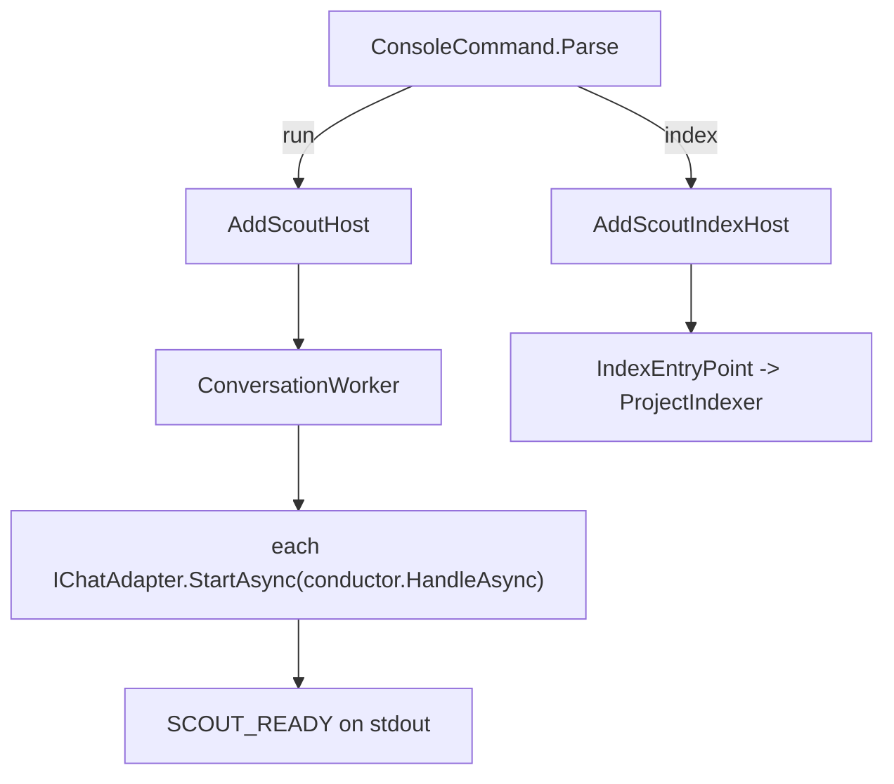

# Host.Console

> The process the desktop app launches and supervises: it starts whichever adapters are configured and answers until stopped.

## To change here, read

- [[pages/invariants/pluggable-boundaries]]
- [[pages/invariants/secrets-never-in-source]]
- [[pages/invariants/local-first-default]]
- [[pages/invariants/no-executive-writes]]
- [[pages/decisions/0028-local-quick-ask-assistant]] - stdin and stdout as the quick-ask transport
- [[pages/conventions/testing]]

## Responsibility

Owns composition, the conversation worker, the readiness marker, the parent watchdog and the `index` command. Does not own behaviour of any piece it wires.

## Public contract

- **Entry point:** `src/Scout.Host.Console/Program.cs`. `ConsoleCommand.Parse` selects run or `index <project>` (`src/Scout.Host.Console/ConsoleCommand.cs:22`); the index path builds a minimal graph (`src/Scout.Host.Console/Program.cs:14`).
- **Composition:** `AddScoutHost` (`src/Scout.Host.Console/HostComposition.cs:30`) registers in order: readiness signal (`:37`), pairing signal (`:38`), LLM (`:40`), skills (`:44`), conversation (`:45`), knowledge (`:46`), Whisper transcription when `Scout:Transcription:ModelPath` exists (`:49`, [[pages/services/transcription-whisper]]), the local adapter when `Scout:Adapters:Local:Enabled` is true, first so stdin has a reader before any network adapter starts (`:53`, [[pages/services/adapter-local]]), three chat adapters (`:54` to `:56`), GitHub plugin (`:59`), Kubernetes plugin (`:60`), worker (`:62`), watchdog (`:66`). `AddScoutIndexHost` (`:82`) registers LLM and knowledge only. A publish target keeps the target platform's Whisper native libraries as loose files beside the single-file binary (`src/Scout.Host.Console/Scout.Host.Console.csproj:37`). The Kubernetes plugin builds its clients on the first call, so composing it reads no kubeconfig (`tests/Scout.Host.Console.Tests/HostCompositionSmokeTests.cs:159`).
- **Runtime types:** `ConversationWorker` (`src/Scout.Host.Console/ConversationWorker.cs:14`), `IReadinessSignal` printing the `SCOUT_READY` marker on stdout (`src/Scout.Host.Console/IReadinessSignal.cs:18`), `StdoutPairingSignal`, the `IPairingSignal` of owner pairing, printing `SCOUT_PAIRED=<id>` when a user pairs and `SCOUT_PAIRING_BURNED` when the code is burned (`src/Scout.Host.Console/StdoutPairingSignal.cs:10`, [[pages/decisions/0021-allowed-users]]), `ParentWatchdogService` (`src/Scout.Host.Console/ParentWatchdogService.cs:13`) with a stdin-EOF probe (`src/Scout.Host.Console/IParentLivenessProbe.cs:23`), or, when the local adapter is registered, a probe that waits on that adapter's `InputClosed`, so stdin has one reader (`src/Scout.Host.Console/IParentLivenessProbe.cs:65`, chosen at `src/Scout.Host.Console/ParentWatchdogRegistration.cs:29`; `AddLocalAdapter` must run before `AddParentWatchdog`, as it does in `AddScoutHost`), `IndexEntryPoint` (`src/Scout.Host.Console/IndexEntryPoint.cs:12`).
- **Configuration keys read here:** `Scout:Adapters:Discord:BotToken`, `Scout:Adapters:Slack:BotToken`, `Scout:Adapters:Teams:AppId`, `Scout:Adapters:Local:Enabled` (startup marker only, `src/Scout.Host.Console/Program.cs:47`, `:59`); everything else is read by the wired projects. Environment variable `SCOUT__PARENT_WATCHDOG` enables the watchdog when set to `1` (`src/Scout.Host.Console/ParentWatchdogRegistration.cs:14`). Configuration root is the binary directory (`src/Scout.Host.Console/Program.cs:17`, `:32`).
- **External boundaries:** stdout carries only the readiness and pairing markers and the local adapter's `SCOUT_LOCAL` reply lines; stdin carries the desktop's quick-ask requests to the local adapter; all logs go to stderr (`src/Scout.Host.Console/Program.cs:38`). Network boundaries belong to the wired projects.

## How it works

With no adapter registered the worker writes a hint to stderr and stops the application (`src/Scout.Host.Console/ConversationWorker.cs:25`); a failing adapter start does the same (`:52`). Readiness is signalled only after every adapter has started (`:66`).

## Invariants

- [[pages/invariants/pluggable-boundaries]]: wires every adapter and plugin at compile time and lets configuration pick (`src/Scout.Host.Console/Scout.Host.Console.csproj:16`).
- [[pages/invariants/secrets-never-in-source]]: ships `appsettings.json` with empty credentials (`src/Scout.Host.Console/appsettings.json:31`, committed content) and a user-secrets id (`src/Scout.Host.Console/Scout.Host.Console.csproj:7`).
- [[pages/invariants/local-first-default]]: committed provider is Ollama (`src/Scout.Host.Console/appsettings.json:10`).
- [[pages/invariants/no-executive-writes]]: composes every plugin the model can call.

## Hot spots

- `src/Scout.Host.Console/HostComposition.cs:44`: registration order matters; skills must precede conversation.
- `src/Scout.Host.Console/ConversationWorker.cs:45`: adapters start sequentially, one failure aborts the host.

## Testing footprint

`tests/Scout.Host.Console.Tests` (34 test attributes, 9 files): command parsing, worker behaviour, the local adapter registered only when enabled and ahead of the network adapters, a host with Local as its only adapter, the watchdog waiting on the local adapter's input when both are on and reading stdin itself otherwise, and the composed host answering a local-owner voice message although no chat user is allowed (`HostLocalCompositionTests.cs`), the composed host answering a voice message with the no-model text or handing it to the transcriber (`HostVoiceCompositionTests.cs`), full-graph and index-graph smoke tests with a throwing HTTP handler to prove no network on resolve (`HostCompositionSmokeTests.cs`, `IndexHostCompositionSmokeTests.cs`), and watchdog registration and service.

## Related

Direct project references: [[pages/services/llm]], [[pages/services/conversation]], [[pages/services/knowledge]], [[pages/services/transcription-whisper]], [[pages/services/adapter-discord]], [[pages/services/adapter-slack]], [[pages/services/adapter-teams]], [[pages/services/adapter-local]], [[pages/services/plugin-github]], [[pages/services/plugin-kubernetes]]. Skills arrives through Conversation. Map: [[pages/architecture/project-map]].
